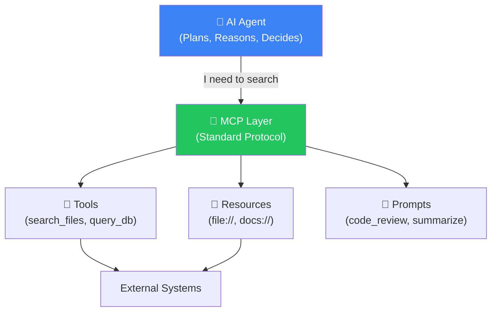
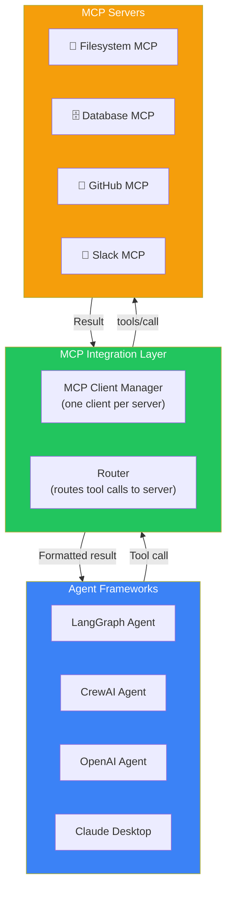
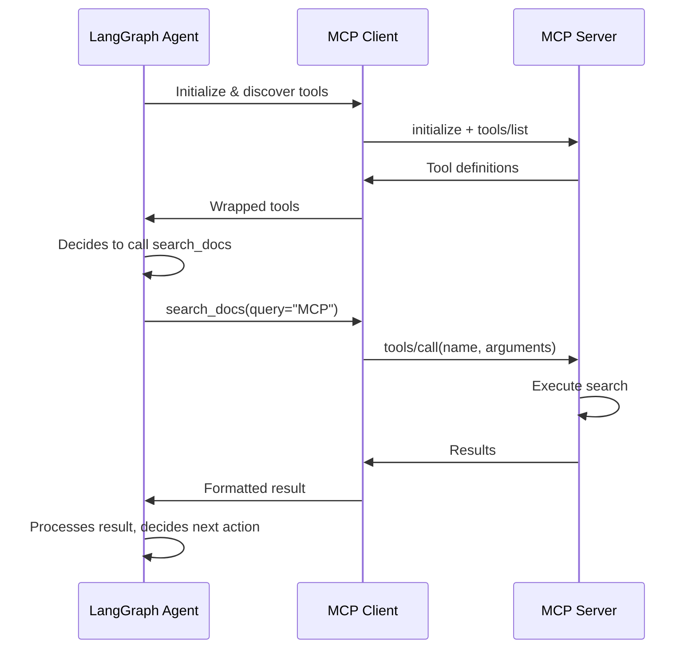
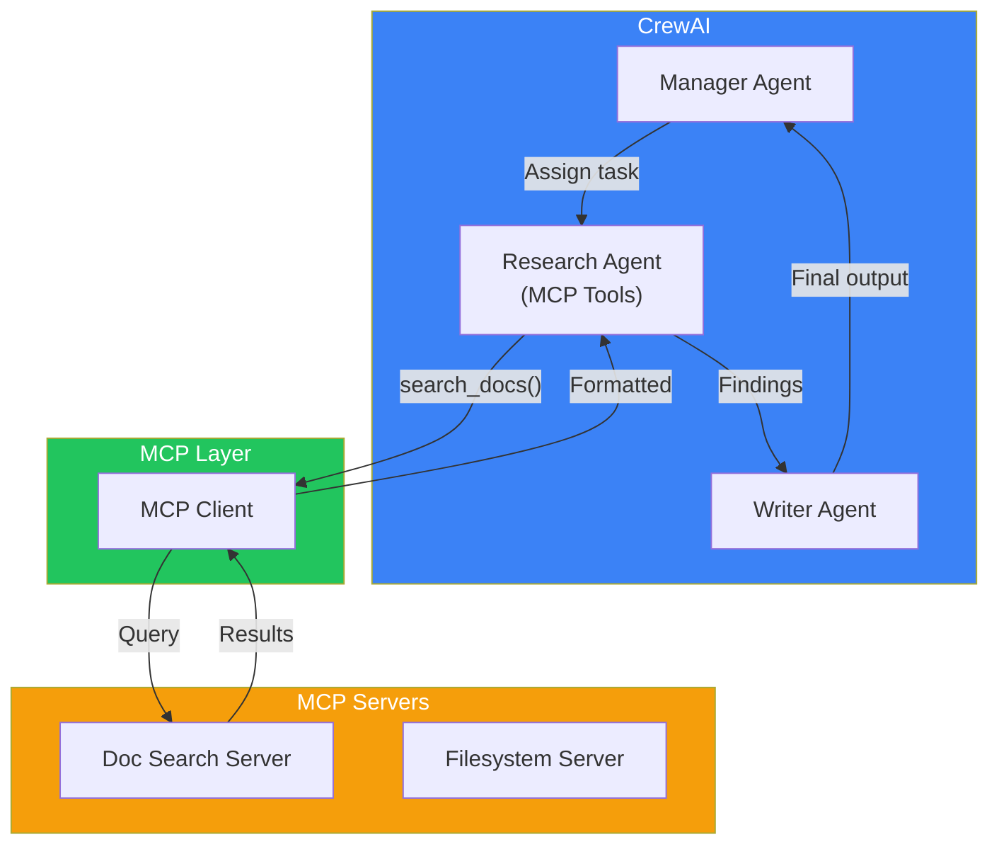
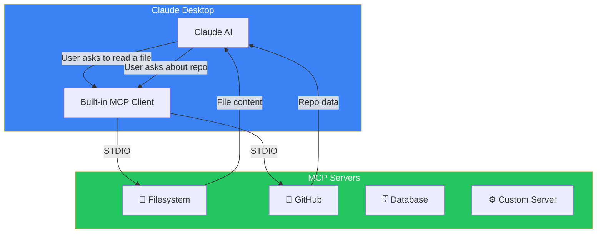
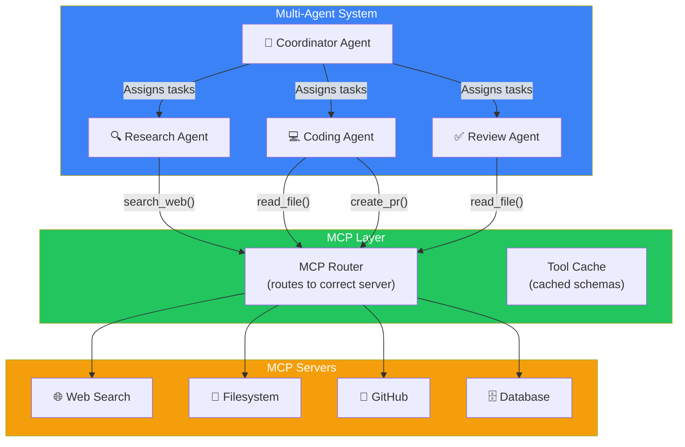

## Introduction

> **MCP and AI Agents are a natural fit — agents need tools to act on the world, and MCP provides a standardized way to discover and invoke those tools.**

An AI agent without MCP is like a chef without a kitchen — knowledgeable but unable to execute. MCP gives agents the tools they need to perform real-world tasks, from searching databases to sending emails to managing files.



---

## Why MCP + Agents?

### The Problem: Every Agent Framework Had Its Own Tool System

- LangGraph had `ToolNode`
- CrewAI had `@tool` decorators
- OpenAI had function calling
- AutoGen had its own tool registration

Each framework required tools to be implemented differently. Switching frameworks meant rewriting all your tools.

### The Solution: MCP as the Universal Tool Interface

With MCP, you write your tools **once** as an MCP server, and any agent framework can use them. MCP becomes the universal layer between agents and tools.

| Without MCP | With MCP |
|-------------|----------|
| Tools tied to one framework | Tools work with any framework |
| Rewrite tools per framework | Write once, use everywhere |
| Framework-specific schemas | Standard JSON-RPC schemas |
| Manual tool registration | Automatic capability discovery |

---

## Real-World Analogy

### The Universal Power Outlet

Imagine every appliance had a different plug shape:

- **LangGraph appliances** need LangGraph-shaped plugs
- **CrewAI appliances** need CrewAI-shaped plugs
- **OpenAI appliances** need OpenAI-shaped plugs

MCP is the standard wall outlet. Any appliance (agent framework) can plug into any device (tool) as long as they both follow the MCP standard.

---

## Agent-MCP Integration Architecture



---

## Integration: LangGraph + MCP

LangGraph agents use tools through `ToolNode`. With MCP, the tools come from an MCP server:

```python
import asyncio
from typing import Literal
from langgraph.graph import StateGraph, MessagesState, END
from langgraph.prebuilt import ToolNode
from mcp import ClientSession
from mcp.client.stdio import stdio_client, StdioServerParameters

class MCPToolWrapper:
    """Wraps an MCP tool for LangGraph."""
    
    def __init__(self, session: ClientSession, tool_def):
        self.session = session
        self.name = tool_def.name
        self.description = tool_def.description
        # Convert MCP schema to LangGraph-compatible format
        self.schema = tool_def.inputSchema
    
    async def __call__(self, **kwargs):
        result = await self.session.call_tool(self.name, kwargs)
        return result.content[0].text if result.content else ""

async def build_mcp_agent():
    # Connect to MCP server
    server_params = StdioServerParameters(
        command="python", 
        args=["-m", "my_mcp_server"]
    )
    
    async with stdio_client(server_params) as (read, write):
        async with ClientSession(read, write) as session:
            await session.initialize()
            
            # Discover tools
            tools = await session.list_tools()
            wrapped_tools = [MCPToolWrapper(session, t) for t in tools]
            
            # Build LangGraph with MCP tools
            tool_node = ToolNode(wrapped_tools)
            
            # Define the agent workflow
            workflow = StateGraph(MessagesState)
            
            def call_agent(state):
                # Agent logic — decides which tool to call
                return {"messages": [decide_next_action(state)]}
            
            def should_continue(state) -> Literal["tools", END]:
                last = state["messages"][-1]
                return "tools" if hasattr(last, "tool_calls") else END
            
            workflow.add_node("agent", call_agent)
            workflow.add_node("tools", tool_node)
            workflow.add_edge("tools", "agent")
            workflow.add_conditional_edges("agent", should_continue)
            workflow.set_entry_point("agent")
            
            app = workflow.compile()
            return app
```



---

## Integration: CrewAI + MCP

CrewAI agents use `@tool` decorated functions. With MCP, tools are sourced from servers:

```python
from crewai import Agent, Task, Crew, Process
from mcp import ClientSession
from mcp.client.stdio import stdio_client, StdioServerParameters
from typing import Any
import json

class MCPToolProvider:
    """Provides MCP server tools as CrewAI-compatible tools."""
    
    def __init__(self, server_command: str, server_args: list[str]):
        self.server_command = server_command
        self.server_args = server_args
        self.session = None
        self.read = None
        self.write = None
    
    async def connect(self):
        params = StdioServerParameters(
            command=self.server_command,
            args=self.server_args
        )
        self.read, self.write = await stdio_client(params).__aenter__()
        self.session = await ClientSession(self.read, self.write).__aenter__()
        await self.session.initialize()
    
    def create_tool(self, tool_def):
        """Create a CrewAI-compatible tool from MCP tool definition."""
        tool_name = tool_def.name
        tool_description = tool_def.description
        
        async def tool_function(**kwargs):
            result = await self.session.call_tool(tool_name, kwargs)
            return result.content[0].text if result.content else ""
        
        tool_function.__name__ = tool_name
        tool_function.__doc__ = tool_description
        return tool_function

# Usage with CrewAI
async def run_crew_with_mcp():
    provider = MCPToolProvider("python", ["-m", "doc_server"])
    await provider.connect()
    
    # Discover and create tools
    tools = await provider.session.list_tools()
    crew_tools = [provider.create_tool(t) for t in tools]
    
    # Create CrewAI agent with MCP tools
    researcher = Agent(
        role="Research Specialist",
        goal="Find and analyze documentation",
        tools=crew_tools,
        backstory="Expert at searching documentation"
    )
    
    task = Task(
        description="Search for MCP documentation and summarize findings",
        agent=researcher
    )
    
    crew = Crew(
        agents=[researcher],
        tasks=[task],
        process=Process.sequential
    )
    
    result = crew.kickoff()
    return result
```



---

## Integration: Claude Desktop

Claude Desktop has built-in MCP support — no code needed:

```json
{
  "mcpServers": {
    "filesystem": {
      "command": "npx",
      "args": ["-y", "@modelcontextprotocol/server-filesystem", "/path/to/allowed/files"]
    },
    "github": {
      "command": "npx",
      "args": ["-y", "@modelcontextprotocol/server-github"],
      "env": {
        "GITHUB_TOKEN": "gh_..."
      }
    },
    "database": {
      "command": "python",
      "args": ["-m", "my_db_server"],
      "env": {
        "DATABASE_URL": "postgresql://..."
      }
    }
  }
}
```



---

## Integration: OpenAI Agents SDK

```python
from openai import OpenAI
from mcp import ClientSession
from mcp.client.stdio import stdio_client, StdioServerParameters
import json

class MCPFunctionProvider:
    """Converts MCP tools to OpenAI function definitions."""
    
    def __init__(self):
        self.session = None
    
    async def connect(self, command: str, args: list[str]):
        params = StdioServerParameters(command=command, args=args)
        read, write = await stdio_client(params).__aenter__()
        self.session = await ClientSession(read, write).__aenter__()
        await self.session.initialize()
    
    def to_openai_functions(self, mcp_tools):
        """Convert MCP tool definitions to OpenAI function format."""
        functions = []
        for tool in mcp_tools:
            functions.append({
                "type": "function",
                "function": {
                    "name": tool.name,
                    "description": tool.description,
                    "parameters": tool.inputSchema
                }
            })
        return functions
    
    async def execute_function(self, name: str, arguments: dict):
        result = await self.session.call_tool(name, arguments)
        return result.content[0].text if result.content else ""

# Usage with OpenAI
async def run_openai_agent():
    provider = MCPFunctionProvider()
    await provider.connect("python", ["-m", "doc_server"])
    
    tools = await provider.session.list_tools()
    functions = provider.to_openai_functions(tools)
    
    client = OpenAI()
    
    response = client.chat.completions.create(
        model="gpt-4o",
        messages=[{"role": "user", "content": "Search for MCP documentation"}],
        tools=functions,
        tool_choice="auto"
    )
    
    # Handle function calls
    for choice in response.choices:
        if choice.message.tool_calls:
            for tool_call in choice.message.tool_calls:
                name = tool_call.function.name
                args = json.loads(tool_call.function.arguments)
                result = await provider.execute_function(name, args)
                print(f"Tool result: {result}")
```

---

## Multi-Agent MCP Architecture



---

## Best Practices

1. **Separate MCP connection from agent logic** — Don't mix MCP transport code with agent reasoning code
2. **Cache tool definitions** — Reduce redundant discovery calls
3. **Handle tool failures gracefully** — Agent should recover from tool errors and try alternatives
4. **Use multiple MCP servers** — One server per domain (filesystem, database, API)
5. **Test MCP servers independently** — Verify server works before connecting to agent
6. **Log all MCP interactions** — Essential for debugging agent behavior
7. **Set timeouts per tool** — Different tools have different expected durations

## Common Mistakes

| Mistake | Why It's Wrong |
|---------|---------------|
| One MCP server for everything | Difficult to maintain, debug, and secure |
| No error handling in tool calls | Agent fails silently, user gets no response |
| Ignoring tool descriptions | Agent can't decide when to use tools |
| Hardcoded server paths | Breaks in different environments |
| Not closing sessions | Resource leaks over time |

---

## Interview Questions

### Beginner

**Q: How does MCP benefit AI agent frameworks?**

> MCP provides a standardized interface for agents to discover and invoke tools. Instead of each agent framework implementing its own tool system, they can all use MCP servers. This means tools are reusable across frameworks, reducing duplication and improving interoperability.

**Q: What's the simplest way to give a Claude Desktop agent MCP capabilities?**

> Configure MCP servers in the `claude_desktop_config.json` file under `mcpServers`. Each server specifies a command and arguments to start the server process. Claude Desktop automatically manages the connections, and Claude can use the tools in conversations.

### Intermediate

**Q: How would you give a LangGraph agent access to MCP tools from multiple servers?**

> Create an MCP client manager that connects to multiple servers, discovers their tools, and wraps them as LangGraph-compatible tools. The manager maintains a session per server and routes tool calls to the correct server. All wrapped tools are registered with the LangGraph ToolNode.

**Q: Explain how MCP replaces OpenAI function calling in an agent system.**

> Instead of declaring function definitions in the OpenAI API request, the agent uses MCP to discover tools from a server. The MCP client converts tool definitions to OpenAI function format and handles the actual execution. This decouples the agent from the function definitions — tools can change without updating the agent's code.

### Senior

**Q: Design an MCP-based tool system for an agent that needs to handle 50+ tools across 10 servers.**

> Design: (1) Create a tool registry that discovers capabilities from all servers on startup, (2) Use semantic tool names to help the agent choose (e.g., `filesystem_read_file`, `database_query_users`), (3) Implement a router that maps tool names to the correct server session, (4) Cache tool schemas to reduce discovery latency, (5) Implement request prioritization and rate limiting per server, (6) Add health checks — if a server is down, remove its tools from the registry, (7) Provide a `list_available_tools()` function so the agent can ask what's available at any time.

**Q: How would you integrate MCP with an agent that uses streaming responses?**

> Integration strategy: (1) Start MCP connections in parallel before the agent begins streaming, (2) Discover and cache all tool definitions upfront, (3) During streaming, when the agent decides to call a tool, pause the stream output, execute the tool call, inject the result into the context, and continue streaming, (4) For long-running tools, use streaming tool responses to stream progress updates to the user, (5) Handle tool call failures during streaming by either retrying or informing the user via the stream.

### Staff Engineer

**Q: Compare MCP-based tool integration with framework-native tool definitions for production agent systems.**

> **MCP**: Tools are externalized, reusable across frameworks, discoverable at runtime, self-documenting via schemas, transport-agnostic (same server works locally or remotely). **Framework-native**: Tools are defined within the framework's code, tightly coupled to the framework, not reusable, faster to develop for single-framework projects. **Production recommendation**: For single-framework projects with a small number of tools, framework-native is simpler. For multi-agent systems, cross-framework deployments, or enterprises that want to maintain a central tool catalog, MCP is superior.

### Architecture

**Q: Design an architecture where multiple agents share the same MCP server tools with proper isolation.**

> Architecture: (1) Deploy MCP servers as HTTP services with session-based authentication, (2) Each agent connection gets a unique session ID, (3) The server tracks which agent called which tool for auditing, (4) Implement per-session rate limiting to prevent one agent from overwhelming the server, (5) Use resource-level access control — agent A can read files in `/team-a/` and agent B in `/team-b/`, (6) Log all tool calls with session IDs for traceability, (7) Implement a session timeout to clean up idle connections, (8) Use connection pooling for efficient resource utilization across agents.

---

## Summary

| Integration | How It Works | Best For |
|-------------|-------------|----------|
| **LangGraph** | MCP tools wrapped as LangGraph ToolNode | Complex agent workflows |
| **CrewAI** | MCP tools wrapped as CrewAI `@tool` | Multi-agent teams |
| **Claude Desktop** | Built-in MCP support (config file) | Personal AI assistant |
| **OpenAI Agents** | MCP tools → OpenAI function format | GPT-based applications |
| **Multi-Agent** | Shared MCP layer with router | Enterprise agent systems |

---

## Navigation

**Previous:** [12 — Build Your First MCP Client](/ai/phase-07-model-context-protocol/12-build-your-first-mcp-client)

**Next:** [14 — Production MCP](/ai/phase-07-model-context-protocol/14-production-mcp)

**Related Topics:**
- [MCP Client](/ai/phase-07-model-context-protocol/04-mcp-client)
- [MCP Server](/ai/phase-07-model-context-protocol/05-mcp-server)
- [Production MCP](/ai/phase-07-model-context-protocol/14-production-mcp)
