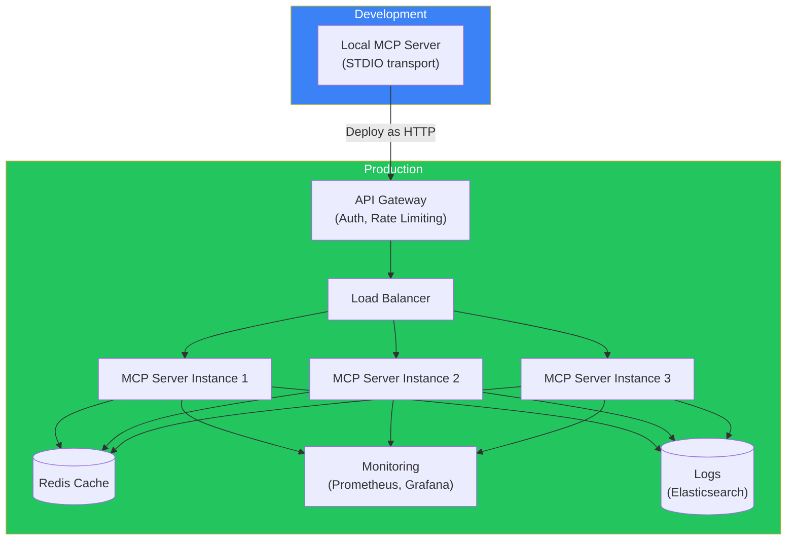
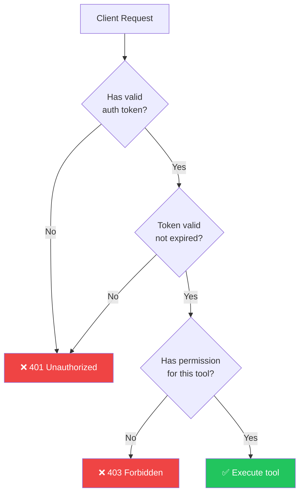
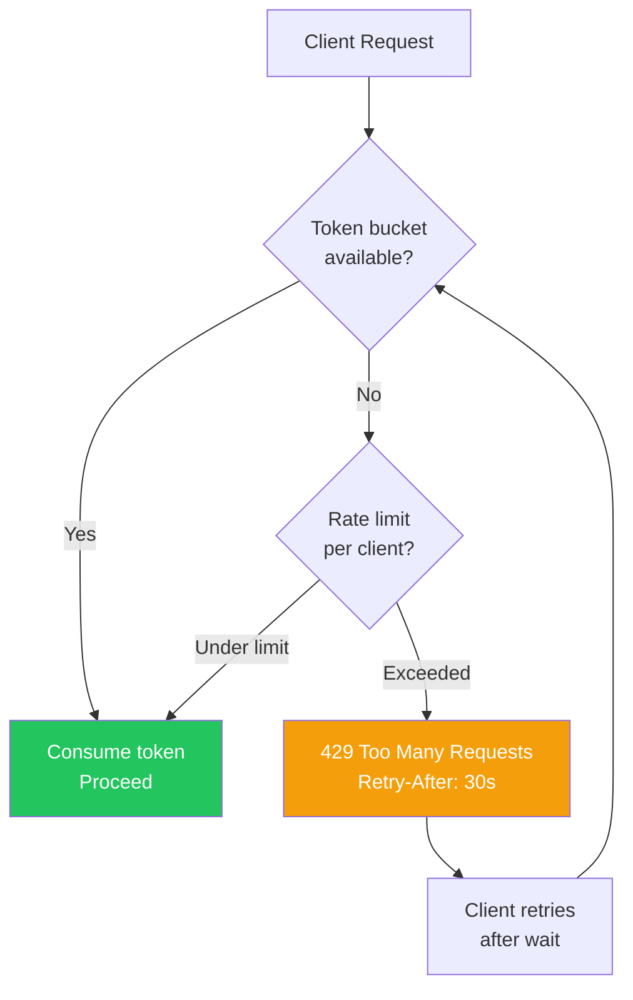
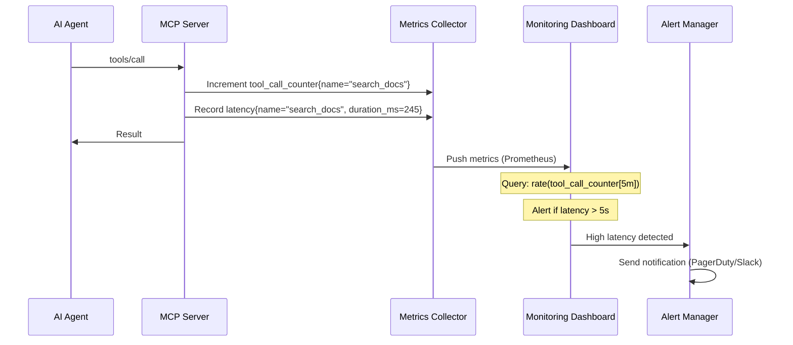
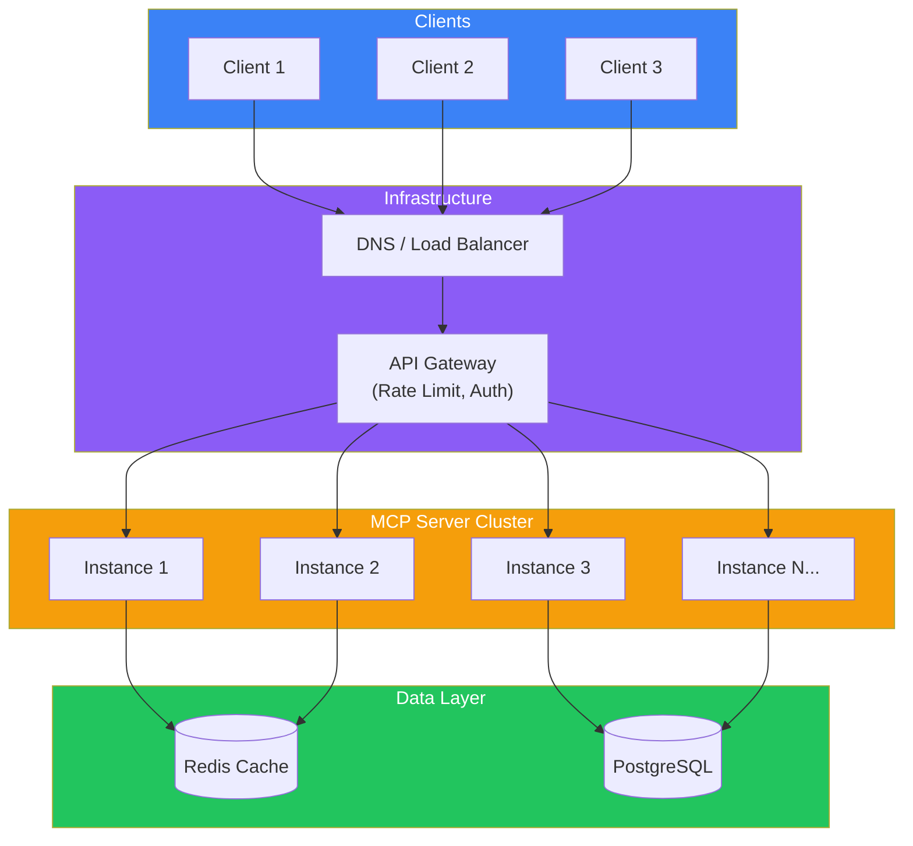
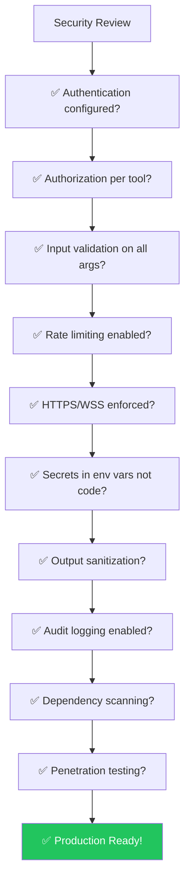

## Introduction

> **Production MCP takes your server from a local prototype to a reliable, secure, and scalable service that can handle real-world traffic and enterprise requirements.**

Running an MCP server in production means thinking about authentication, rate limiting, monitoring, high availability, and security — the same concerns as any production API, but adapted for the unique requirements of AI agent communication.



---

## Why Production MCP Matters

### The Problem: Local MCP Servers Don't Scale

A local MCP server running over STDIO is:
- Only accessible from one machine
- Not monitored for failures
- Not authenticated (any process on the machine can use it)
- Not load-balanced
- Not backed up

### The Solution: Production Architecture

Production MCP transforms the server into a proper service with:

| Aspect | Development | Production |
|--------|-------------|------------|
| **Transport** | STDIO | HTTP/HTTPS, WebSocket |
| **Authentication** | None | API keys, OAuth, JWT |
| **Monitoring** | None | Prometheus, Grafana, alerts |
| **Scaling** | Single process | Horizontal scaling, load balancing |
| **Caching** | None | Redis, in-memory cache |
| **Resilience** | None | Circuit breakers, retries, health checks |

---

## Real-World Analogy

### The Pop-up Stand vs. The Restaurant Chain

A **pop-up stand** (development MCP) is:
- One person running it
- Open when they're available
- No consistency guarantees
- No backup if something breaks

A **restaurant chain** (production MCP) is:
- Multiple locations (load balancing)
- Standardized processes (monitoring)
- Backup chefs (failover)
- Quality control (testing)
- Customer service (support)

---

## Authentication & Authorization



### Authentication Methods

| Method | Security Level | Use Case | Implementation |
|--------|---------------|----------|----------------|
| **API Key** | Medium | Server-to-server | Header: `X-API-Key: sk-...` |
| **JWT** | High | User-based access | Token contains user context |
| **OAuth 2.0** | High | Third-party access | Standard OAuth flow |
| **mTLS** | Very high | Internal services | Certificate-based mutual TLS |

### Production Auth Configuration

```python
# MCP Server with authentication
from mcp.server import Server
from mcp.server.http import HTTPServerTransport
import jwt

# Auth middleware
async def authenticate_request(request):
    auth_header = request.headers.get("Authorization", "")
    token = auth_header.replace("Bearer ", "")
    
    try:
        payload = jwt.decode(token, SECRET_KEY, algorithms=["HS256"])
        return {
            "authenticated": True,
            "user_id": payload["sub"],
            "role": payload.get("role", "user"),
            "tenant": payload.get("tenant", "default")
        }
    except jwt.ExpiredSignatureError:
        raise PermissionError("Token expired")
    except jwt.InvalidTokenError:
        raise PermissionError("Invalid token")

# Authorization middleware
def authorize_tool(user, tool_name, arguments):
    """Check if user has permission to call a tool."""
    permissions = {
        "admin": ["*"],  # All tools
        "editor": ["search_docs", "get_file", "list_files"],
        "viewer": ["search_docs", "list_files"]
    }
    
    user_role = user.get("role", "viewer")
    allowed = permissions.get(user_role, [])
    
    if "*" not in allowed and tool_name not in allowed:
        raise PermissionError(f"Role '{user_role}' cannot call '{tool_name}'")
    
    return True
```

---

## Rate Limiting



### Rate Limiting Strategy

```python
import time
from collections import defaultdict
import asyncio

class RateLimiter:
    """Token bucket rate limiter per client."""
    
    def __init__(self, rate: int, burst: int):
        self.rate = rate  # Requests per second
        self.burst = burst  # Maximum burst size
        self.tokens = defaultdict(lambda: burst)
        self.last_refill = defaultdict(time.time)
    
    async def check(self, client_id: str) -> bool:
        now = time.time()
        elapsed = now - self.last_refill[client_id]
        
        # Refill tokens
        self.tokens[client_id] = min(
            self.burst,
            self.tokens[client_id] + elapsed * self.rate
        )
        self.last_refill[client_id] = now
        
        if self.tokens[client_id] >= 1:
            self.tokens[client_id] -= 1
            return True
        return False
    
    async def get_retry_after(self, client_id: str) -> float:
        """Calculate how long client should wait."""
        deficit = 1 - self.tokens[client_id]
        return max(0, deficit / self.rate)

# Usage in production server
rate_limiter = RateLimiter(rate=10, burst=20)

@server.call_tool()
async def call_tool(name: str, arguments: dict, client_id: str = None):
    if not await rate_limiter.check(client_id):
        retry_after = await rate_limiter.get_retry_after(client_id)
        raise RateLimitError(
            f"Rate limit exceeded. Retry after {retry_after:.1f}s",
            retry_after=retry_after
        )
    # Execute tool...
```

---

## Monitoring & Observability



### Key Metrics

| Metric | What It Measures | Alert Threshold |
|--------|-----------------|-----------------|
| `tool_call_latency_ms` | Time to execute each tool | > 5s |
| `tool_call_errors_total` | Number of failed tool calls | > 1% error rate |
| `tool_calls_per_second` | Throughput of tool calls | Based on capacity |
| `active_connections` | Current connected clients | > 80% of max |
| `rate_limit_exceeded_total` | Clients being rate limited | Spike detection |
| `memory_usage_bytes` | Server memory consumption | > 80% of limit |

### Logging Configuration

```python
import structlog

# Structured logging for MCP server
logger = structlog.get_logger()

@server.call_tool()
async def call_tool(name: str, arguments: dict, context: dict = None):
    request_id = context.get("request_id")
    client_id = context.get("client_id")
    
    logger.info("tool_call_started",
        request_id=request_id,
        client_id=client_id,
        tool_name=name,
        arguments_schema=list(arguments.keys())
    )
    
    try:
        result = await execute_tool(name, arguments)
        
        logger.info("tool_call_completed",
            request_id=request_id,
            tool_name=name,
            duration_ms=result.duration_ms,
            result_size=len(str(result.content))
        )
        
        return result
    except Exception as e:
        logger.error("tool_call_failed",
            request_id=request_id,
            tool_name=name,
            error=str(e),
            error_type=type(e).__name__
        )
        raise
```

---

## Scaling Architecture



### Scaling Strategies

| Strategy | Description | When to Use |
|----------|-------------|-------------|
| **Horizontal** | Add more server instances | Stateless tools, high traffic |
| **Vertical** | Increase server resources (CPU/RAM) | Memory-intensive tools |
| **Sharding** | Route clients to specific instances | Multi-tenant isolation |
| **Caching** | Cache tool results per client | Repeated queries |
| **Connection Pooling** | Reuse database connections | Database-backed tools |

---

## Security Checklist



---

## Deployment Options

| Platform | Transport | Setup Complexity | Best For |
|----------|-----------|-----------------|----------|
| **Docker** | STDIO, HTTP | Low | Containerized deployments |
| **Kubernetes** | HTTP | Medium | Auto-scaling, high availability |
| **AWS Lambda** | HTTP | Low | Serverless MCP endpoints |
| **Vercel Edge** | HTTP | Low | Edge-deployed MCP |
| **Railway/Render** | HTTP | Low | Quick production hosting |

---

## Best Practices

1. **Start with STDIO, deploy as HTTP** — Develop locally, deploy remotely
2. **Always authenticate** — Never expose MCP servers without auth
3. **Cache aggressively** — Tool definitions rarely change, cache them
4. **Monitor everything** — Latency, errors, rate limits, resource usage
5. **Implement circuit breakers** — Protect downstream services from cascading failures
6. **Version your servers** — Include version in metadata, support multiple versions
7. **Test failure scenarios** — What happens when Redis is down? When DB is slow?

## Common Mistakes

| Mistake | Why It's Wrong |
|---------|---------------|
| No authentication on HTTP servers | Anyone can call your tools |
| No rate limiting | One client can overwhelm the server |
| No monitoring | You don't know if the server is healthy |
| Hardcoded secrets | Security breach waiting to happen |
| No circuit breakers | Downstream failure cascades to all clients |
| Single instance | No redundancy, downtime on failure |

---

## Interview Questions

### Beginner

**Q: What are the key differences between developing an MCP server locally and deploying it to production?**

> Development: STDIO transport, no auth, single process, no monitoring, no caching. Production: HTTP/WebSocket transport, authentication (API keys/JWT), load-balanced instances, monitoring (Prometheus/Grafana), caching (Redis), rate limiting, and logging.

**Q: Why is authentication important for production MCP servers?**

> Without authentication, anyone who discovers the server endpoint can call its tools. For a filesystem server, this means unauthorized file access. For a database server, unauthorized queries. Authentication ensures only authorized clients can use the server's capabilities.

### Intermediate

**Q: How would you implement rate limiting for an MCP server with multiple instances?**

> Use a centralized rate limiter with Redis as the backing store. Each server instance reads and updates the token count in Redis atomically. This ensures rate limits are enforced across all instances. Implement the token bucket algorithm for per-client rate limiting, with configurable rates per client tier.

**Q: What metrics would you monitor for a production MCP server and why?**

> (1) Tool call latency — detects slow operations, (2) Error rate — detects bugs or downstream failures, (3) Throughput (calls/second) — capacity planning, (4) Active connections — resource utilization, (5) Rate limit exceed count — client behavior patterns, (6) Memory and CPU usage — resource planning.

### Senior

**Q: Design a disaster recovery plan for a production MCP server.**

> Recovery plan: (1) **Backup**: Daily backups of server configuration and tool definitions, (2) **Replication**: Run active-passive instances, (3) **Failover**: Automatic DNS failover to passive instance on health check failure, (4) **Restore**: Documented restore procedure (deploy latest backup, restore configuration, verify connectivity), (5) **Testing**: Monthly disaster recovery drills, (6) **Recovery time objective (RTO)**: 5 minutes, Recovery point objective (RPO): 1 hour, (7) **Communication**: Alert on-call engineer, notify clients of incident.

**Q: How would you handle secret rotation for MCP servers without downtime?**

> Strategy: (1) Store secrets in a vault (HashiCorp Vault, AWS Secrets Manager), (2) Server fetches secrets at startup and caches them, (3) Subscribe to secret rotation events from the vault, (4) On rotation notification, fetch new secret and update the in-memory cache, (5) Continue using the old secret for in-flight requests, (6) Switch to the new secret for new requests, (7) Log the rotation event for audit.

### Staff Engineer

**Q: Design a multi-region MCP server deployment with disaster recovery.**

> Architecture: (1) Deploy in 3 regions (us-east, eu-west, ap-southeast), (2) Global load balancer routes clients to nearest region, (3) Each region has 3+ server instances behind a regional load balancer, (4) Data synchronized across regions via CRDT or primary-replica replication, (5) Health checks between regions — if one region fails, others absorb the traffic, (6) Rate limiting is global (Redis across regions), (7) Monitoring dashboard shows all regions with alerting on regional degradation, (8) Chaos engineering — regularly test region failures.

### Architecture

**Q: Compare deploying an MCP server as a Docker container vs a serverless function.**

> **Docker**: Full control over runtime, persistent connections, any transport, long-running, easier debugging, more resource capacity. **Serverless (Lambda)**: Auto-scaling, pay-per-use, simpler deployment, HTTP-only transport, cold start latency, limited execution time (15 min max), stateless. **Verdict**: Docker for production MCP with high traffic and complex tools. Serverless for simple, infrequently used tools and cost-sensitive deployments.

---

## Summary

| Concern | Development | Production |
|---------|-------------|------------|
| **Transport** | STDIO | HTTP/HTTPS, WebSocket |
| **Auth** | None | API keys, JWT, OAuth, mTLS |
| **Rate Limiting** | None | Token bucket per client |
| **Monitoring** | None | Metrics, logs, traces, alerts |
| **Scaling** | Single instance | Horizontal, load-balanced |
| **Caching** | None | Redis, in-memory |
| **Resilience** | None | Circuit breakers, retries, failover |
| **Secrets** | Env vars | Vault, secret manager |

---

## Navigation

**Previous:** [13 — MCP with AI Agents](/ai/phase-07-model-context-protocol/13-mcp-with-ai-agents)

**Next:** [15 — Phase Summary](/ai/phase-07-model-context-protocol/15-phase-summary)

**Related Topics:**
- [MCP Server](/ai/phase-07-model-context-protocol/05-mcp-server)
- [Transports](/ai/phase-07-model-context-protocol/10-transports)
- [MCP with AI Agents](/ai/phase-07-model-context-protocol/13-mcp-with-ai-agents)
