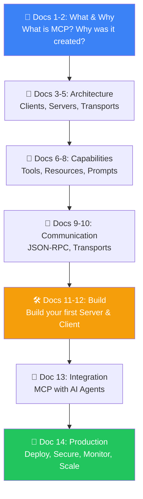
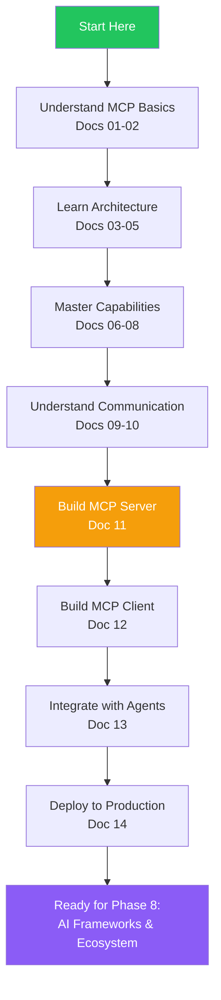
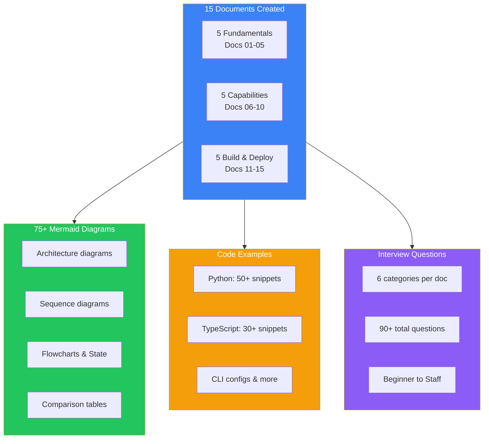
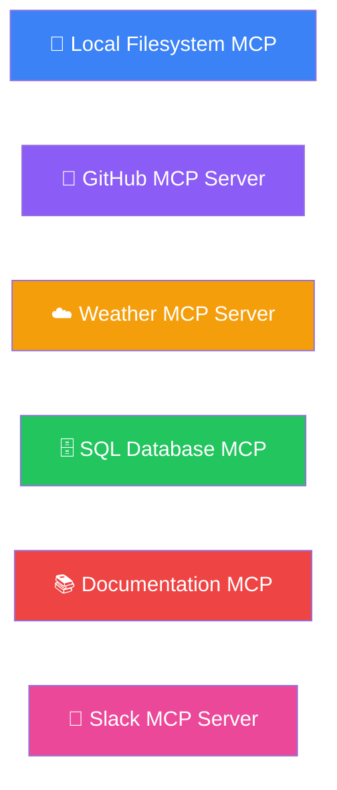
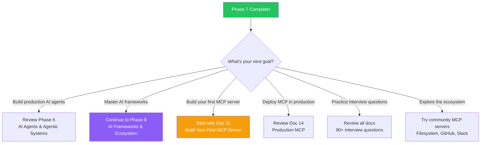

## Introduction

> **Phase 7 covered everything from the fundamentals of Model Context Protocol to building and deploying production MCP servers — this summary brings it all together into a cohesive roadmap.**

By now you should understand why MCP exists, how it works, how to build servers and clients, how to integrate with AI agents, and how to deploy securely in production.



---

## Complete Roadmap



---

## Phase 7 by the Numbers



## MCP Cheat Sheet

### Core Concepts

| Concept | Definition |
|---------|------------|
| **MCP** | Model Context Protocol — open protocol for AI agent-tool communication |
| **Client** | SDK wrapper that connects agents to MCP servers |
| **Server** | Exposes tools, resources, and prompts via MCP |
| **Transport** | Communication channel (STDIO, HTTP, WebSocket) |
| **Tool** | Callable action (has side effects, can change state) |
| **Resource** | Read-only data identified by URI |
| **Prompt** | Reusable prompt template with arguments |

### Quick Reference

```python
# MCP Server (minimum)
from mcp.server import Server
from mcp.server.stdio import stdio_server

server = Server("my-server")

@server.list_tools()
async def list_tools():
    return [Tool(name="hello", description="Say hello", inputSchema={...})]

@server.call_tool()
async def call_tool(name: str, arguments: dict):
    return [TextContent(type="text", text=f"Hello!")]

async def main():
    async with stdio_server() as (read, write):
        await server.run(read, write, ...)
```

```python
# MCP Client (minimum)
from mcp import ClientSession
from mcp.client.stdio import stdio_client

async with stdio_client(params) as (read, write):
    async with ClientSession(read, write) as session:
        await session.initialize()
        tools = await session.list_tools()
        result = await session.call_tool("search", {"query": "MCP"})
```

---

## Comparison Tables

### MCP vs REST API

| Feature | MCP | REST API |
|---------|-----|----------|
| **Purpose** | AI agent tool access | Application API |
| **Discovery** | Built-in (capabilities handshake) | External (OpenAPI, docs) |
| **Transport** | STDIO, HTTP, WebSocket | HTTP only |
| **Schema** | Standard JSON-RPC | Varies per API |
| **Streaming** | Native support | SSE or custom |
| **Client** | MCP SDK | HTTP client |
| **State** | Session-based | Stateless (typically) |

### MCP vs Function Calling

| Feature | MCP | Function Calling |
|---------|-----|-----------------|
| **Scope** | Any client, any server | Specific provider (OpenAI) |
| **Discovery** | Runtime | Compile-time (defined in request) |
| **Reusability** | Cross-framework | Single provider |
| **Transport** | Multiple | HTTP only |
| **Tools** | Server-defined | Client-defined |
| **Open standard** | Yes | No |

### Tool vs Resource

| Feature | Tool | Resource |
|---------|------|----------|
| **Purpose** | Perform action | Provide data |
| **Side effects** | Yes | No (read-only) |
| **Called via** | `tools/call` | `resources/read` |
| **Schema** | Complex input | Simple URI |
| **Caching** | Not typical | Aggressively cached |
| **Example** | `search_docs(query)` | `docs://overview` |

### STDIO vs HTTP vs WebSocket

| Feature | STDIO | HTTP | WebSocket |
|---------|-------|------|-----------|
| **Latency** | Microseconds | Milliseconds | Milliseconds |
| **Security** | Process isolation | Network security | Network security |
| **Persistence** | Per-call | Per-request | Persistent |
| **Bidirectional** | Yes | No | Yes |
| **Deployment** | Local only | Remote | Remote |
| **Best for** | Development | Production API | Real-time streaming |

### Single MCP Server vs Multiple MCP Servers

| Feature | Single Server | Multiple Servers |
|---------|---------------|-----------------|
| **Complexity** | Low | Medium |
| **Separation of concerns** | Low | High |
| **Independent deployment** | No | Yes |
| **Discovery overhead** | Low | Medium |
| **Fault isolation** | Poor | Good |
| **Best for** | Simple tools | Complex systems |

---

## MCP Glossary

| Term | Definition |
|------|------------|
| **Capabilities** | What a server can do (tools, resources, prompts) |
| **Capability Discovery** | Process of client learning what server can do |
| **Handshake** | Initial exchange of protocol versions and capabilities |
| **Host** | The AI application (Claude Desktop, Cursor) |
| **Initialization** | First communication phase between client and server |
| **JSON-RPC** | Remote procedure call protocol used by MCP |
| **Notification** | One-way message from server to client (no response expected) |
| **Request** | Message expecting a response |
| **Response** | Reply to a request (result or error) |
| **Transport** | Communication layer (STDIO, HTTP, WebSocket) |

---

## Common Mistakes to Avoid

| Mistake | Fix |
|---------|-----|
| Skipping initialization | Always call `initialize()` before any operation |
| Using HTTP for local servers | Use STDIO — faster, simpler, more secure |
| No auth on production MCP | Add API keys, JWT, or OAuth |
| Too many tools in one server | Split into multiple servers by domain |
| Blocking operations | Use async I/O for all tool handlers |
| No error handling | Every tool call should handle failures gracefully |
| Hardcoded configuration | Use environment variables for all configuration |
| No monitoring | Add metrics, logging, and alerting from day one |

---

## Mini Projects



| Project | What You Learn | Difficulty |
|---------|---------------|------------|
| **1. Filesystem MCP** | Basic tools (read, write, list files) | Beginner |
| **2. GitHub MCP** | API integration, auth, pagination | Intermediate |
| **3. Weather MCP** | External API, caching, rate limiting | Intermediate |
| **4. SQL Database MCP** | Connection pooling, query safety | Advanced |
| **5. Documentation MCP** | Resources, prompts, templates | Advanced |
| **6. Slack MCP** | Webhooks, real-time, OAuth | Advanced |

---

## Learning Path to Phase 8

```
Phase 1: AI Fundamentals     ───→  Done ✓
Phase 2: Machine Learning    ───→  Done ✓
Phase 3: Deep Learning       ───→  Done ✓
Phase 4: Large Language Models ─→  Done ✓
Phase 5: Retrieval Systems   ───→  Done ✓
Phase 6: AI Agents           ───→  Done ✓
Phase 7: Model Context Protocol ─→  Done ✓
                                     ↓
Phase 8: AI Frameworks & Ecosystem ←── Next!
```

---

## Interview Questions

### Beginner

**Q: What is the Model Context Protocol and why was it created?**

> MCP is an open standard protocol for connecting AI agents to external tools and data sources. It was created by Anthropic to solve the problem of every AI application needing custom integrations for every tool. MCP provides a universal interface — like USB-C for AI — where any MCP client can work with any MCP server.

**Q: What are the three capabilities an MCP server can expose?**

> (1) **Tools** — callable actions that perform work, (2) **Resources** — read-only data sources, (3) **Prompts** — reusable prompt templates.

### Intermediate

**Q: How would you explain MCP to a backend engineer in one minute?**

> "MCP is a standardized protocol for AI agents to use tools. Instead of building a custom API for each tool and writing custom integration code for each AI platform, MCP lets you write a server that exposes your tools through a standard interface. Any MCP-compatible agent — Claude, GPT, Gemini — can discover and use those tools automatically, without custom integration code."

**Q: Compare MCP with OpenAI's function calling.**

> MCP is transport-agnostic (STDIO, HTTP, WebSocket) while function calling is HTTP-only. MCP supports runtime capability discovery while function calling requires all functions to be declared upfront. MCP is an open standard usable with any agent, while function calling is tied to OpenAI's API. MCP tools are reusable across frameworks; function calling tools are per-request.

### Senior

**Q: Design a system where multiple MCP servers are managed by a central registry.**

> Architecture: (1) **Registry Service** — Central catalog of all MCP servers, their endpoints, capabilities, and health status, (2) **Server Registration** — Servers register on startup with their capabilities and health check URL, (3) **Client Discovery** — Clients query the registry to find servers that expose needed capabilities, (4) **Health Monitoring** — Registry periodically checks server health and removes unhealthy servers, (5) **Routing** — Client uses registry data to route tool calls to the correct server, (6) **Authentication** — Registry provides auth tokens for client-server communication, (7) **Versioning** — Registry supports multiple versions of the same server type.

**Q: How would you handle schema evolution in MCP tools without breaking existing clients?**

> Schema evolution strategies: (1) Add new properties as optional (never required), (2) Set sensible defaults for new optional properties, (3) Never remove or rename existing properties, (4) Deprecate old properties with a warning in the tool response, (5) Add new properties alongside deprecated ones during migration period, (6) Use semantic versioning for the server — breaking changes require a major version, (7) Support multiple versions of the same tool (e.g., `search_v1`, `search_v2`) during transition.

### Staff Engineer

**Q: Design a governance framework for MCP tools in a large enterprise with 500+ tools.**

> Governance framework: (1) **Tool Catalog** — Central registry with search, categories, tags, and ownership, (2) **Approval Workflow** — New tools require schema review, security review, and performance review, (3) **Access Control** — Role-based access per tool, team, or department, (4) **Usage Analytics** — Dashboard showing tool usage, failure rates, latency, and cost per tool, (5) **Lifecycle Management** — Tools have lifecycle stages (draft → active → deprecated → retired), (6) **Compliance** — Audit logging, data retention policies, GDPR/HIPAA compliance per tool, (7) **Testing** — Sandbox environment for testing tools before production, (8) **Documentation** — Every tool must have a description, example usage, and known limitations.

### Architecture

**Q: Design a complete MCP architecture for a customer support AI system that uses multiple tools.**

> Architecture components: (1) **Agent**: Customer support AI that understands queries and decides which tools to use, (2) **MCP Servers**: Ticket system server (read/create/update tickets), Knowledge base server (search articles, read documentation), Customer data server (get customer info, order history), Communication server (send emails, Slack messages), (3) **Router**: Maps tool calls to the correct MCP server based on tool name prefix (e.g., `ticket_*` → ticket server), (4) **Cache Layer**: Redis caches frequently accessed resources (knowledge base articles, customer profiles), (5) **Monitoring**: Prometheus metrics for tool latency, error rates, and usage patterns, (6) **Security**: JWT authentication with role-based access control — support agents can read, managers can update, admins can delete, (7) **Scaling**: Horizontal scaling per server type based on usage patterns.

---

## Next Steps Decision Guide



## Summary

| Area | Key Takeaway |
|------|-------------|
| **What is MCP** | Standard protocol for AI agent-tool communication |
| **Architecture** | Client-server with capabilities discovery |
| **Capabilities** | Tools (actions), Resources (data), Prompts (templates) |
| **Communication** | JSON-RPC over STDIO, HTTP, or WebSocket |
| **Build** | Python or TypeScript SDK |
| **Integration** | Works with LangGraph, CrewAI, Claude Desktop, OpenAI |
| **Production** | Auth, rate limiting, monitoring, scaling |

---

## Navigation

**Previous:** [14 — Production MCP](/ai/phase-07-model-context-protocol/14-production-mcp)

**Next:** Phase 8 — AI Frameworks & Ecosystem (Coming Soon)

**Related Topics:**
- [Phase 6 — AI Agents](/ai/phase-06-ai-agents/01-what-is-an-ai-agent)
- [Phase 5 — RAG Systems](/ai/phase-05-retrieval-systems/01-embeddings-introduction)
