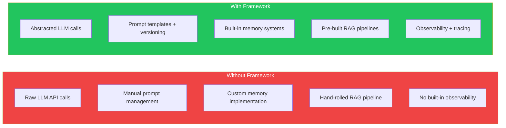
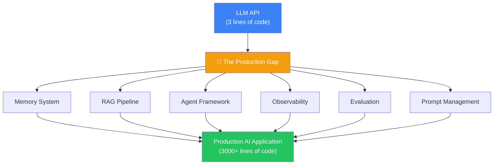
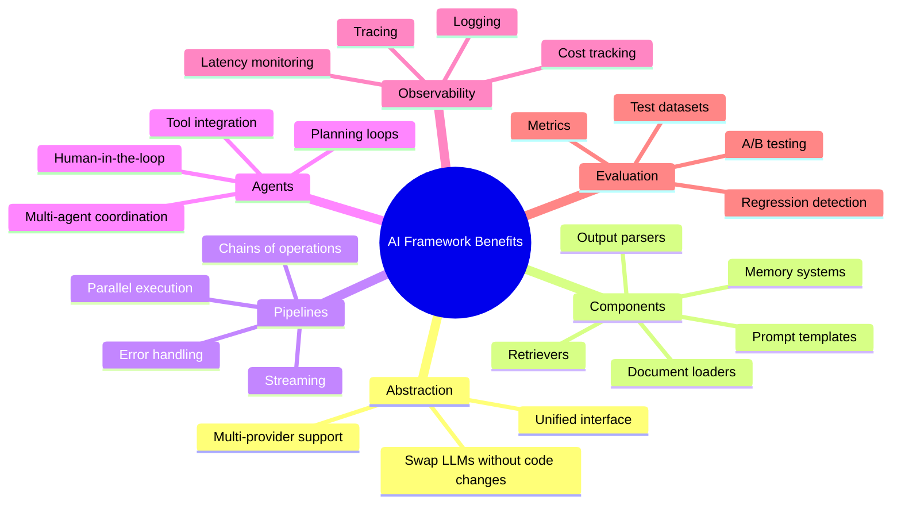
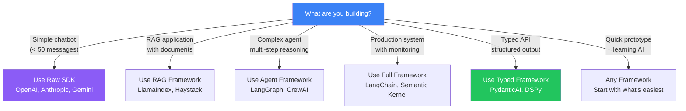
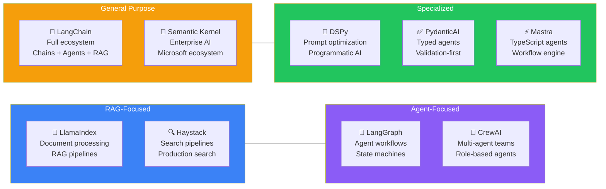
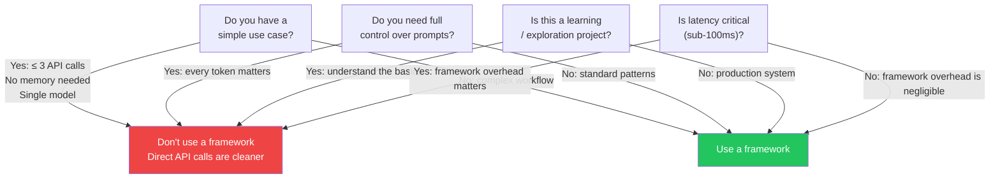

## Introduction

> **AI frameworks exist because building production AI applications requires more than just calling an LLM API — they provide abstractions for memory, retrieval, agents, observability, and evaluation that would otherwise need to be built from scratch.**

You can build a web app with just Node.js's HTTP module. But frameworks like Express, Next.js, and Django exist because they solve common problems — routing, middleware, templating, database integration — so you don't have to reinvent them. AI frameworks serve the same purpose for AI applications.

---

## The Problem Frameworks Solve

### The Gap Between LLM API and Production App

Calling an LLM API is simple — a few lines of code. But a production AI application needs:

- **Memory** — Conversation history, knowledge, state
- **Retrieval** — Finding relevant information from documents
- **Agents** — Planning, tool use, multi-step reasoning
- **Observability** — Tracing, monitoring, debugging
- **Evaluation** — Measuring quality, detecting regressions
- **Prompt Management** — Versioning, testing, optimization

Each of these is a significant engineering project on its own. Frameworks provide them as reusable components.

---

## Real-World Analogy

### Building a Restaurant vs Cooking at Home

**Cooking at home (Raw SDK):**
- You control every ingredient
- Simple meals are fast
- Complex meals take forever
- No standard recipes or processes

**Running a restaurant (Framework):**
- You have professional kitchen tools
- Standard recipes (components)
- Pre-prepared ingredients (abstractions)
- A team following processes (pipelines)
- Quality control (evaluation)

Both approaches make food. But one scales to serve hundreds of customers daily. AI frameworks are the restaurant kitchen — they provide the infrastructure so you can focus on your unique recipe (your application logic).

---

## What Frameworks Provide

---

## SDK vs Framework: When to Use Each

| Use Case | Raw SDK | Framework |
|----------|---------|-----------|
| Simple completions | ✅ Best choice | ❌ Overkill |
| Chat with history | ✅ Manage manually | ✅ Built-in memory |
| RAG pipeline | ❌ Build from scratch | ✅ Pre-built |
| Multi-step agents | ❌ Complex to build | ✅ Built-in loops |
| Production monitoring | ❌ Manual setup | ✅ Built-in tracing |
| Quick prototype | ✅ Fast to start | ✅ Faster for complex apps |

---

## The Framework Landscape

---

## When NOT to Use a Framework

---

## Best Practices

1. **Start without a framework** — Understand the raw API first, then adopt frameworks for the complexity they solve
2. **Choose one framework per project** — Mixing LangChain, LlamaIndex, and CrewAI leads to complexity
3. **Evaluate based on your primary need** — RAG → LlamaIndex, Agents → LangGraph, Enterprise → Semantic Kernel
4. **Don't fight the framework** — If you're working around it constantly, you chose the wrong one
5. **Always have an escape hatch** — Raw API calls should be possible within any framework

## Common Mistakes

| Mistake | Why It's Wrong |
|---------|---------------|
| Using a framework for a simple chatbot | Adds unnecessary complexity and dependencies |
| Mixing multiple frameworks | Conflicting abstractions, dependency bloat |
| Ignoring framework updates | Security vulnerabilities, missing features |
| Not understanding the underlying API | Debugging becomes impossible without knowing what the framework abstracts |

---

## Interview Questions

### Beginner

**Q: Why do AI frameworks exist when you can call the OpenAI SDK directly?**

> AI frameworks exist because production AI applications need more than just API calls — they need memory, retrieval, agents, observability, and evaluation. Frameworks provide these as reusable components so developers don't have to build everything from scratch for every project.

**Q: What's the difference between an SDK and an AI framework?**

> An SDK (like the OpenAI Python SDK) provides a direct interface to call an API. A framework (like LangChain) builds on top of SDKs to provide higher-level abstractions like chain-of-thought, memory, RAG pipelines, and agent loops. SDK = API access. Framework = application building blocks.

### Intermediate

**Q: When would you choose not to use an AI framework?**

> When the use case is simple — a single API call with no memory, no retrieval, and no agent logic. For example, a text summarizer or translation tool. Frameworks add dependency and complexity that aren't justified for simple use cases.

**Q: What should you evaluate when choosing an AI framework?**

> (1) Learning curve, (2) Language support (Python/TS/.NET), (3) Built-in features (memory, RAG, agents), (4) Production readiness (observability, evaluation), (5) Community size and activity, (6) Compatibility with your LLM provider, (7) Performance overhead, (8) Long-term maintenance and upgrade path.

### Senior

**Q: Design a framework selection strategy for a company building 5 different AI applications.**

> Evaluate each application's primary need: (1) **Customer support chatbot** — Needs RAG + memory → LlamaIndex or LangChain, (2) **Code review agent** — Needs multi-step reasoning + tools → LangGraph, (3) **Enterprise document search** — Needs search pipeline → Haystack, (4) **Marketing content generator** — Needs prompt optimization → DSPy, (5) **Internal API assistant** — Needs typed structured output → PydanticAI. Use the same LLM provider across all to reduce costs. Build a shared library of common components. Avoid mixing frameworks within the same application.

**Q: How would you migrate a production application from raw OpenAI SDK calls to an AI framework without downtime?**

> Strategy: (1) Wrap raw API calls in an adapter interface, (2) Implement the same interface using the framework, (3) Run both implementations in parallel with feature flags, (4) Gradually migrate traffic to the framework version, (5) Monitor for regressions in quality, latency, and cost, (6) Once stable, remove the adapter and raw calls. Take 2-4 weeks for the migration with canary deployments.

### Staff Engineer

**Q: What architectural problems do AI frameworks solve that raw SDKs cannot?**

> (1) **Complexity management** — Frameworks provide structured abstractions (chains, graphs, pipelines) that make complex AI workflows maintainable. (2) **Cross-cutting concerns** — Observability, retries, rate limiting, and error handling are built into the framework rather than manually implemented per feature. (3) **Provider abstraction** — Switching from OpenAI to Anthropic should be a config change, not a code rewrite. (4) **Composability** — Frameworks let you compose complex workflows from reusable components. Raw SDKs require custom orchestration code. (5) **Standardization** — Frameworks establish conventions for memory, tools, agents, and evaluation that make AI codebases easier to understand and maintain.

### Architecture

**Q: Compare the architectural patterns of LangChain, LlamaIndex, and Semantic Kernel. When would you choose each based on architecture alone?**

> **LangChain**: Modular architecture with Runnables and LCEL (declarative composition). Best when you need flexible, composable chains that can mix RAG, agents, and tools arbitrarily. **LlamaIndex**: Index-centric architecture focused on data processing and retrieval. Best when your primary need is document ingestion, indexing, and querying — RAG-first. **Semantic Kernel**: Kernel-plugin architecture with dependency injection and enterprise patterns. Best when you need .NET integration, enterprise security patterns, and strict coding standards.

### System Design

**Q: Design an AI platform that supports multiple frameworks so different teams can use their preferred tools while sharing infrastructure.**

> Architecture: (1) **LLM Gateway** — Central service that all frameworks call, with rate limiting, caching, and auth, (2) **Shared Vector Store** — Pinecone/Pgvector accessible by any framework, (3) **Observability Layer** — OpenTelemetry traces from all frameworks to a central dashboard, (4) **Prompt Registry** — Versioned prompts accessible by any framework, (5) **Adapter Layer** — Team-specific adapters translate between the shared infrastructure and each framework's expectations, (6) **Governance** — All framework choices must pass review for security and cost implications.

---

## Summary

| Concept | Key Point |
|---------|-----------|
| **Why frameworks exist** | Production AI needs more than API calls — memory, RAG, agents, observability |
| **What they provide** | Abstractions, components, pipelines, agents, evaluation |
| **When to use** | Complex workflows, production systems, multi-step reasoning |
| **When to skip** | Simple API calls, learning, ultra-low-latency requirements |
| **Major categories** | RAG-focused, Agent-focused, General purpose, Specialized |

---

## Navigation

**Previous:** [15 — Phase Summary — MCP](/ai/phase-07-model-context-protocol/15-phase-summary)

**Next:** [02 — LangChain](/ai/phase-08-ai-frameworks/02-langchain)

**Related Topics:**
- [LangChain](/ai/phase-08-ai-frameworks/02-langchain)
- [Framework Comparison](/ai/phase-08-ai-frameworks/09-framework-comparison)
- [Framework Selection Guide](/ai/phase-08-ai-frameworks/10-framework-selection-guide)
