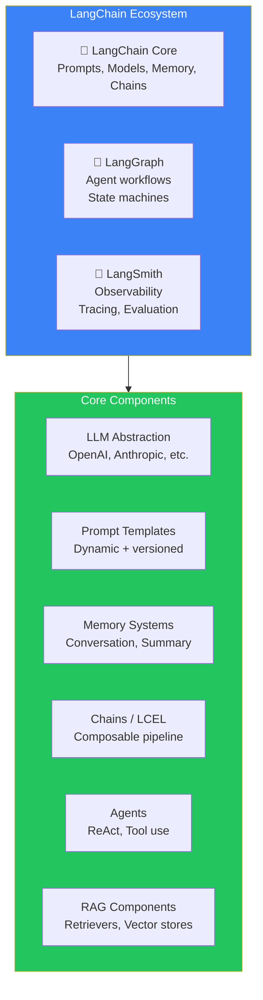
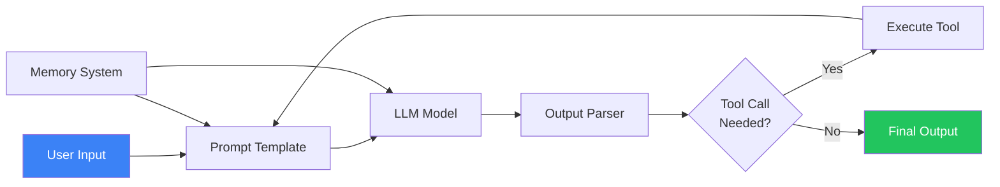
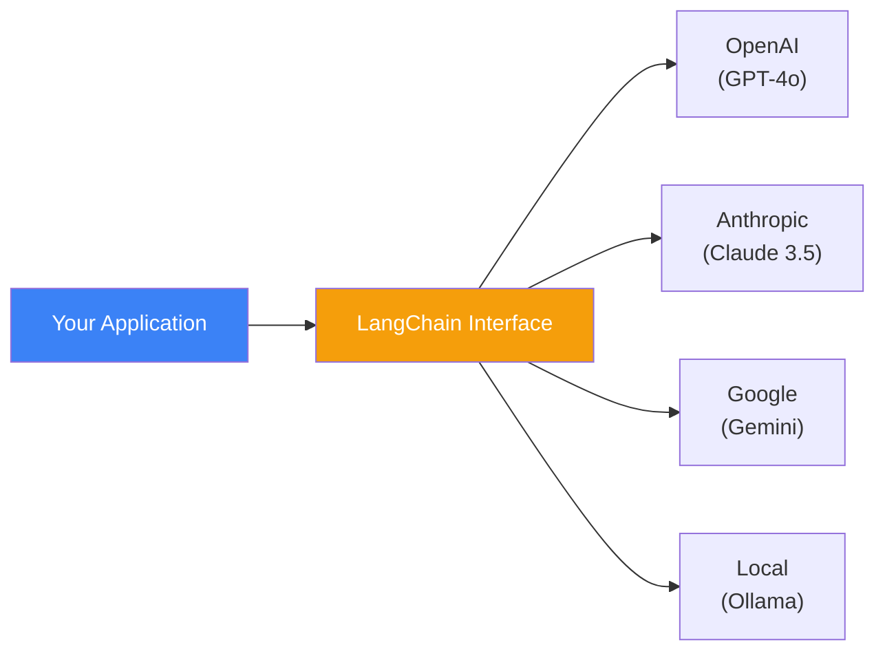
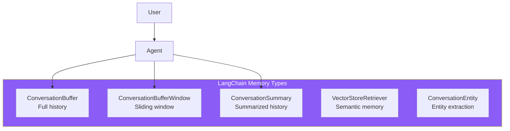
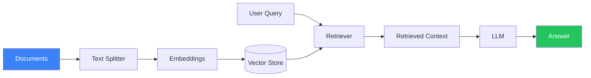
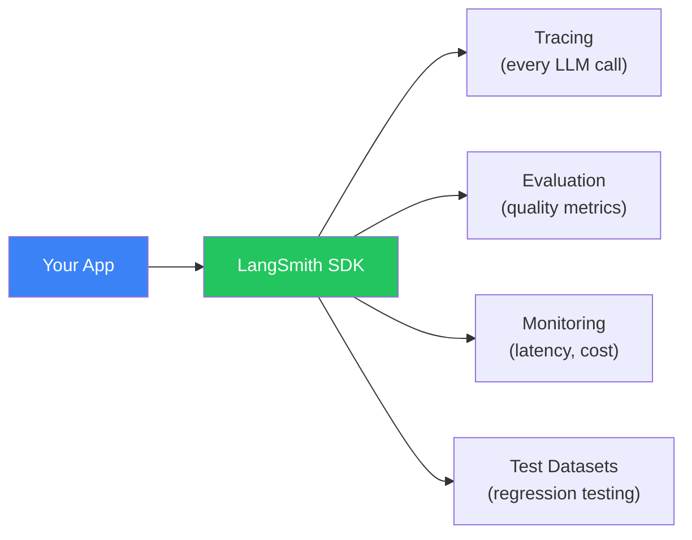

## Introduction

> **LangChain is a modular framework for building AI applications — it provides abstractions for LLMs, prompts, memory, chains, agents, and RAG, all connected through a composable interface called LCEL (LangChain Expression Language).**

LangChain is the most widely adopted AI framework, with over 100k GitHub stars and a comprehensive ecosystem including LangSmith (observability) and LangGraph (agent orchestration). It supports Python and TypeScript.



---

## Why LangChain Exists

### The Problem: Every AI App Needed the Same Infrastructure

Before LangChain (late 2022), every AI developer building with LLMs had to:
- Write custom code for prompt templates
- Implement memory management for conversations
- Build chain-of-thought reasoning from scratch
- Create RAG pipelines manually
- Implement their own agent loop

LangChain standardized all of these into a single, composable framework.

### LangChain's Philosophy

1. **Composability** — Small components that connect via a standard interface (LCEL)
2. **Provider agnostic** — Swap OpenAI for Anthropic with one line of code
3. **Progressive disclosure** — Simple for basic use, powerful for complex ones
4. **Ecosystem** — Framework + observability (LangSmith) + orchestration (LangGraph)

---

## Real-World Analogy

### The LEGO System

LangChain is like LEGO:

- **Individual bricks** are components (prompts, models, memory, retrievers)
- **Instructions** are chains (how bricks connect)
- **Mini-figures** are agents (autonomous actors)
- **The LEGO mat** is the base plate (LCEL — where everything connects)
- **The storage box** is LangSmith (tracking all your pieces)

You can build a simple car (basic chain) or a detailed castle (complex agent) using the same system of compatible pieces.

---

## Core Architecture



### LCEL — LangChain Expression Language

LCEL is the pipe operator (`|`) that connects components:

```python
from langchain_openai import ChatOpenAI
from langchain_core.prompts import ChatPromptTemplate

# Simple LCEL chain
prompt = ChatPromptTemplate.from_template("Tell me a {adjective} joke")
model = ChatOpenAI(model="gpt-4o")

# The | operator connects components
chain = prompt | model

result = chain.invoke({"adjective": "funny"})
```

---

## Core Components

### 1. LLM Abstraction



### 2. Prompt Templates

```python
from langchain_core.prompts import ChatPromptTemplate, MessagesPlaceholder

# System + User template
prompt = ChatPromptTemplate.from_messages([
    ("system", "You are a {role} expert. Be {tone}."),
    MessagesPlaceholder(variable_name="history"),
    ("human", "{input}")
])

# Use it
chain = prompt | model
result = chain.invoke({
    "role": "Python",
    "tone": "concise",
    "history": [],
    "input": "Explain decorators"
})
```

### 3. Memory Systems



### 4. RAG Pipeline

```python
from langchain_openai import OpenAIEmbeddings
from langchain_community.vectorstores import Chroma
from langchain.text_splitter import RecursiveCharacterTextSplitter
from langchain.chains import create_retrieval_chain

# Load and split documents
text_splitter = RecursiveCharacterTextSplitter(chunk_size=1000, chunk_overlap=200)
splits = text_splitter.split_documents(documents)

# Create vector store
vectorstore = Chroma.from_documents(splits, OpenAIEmbeddings())
retriever = vectorstore.as_retriever()

# Create RAG chain
rag_chain = create_retrieval_chain(retriever, llm)
```



### 5. Agents

```python
from langchain.agents import create_react_agent, AgentExecutor
from langchain.tools import tool

@tool
def search(query: str) -> str:
    """Search the knowledge base."""
    return f"Results for {query}..."

@tool
def calculator(expression: str) -> str:
    """Evaluate a mathematical expression."""
    return str(eval(expression))

tools = [search, calculator]

# Create agent
agent = create_react_agent(llm, tools, prompt)
agent_executor = AgentExecutor(agent=agent, tools=tools)

result = agent_executor.invoke({"input": "What is 42 * 7? Search for context first."})
```

---

## LangSmith: Observability



---

## Advantages

1. **Massive ecosystem** — 100k+ GitHub stars, thousands of integrations
2. **Language support** — Python + TypeScript with consistent APIs
3. **LCEL** — Elegant, composable pipeline syntax
4. **LangSmith** — Built-in observability, tracing, and evaluation
5. **Flexibility** — Use as much or as little as needed
6. **Community** — Extensive documentation, tutorials, and examples

## Disadvantages

| Issue | Impact |
|-------|--------|
| **Rapid API changes** | Code breaks between versions frequently |
| **Abstraction hiding** | Hard to debug when something goes wrong |
| **Dependency bloat** | Installing LangChain pulls in many dependencies |
| **Over-engineering risk** | Easy to over-complicate simple tasks |
| **Documentation gaps** | Advanced features lack detailed docs |

---

## When NOT to Use LangChain

- Simple chatbot with < 5 API calls
- When latency is critical (framework adds ~50ms overhead)
- When you need full control over every prompt token
- When learning — understand the raw API first
- For ultra-simple tasks like text summarization

---

## Interview Questions

### Beginner

**Q: What is LangChain and what problem does it solve?**

> LangChain is a framework for building AI applications. It solves the problem of needing to build common infrastructure (prompt templates, memory, chains, agents) from scratch for every AI project. It provides reusable components that connect via a composable interface (LCEL).

**Q: What is LCEL and how does it work?**

> LCEL (LangChain Expression Language) is a declarative syntax for composing LangChain components using the `|` pipe operator. It allows you to chain prompts, models, parsers, and other components together in a readable pipeline. Example: `chain = prompt | model | output_parser`.

### Intermediate

**Q: How does LangChain handle memory in a conversation?**

> LangChain provides multiple memory types: ConversationBuffer (full history), ConversationBufferWindow (sliding window of last N messages), ConversationSummary (summarized history for long conversations), and VectorStoreRetrieverMemory (semantic search over past conversations). Memory injects relevant history into the prompt before each LLM call.

**Q: Compare LangChain's RAG pipeline with building one from scratch.**

> LangChain provides: Document loaders (PDF, web, database), text splitters (recursive, semantic), embedding integrations, vector store connectors, retrievers, and chain-of-document retrieval chains. Building from scratch requires implementing each of these manually. LangChain's RAG pipeline is ~10 lines of code vs 200+ lines manually.

### Senior

**Q: How would you handle LangChain's API instability in a production application?**

> Strategies: (1) Pin LangChain versions in requirements.txt, (2) Use the core LangChain libraries (langchain-core) instead of the full meta-package, (3) Abstract LangChain behind your own interface so you can swap it if needed, (4) Write integration tests that verify LangChain components work after upgrades, (5) Wait for patch versions before upgrading (skip x.0 releases), (6) Use LangSmith to monitor for regressions after upgrades.

**Q: Design a multi-agent system using LangChain that handles customer support across email, chat, and phone.**

> Architecture: (1) **Router Agent** — Classifies incoming requests by channel and type, (2) **Knowledge Agent** — Retrieves relevant documentation (RAG), (3) **Resolution Agent** — Attempts to resolve the issue, (4) **Escalation Agent** — If the resolution agent can't solve, escalates to human. Use LangGraph for the state machine. Use LangSmith for tracing across all agents. Each agent uses LangChain's memory system independently.

### Staff Engineer

**Q: What are the key architectural decisions the LangChain team made that contributed to its success?**

> (1) **Provider agnosticism** — A common interface for all LLM providers made it the default choice for teams that didn't want vendor lock-in. (2) **LCEL** — The pipe operator syntax was a UX innovation that made complex chains readable. (3) **Ecosystem strategy** — LangSmith (observability) and LangGraph (agents) created a complete platform rather than just a library. (4) **TypeScript + Python parity** — Both languages have feature-complete SDKs, enabling full-stack AI development. (5) **Progressive disclosure** — Simple chains require minimal code, but the framework scales to complex agent workflows.

### Architecture

**Q: Compare LangChain's architecture with LlamaIndex's architecture. How does each approach affect the developer experience?**

> **LangChain**: General-purpose, component-based architecture. Every piece (prompts, models, memory, retrievers) is a separate component that connects via LCEL. Flexible but can be overwhelming for beginners. **LlamaIndex**: Index-centric architecture focused on documents and retrieval. The primary abstraction is an "Index" over your data. Simpler mental model for RAG applications but less flexible for non-RAG use cases. **DX Impact**: LangChain requires understanding many components; LlamaIndex requires understanding Indexes and Query Engines. Choose LangChain for arbitrary workflows; choose LlamaIndex when RAG is the primary use case.

### System Design

**Q: Design a production LangChain deployment that serves 100k users with sub-second latency.**

> Architecture: (1) **Caching Layer** — Redis for response caching (cache identical queries), (2) **Prompt Cache** — Cache compiled prompt templates, (3) **Model Router** — Simple queries → fast/cheap model (GPT-4o-mini), Complex → powerful model (GPT-4o), (4) **Retriever Optimization** — Pre-compute embeddings, use HNSW indexes for fast search, (5) **Async Processing** — All LangChain components use async, (6) **Batching** — Group similar LLM requests for batch processing, (7) **Monitoring** — LangSmith for tracing every request, (8) **Horizontal Scaling** — Stateless LangChain servers behind a load balancer.

---

## Summary

| Concept | Key Point |
|---------|-----------|
| **LangChain** | Modular framework for building AI applications |
| **LCEL** | Composable pipe syntax for connecting components |
| **Core components** | Models, prompts, memory, chains, agents, RAG |
| **Ecosystem** | LangChain + LangGraph + LangSmith |
| **Best for** | Complex AI workflows, full-stack AI apps |
| **Trade-off** | Flexibility vs simplicity, abstraction overhead |

---

## Navigation

**Previous:** [01 — Why AI Frameworks Exist](/ai/phase-08-ai-frameworks/01-why-ai-frameworks)

**Next:** [03 — LlamaIndex](/ai/phase-08-ai-frameworks/03-llamaindex)

**Related Topics:**
- [LlamaIndex](/ai/phase-08-ai-frameworks/03-llamaindex)
- [Framework Comparison](/ai/phase-08-ai-frameworks/09-framework-comparison)
- [Framework Selection Guide](/ai/phase-08-ai-frameworks/10-framework-selection-guide)
