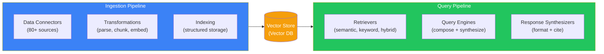
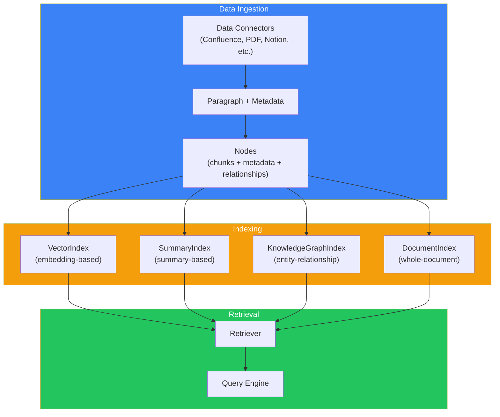
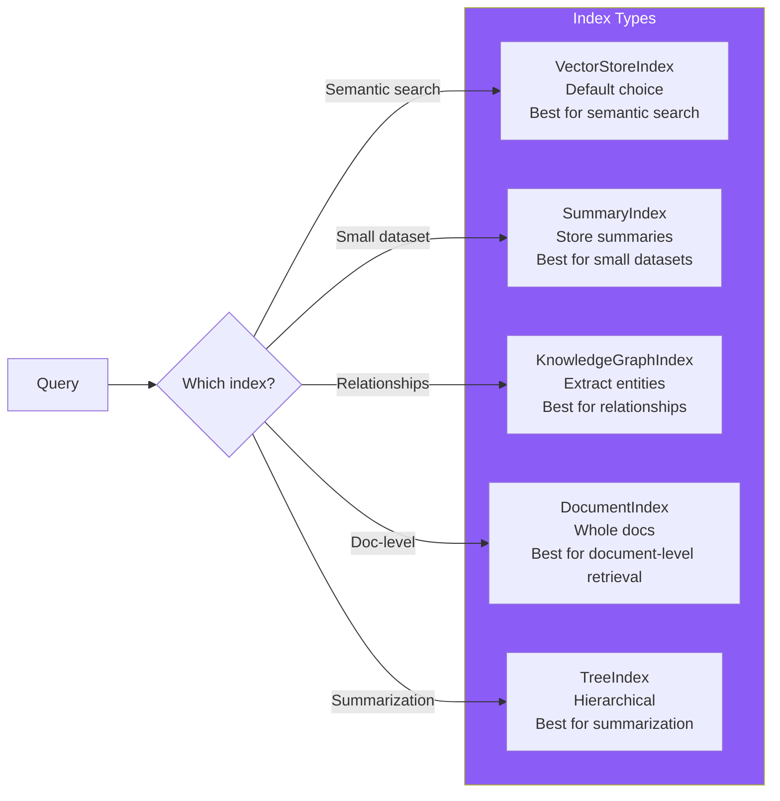
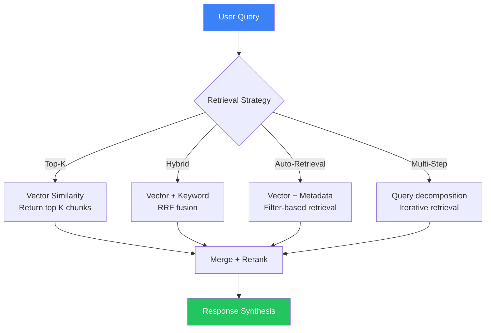
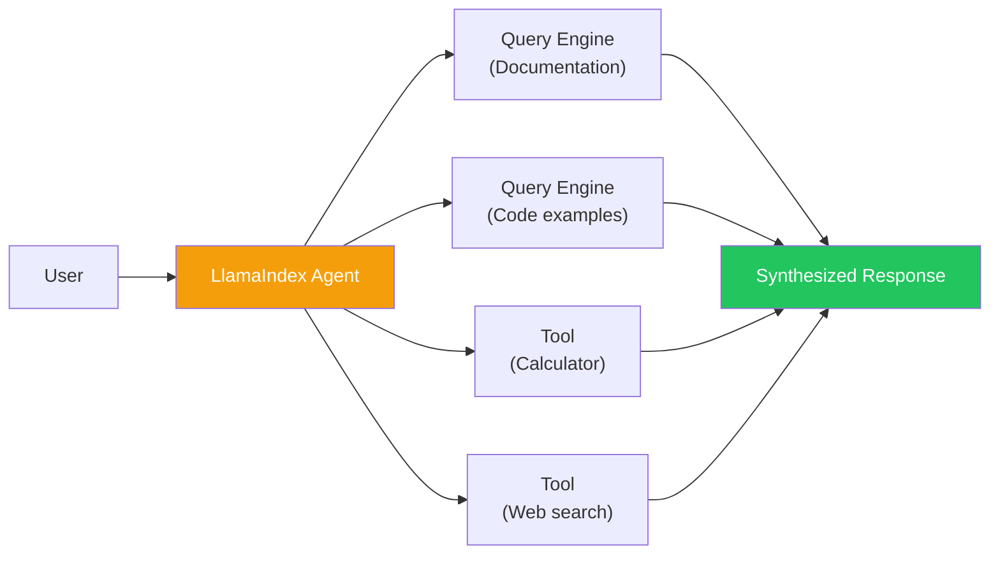

## Introduction

> **LlamaIndex (formerly GPT Index) is a data framework designed specifically for building RAG applications — it excels at ingesting, indexing, and retrieving information from large document collections.**

While LangChain is general-purpose, LlamaIndex is RAG-first. Every component in LlamaIndex is optimized for the document-to-retrieval pipeline: data connectors, indexing strategies, retrieval methods, and query engines.



---

## Why LlamaIndex Exists

### The Problem: RAG Was Too Hard

Before LlamaIndex, building a RAG application required:
- Writing custom parsers for different file types (PDF, HTML, Markdown)
- Implementing chunking strategies
- Managing embedding pipelines
- Building retrieval logic
- Writing response synthesis code

LlamaIndex provides all of this as a cohesive, RAG-focused framework.

### LlamaIndex vs LangChain

| Aspect | LlamaIndex | LangChain |
|--------|------------|-----------|
| **Primary focus** | Data + RAG | General-purpose AI apps |
| **Core abstraction** | Index → Query Engine | Chain → Agent |
| **Document processing** | Built-in, extensive | External loaders |
| **Learning curve** | Moderate (RAG-only) | Steep (many concepts) |
| **Best use case** | Knowledge base, search | Agents, complex workflows |

---

## Real-World Analogy

### The Digital Library

LlamaIndex is like a digital library:

- **Data connectors** = Book acquisition (getting books from publishers)
- **Indexes** = The card catalog (organizing books for discovery)
- **Retrievers** = Librarians (finding the right books)
- **Query engines** = Research assistants (reading and synthesizing answers)
- **Response synthesizers** = The final report (formatted with citations)

Everything is optimized for the flow: acquire documents → organize them → find relevant information → answer questions.

---

## Core Architecture



---

## Data Connectors

LlamaIndex supports 80+ data sources through its LlamaHub ecosystem:

```python
from llama_index.core import SimpleDirectoryReader
from llama_index.readers.confluence import ConfluenceReader
from llama_index.readers.notion import NotionReader
from llama_index.readers.s3 import S3Reader

# Local files
documents = SimpleDirectoryReader("./data").load_data()

# Confluence (enterprise docs)
confluence_reader = ConfluenceReader(base_url="https://your-domain.atlassian.net")
documents = confluence_reader.load_data(space_key="ENG")

# Notion workspaces
notion_reader = NotionReader(integration_token="...")
documents = notion_reader.load_data()
```

---

## Index Types



### Building an Index

```python
from llama_index.core import VectorStoreIndex, SimpleDirectoryReader
from llama_index.core import Settings

# Configure embedding model
Settings.embed_model = "local:BAAI/bge-small-en-v1.5"
Settings.llm = "gpt-4o"

# Load and index in 3 lines
documents = SimpleDirectoryReader("./docs").load_data()
index = VectorStoreIndex.from_documents(documents)

# Query
query_engine = index.as_query_engine()
response = query_engine.query("What is the project about?")
print(response)
```

---

## Retrieval Strategies



### Advanced Retrieval

```python
from llama_index.core.retrievers import (
    VectorIndexRetriever,
    KeywordTableSimpleRetriever,
)
from llama_index.core.query_engine import RetrieverQueryEngine
from llama_index.core.postprocessor import SimilarityPostprocessor

# Create retriever with custom config
retriever = VectorIndexRetriever(
    index=index,
    similarity_top_k=10,
    vector_store_query_mode="hybrid"
)

# Add post-processing
node_postprocessor = SimilarityPostprocessor(similarity_cutoff=0.7)

# Create query engine
query_engine = RetrieverQueryEngine(
    retriever=retriever,
    node_postprocessor=[node_postprocessor]
)

response = query_engine.query("Find documentation about authentication")
```

---

## Query Engines

LlamaIndex provides multiple query engine types:

```python
from llama_index.core.query_engine import (
    RetrieverQueryEngine,       # Standard RAG
    ToolRetrieverRouterQueryEngine, # Router for multiple tools
    CitationQueryEngine,        # With source citations
    PandasQueryEngine,          # CSV/DataFrame queries
    SQLQueryEngine,             # Natural language to SQL
)

# Citation engine (shows sources)
citation_engine = CitationQueryEngine.from_index(
    index=index,
    citation_chunk_size=512
)
response = citation_engine.query("Authentication methods")
print(f"Answer: {response}")
print(f"Sources: {response.source_nodes}")
```

---

## Agents in LlamaIndex



---

## Advantages

1. **RAG-first design** — Everything is optimized for retrieval-augmented generation
2. **80+ data connectors** — LlamaHub provides connectors for almost any data source
3. **Multiple index types** — Vector, summary, knowledge graph, tree, document
4. **Excellent response synthesis** — Built-in citation support, structured outputs
5. **Active development** — Rapid innovation in retrieval techniques

## Disadvantages

| Issue | Impact |
|-------|--------|
| **RAG-only focus** | Not suitable for non-RAG AI applications |
| **Less mature agents** | Agent capabilities are weaker than LangGraph |
| **Smaller community** | Fewer tutorials, examples than LangChain |
| **Limited language support** | Python only (no TypeScript) |
| **Steep learning curve for advanced features** | Basic usage is easy, custom retrieval is complex |

---

## When NOT to Use LlamaIndex

- Building agents or multi-step workflows (use LangGraph)
- Need cross-language support (Python-only)
- Simple chatbot with no document retrieval
- When your data is already in a vector database (just query it directly)

---

## Interview Questions

### Beginner

**Q: What is LlamaIndex and what makes it different from LangChain?**

> LlamaIndex is a data framework for RAG applications. Unlike LangChain which is general-purpose, LlamaIndex is specifically designed for ingesting, indexing, and retrieving information from documents. Its core abstractions are Indexes and Query Engines, optimized for the document-to-answer pipeline.

**Q: What is a VectorStoreIndex in LlamaIndex?**

> A VectorStoreIndex is the most common index type. It chunks documents, embeds each chunk, and stores the embeddings in a vector database. When queried, it finds the most semantically similar chunks to the query and returns them as context for the LLM.

### Intermediate

**Q: How does LlamaIndex handle document chunking differently from manual implementation?**

> LlamaIndex provides built-in Node parsing with strategies for: chunk size, chunk overlap, metadata extraction, and relationship tracking between nodes. It also supports hierarchical chunking (parent-child relationships) where small chunks are retrieved and large parent chunks are provided as context. Manual implementation requires building all of this from scratch.

**Q: Compare LlamaIndex's Response Synthesis with manual RAG response generation.**

> LlamaIndex provides multiple synthesis modes: (1) **Accumulate** — Concatenate all retrieved chunks, (2) **Compact** — Refit chunks into context window, (3) **Tree Summarize** — Summarize chunks recursively, (4) **Refine** — Iteratively refine the answer with each chunk. Manual RAG typically just concatenates chunks in a prompt. LlamaIndex's synthesis handles citation tracking, source attribution, and optimal context utilization.

### Senior

**Q: Design a multi-source RAG system using LlamaIndex that queries Confluence, Notion, and local files simultaneously.**

> Architecture: (1) Create separate indexes for each source (ConfluenceIndex, NotionIndex, LocalIndex), (2) Create query engines for each, (3) Use a RouterQueryEngine that routes based on query type, (4) Or use a SubQuestionQueryEngine that decomposes queries and sends sub-questions to the right engine, (5) Configure a response synthesizer that cites sources from all three indexes, (6) Use metadata filters to track which source each response came from, (7) Set up a retriever with a reranker to prioritize results across sources.

**Q: How would you optimize LlamaIndex for a production system with millions of documents?**

> Optimization strategies: (1) Use a managed vector database instead of in-memory (Pinecone, Qdrant), (2) Pre-compute embeddings offline during ingestion, (3) Use batch processing for document ingestion, (4) Implement tiered caching — hot documents in memory, cold on disk, (5) Use incremental indexing — only re-index changed documents, (6) Enable hybrid search (vector + BM25) for better recall, (7) Add a reranker (Cohere rerank) for precision, (8) Use async query processing for concurrent requests.

### Staff Engineer

**Q: What architectural principles make LlamaIndex particularly effective for RAG compared to building your own solution?**

> (1) **Node-centric data model** — Every chunk is a Node with metadata, relationships, and embedding — enabling rich retrieval beyond simple vector search. (2) **Index abstraction** — Multiple index types (vector, summary, knowledge graph) can be combined for comprehensive retrieval. (3) **Composable retrievers** — Retrievers can be chained, merged, and routed. (4) **Callback system** — Built-in observability for every step of the RAG pipeline. (5) **LlamaHub** — 80+ pre-built connectors create a plug-and-play data ecosystem.

### Architecture

**Q: Compare LlamaIndex's indexing architecture with Haystack's pipeline architecture.**

> **LlamaIndex**: Index-centric. Documents → Nodes → Index → Retriever → Query Engine → Response. The Index is the central abstraction that organizes all data. **Haystack**: Pipeline-centric. Documents → Pipeline (with FileConverter → PreProcessor → Embedder → DocumentStore as components). The Pipeline is the central abstraction that orchestrates components. **Key difference**: LlamaIndex is data-structure oriented (build the right index for your data); Haystack is process-oriented (build the right pipeline for your workflow). LlamaIndex is better for RAG-focused applications; Haystack is better for search-focused applications.

### System Design

**Q: Design a LlamaIndex-based knowledge assistant for a 10,000-employee company with documents across multiple platforms.**

> Architecture: (1) **Data Connectors** — ConfluenceReader for engineering docs, NotionReader for product docs, SharePointReader for HR and finance, S3Reader for technical specs, (2) **Processing Pipeline** — Async batch processing with 50k documents/day throughput, (3) **Indexing Strategy** — VectorIndex + KnowledgeGraphIndex for relationship extraction, (4) **Query Layer** — RouterQueryEngine that routes to the correct index based on query intent, (5) **Security** — Metadata filtering to restrict document access by department, (6) **Monitoring** — LlamaIndex callbacks + OpenTelemetry for observability, (7) **Scaling** — Horizontal scaling of query engines with connection pooling to vector DB.

---

## Summary

| Concept | Key Point |
|---------|-----------|
| **LlamaIndex** | RAG-first data framework for document ingestion and retrieval |
| **Core abstraction** | Index → Query Engine |
| **Data connectors** | 80+ through LlamaHub |
| **Index types** | Vector, Summary, Knowledge Graph, Tree, Document |
| **Best for** | RAG applications, knowledge bases, document QA |
| **Trade-off** | RAG-focused — less suitable for general agent workflows |

---

## Navigation

**Previous:** [02 — LangChain](/ai/phase-08-ai-frameworks/02-langchain)

**Next:** [04 — Semantic Kernel](/ai/phase-08-ai-frameworks/04-semantic-kernel)

**Related Topics:**
- [LangChain](/ai/phase-08-ai-frameworks/02-langchain)
- [Haystack](/ai/phase-08-ai-frameworks/06-haystack)
- [Framework Comparison](/ai/phase-08-ai-frameworks/09-framework-comparison)
