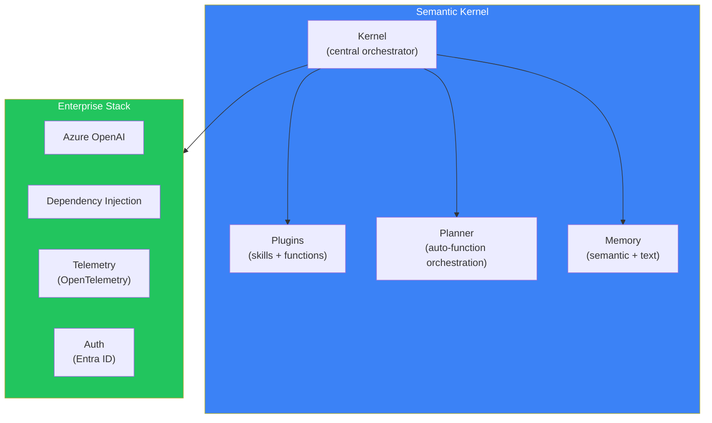
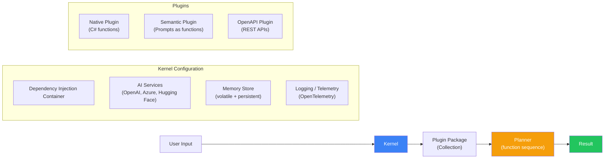
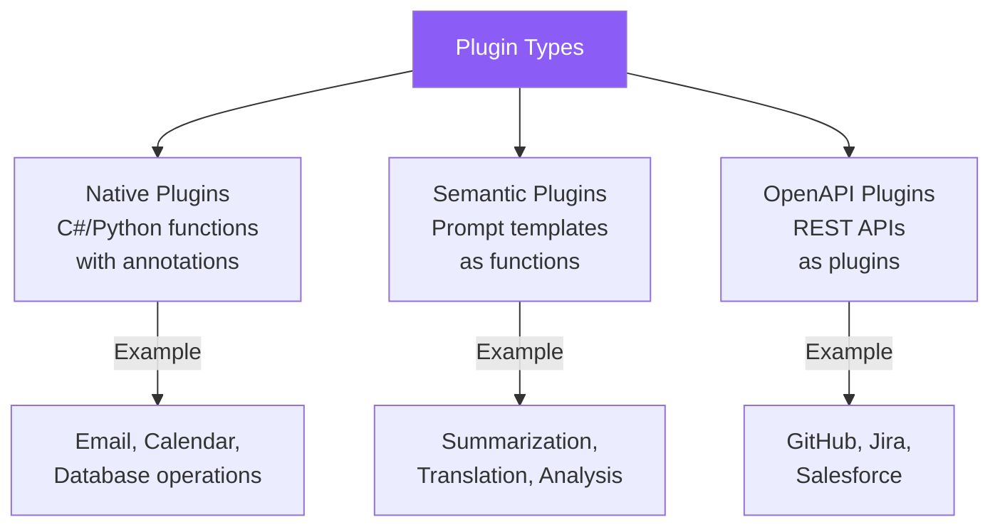
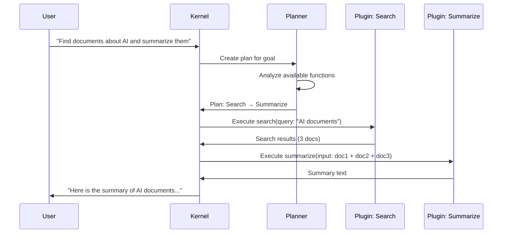
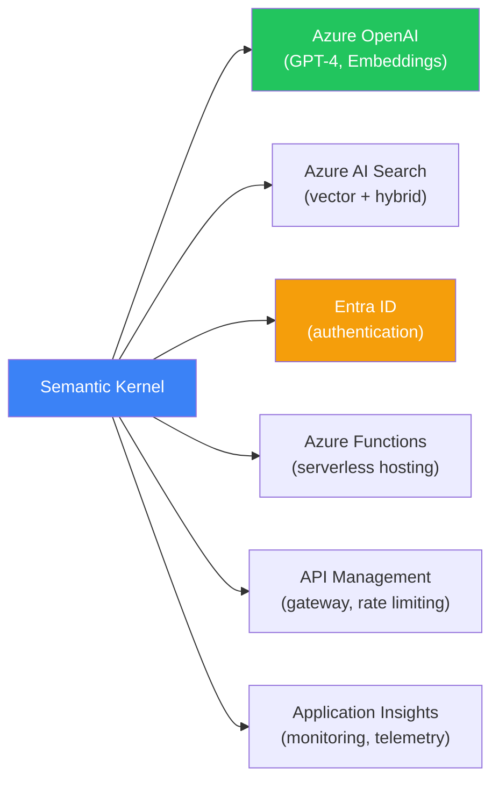

## Introduction

> **Semantic Kernel (SK) is Microsoft's AI framework designed for enterprise applications — it integrates deeply with Azure, follows enterprise coding patterns (DI, plugins, dependency injection), and supports .NET, Python, and Java.**

While LangChain and LlamaIndex are popular in the startup/developer community, Semantic Kernel is the framework of choice for enterprises that need Azure integration, .NET support, and enterprise-grade architecture patterns.



---

## Why Semantic Kernel Exists

### The Problem: AI Frameworks Don't Fit Enterprise Patterns

Microsoft observed that existing AI frameworks (LangChain, LlamaIndex) were built for Python developers building prototypes, not for enterprise .NET teams with:
- Strict coding standards and architecture patterns
- Dependency injection and testability requirements
- Azure infrastructure and Active Directory
- Compliance and governance requirements

Semantic Kernel was designed from the ground up for this audience.

### Key Differentiators

1. **First-class .NET support** — Native C# SDK (not a port)
2. **Dependency Injection** — Built-in DI integration
3. **Plugin architecture** — Reusable, versioned, discoverable
4. **Azure native** — Deep integration with Azure OpenAI, Cognitive Search, etc.
5. **Enterprise security** — Entra ID, managed identities, RBAC
6. **Multi-language** — .NET, Python, Java with consistent APIs

---

## Real-World Analogy

### The Enterprise Software Platform

Semantic Kernel is like the SAP of AI frameworks:

- You don't just write code — you configure a **Kernel** with **Plugins**
- **Planners** act like business process managers (they figure out the optimal workflow)
- **Memory** works like an enterprise document management system
- Everything follows strict **enterprise architecture standards** (DI, logging, telemetry)

It's designed for the Fortune 500 development team, not the solo startup developer.

---

## Core Architecture



---

## Plugins

Plugins are the fundamental unit of functionality in Semantic Kernel:

```csharp
// C# Example: Native Plugin
using Microsoft.SemanticKernel;
using System.ComponentModel;

public class EmailPlugin
{
    [KernelFunction("send_email")]
    [Description("Send an email to a recipient")]
    public async Task<string> SendEmailAsync(
        Kernel kernel,
        [Description("Email recipient")] string to,
        [Description("Email subject")] string subject,
        [Description("Email body")] string body)
    {
        // Send email logic
        return $"Email sent to {to}";
    }

    [KernelFunction("get_unread_emails")]
    [Description("Get unread emails for the current user")]
    [return: Description("List of unread emails")]
    public async Task<string> GetUnreadEmailsAsync(Kernel kernel)
    {
        return "Unread email list...";
    }
}
```

### Semantic Functions (Prompts as Code)

```csharp
// Define prompt as a semantic function
var summarizePlugin = kernel.CreateFunctionFromPrompt(
    promptTemplate: """
    Summarize the following text:
    
    {{$input}}
    
    Summary:
    """,
    functionName: "summarize",
    pluginName: "TextPlugin"
);

// Use it
var summary = await kernel.InvokeAsync(summarizePlugin, 
    new() { ["input"] = longText });
```

### Plugin Types



---

## Planner

The Planner automatically orchestrates functions:



---

## Memory

```python
# Python example: Semantic Memory
from semantic_kernel import Kernel
from semantic_kernel.memory import SemanticTextMemory
from semantic_kernel.connectors.memory.azure_cognitive_search import (
    AzureCognitiveSearchMemoryStore
)

kernel = Kernel()

# Configure memory with Azure Cognitive Search
memory_store = AzureCognitiveSearchMemoryStore(
    search_endpoint="https://your-search.search.windows.net",
    admin_key="your-admin-key"
)

memory = SemanticTextMemory(
    storage=memory_store,
    embeddings_generator=kernel.get_service("text_embedding")
)

# Save information
await memory.save_information_async(
    collection="documents",
    text="Semantic Kernel supports .NET, Python, and Java",
    id="sk-001"
)

# Query memory
results = await memory.search_async(
    collection="documents",
    query="What languages does SK support?",
    limit=5
)
```

---

## Enterprise Integrations



---

## Advantages

1. **Enterprise-ready** — DI, logging, telemetry, security built in
2. **Multi-language** — .NET, Python, Java consistent APIs
3. **Plugin ecosystem** — OpenAPI plugin support, auto-discovery
4. **Azure integration** — Deep Azure AI Search, OpenAI, Functions integration
5. **Planner** — Auto-function orchestration reduces boilerplate
6. **Microsoft support** — Backed by Microsoft, used in Copilot products

## Disadvantages

| Issue | Impact |
|-------|--------|
| **Azure-centric** | Best experience is on Azure; limited elsewhere |
| **Smaller community** | Fewer tutorials, examples than LangChain |
| **Plugin complexity** | Plugin model is powerful but requires more code |
| **Less flexible** | More opinionated than LangChain |
| **Python maturity** | Python SDK is newer; .NET SDK is more mature |

---

## When NOT to Use Semantic Kernel

- Building a quick prototype (more ceremony than necessary)
- Not using Azure or Microsoft stack
- Need the latest AI feature immediately (LangChain releases faster)
- Python-only team (the Python SDK is newer and less mature)
- Startup environment (LangChain/LlamaIndex have more community support)

---

## Interview Questions

### Beginner

**Q: What is Semantic Kernel and what makes it unique?**

> Semantic Kernel is Microsoft's enterprise AI framework. It's unique because it follows enterprise architecture patterns (dependency injection, plugin-based, telemetry), integrates deeply with Azure services, and provides first-class support for .NET, Python, and Java.

**Q: What is a Plugin in Semantic Kernel?**

> A Plugin is a collection of functions that the Kernel can use. Plugins can be Native (C#/Python functions with annotations), Semantic (prompt templates as functions), or OpenAPI (REST APIs wrapped as plugins). Plugins are the primary way to extend what the Kernel can do.

### Intermediate

**Q: How does Semantic Kernel's Planner compare to LangChain's Agent?**

> SK's Planner analyzes available plugins and creates an execution plan before running, then executes the plan step by step. LangChain's Agent decides each action at runtime (ReAct loop). SK's approach is more predictable and testable (the plan can be reviewed before execution). LangChain's approach is more flexible and better for dynamic environments.

**Q: How does Semantic Kernel handle dependency injection?**

> SK integrates with the host application's DI container. AI services, memory stores, plugins, and logging are all registered via DI. This makes SK applications testable (mock plugins in tests), configurable (swap services via config), and compliant with enterprise architecture standards.

### Senior

**Q: Design a Semantic Kernel application for an enterprise that needs to process HR documents with Azure OpenAI.**

> Architecture: (1) **Kernel setup** with Azure OpenAI (GPT-4o) and Azure AI Search, (2) **Plugins**: HRPolicyPlugin (query policies), DocumentParserPlugin (parse PDF/Word), EmployeeDataPlugin (get employee info from HR system via OpenAPI), (3) **Memory**: Store HR documents in Azure AI Search with role-based metadata (which departments can see which docs), (4) **Planner**: Automatically orchestrates plugins for complex queries like "What is the maternity leave policy for the engineering department?", (5) **Security**: Entra ID authentication, RBAC per plugin, (6) **Monitoring**: Application Insights for telemetry.

**Q: How would you migrate a .NET enterprise application from LangChain to Semantic Kernel?**

> Migration strategy: (1) Identify all LangChain components used (prompts, memory, chains), (2) Map LangChain concepts to SK equivalents (Chain → Plugin sequence, Agent → Planner, Memory → SemanticTextMemory), (3) Reimplement prompts as Semantic Functions, (4) Wrap external API calls as OpenAPI Plugins, (5) Add DI registration for all SK components, (6) Run in parallel during migration (both LangChain and SK active), (7) Compare outputs for consistency, (8) Remove LangChain after validation.

### Staff Engineer

**Q: What architectural decisions made Semantic Kernel particularly suitable for enterprise adoption?**

> (1) **Plugin architecture** — Functions are self-describing (annotations provide function name, description, parameter metadata). This enables auto-discovery, auto-generated UI, and governance. (2) **DI-first** — SK doesn't manage its own container; it integrates with the host's DI, following enterprise patterns. (3) **Planner** — Separates planning from execution, enabling plan review, approval workflows, and audit trails. (4) **Telemetry built-in** — OpenTelemetry integration provides observability out of the box. (5) **Multi-language with parity** — .NET team doesn't need Python developers to use AI.

### Architecture

**Q: Compare Semantic Kernel's architecture with LangChain's. How does each framework's architectural philosophy affect production deployment?**

> **SK**: Kernel-centric, plugin-based, with a Planner that separates planning from execution. Deployments follow existing .NET patterns (DI, IHostedService, middleware). Benefits from Azure's managed services. **LangChain**: Component-centric, chain-based, with an Agent that merges planning and execution. Deployments are more flexible but require more custom infrastructure. **Production impact**: SK fits naturally into existing .NET enterprise deployments (add SK as a service, configure via appsettings.json). LangChain requires more custom setup (server configuration, infrastructure decisions).

### System Design

**Q: Design a multi-tenant Semantic Kernel deployment for a SaaS platform.**

> Architecture: (1) **Tenant isolation** — Each tenant gets its own Kernel instance with tenant-specific plugins and memory stores, (2) **Plugin registry** — Central registry of available plugins, tenants configure which they need, (3) **Memory partitioning** — Use tenant ID as prefix in Azure AI Search indexes, (4) **Rate limiting** — Per-tenant token and request limits via API Management, (5) **Cost tracking** — Each Kernel call tagged with tenant ID for billing, (6) **Customization** — Tenants can add their own plugins (OpenAPI) without affecting others, (7) **Deployment** — Auto-scaling Kernel hosts behind a load balancer, (8) **Monitoring** — Per-tenant dashboards in Application Insights.

---

## Summary

| Concept | Key Point |
|---------|-----------|
| **Semantic Kernel** | Microsoft's enterprise AI framework |
| **Core abstraction** | Kernel + Plugins + Planner |
| **Language support** | .NET (primary), Python, Java |
| **Best for** | Enterprise .NET apps, Azure ecosystem |
| **Unique features** | DI integration, Plugin system, Planner |
| **Trade-off** | Azure-centric vs flexibility, enterprise patterns vs quick prototyping |

---

## Navigation

**Previous:** [03 — LlamaIndex](/ai/phase-08-ai-frameworks/03-llamaindex)

**Next:** [05 — DSPy](/ai/phase-08-ai-frameworks/05-dspy)

**Related Topics:**
- [LangChain](/ai/phase-08-ai-frameworks/02-langchain)
- [Framework Comparison](/ai/phase-08-ai-frameworks/09-framework-comparison)
- [Framework Selection Guide](/ai/phase-08-ai-frameworks/10-framework-selection-guide)
