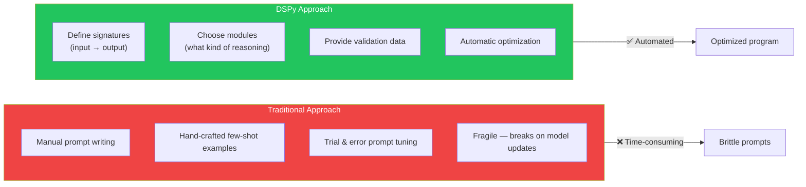
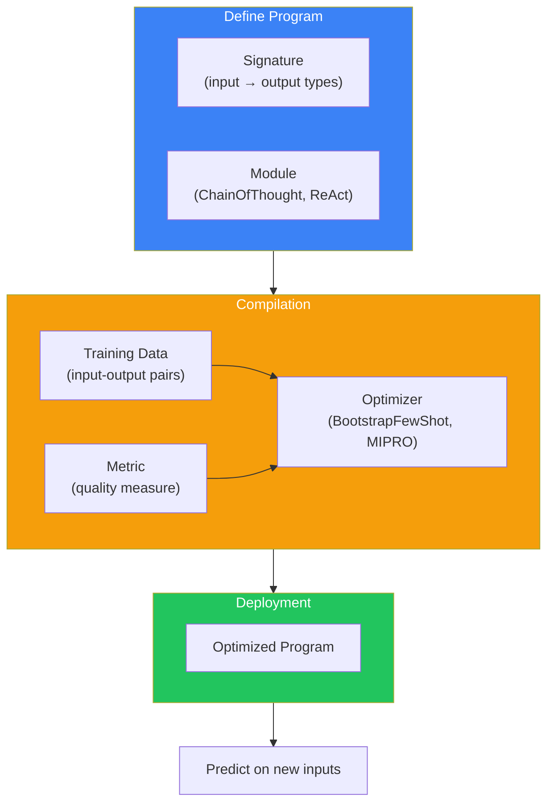
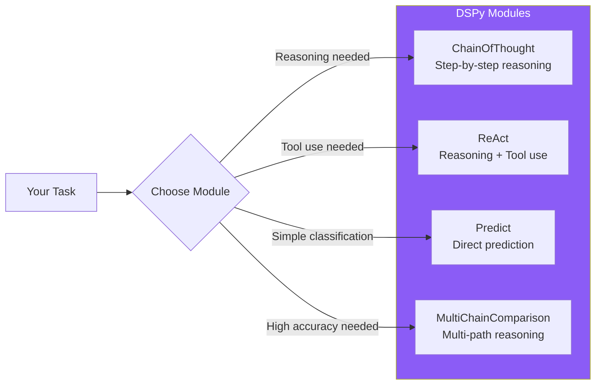
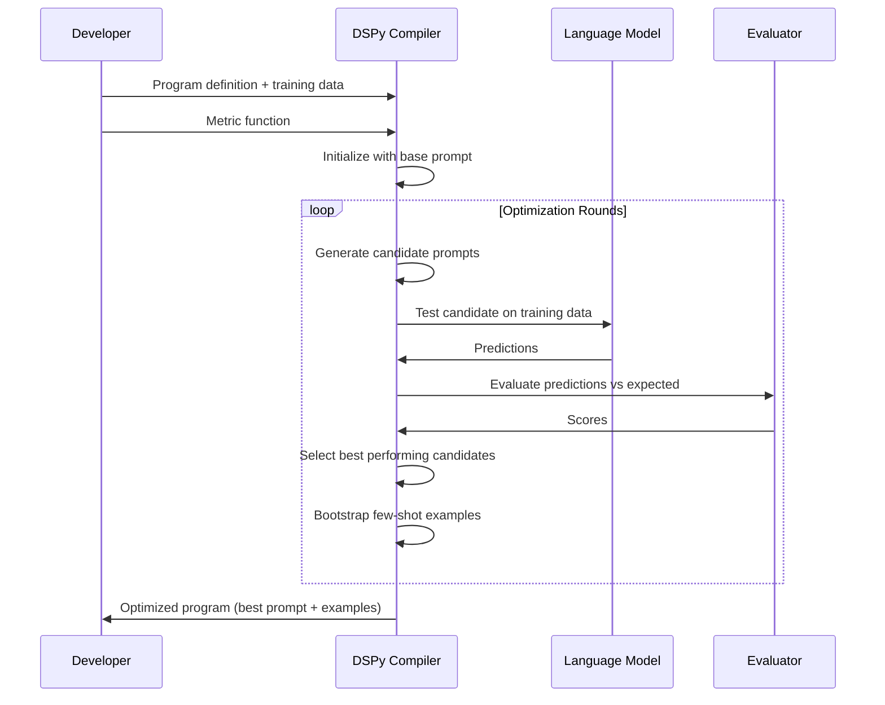
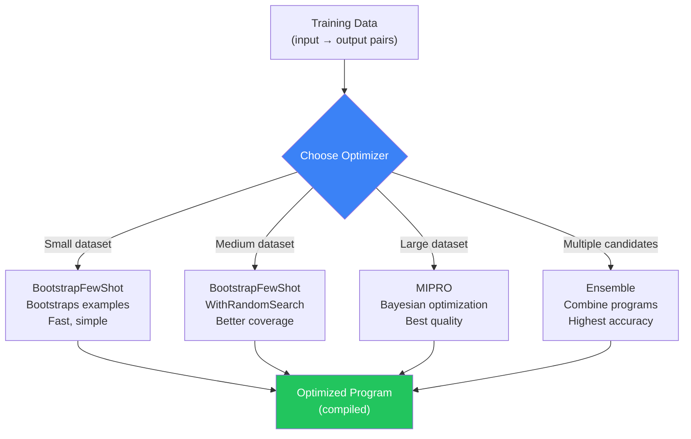

## Introduction

> **DSPy is a radically different AI framework — instead of writing prompts, you define programmatic signatures and modules, and DSPy automatically optimizes the prompts and few-shot examples for your task.**

Most AI frameworks make prompt management easier. DSPy eliminates manual prompt engineering entirely. You define **what** you want (input/output signatures), not **how** to get it (prompts). DSPy's optimizers automatically find the best prompts and few-shot examples for your task.



---

## Why DSPy Exists

### The Problem: Prompt Engineering Doesn't Scale

Manual prompt engineering has fundamental problems:
- **Brittle** — A prompt that works with GPT-4 may fail with GPT-4o or Claude
- **Not transferable** — What works for one task may not work for another
- **Tedious** — Hours spent tweaking wording and examples
- **Unprincipled** — No systematic way to improve prompts

### DSPy's Solution: Programmatic AI

DSPy treats AI programs as **programs** (not prompts). You define:
1. **Signatures** — Type-safe input/output definitions
2. **Modules** — Reusable reasoning patterns (ChainOfThought, ReAct)
3. **Optimizers** — Automatic prompt and example optimization
4. **Metrics** — How to measure success

Then DSPy compiles your program into optimized prompts automatically.

---

## Real-World Analogy

### The Auto-Tuner for AI

Imagine you're tuning a race car:

**Traditional AI** = Manual tuning: You adjust the carburetor, check the timing, test, adjust again, repeat for hours.

**DSPy** = Automatic ECU tuning: You tell the computer "I want maximum horsepower with safe fuel mixture" and the computer automatically finds the optimal settings.

DSPy is the automatic ECU tuner for AI prompts — you provide the goal and data, and it finds the optimal configuration automatically.

---

## Core Architecture



---

## Signatures

Signatures are the core abstraction — they define what a module does:

```python
import dspy

# Define a signature: input → output
class GenerateAnswer(dspy.Signature):
    """Answer questions based on context."""
    
    context = dspy.InputField(desc="Relevant information")
    question = dspy.InputField(desc="User's question")
    answer = dspy.OutputField(desc="Concise answer with citations")
```

| Component | Example | Purpose |
|-----------|---------|---------|
| **InputField** | `question: str` | What the module needs |
| **OutputField** | `answer: str` | What the module produces |
| **Docstring** | "Answer questions..." | Instructions for the LLM |

---

## Modules

Modules are the reasoning patterns:

```python
# Chain of Thought reasoning
cot = dspy.ChainOfThought("question → answer")

# ReAct agent loop
react = dspy.ReAct("question → answer", tools=[search_tool])

# Retrieve-then-read (RAG)
rag = dspy.ChainOfThought("context, question → answer")

# Classify
classify = dspy.ChainOfThought("text → sentiment: positive, negative, neutral")
```



---

## Compilation (Automated Optimization)



```python
from dspy.teleprompt import BootstrapFewShot

# Define metric
def validate_answer(example, pred, trace=None):
    return example.answer == pred.answer

# Configure optimizer
optimizer = BootstrapFewShot(
    metric=validate_answer,
    max_bootstrapped_demos=4,
    max_labeled_demos=8
)

# Compile!
compiled_program = optimizer.compile(
    student=my_program,
    teacher=my_program,
    trainset=training_data
)

# Use the compiled program
answer = compiled_program(question="What is RAG?", context="...")
```

---

## Optimizers (Teleprompters)



| Optimizer | Strategy | Best For |
|-----------|----------|----------|
| **BootstrapFewShot** | Bootstraps few-shot examples from training data | When you have labeled examples |
| **BootstrapFewShotWithRandomSearch** | Random search over prompt variations | When you need better optimization |
| **MIPRO** | Bayesian optimization over prompt instructions | Complex tasks, production quality |
| **SignatureOptimizer** | Optimizes signature descriptions | When signatures need refinement |
| **Ensemble** | Combines multiple optimized programs | Maximum accuracy (higher cost) |

---

## RAG with DSPy

```python
import dspy
from dspy.retrieve import ColBERTv2

# Configure retriever
retriever = ColBERTv2(collection="my_docs")

class RAG(dspy.Module):
    def __init__(self):
        super().__init__()
        self.retrieve = dspy.Retrieve(k=3)
        self.generate_answer = dspy.ChainOfThought(
            "context, question → answer"
        )
    
    def forward(self, question):
        context = self.retrieve(question).passages
        answer = self.generate_answer(
            context="\n".join(context),
            question=question
        )
        return dspy.Prediction(context=context, answer=answer.answer)

# Compile RAG
rag = RAG()
compiled_rag = optimizer.compile(rag, trainset=train_data)
```

---

## Advantages

1. **No manual prompt engineering** — Signatures replace prompts
2. **Automatic optimization** — BootstrapFewShot, MIPRO find optimal prompts
3. **Model-agnostic** — Same program works with GPT-4, Claude, Llama
4. **Systematic** — Metric-driven optimization instead of guesswork
5. **Reproducible** — Same compilation produces same results
6. **Progressive** — Works with simple tasks and complex pipelines

## Disadvantages

| Issue | Impact |
|-------|--------|
| **Learning curve** | Different mental model from traditional prompting |
| **Compilation cost** | Optimization requires LLM calls (time + money) |
| **Limited community** | Smaller than LangChain, fewer examples |
| **Debugging difficulty** | Hard to understand why the optimizer chose certain prompts |
| **Over-optimization risk** | May optimize for the training set specifically |

---

## When NOT to Use DSPy

- Simple one-shot tasks (just write the prompt directly)
- Need full control over exact prompt wording
- Small or simple projects where optimization isn't worth the overhead
- When you don't have labeled training data (compilation requires examples)

---

## Interview Questions

### Beginner

**Q: What is DSPy and how is it different from other AI frameworks?**

> DSPy is a programmatic AI framework that replaces manual prompt engineering with automated optimization. Instead of writing prompts, you define typed signatures (input → output) and DSPy automatically finds the best prompts and few-shot examples for your task using optimizers like BootstrapFewShot.

**Q: What is a DSPy Signature?**

> A Signature defines the input and output fields of a module with types and descriptions. Example: `class Summarize(dspy.Signature): text -> summary`. The signature tells DSPy what the module does without specifying how — DSPy figures out the prompt automatically.

### Intermediate

**Q: How does DSPy's compilation process work? Explain the flow.**

> Compilation takes: (1) a DSPy program with signatures and modules, (2) labeled training data (input → expected output pairs), (3) a metric function that measures quality. The optimizer generates prompt variations, tests them against the training data, evaluates with the metric, and selects the best performing prompts. It also bootstraps few-shot examples from correct predictions. The result is an optimized program with the best prompt + examples.

**Q: Compare DSPy's ChainOfThought module with manually writing a chain-of-thought prompt.**

> Manual: You write "Let's think step by step" in the prompt, hope the model follows it, and manually test different phrasings. DSPy: You use `dspy.ChainOfThought("input → output")` and the module automatically generates optimal chain-of-thought instructions and examples during compilation. The DSPy approach is systematic, measurable, and transfers across models.

### Senior

**Q: Design a DSPy pipeline for a production question-answering system that needs high accuracy.**

> Architecture: (1) **Retrieve module** — Retrieves top-5 documents, (2) **Rerank module** — ChainOfThought signature that scores and selects the best 2 documents, (3) **Answer module** — Generates answer with citations from selected docs, (4) **Validate module** — Checks answer for hallucinations (groundedness check), (5) **Fallback** — If validation fails, re-answer with stricter instructions. Compile all modules together with a combined metric (accuracy + groundedness). Use MIPRO optimizer for the highest quality. Deploy the compiled program.

**Q: How would you handle domain-specific optimization when your training data is limited?**

> Strategies: (1) Use BootstrapFewShot with small labeled datasets (5-10 examples), (2) Augment training data using the LLM itself to generate synthetic examples, (3) Use Transfer Learning — compile on a related task with more data, then fine-tune on the target task, (4) Use MIPRO's Bayesian optimization which works well with limited data, (5) Implement cross-validation during compilation to prevent overfitting, (6) Use the ensemble optimizer to combine multiple programs trained on different data subsets.

### Staff Engineer

**Q: What makes DSPy's approach fundamentally different from traditional prompt engineering from a software engineering perspective?**

> Traditional prompt engineering is **non-systematic**: you tweak text, observe output, tweak again. There's no type safety, no testability, no version control for prompts (they're just strings). DSPy brings **software engineering principles** to AI: (1) **Type safety** — Signatures define exactly what goes in and out, (2) **Testability** — Compilation uses metrics to measure quality objectively, (3) **Reproducibility** — Compilation produces deterministic programs, (4) **Versioning** — Programs can be versioned, compared, and rolled back, (5) **CI/CD** — Compilation can run in CI pipelines, preventing regressions.

### Architecture

**Q: Compare DSPy's architecture with LangChain's. How does each handle prompt optimization?**

> **LangChain**: Prompt templates are manually written and managed by the developer. There's no built-in optimization — you A/B test prompts manually using LangSmith. **DSPy**: Prompts are generated automatically from signatures. The optimizer finds the best prompts programmatically. **Key difference**: LangChain treats prompts as developer-managed artifacts; DSPy treats prompts as compiler-managed artifacts. LangChain gives you control; DSPy gives you automation. Neither is universally better — LangChain is better when you have prompt expertise; DSPy is better when you want systematic optimization.

### System Design

**Q: Design a CI/CD pipeline for DSPy programs in a production environment.**

> Pipeline: (1) **Data** — Versioned training dataset in a data lake, (2) **Compile** — DSPy compilation step (may take 30-60 minutes), (3) **Evaluate** — Run compiled program against held-out test set, (4) **Compare** — Compare metrics against the current production program, (5) **Gate** — Only deploy if metrics meet thresholds (accuracy > 0.85, latency < 2s), (6) **Deploy** — Push compiled program to model registry, (7) **Monitor** — Track production metrics, collect new training data from production traces, (8) **Iterate** — Retrain weekly with accumulated data.

---

## Summary

| Concept | Key Point |
|---------|-----------|
| **DSPy** | Programmatic AI framework — replaces prompt engineering with optimization |
| **Core abstraction** | Signatures (typed input/output) + Modules (reasoning patterns) |
| **Compilation** | Automatic optimization of prompts and examples |
| **Optimizers** | BootstrapFewShot, MIPRO, Ensemble |
| **Best for** | Tasks where prompt quality matters and you have training data |
| **Trade-off** | Less control over exact prompts, more systematic/optimized results |

---

## Navigation

**Previous:** [04 — Semantic Kernel](/ai/phase-08-ai-frameworks/04-semantic-kernel)

**Next:** [06 — Haystack](/ai/phase-08-ai-frameworks/06-haystack)

**Related Topics:**
- [LangChain](/ai/phase-08-ai-frameworks/02-langchain)
- [Framework Comparison](/ai/phase-08-ai-frameworks/09-framework-comparison)
- [Build Without Frameworks](/ai/phase-08-ai-frameworks/11-build-without-frameworks)
