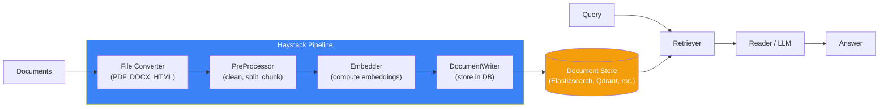
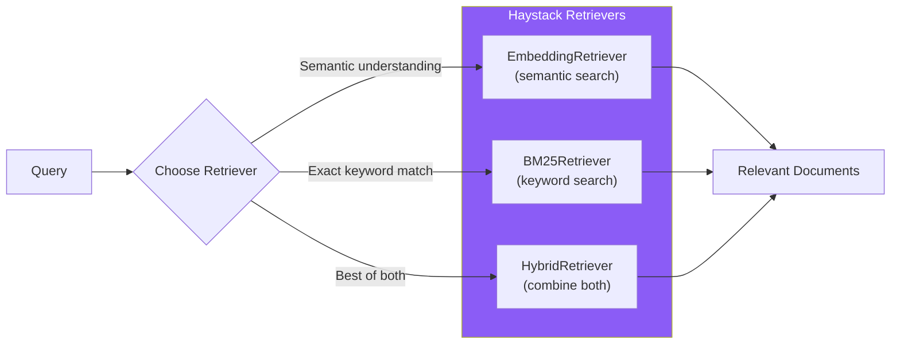
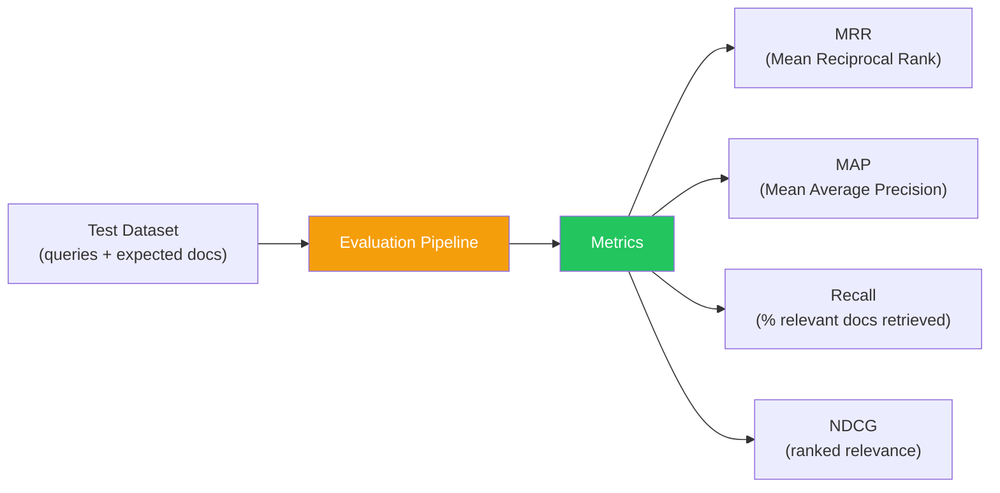
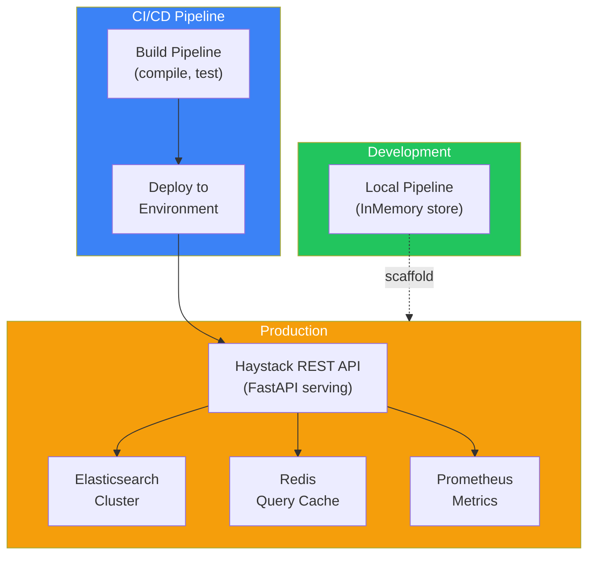

## Introduction

> **Haystack is an open-source framework for building production-ready search and RAG systems — it focuses on creating composable pipelines for document processing, retrieval, and question answering.**

Developed by deepset, Haystack is the go-to framework when you need robust, scalable search infrastructure. Unlike general-purpose frameworks, Haystack is laser-focused on the search and retrieval use case with enterprise-grade production features.



---

## Why Haystack Exists

### The Problem: Search Is Hard to Get Right

Building a production search system requires:
- Document parsing and preprocessing
- Embedding computation and storage
- Retrieval strategies (keyword, semantic, hybrid)
- Ranking and reranking
- Evaluation and optimization

Haystack provides all of this as pre-built, customizable pipeline components.

### Haystack vs Other Frameworks

| Aspect | Haystack | LlamaIndex | LangChain |
|--------|----------|------------|-----------|
| **Primary focus** | Search + RAG | RAG | General AI apps |
| **Pipeline model** | Explicit DAG | Implicit (Index → Query) | Chain / Graph |
| **Production features** | Built-in caching, batching | Limited | Via LangSmith |
| **Document stores** | 7+ native integrations | Via vector stores | Via vector stores |
| **Best for** | Enterprise search | Document QA | Complex AI workflows |

---

## Real-World Analogy

### The Factory Assembly Line

Haystack is like a factory assembly line for search:

- **File Converters** = Raw material processors (turn ore into metal)
- **PreProcessors** = Quality control (clean, sort, size)
- **Embedders** = Labeling (add metadata for search)
- **Document Stores** = Warehouse (organized storage)
- **Retrievers** = Order Pickers (find the right products)
- **Readers** = Quality Inspectors (verify the right product was found)

Everything is a step in a pipeline. Each step can be swapped, upgraded, or reconfigured independently.

---

## Core Architecture: Pipelines


```python
from haystack import Pipeline
from haystack.components.converters import PyPDFToDocument
from haystack.components.preprocessors import DocumentSplitter
from haystack.components.embedders import SentenceTransformersDocumentEmbedder
from haystack.components.writers import DocumentWriter
from haystack.document_stores import InMemoryDocumentStore

# Create indexing pipeline
doc_store = InMemoryDocumentStore()

indexing = Pipeline()
indexing.add_component("converter", PyPDFToDocument())
indexing.add_component("splitter", DocumentSplitter(split_by="word", split_length=200))
indexing.add_component("embedder", SentenceTransformersDocumentEmbedder())
indexing.add_component("writer", DocumentWriter(document_store=doc_store))

indexing.connect("converter", "splitter")
indexing.connect("splitter", "embedder")
indexing.connect("embedder", "writer")

# Run
indexing.run({"converter": {"sources": ["report.pdf"]}})
```

---

## Retrievers



```python
from haystack.components.retrievers import (
    EmbeddingRetriever,
    BM25Retriever,
)

# Semantic retriever
semantic_retriever = EmbeddingRetriever(
    document_store=doc_store,
    top_k=10
)

# Keyword retriever
keyword_retriever = BM25Retriever(
    document_store=doc_store,
    top_k=10
)

# Hybrid (use both and merge)
from haystack.components.retrievers import HybridRetriever
hybrid_retriever = HybridRetriever(
    document_store=doc_store,
    top_k=10
)
```

---

## Document Stores

Haystack supports multiple backends:

| Store | Best For | Features |
|-------|----------|----------|
| **InMemory** | Development, testing | Simple, fast |
| **Elasticsearch** | Production search | Full-text + vector, faceted search |
| **OpenSearch** | AWS environments | Similar to Elasticsearch |
| **Qdrant** | Vector search | High-performance ANN |
| **Weaviate** | Vector + metadata | GraphQL API |
| **Pinecone** | Managed vector | Fully managed, scalable |
| **Chroma** | Local vector | Lightweight, Pythonic |

---

## RAG Pipeline

```python
from haystack.components.builders import PromptBuilder
from haystack.components.generators import OpenAIGenerator

# Query pipeline with RAG
query_pipeline = Pipeline()
query_pipeline.add_component("query_embedder", SentenceTransformersTextEmbedder())
query_pipeline.add_component("retriever", EmbeddingRetriever(doc_store, top_k=5))
query_pipeline.add_component("reranker", CohereRanker())
query_pipeline.add_component("prompt_builder", PromptBuilder(
    template="""
    Answer the question based on the provided documents.
    
    Documents:
    
    {{ doc.content }}
    
    
    Question: {{ question }}
    Answer:
    """
))
query_pipeline.add_component("llm", OpenAIGenerator(model="gpt-4o"))

query_pipeline.connect("query_embedder", "retriever")
query_pipeline.connect("retriever", "reranker")
query_pipeline.connect("reranker", "prompt_builder.documents")
query_pipeline.connect("prompt_builder", "llm")

# Query
result = query_pipeline.run({
    "query_embedder": {"text": "What is Haystack?"},
    "prompt_builder": {"question": "What is Haystack?"}
})
print(result["llm"]["replies"][0])
```

---

## Evaluation



```python
from haystack.evaluation import EvaluationPipeline, EvaluationRun

# Evaluate retrieval quality
eval_run = EvaluationRun(
    pipeline=query_pipeline,
    dataset=test_dataset,
    metrics=["mrr", "recall_single_hit", "ndcg"],
    return_run=True
)

print(f"MRR: {eval_run.metrics['mrr']}")
print(f"Recall@10: {eval_run.metrics['recall_single_hit']}")
```

---

## Deployment Architecture



---

## Advantages

1. **Pipeline-first architecture** — Explicit, visible, debuggable pipelines
2. **Production-ready** — Built-in caching, batching, async support
3. **Multiple document stores** — 7+ native integrations
4. **Evaluation built-in** — MRR, MAP, Recall, NDCG metrics
5. **REST API support** — Haystack can serve as a search API
6. **Active commercial backing** — deepset provides enterprise support

## Disadvantages

| Issue | Impact |
|-------|--------|
| **Search-focused** — Not suitable for general agent workflows | Find another framework for agents |
| **Smaller community** than LangChain | Fewer tutorials and examples |
| **Pipeline debugging** can be complex | Hard to trace issues in multi-step pipelines |
| **Limited agent support** | Agents are basic compared to LangGraph |

---

## When NOT to Use Haystack

- Building autonomous agents (use LangGraph)
- Need a general-purpose AI framework (use LangChain)
- Simple chatbot with no search requirements
- Prototyping (overhead of pipeline setup)

---

## Interview Questions

### Beginner

**Q: What is Haystack and what problem does it solve?**

> Haystack is an open-source framework for building search and RAG systems. It solves the problem of building production-grade search infrastructure by providing composable pipeline components for document processing, retrieval, ranking, and generation.

**Q: What is a Haystack Pipeline?**

> A Pipeline is a directed acyclic graph (DAG) of components that process data. Indexing pipelines convert documents into searchable formats. Query pipelines retrieve and rank relevant documents. Pipelines are explicit — you can see exactly how data flows through each component.

### Intermediate

**Q: How does Haystack's pipeline architecture compare to LangChain's chain architecture?**

> Haystack pipelines are explicit DAGs where each component is a node with defined inputs and outputs. Pipelines are visible, debuggable, and can branch. LangChain chains are sequential (LCEL uses `|` operator) or graph-based (LangGraph). Haystack's approach is better for complex search workflows with branching and merging. LangChain's approach is better for sequential AI operations.

**Q: How would you implement hybrid search in Haystack?**

> Use the HybridRetriever which combines EmbeddingRetriever (semantic) and BM25Retriever (keyword) results. Configure weights to control the balance. Optionally add a Reranker (like CohereRanker) after the hybrid retriever to refine results. Haystack handles the normalization and merging of scores from different retrieval methods automatically.

### Senior

**Q: Design a multi-stage search pipeline using Haystack that handles 1M+ documents.**

> Architecture: (1) **Indexing** — Batch processing with parallel document converters, use Elasticsearch as the document store for scalability, (2) **Stage 1: Fast Retrieval** — Hybrid retriever (BM25 + embedding) with top_k=100 for high recall, (3) **Stage 2: Reranking** — Cross-encoder reranker (Cohere or BAAI/bge-reranker) that scores top-100 and returns top-10, (4) **Stage 3: Generation** — LLM generates answer from top-10 documents with citations, (5) **Caching** — Cache retrieval results for identical queries, (6) **Async** — Query pipeline runs fully async for concurrent requests.

**Q: How would you evaluate a Haystack search pipeline before deploying to production?**

> (1) Create a test dataset of 1000+ queries with known relevant documents, (2) Run evaluation pipeline with metrics: MRR@10, Recall@10, NDCG@10, (3) Compare against baseline (e.g., BM25-only), (4) A/B test pipeline variants (different retrievers, rerankers, chunk sizes), (5) Test with different document stores to measure latency, (6) Measure end-to-end latency (P50, P95, P99), (7) Monitor for regressions after deployment using Haystack's evaluation framework.

### Staff Engineer

**Q: What architectural principles make Haystack particularly well-suited for search applications?**

> (1) **Pipeline-as-DAG** — Every search workflow is a visible, debuggable graph of components. This makes it easy to optimize individual steps without affecting others. (2) **Separation of indexing and query** — Indexing pipelines and query pipelines are completely independent, enabling different scaling strategies. (3) **Document store abstraction** — Same pipeline works with any backend, enabling migration without code changes. (4) **Component isolation** — Each component (converter, splitter, embedder, retriever) is independently testable and swappable. (5) **Built-in evaluation** — Search quality can be measured objectively, enabling data-driven optimization.

### Architecture

**Q: Compare Haystack's architecture with Elasticsearch's native search capabilities. When would you use each?**

> **Elasticsearch** is a search engine — it handles indexing, storage, and retrieval efficiently but doesn't understand semantic meaning natively. **Haystack** is a search framework — it orchestrates LLMs, embedders, and retrievers to build AI-powered search. **When to use each**: Elasticsearch alone is sufficient for keyword/faceted search. Add Haystack on top when you need: semantic search, RAG-based answers, cross-encoder reranking, or multi-stage retrieval pipelines. Many production systems use Elasticsearch as the document store within a Haystack pipeline.

### System Design

**Q: Design a Haystack-based enterprise search system for a company with 10M documents across 50 file formats.**

> Architecture: (1) **File Converters** — 50 Haystack converters (PDF, DOCX, HTML, Markdown, code files, images with OCR), (2) **PreProcessing** — DocumentSplitter with configurable chunk sizes per format (code: 500 tokens, PDF: 1000 tokens), (3) **Embedding** — Batch embedding with GPU acceleration, (4) **Document Store** — Elasticsearch cluster (3 nodes) with both keyword and vector indexes, (5) **Query Pipeline** — Hybrid retrieval (BM25 + embedding) → Cross-encoder reranker → GPT-4o generation, (6) **Security** — Metadata filtering for access control (department, role, sensitivity), (7) **Scaling** — Indexing pipeline runs as a batch job; query pipeline scales horizontally behind a load balancer, (8) **Monitoring** — Evaluation pipeline runs weekly to detect retrieval quality regressions.

---

## Summary

| Concept | Key Point |
|---------|-----------|
| **Haystack** | Open-source framework for production search and RAG |
| **Core abstraction** | Pipeline (DAG of components) |
| **Best for** | Enterprise search, RAG, document QA |
| **Document stores** | Elasticsearch, Qdrant, Weaviate, Pinecone, 7+ |
| **Unique features** | Pipeline visibility, built-in evaluation, hybrid search |
| **Trade-off** | Search-focused — not suitable for general agent workflows |

---

## Navigation

**Previous:** [05 — DSPy](/ai/phase-08-ai-frameworks/05-dspy)

**Next:** [07 — PydanticAI](/ai/phase-08-ai-frameworks/07-pydanticai)

**Related Topics:**
- [LlamaIndex](/ai/phase-08-ai-frameworks/03-llamaindex)
- [Framework Comparison](/ai/phase-08-ai-frameworks/09-framework-comparison)
- [Framework Selection Guide](/ai/phase-08-ai-frameworks/10-framework-selection-guide)
