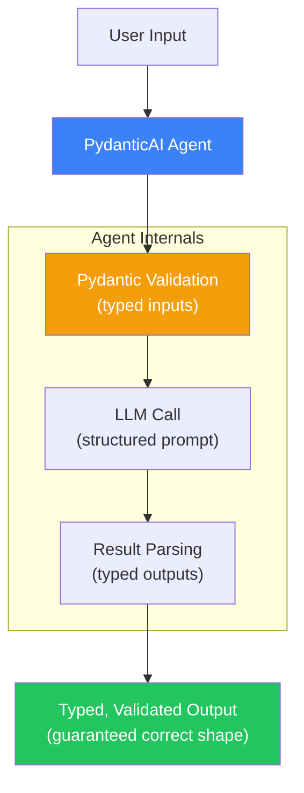
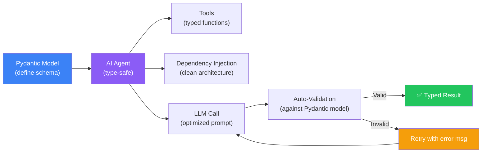
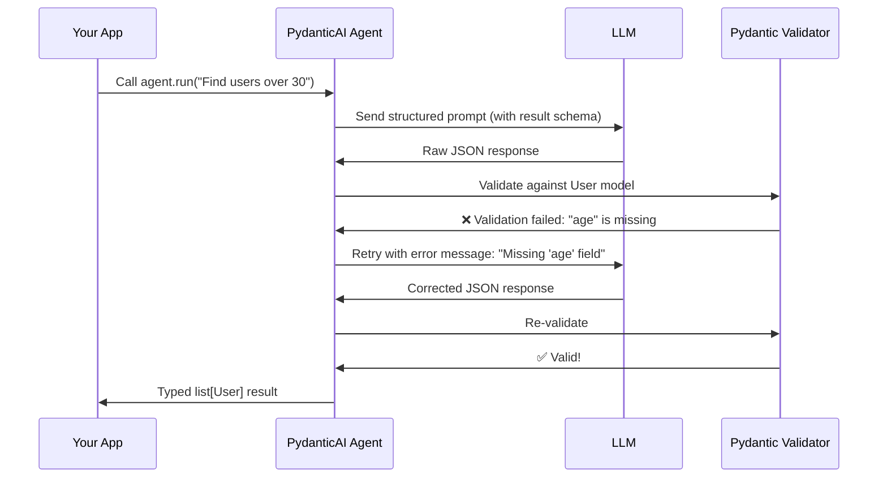
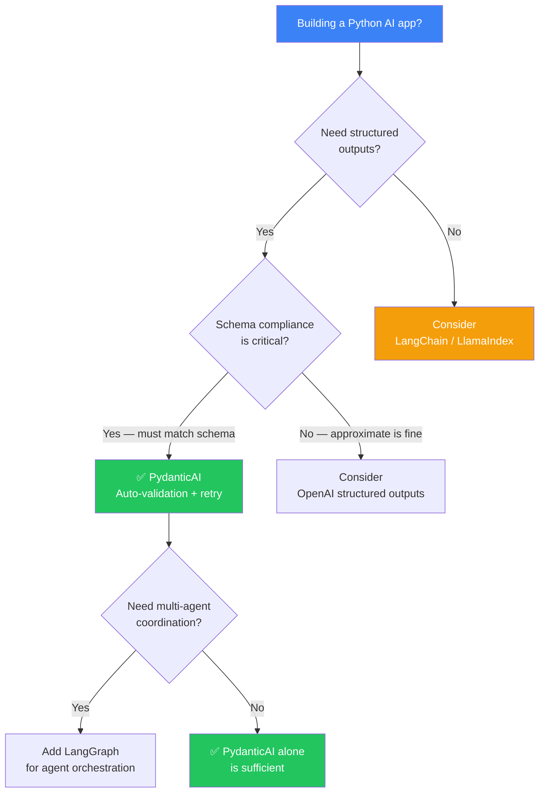

## Introduction

> **PydanticAI is a Python AI framework that puts type safety and validation first — it provides typed agents with dependency injection, structured outputs, and seamless integration with Pydantic's validation ecosystem.**

Built by the team behind Pydantic (the most popular Python data validation library), PydanticAI brings the same type-safety philosophy to AI applications. If you've ever struggled with LLMs returning malformed JSON or hallucinating fields, PydanticAI is the solution.



---

## Why PydanticAI Exists

### The Problem: LLMs Don't Follow Schemas

The biggest pain point in production AI is **unreliable structured output**:
- LLMs return malformed JSON
- Missing required fields
- Extra unexpected fields
- Wrong types (string instead of number)

Developers spend hours writing validation code, retry logic, and error handling around LLM outputs.

### The Solution: Pydantic-Powered Agents

PydanticAI solves this by:
1. Generating optimized prompts from Pydantic models
2. Validating LLM outputs automatically
3. Retrying with error messages when validation fails
4. Providing typed, validated results guaranteed to match your schema

---

## Real-World Analogy

### The Quality Control Inspector

Imagine a factory that produces widgets:

**Without PydanticAI**: The factory ships everything it produces. Sometimes widgets come out wrong — missing parts, wrong size, broken. Customers complain. The factory has to handle returns and rework.

**With PydanticAI**: Every widget passes through a quality control inspector before shipping. The inspector checks size, parts, and functionality. If something is wrong, the inspector sends it back to the production line with notes on what to fix. Only perfect widgets ship to customers.

PydanticAI is that quality control inspector for LLM outputs — it validates, catches errors, and gives the LLM feedback to self-correct.

---

## Core Architecture



---

## Model Abstraction

```mermaid
flowchart LR
    subgraph PROVIDERS["Supported LLM Providers"]
        OA["OpenAI\ngpt-4o, gpt-4o-mini"]
        ANTH["Anthropic\nclaude-3-5-sonnet"]
        GEM["Gemini\ngemini-1.5-pro"]
        OLL["Ollama\nllama3, mixtral"]
        GROQ["Groq\nllama3, mixtral"]
    end
    
    PROVIDERS --> PAI["PydanticAI\n(model string: \"openai:gpt-4o\")"]
    PAI --> AGENT["Typed Agent\n(result_type=MyModel)"]
    AGENT --> OUTPUT["✅ Validated, Typed Output"]
    
    style PROVIDERS fill:#3b82f6,color:#fff
    style AGENT fill:#8b5cf6,color:#fff
    style OUTPUT fill:#22c55e,color:#fff
```

```python
from pydantic_ai import Agent
from pydantic import BaseModel

# Same agent works with ANY provider — just change the model string
agent = Agent(
    "openai:gpt-4o",       # OpenAI
    # "anthropic:claude-3-5-sonnet-20241022",  # Anthropic
    # "gemini:gemini-1.5-pro",                   # Gemini
    # "ollama:llama3",                           # Local
    
    result_type=str,
    system_prompt="Explain AI concepts simply."
)
```

---

## Basic Usage
from pydantic import BaseModel
from pydantic_ai import Agent
import asyncio

# Define the output schema
class SearchResult(BaseModel):
    title: str
    url: str
    summary: str
    relevance_score: float

# Create a typed agent
agent = Agent(
    "openai:gpt-4o",
    result_type=list[SearchResult],
    system_prompt="Search the documentation and return relevant results."
)

async def main():
    result = await agent.run("Find documentation about PydanticAI agents")
    
    # Result is automatically validated and typed
    for item in result.data:
        print(f"{item.title} ({item.relevance_score}): {item.summary}")
        # Type-safe access — IDE autocompletion works!
        # item.title is str, item.relevance_score is float
```

---

## Tools with Type Safety

```python
from pydantic_ai import Agent, RunContext
from pydantic import BaseModel
from typing import Annotated

class DatabaseConn(BaseModel):
    """Dependency injection type."""
    connection_string: str
    max_queries: int = 100

agent = Agent(
    "openai:gpt-4o",
    deps_type=DatabaseConn,
    system_prompt="Query the database to answer questions."
)

@agent.tool
async def query_database(
    ctx: RunContext[DatabaseConn],
    sql: Annotated[str, "The SQL query to execute"],
    limit: Annotated[int, "Max results to return"] = 10
) -> list[dict]:
    """Execute a database query."""
    # ctx.deps has the validated DatabaseConn
    return execute_query(ctx.deps.connection_string, sql, limit)

@agent.tool
async def get_schema(
    ctx: RunContext[DatabaseConn],
    table: Annotated[str, "Table name to describe"]
) -> str:
    """Get the schema of a database table."""
    pass
```

---

## Result Validation



---

## When to Choose PydanticAI



---

## Dependency Injection

```python
from pydantic_ai import Agent, RunContext
from pydantic import BaseModel

class UserProfile(BaseModel):
    user_id: str
    role: str
    permissions: list[str]

class SupportConfig(BaseModel):
    knowledge_base_path: str
    max_tickets_per_session: int = 5

support_agent = Agent(
    "openai:gpt-4o",
    deps_type=SupportConfig,
    result_type=str,
    system_prompt="Help users with support tickets."
)

@support_agent.system_prompt
async def add_user_context(ctx: RunContext[UserProfile]) -> str:
    return f"The user is {ctx.deps.role} with permissions: {', '.join(ctx.deps.permissions)}"

# Use with dependencies
config = SupportConfig(knowledge_base_path="./docs/")
result = await support_agent.run("How do I reset my password?", deps=config)
```

---

## Advantages

1. **Type safety** — Fully typed agents with Pydantic validation
2. **Guaranteed structured output** — Automatic validation + retry on failure
3. **Dependency injection** — Clean architecture for production apps
4. **Python-native** — Built by the Pydantic team, integrates perfectly
5. **Testing support** — Easy to mock and test
6. **Model abstraction** — Works with OpenAI, Anthropic, Gemini, Ollama

## Disadvantages

| Issue | Impact |
|-------|--------|
| **Python only** — No TypeScript support | TypeScript teams can't use it |
| **Newer framework** — Smaller ecosystem | Fewer integrations, examples |
| **No built-in RAG** — You need to bring your own retrieval | More work for RAG apps |
| **Limited agents** — No multi-agent orchestration | Need LangGraph for complex agent teams |

---

## When NOT to Use PydanticAI

- Building in TypeScript (use Mastra or Vercel AI SDK)
- Need built-in RAG pipelines (use LlamaIndex or Haystack)
- Multi-agent coordination (use LangGraph or CrewAI)
- Quick prototyping without strict validation

---

## Interview Questions

### Beginner

**Q: What is PydanticAI and what makes it unique?**

> PydanticAI is a Python AI framework that focuses on type safety and validation. It's unique because it guarantees that LLM outputs match your Pydantic schemas — if the LLM returns invalid data, it automatically retries with error messages until the output is valid.

**Q: How does PydanticAI handle LLM output validation?**

> It compares the LLM's response against your Pydantic model schema. If validation fails (missing fields, wrong types), PydanticAI sends the error message back to the LLM and asks it to correct the output. This loop continues until the output is valid or max retries are reached.

### Intermediate

**Q: How does PydanticAI's dependency injection work and why does it matter?**

> PydanticAI uses Python's type annotations to inject dependencies into agent tools and system prompts. You define dependencies as a Pydantic model, and PydanticAI provides them through `RunContext`. This enables: (1) Clean separation of configuration and logic, (2) Easy testing (mock dependencies), (3) Dynamic behavior based on context (user role, permissions, etc.).

**Q: Compare PydanticAI's structured output approach with OpenAI's structured output feature.**

> OpenAI's structured output: The API guarantees JSON that matches the schema — validation is server-side. Only works with OpenAI. PydanticAI's approach: Validation is client-side using Pydantic. Works with any LLM provider. Retry loop means even non-OpenAI models can produce reliable structured output. PydanticAI also provides richer validation (custom validators, nested models, field constraints).

### Senior

**Q: Design a customer support system using PydanticAI that handles 10 different ticket types with validated outputs.**

> Architecture: (1) Define Pydantic models for each ticket type (BugReport, FeatureRequest, AccountIssue, etc.) with validation, (2) Create a `TicketResult` union type: `BugReport | FeatureRequest | AccountIssue`, (3) Use a single agent with `result_type=TicketResult`, (4) PydanticAI automatically handles validation and retries for any ticket type, (5) Add tools for database queries, knowledge base search, and ticket creation, (6) Use dependency injection for tenant-specific configuration, (7) Implement custom validators for business rules (e.g., priority must match severity).

**Q: How would you test a PydanticAI agent in production?**

> Testing strategies: (1) Unit test Pydantic models — ensure your schemas are correct, (2) Test agent tools in isolation — mock the LLM, verify tool logic, (3) Integration tests with a test LLM (use OpenAI's small model or a local one), (4) Validation tests — deliberately send invalid data and verify the agent handles retries correctly, (5) Snapshot tests — compare agent outputs against expected results, (6) Property-based tests — generate random inputs and verify outputs always match schemas.

### Staff Engineer

**Q: What makes PydanticAI's validation architecture different from other AI frameworks' approach to structured output?**

> (1) **Native Pydantic integration** — Other frameworks use JSON Schema or manual parsing. PydanticAI uses Pydantic models directly, leveraging all Pydantic features (field validators, model validators, nested models, discriminated unions). (2) **Retry loop** — Other frameworks typically parse the response and fail if it's invalid. PydanticAI automatically retries with the error message, using the LLM to self-correct. (3) **Type propagation** — Types flow from model definition through the agent to the output, enabling full IDE support and compile-time checking. (4) **Dependency injection** — Clean separation of concerns means agents are testable without mocking.

### Architecture

**Q: Compare PydanticAI's architecture with DSPy's approach to structured output.**

> **PydanticAI**: Type-first. You define the output structure as a Pydantic model, and the framework handles prompt generation and validation automatically. Best when you know exactly what structure you need. **DSPy**: Program-first. You define signatures (typed fields) and the framework optimizes prompts for you. Best when you want automated prompt optimization. **Key difference**: PydanticAI guarantees structural validity (the output always matches your schema). DSPy optimizes for task performance (the output is the best possible for your metric). Choose PydanticAI when schema compliance is critical; choose DSPy when output quality is critical and you have training data.

### System Design

**Q: Design a PydanticAI-powered API that serves validated AI responses to 10k requests/day.**

> Architecture: (1) **API Layer** — FastAPI endpoints with Pydantic request/response models, (2) **Agent Layer** — PydanticAI agents with typed inputs and outputs, (3) **Validation Layer** — Automatic retry with configurable max retries (2-3), (4) **Caching** — Cache validated LLM responses by query hash (TTL: 1 hour), (5) **Fallback** — If retries exhausted, return a fallback response with error details, (6) **Monitoring** — Track validation failure rate, retry count, latency per agent, (7) **Scaling** — Async agents handled by worker processes (Celery or background tasks), (8) **Testing** — Each endpoint has validation tests ensuring output consistency.

---

## Summary

| Concept | Key Point |
|---------|-----------|
| **PydanticAI** | Type-safe AI framework with Pydantic validation |
| **Core feature** | Automatic validation + retry for structured outputs |
| **Dependency injection** | Clean architecture with RunContext |
| **Best for** | APIs needing validated structured outputs |
| **Language** | Python only |
| **Trade-off** | Type safety vs flexibility; newer ecosystem |

---

## Navigation

**Previous:** [06 — Haystack](/ai/phase-08-ai-frameworks/06-haystack)

**Next:** [08 — Mastra](/ai/phase-08-ai-frameworks/08-mastra)

**Related Topics:**
- [DSPy](/ai/phase-08-ai-frameworks/05-dspy)
- [Framework Comparison](/ai/phase-08-ai-frameworks/09-framework-comparison)
- [Build Without Frameworks](/ai/phase-08-ai-frameworks/11-build-without-frameworks)
