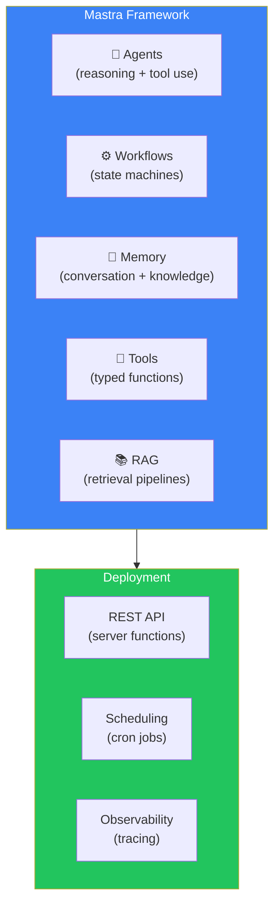
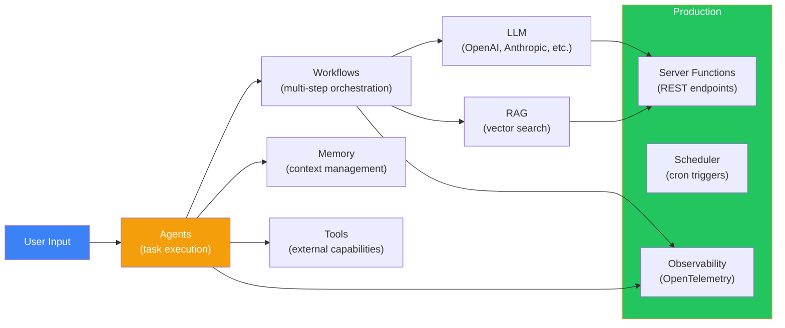
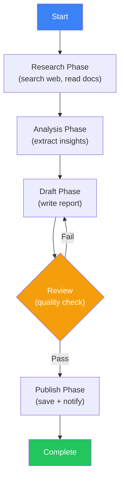
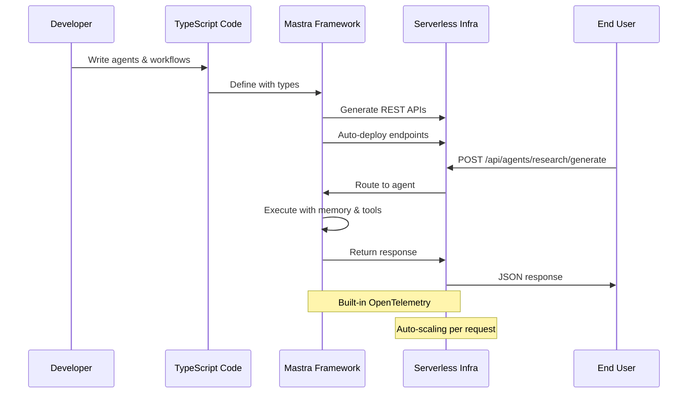

## Introduction

> **Mastra is a TypeScript-native AI framework for building agents with memory, tools, and workflows — designed for developers who want to build and deploy AI applications on the modern JavaScript/TypeScript stack.**

While many AI frameworks are Python-first and treat TypeScript as a secondary concern, Mastra is built from the ground up for the TypeScript ecosystem. It provides agents, workflow orchestration, memory, RAG, and deployment — all in TypeScript.



---

## Why Mastra Exists

### The Problem: TypeScript AI Frameworks Were Ports

Before Mastra, TypeScript developers who wanted to build AI applications had two options:
1. Use Python frameworks (different language, different ecosystem)
2. Use TypeScript ports of Python frameworks (lagging features, Python-like APIs)

Mastra is **TypeScript-native** — designed for TypeScript developers by TypeScript developers.

### Mastra's Philosophy

1. **TypeScript first** — Full type safety, no Python dependencies
2. **Serverless-ready** — Built for Vercel, Netlify, Cloudflare Workers
3. **Workflow engine** — State machine-based workflows for reliability
4. **All-in-one** — Agents + workflows + memory + RAG in one framework

---

## Real-World Analogy

### The TypeScript Workshop

Mastra is like a specialized workshop for TypeScript developers:

- **Python frameworks** are like a general hardware store — they have everything, but you need to know how to use each tool
- **Mastra** is like a pre-organized workshop — every tool is designed for TypeScript, organized for productivity

If you're a TypeScript developer, Mastra feels natural because it follows TypeScript patterns (types, interfaces, async/await, classes).

---

## Core Architecture



---

## Agents

```typescript
import { Agent } from "@mastra/core/agent";
import { openai } from "@ai-sdk/openai";

// Define a typed agent
const researchAgent = new Agent({
  name: "research-assistant",
  instructions: `
    You are a research assistant. Search the web, analyze results,
    and provide comprehensive answers with citations.
  `,
  model: openai("gpt-4o"),
  tools: {
    webSearch: searchWebTool,
    summarizeUrl: summarizeTool,
    extractKeyPoints: extractTool,
  },
  memory: {
    type: "working",
    maxTokens: 4000,
  },
});

// Use the agent
const result = await researchAgent.generate(
  "What are the latest developments in AI agents?"
);

console.log(result.text);
console.log(result.toolCalls); // Track which tools were used
console.log(result.sources);   // Citations
```

---

## Workflows

Workflows are state machines that orchestrate multi-step processes:



```typescript
import { Workflow } from "@mastra/core/workflow";
import { Step } from "@mastra/core/workflow";

const researchWorkflow = new Workflow({
  name: "research-report",
  trigger: { type: "manual" },
});

// Define steps
const researchStep = new Step({
  name: "research",
  execute: async ({ context }) => {
    const results = await searchWeb(context.triggerData.query);
    return { documents: results };
  },
});

const analyzeStep = new Step({
  name: "analyze",
  execute: async ({ context }) => {
    const insights = await extractInsights(context.research.documents);
    return { insights };
  },
});

const draftStep = new Step({
  name: "draft",
  execute: async ({ context }) => {
    const report = await generateReport(context.analyze.insights);
    return { report };
  },
  retry: {
    maxAttempts: 3,
    backoff: "exponential",
  },
});

// Define state machine transitions
researchWorkflow
  .step(researchStep)
  .step(analyzeStep)
  .step(draftStep)
  .commit();

// Execute
const { results } = await researchWorkflow.execute({
  triggerData: { query: "AI agent frameworks" },
});
```

---

## Deployment Flow



---

## Scheduling

```mermaid
flowchart LR
    SCHED["Scheduler\n(cron config)"] --> TRIGGER["Trigger Event\n(5am daily)"]
    TRIGGER --> WORKFLOW["Mastra Workflow\n(state machine)"]
    WORKFLOW --> STEP1["Step 1: Fetch Data\n(external API)"]
    STEP1 --> STEP2["Step 2: Analyze\n(LLM call)"]
    STEP2 --> STEP3["Step 3: Generate Report\n(template)"]
    STEP3 --> STEP4["Step 4: Notify\n(email, Slack)"]
    STEP4 --> COMPLETE["✅ Complete\n(observability log)"]
    
    style SCHED fill:#f59e0b,color:#fff
    style WORKFLOW fill:#8b5cf6,color:#fff
    style COMPLETE fill:#22c55e,color:#fff
```



---

## Memory

```typescript
import { Memory } from "@mastra/core/memory";

const agentMemory = new Memory({
  type: "semantic",  // or "working", "conversation"
  storage: {
    type: "upstash",  // Redis-based
    config: {
      url: process.env.UPSTASH_REDIS_URL,
      token: process.env.UPSTASH_REDIS_TOKEN,
    },
  },
  embedder: openai.embedding("text-embedding-3-small"),
  maxTokens: 8000,
  semanticRecall: {
    topK: 5,
    minScore: 0.7,
  },
});

// Agent with memory
const agent = new Agent({
  // ...
  memory: agentMemory,
});

// Memory persists across conversations
await agent.generate("What was my last question about?");
// Agent can retrieve relevant context from memory
```

---

## RAG

```typescript
import { RAG } from "@mastra/core/rag";
import { openai } from "@ai-sdk/openai";

const rag = new RAG({
  embedder: openai.embedding("text-embedding-3-small"),
  vectorStore: {
    type: "pinecone",
    config: {
      apiKey: process.env.PINECONE_API_KEY,
      index: "docs",
    },
  },
  chunker: {
    type: "recursive",
    size: 1000,
    overlap: 200,
  },
});

// Index documents
await rag.index({
  documents: [
    { content: "...", metadata: { source: "docs.pdf" } },
  ],
});

// Query
const results = await rag.query("How do agents work in Mastra?");
console.log(results.documents);
```

---

## Server Functions

```typescript
import { createServer } from "@mastra/core/server";

const app = createServer({
  agents: { research: researchAgent },
  workflows: { report: researchWorkflow },
});

// Auto-generated REST API
// POST /api/agents/research/generate
// POST /api/workflows/report/execute
// GET /api/memory/research-agent/history

app.listen(3000);
```

---

## Advantages

1. **TypeScript native** — Full type safety, no Python dependency
2. **Serverless-ready** — Built for modern deployment platforms
3. **Workflow engine** — State machine-based reliability
4. **All-in-one** — Agents, workflows, memory, RAG
5. **Modern DX** — TypeScript patterns, great IDE support
6. **Deployment included** — Auto-generated REST APIs, scheduling

## Disadvantages

| Issue | Impact |
|-------|--------|
| **Newest framework** — Smaller community | Fewer examples, integrations |
| **Python developers** not served | Python teams should use LangChain/LlamaIndex |
| **Less mature** than LangChain | Fewer production deployments |
| **Limited model support** compared to LangChain | May not support niche providers |

---

## When NOT to Use Mastra

- Building in Python (use LangChain or LlamaIndex)
- Need a mature, battle-tested framework (use LangChain)
- Need the largest possible ecosystem of integrations (use LangChain)
- Building simple one-off scripts without TypeScript

---

## Interview Questions

### Beginner

**Q: What is Mastra and what makes it unique?**

> Mastra is a TypeScript-native AI framework for building agents, workflows, and RAG applications. It's unique because it's built from the ground up for TypeScript developers — unlike other frameworks that are Python ports with TypeScript wrappers.

**Q: How does Mastra's workflow engine differ from LangChain's chains?**

> Mastra workflows are state machines with defined steps, transitions, and retry logic. LangChain chains are sequential operations connected by the LCEL pipeline operator. Mastra workflows are better for complex, multi-step processes that need reliability (retries, state persistence). LangChain chains are better for simpler, sequential AI operations.

### Intermediate

**Q: How does Mastra handle agent memory?**

> Mastra provides three memory types: (1) **Working memory** — Short-term context within a session (token-limited), (2) **Conversation memory** — Full message history for ongoing conversations, (3) **Semantic memory** — Vector-based memory that retrieves relevant past information using embeddings. Memory can be backed by Redis (Upstash) or other stores.

**Q: Compare Mastra's deployment model with LangChain's.**

> Mastra includes built-in server functions that auto-generate REST APIs from your agents and workflows — deploy to Vercel, Netlify, or Node.js with minimal configuration. LangChain requires separate infrastructure (LangServe, FastAPI, or custom servers) for deployment. Mastra's approach is simpler and more TypeScript-native; LangChain's approach is more flexible but requires more setup.

### Senior

**Q: Design a multi-step research workflow using Mastra that includes web search, analysis, and report generation.**

> Workflow design: (1) **Trigger** — User submits a research query, (2) **Research Step** — Web search agent queries 3 sources, extracts key information, (3) **Analysis Step** — Analysis agent identifies themes, contradictions, and key findings, (4) **Draft Step** — Report generation agent writes a structured report with sections, (5) **Review Step** — Quality check agent verifies citations, grammar, completeness, (6) **Publish Step** — Save to database and notify user. Each step has retry logic (max 3 attempts, exponential backoff). Failed steps are logged and can be manually retriggered.

**Q: How would you implement a Mastra agent that uses tools from multiple external APIs?**

> Implementation: (1) Define typed tools for each API (GitHub, Slack, Notion) using Mastra's tool interface, (2) Each tool has typed inputs, outputs, and error handling, (3) Register all tools with a single agent, (4) The agent uses its LLM to decide which tool to call based on the user's request, (5) Add middleware for rate limiting, authentication, and logging, (6) Use Mastra's workflow engine for complex multi-tool operations (e.g., search GitHub, post results to Slack, save to Notion), (7) Monitor tool usage per agent for cost tracking.

### Staff Engineer

**Q: What architectural decisions make Mastra particularly suitable for serverless deployments?**

> (1) **Stateless agents** — Agent state is managed in external stores (Redis, vector DB), enabling horizontal scaling, (2) **Workflow state persistence** — State machine state is checkpointed, allowing workflows to survive function cold starts, (3) **No native file system dependency** — Designed for environments without persistent storage, (4) **Auto-generated REST API** — Converts agents and workflows to HTTP endpoints automatically, (5) **Async-first** — All I/O is async, fitting Node.js serverless runtimes, (6) **Minimal cold start** — Lightweight TypeScript runtime (no Python process).

### Architecture

**Q: Compare Mastra's TypeScript-native architecture with using Python frameworks through TypeScript wrappers.**

> **Mastra**: TypeScript all the way down. Full type safety across the entire stack. No Python runtime needed. TypeScript builds, errors at compile time. One language for frontend and backend. **Wrappers**: Python framework runs in a subprocess or separate service. TypeScript wrapper sends HTTP requests to Python. Limited type safety (Python outputs are strings, not typed). Two runtimes to manage. Network latency between TypeScript and Python. **Verdict**: Mastra is better for TypeScript teams; wrappers are better when you need Python-specific libraries (PyTorch, Hugging Face, etc.).

### System Design

**Q: Design a Mastra-based customer support platform that uses agents, workflows, and scheduled tasks.**

> Architecture: (1) **Agent Layer** — Support agents for common issues (password reset, billing, account management), each with domain-specific tools, (2) **Workflow Layer** — Escalation workflow: try agent resolution → if failed → route to human with context → notify user, (3) **Memory Layer** — Semantic memory across all customer interactions for context, (4) **Scheduled Tasks** — Daily summary generation, weekly quality analysis, monthly trend reports, (5) **Deployment** — Server functions on Vercel, Redis for memory state, PostgreSQL for long-term storage, (6) **Monitoring** — OpenTelemetry tracing across agents and workflows, (7) **Scaling** — Auto-scaling based on queue depth with fallback to human agents.

---

## Summary

| Concept | Key Point |
|---------|-----------|
| **Mastra** | TypeScript-native AI framework for agents and workflows |
| **Core features** | Agents, Workflows, Memory, RAG, Deployment |
| **Best for** | TypeScript teams, serverless deployments |
| **Unique features** | Workflow engine (state machine), auto-generated APIs |
| **Language** | TypeScript only |
| **Trade-off** | Modern DX vs ecosystem maturity |

---

## Navigation

**Previous:** [07 — PydanticAI](/ai/phase-08-ai-frameworks/07-pydanticai)

**Next:** [09 — Framework Comparison](/ai/phase-08-ai-frameworks/09-framework-comparison)

**Related Topics:**
- [LangChain](/ai/phase-08-ai-frameworks/02-langchain)
- [Framework Comparison](/ai/phase-08-ai-frameworks/09-framework-comparison)
- [Framework Selection Guide](/ai/phase-08-ai-frameworks/10-framework-selection-guide)
