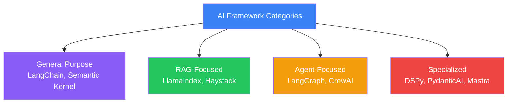
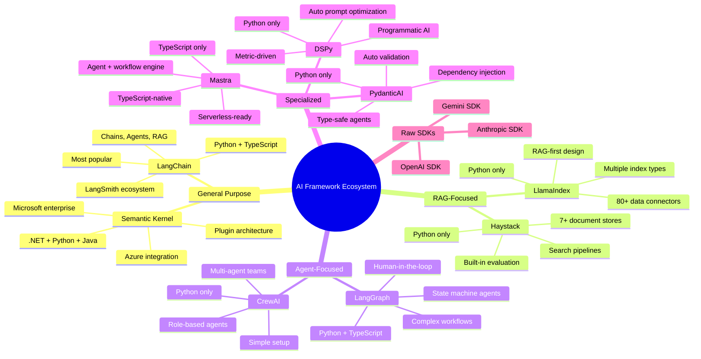
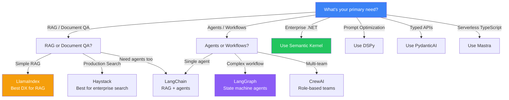
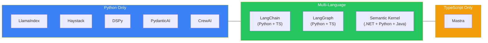
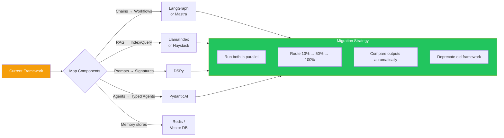

## Introduction

> **Choosing the right AI framework is the most consequential technical decision you'll make in an AI project — this comparison covers all major frameworks across 15 dimensions so you can make an informed choice.**

No single framework is best for everything. Each framework makes architectural trade-offs that make it suitable for specific use cases. Understanding these trade-offs is more important than knowing any single framework deeply.

---

## Framework Overview

---

## Comparison Matrix

| Feature | LangChain | LlamaIndex | Haystack | Semantic Kernel | DSPy | PydanticAI | Mastra | CrewAI | LangGraph |
|---------|-----------|------------|----------|-----------------|------|------------|--------|--------|-----------|
| **Language** | Python, TS | Python | Python | .NET, Python, Java | Python | Python | TypeScript | Python | Python, TS |
| **Primary use** | General AI | RAG | Search | Enterprise | Prompt opt | Typed APIs | TS AI | Multi-agent | Agents |
| **Learning curve** | Steep | Moderate | Moderate | Steep | Moderate | Low | Moderate | Low | Steep |
| **RAG support** | ✅ Good | ✅ Excellent | ✅ Excellent | ✅ Good | ⚠️ Manual | ⚠️ Manual | ✅ Good | ⚠️ Manual | ⚠️ Manual |
| **Agents** | ✅ Good | ⚠️ Basic | ❌ No | ✅ Good | ⚠️ Limited | ✅ Good | ✅ Good | ✅ Excellent | ✅ Excellent |
| **Memory** | ✅ Built-in | ⚠️ Limited | ⚠️ Limited | ✅ Built-in | ❌ No | ✅ Built-in | ✅ Built-in | ✅ Built-in | ✅ Built-in |
| **Prompt mgmt** | ✅ Templates | ⚠️ Basic | ✅ Templates | ✅ Semantic | ✅ Auto | ✅ Auto | ✅ Templates | ✅ Templates | ✅ Templates |
| **Observability** | ✅ LangSmith | ⚠️ Callbacks | ⚠️ Limited | ✅ Telemetry | ✅ Metrics | ⚠️ Logging | ✅ Tracing | ⚠️ Logging | ✅ LangSmith |
| **Evaluation** | ✅ LangSmith | ⚠️ Basic | ✅ Built-in | ⚠️ Manual | ✅ Built-in | ✅ Validation | ⚠️ Manual | ⚠️ Manual | ✅ LangSmith |
| **Community size** | Very Large | Large | Medium | Medium | Growing | Growing | Small | Medium | Large |
| **Production maturity** | High | High | High | High | Medium | Medium | Low | Medium | High |
| **LLM providers** | 20+ | 10+ | 10+ | 5+ | 10+ | 5+ | 5+ | 10+ | 20+ |
| **Multi-modal** | ✅ Yes | ⚠️ Limited | ❌ No | ⚠️ Limited | ❌ No | ❌ No | ❌ No | ❌ No | ✅ Yes |
| **Streaming** | ✅ Yes | ✅ Yes | ✅ Yes | ✅ Yes | ✅ Yes | ✅ Yes | ✅ Yes | ✅ Yes | ✅ Yes |
| **Best use case** | Complex AI apps | Doc QA | Enterprise search | Enterprise .NET | Prompt quality | Typed APIs | Serverless TS | Team agents | Agent workflows |

---

## Quick Decision Guide

---

## Language Support

---

## Migration Between Frameworks

---

## Production Readiness

| Framework | Tracing | Monitoring | Evaluation | Testing | Deployment |
|-----------|---------|------------|------------|---------|------------|
| **LangChain** | LangSmith | LangSmith | LangSmith | Unit + Integ | LangServe, FastAPI |
| **LlamaIndex** | Callbacks | Custom | Custom | Unit tests | FastAPI, custom |
| **Haystack** | Built-in | Prometheus | Built-in metrics | Pipeline tests | REST API, Docker |
| **Semantic Kernel** | OpenTelemetry | App Insights | Custom | DI-based | Azure, Docker |
| **DSPy** | Custom | Custom | Built-in metrics | Compile tests | Custom |
| **PydanticAI** | Logging | Custom | Auto-validation | Unit + E2E | FastAPI, serverless |
| **Mastra** | OpenTelemetry | Built-in | Custom | Unit tests | Built-in serverless |
| **CrewAI** | Logging | Custom | Custom | Unit tests | Custom |
| **LangGraph** | LangSmith | LangSmith | LangSmith | Graph tests | LangServe, FastAPI |

---

## Ecosystem Integration

| Framework | Vector Stores | Document Loaders | LLM Providers | Memory Stores |
|-----------|---------------|-----------------|---------------|---------------|
| **LangChain** | 15+ | 100+ | 20+ | 5+ |
| **LlamaIndex** | 10+ | 80+ (LlamaHub) | 10+ | 3+ |
| **Haystack** | 7+ | 10+ | 10+ | Limited |
| **Semantic Kernel** | 3+ | 5+ | 5+ | 3+ |
| **DSPy** | 3+ | Limited | 10+ | None |
| **PydanticAI** | Limited | Limited | 5+ | 3+ |
| **Mastra** | 3+ | Limited | 5+ | 3+ |
| **CrewAI** | Limited | Limited | 10+ | 3+ |
| **LangGraph** | 15+ | 100+ | 20+ | 5+ |

---

## Cost Comparison

| Factor | Most Expensive | Moderate | Cheapest |
|--------|---------------|----------|----------|
| **Framework overhead** | LangChain (many deps) | LlamaIndex, Haystack | PydanticAI (minimal deps) |
| **Development time** | LangGraph (complex) | Semantic Kernel (DI setup) | PydanticAI, CrewAI (simple) |
| **LLM costs (optimization)** | DSPy (compilation calls) | LangChain (standard) | Raw SDK (no framework overhead) |
| **Infrastructure** | Haystack (ES cluster) | LangChain (LangSmith) | Mastra (serverless minimal) |
| **Learning investment** | LangChain (many concepts) | Semantic Kernel (enterprise) | PydanticAI (Pydantic knowledge) |

---

## The Right Tool for Each Task

| Task | Best Framework | Why |
|------|---------------|-----|
| **Chat with PDF** | LlamaIndex | RAG-first, built-in PDF parsing |
| **Enterprise search** | Haystack | Production search, evaluation |
| **Customer support agent** | LangGraph + LangChain | Complex agent + RAG |
| **Multi-agent research team** | CrewAI | Role-based teams, simple setup |
| **Enterprise .NET app** | Semantic Kernel | .NET native, Azure integration |
| **Prompt optimization** | DSPy | Automatic, metric-driven |
| **Type-safe API** | PydanticAI | Guaranteed structured output |
| **Serverless TS app** | Mastra | TypeScript native, deployment built-in |
| **Quick prototype** | Raw SDK | No framework overhead |
| **Full-stack AI platform** | LangChain + LangGraph | Most comprehensive ecosystem |

---

## Interview Questions

### Beginner

**Q: Which AI framework is the most popular and why?**

> LangChain is the most popular AI framework due to: (1) First-mover advantage — launched in late 2022, (2) Comprehensive ecosystem — LangChain + LangSmith + LangGraph, (3) Language support — both Python and TypeScript, (4) Largest community — 100k+ GitHub stars, extensive documentation and tutorials.

**Q: What's the difference between LangChain and LlamaIndex?**

> LangChain is a general-purpose AI framework for chains, agents, and RAG. LlamaIndex is specifically designed for RAG — document processing, indexing, and retrieval. Choose LangChain for complex AI workflows; choose LlamaIndex when RAG is your primary need.

### Intermediate

**Q: When would you choose Haystack over LlamaIndex for RAG?**

> Choose Haystack when: (1) You need production-grade search infrastructure (Elasticsearch, OpenSearch), (2) You require built-in evaluation metrics (MRR, NDCG, Recall), (3) You need faceted search or filtering, (4) Your team has search engineering experience. Choose LlamaIndex when: (1) You need simple document QA without search infrastructure, (2) You want 80+ data connectors, (3) You need multiple index types (vector, summary, knowledge graph).

**Q: Compare Semantic Kernel with LangChain for enterprise applications.**

> Semantic Kernel is better for: .NET shops, Azure infrastructure, enterprise security patterns, dependency injection, and compliance requirements. LangChain is better for: rapid prototyping, the largest ecosystem, non-.NET teams, and startups. The choice often comes down to the existing technology stack — .NET/Azure → Semantic Kernel, Python/cloud-agnostic → LangChain.

### Senior

**Q: Design a framework selection strategy for a startup building 3 AI products.**

> Strategy: (1) **Product A: Customer support chatbot** — LangGraph + LangChain for complex agent workflows with RAG, (2) **Product B: Document search tool** — LlamaIndex for RAG-first approach with multiple document sources, (3) **Product C: API assistant** — PydanticAI for type-safe structured outputs. Shared infrastructure: Use LangSmith for observability across all products. Use OpenAI as the primary provider across all products. Standardize on Python for all three teams. Hire for LangChain expertise (most transferable).

**Q: How would you migrate a company's AI applications from exclusively LangChain to using multiple frameworks?**

> Migration strategy: (1) **Audit** — Identify which applications need what (RAG, agents, typed outputs), (2) **Boundaries** — Define clear boundaries: LangChain for complex workflows, LlamaIndex for document processing, PydanticAI for API endpoints, (3) **Shared layer** — Create a shared abstraction layer (LLM client, vector store, caching) that all frameworks use, (4) **Pilot** — Migrate one application first, measure improvements, (5) **Phased rollout** — Migrate one framework at a time, (6) **Deprecate** — Remove LangChain from applications where it's overkill, (7) **Document** — Record which framework is used for what and why.

### Staff Engineer

**Q: What are the key architectural considerations when choosing between a monolithic framework (LangChain) and specialized frameworks (LlamaIndex + LangGraph + PydanticAI)?**

> **Monolithic (LangChain)**: Single framework, consistent API, easier to learn (one ecosystem), but couples all concerns — RAG, agents, and API logic all depend on LangChain's abstractions. Upgrading LangChain affects everything. **Specialized**: Each framework does one thing well — LlamaIndex for RAG, LangGraph for agents, PydanticAI for APIs. Loose coupling — upgrade one without affecting others. Harder to learn (three frameworks), but each is simpler than LangChain. **Recommendation**: Start monolithic for small teams/prototypes. Switch to specialized as the system grows and the costs of coupling outweigh the benefits of consistency.

### Architecture

**Q: Design an architecture that uses multiple AI frameworks without creating dependency conflicts.**

> Architecture: (1) **Microservice isolation** — Each framework runs in its own service/container, (2) **API boundary** — Each service exposes a REST or gRPC API with its framework's outputs serialized to JSON, (3) **Shared infrastructure** — Common LLM gateway (rate limiting, caching, auth) that all services use, (4) **Shared vector store** — Pinecone/Qdrant accessible by all services, (5) **Orchestration** — A lightweight orchestrator (not a framework, just code) calls the right service based on request type, (6) **Observability** — OpenTelemetry traces across all services with consistent span names and attributes, (7) **Testing** — Each service tested independently; integration tests validate inter-service communication.

### System Design

**Q: Design a company-wide AI framework policy that balances developer freedom with architectural consistency.**

> Policy: (1) **Approved frameworks** — LangChain, LlamaIndex, Semantic Kernel (choose one per project), (2) **Exception process** — DSPy, PydanticAI, Mastra allowed with architectural review, (3) **Mandatory shared infrastructure** — All frameworks must use the central LLM gateway and vector store, (4) **Observability standard** — OpenTelemetry tracing required, regardless of framework, (5) **Documentation requirement** — Each project must document why they chose their framework, (6) **Migration path** — Projects can switch frameworks with a planned migration (2-4 weeks), (7) **Knowledge sharing** — Monthly framework deep-dives where teams share learnings, (8) **Deprecation** — If a framework version is EOL, projects have 3 months to upgrade.

---

## Summary

| Framework | Best For | Avoid When | 
|-----------|----------|------------|
| **LangChain** | General AI, complex apps | Simple tasks, ultra-low latency |
| **LlamaIndex** | RAG, document QA | Agent workflows, non-RAG |
| **Haystack** | Production search | General AI, quick prototypes |
| **Semantic Kernel** | Enterprise .NET | Non-Azure, startups |
| **DSPy** | Prompt optimization | Simple prompts, no training data |
| **PydanticAI** | Typed APIs | TypeScript, non-Python |
| **Mastra** | Serverless TypeScript | Python teams, ecosystem maturity |
| **CrewAI** | Multi-agent teams | Single agent, complex state |
| **LangGraph** | Complex agent workflows | Simple chains |

---

## Navigation

**Previous:** [08 — Mastra](/ai/phase-08-ai-frameworks/08-mastra)

**Next:** [10 — Framework Selection Guide](/ai/phase-08-ai-frameworks/10-framework-selection-guide)

**Related Topics:**
- [Why AI Frameworks Exist](/ai/phase-08-ai-frameworks/01-why-ai-frameworks)
- [Framework Selection Guide](/ai/phase-08-ai-frameworks/10-framework-selection-guide)
- [Build Without Frameworks](/ai/phase-08-ai-frameworks/11-build-without-frameworks)
