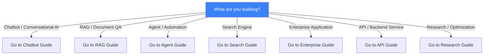
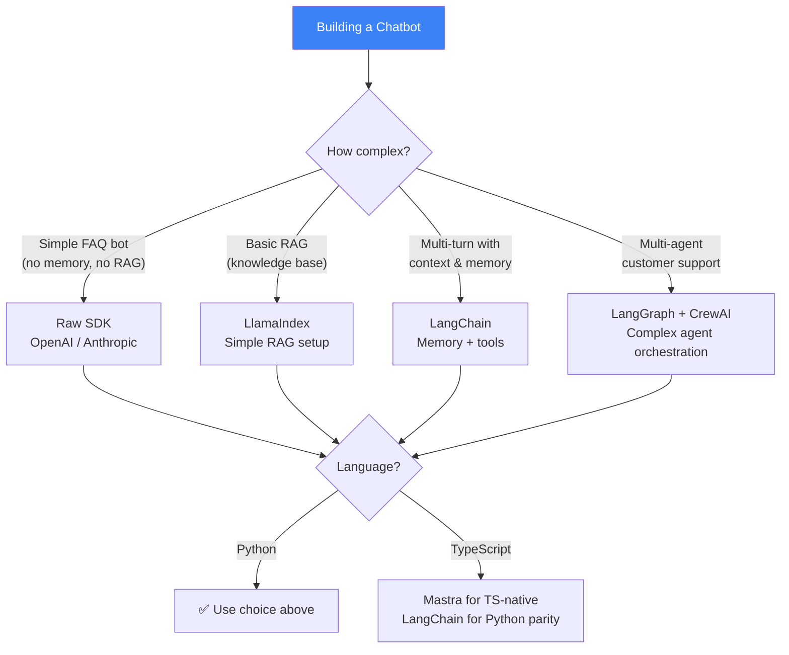
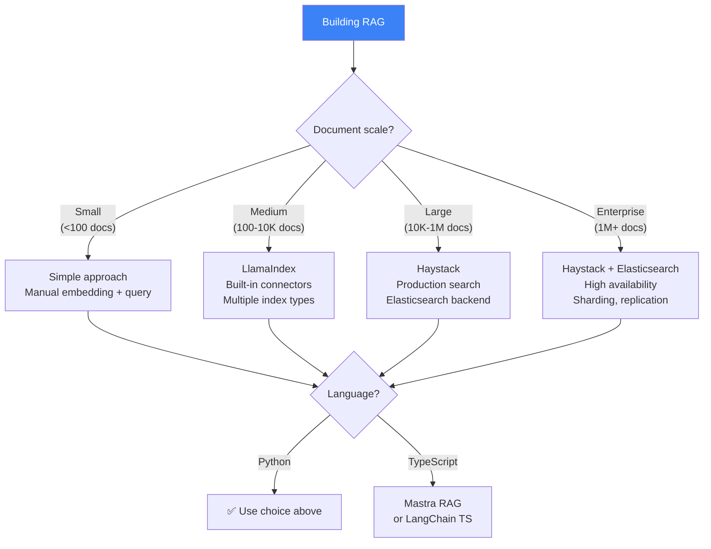
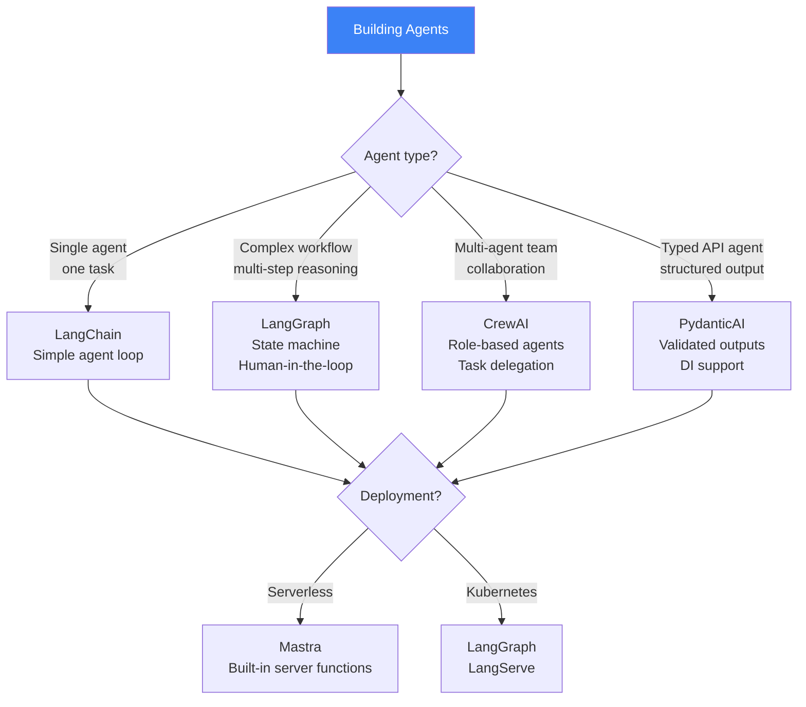
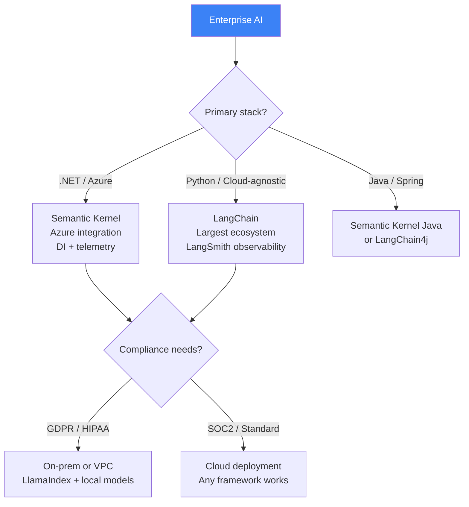
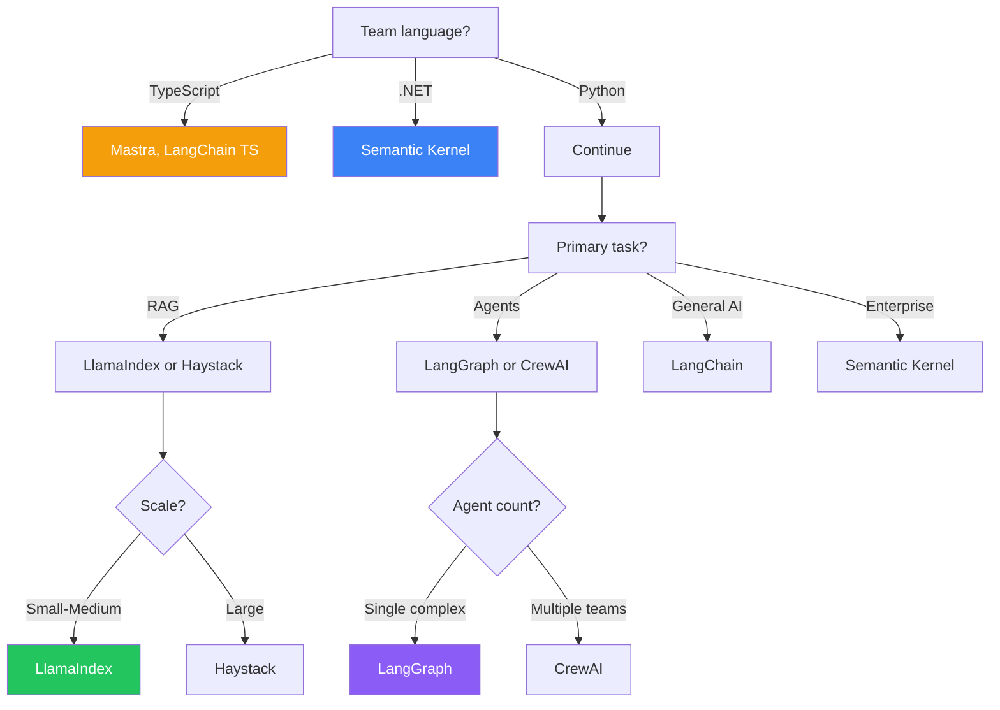
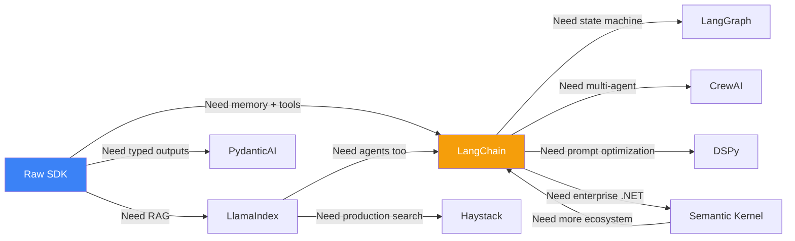

## Introduction

> **Choosing the right AI framework isn't about picking the "best" one — it's about picking the one that best matches your specific project requirements, team skills, deployment constraints, and long-term maintenance needs.**

This guide walks through common scenarios, decision trees, and trade-offs to help you make an informed choice.

---

## Decision Trees

### Chatbot / Conversational AI

### RAG / Document QA

### Agent / Automation

### Enterprise Application

---

## Scenario-Based Recommendations

### Scenario 1: Startup Building MVP

**Context**: 2 developers, 3-month timeline, Python, AWS

**Recommendation**: LangChain + LangSmith

| Factor | Why |
|--------|-----|
| **Speed** | LangChain has the most examples and templates |
| **Flexibility** | Can pivot from chatbot → RAG → agents without switching |
| **Observability** | LangSmith provides production monitoring out of the box |
| **Hiring** | LangChain skills are widely available |
| **Trade-off** | More complex than needed for simple use cases |

### Scenario 2: Enterprise Document Search

**Context**: 10-person team, 500K documents, .NET, Azure

**Recommendation**: Semantic Kernel + Azure AI Search

| Factor | Why |
|--------|-----|
| **Stack match** | .NET + Azure = Semantic Kernel's sweet spot |
| **Scale** | Azure AI Search handles 500K+ documents |
| **Security** | Entra ID integration, managed identities |
| **Observability** | Application Insights telemetry built-in |
| **Trade-off** | Limited if you ever need to move off Azure |

### Scenario 3: Research Team Optimizing Prompts

**Context**: 3 person team, Python, accuracy-critical

**Recommendation**: DSPy

| Factor | Why |
|--------|-----|
| **Optimization** | DSPy's MIPRO optimizer finds optimal prompts |
| **Systematic** | Metric-driven improvement instead of guesswork |
| **Reproducible** | Compilation produces deterministic programs |
| **Trade-off** | Requires labeled training data, compilation time |

### Scenario 4: TypeScript Serverless API

**Context**: Full-stack TS team, Vercel, needs typed outputs

**Recommendation**: Mastra + PydanticAI (Python) if needed

| Factor | Why |
|--------|-----|
| **Language match** | TypeScript-native, no Python runtime |
| **Deployment** | Built-in serverless deployment for Vercel |
| **Workflows** | State machine engine for reliability |
| **Trade-off** | Newer framework, smaller ecosystem |

### Scenario 5: Multi-Agent Customer Support

**Context**: 5-person team, Python, complex routing

**Recommendation**: LangGraph + LangChain

| Factor | Why |
|--------|-----|
| **Agent orchestration** | LangGraph's state machine handles complex logic |
| **RAG integration** | LangChain provides RAG for knowledge base |
| **Human-in-the-loop** | LangGraph supports interrupt/resume |
| **Observability** | LangSmith traces across all agents |
| **Trade-off** | Steep learning curve, more code complexity |

---

## Framework Selection Matrix

---

## Anti-Patterns to Avoid

| Anti-Pattern | Why It's Wrong | Better Approach |
|-------------|---------------|-----------------|
| Using LangChain for a 2-line API call | Massive dependency for simple task | Use raw SDK |
| Mixing LangChain and LlamaIndex retrievers | Conflicting abstractions, dependency bloat | Pick one RAG framework |
| Using CrewAI for a single agent | Over-engineered for simple agent | Use LangChain Agent |
| Using LangGraph for a linear chain | State machine overkill for sequential tasks | Use LangChain LCEL |
| Using DSPy without training data | Can't optimize without metrics | Use standard prompts first |
| Using Semantic Kernel outside .NET/Azure | Losing the main benefit of SK | Use LangChain instead |
| Using Mastra for Python team | Wrong language for the team | Use LangChain |

---

## Migration Paths

---

## Interview Questions

### Beginner

**Q: How do you decide which AI framework to use for a project?**

> Consider: (1) Language — Python, TypeScript, or .NET?, (2) Primary task — RAG, agents, search, or general AI?, (3) Scale — number of documents, users, requests, (4) Team expertise — what does your team already know?, (5) Infrastructure — cloud provider, deployment platform, (6) Production requirements — observability, evaluation, security.

**Q: When should you NOT use an AI framework?**

> When the task is simple enough that the framework adds more complexity than it removes. For example: a single LLM call with no memory, no RAG, and no agent logic. Raw SDK calls are cleaner, faster, and have fewer dependencies.

### Intermediate

**Q: Your team is building a document QA system for 10K internal documents. Which framework would you choose and why?**

> LlamaIndex: (1) RAG-first design matches the use case perfectly, (2) Built-in data connectors (Confluence, Notion, SharePoint) for internal documents, (3) Multiple index types for different query patterns, (4) Simple API — 3 lines to index, 1 line to query. If scale grows to 100K+ documents, migrate to Haystack for production search infrastructure.

**Q: Compare the migration path from raw SDK to LangChain vs from raw SDK to PydanticAI.**

> Raw → LangChain: Gradual adoption. Start with just the LLM abstraction (swap providers easily), add prompts templates, then memory, then agents. LangChain is designed for incremental adoption. Raw → PydanticAI: Bigger initial change because PydanticAI requires defining typed schemas upfront. But once set up, you get guaranteed structured outputs. PydanticAI is easier for API endpoints; LangChain is easier for complex workflows.

### Senior

**Q: Design a framework selection strategy for a company with 50 developers building 10 AI applications.**

> Strategy: (1) **Standardize** on LangChain as the default framework (most versatile, largest ecosystem), (2) **Specialize** — LlamaIndex for RAG-heavy apps, LangGraph for agent-heavy apps, Semantic Kernel for .NET apps, (3) **Shared infrastructure** — LLM gateway, vector store, caching layer (framework-agnostic), (4) **Governance** — Framework choice requires architecture review for non-standard picks, (5) **Training** — LangChain bootcamp for all 50 developers, specialized training per team, (6) **Migration tolerance** — Allow teams to switch frameworks with 2-week migration, (7) **Knowledge sharing** — Monthly framework deep-dives.

**Q: How would you convince a team to switch from exclusively using LangChain to a multi-framework approach?**

> Present data-driven arguments: (1) **LlamaIndex reduces RAG code by 60%** compared to LangChain's RAG implementation, (2) **PydanticAI eliminates structured output bugs** — no more malformed JSON in production, (3) **LangGraph reduces agent workflow bugs** — state machine prevents invalid state transitions, (4) **Developer productivity** — specialized frameworks are simpler for specific tasks (less code, fewer bugs). But warn against over-fragmentation — limit to 3 frameworks max.

### Staff Engineer

**Q: What are the long-term risks of choosing the wrong AI framework, and how do you mitigate them?**

> Risks: (1) **Vendor lock-in** — Framework dependencies couple you to specific APIs, (2) **Ecosystem dependency** — Framework popularity affects community, talent, and support, (3) **Migration cost** — Switching frameworks later is expensive, (4) **Technical debt** — Framework abstractions that no longer fit your use case. **Mitigation**: (1) Abstract the framework behind your own interface (ports & adapters), (2) Use the framework for orchestration, not data — keep your business logic framework-agnostic, (3) Choose frameworks with stable APIs and large communities, (4) Plan for framework migration every 2-3 years, (5) Maintain raw SDK fallbacks for critical paths.

### Architecture

**Q: Design a "framework-agnostic" AI service that can switch between LangChain, LlamaIndex, and raw SDK based on configuration.**

> Architecture: (1) **Interface layer** — Define abstract interfaces for LLM calls, RAG, memory, agents, (2) **Adapter layer** — Implement each interface with LangChain, LlamaIndex, or raw SDK, (3) **Config-driven** — Configuration file specifies which adapter to use per component, (4) **Feature parity** — Ensure all adapters produce equivalent results (may require testing), (5) **Migration tooling** — Script to convert prompts/configs between frameworks, (6) **Testing** — Run the same test suite against all adapters, (7) **Observability** — Consistent telemetry regardless of underlying framework.

### System Design

**Q: Design a platform that allows different teams to use different AI frameworks while sharing infrastructure.**

> Platform design: (1) **LLM Gateway** — Central API with rate limiting, caching, auth, and cost tracking. All frameworks call this. (2) **Vector Store** — Shared Pinecone/Qdrant with collection-per-team isolation. (3) **Prompt Registry** — Central store for versioned prompts, accessible by any framework. (4) **Observability** — OpenTelemetry collector that receives traces from all frameworks. (5) **Secret Manager** — Vault for API keys, database credentials. (6) **CI/CD** — Pipeline templates per framework (Python → LangChain/LlamaIndex, TS → Mastra, .NET → SK). (7) **Dev Containers** — Pre-configured environments per framework. (8) **Documentation** — Framework selection guide with platform integration instructions.

---

## Summary

| Factor | Consideration |
|--------|--------------|
| **Team language** | Python, TypeScript, .NET, or Java |
| **Primary task** | RAG, agents, search, or general AI |
| **Scale** | Documents, users, request volume |
| **Infrastructure** | Cloud provider, deployment platform |
| **Production needs** | Observability, evaluation, security |
| **Team expertise** | What does your team already know? |
| **Migration risk** | How hard to switch frameworks later? |

---

## Navigation

**Previous:** [09 — Framework Comparison](/ai/phase-08-ai-frameworks/09-framework-comparison)

**Next:** [11 — Build Without Frameworks](/ai/phase-08-ai-frameworks/11-build-without-frameworks)

**Related Topics:**
- [Why AI Frameworks Exist](/ai/phase-08-ai-frameworks/01-why-ai-frameworks)
- [Framework Comparison](/ai/phase-08-ai-frameworks/09-framework-comparison)
- [Build Without Frameworks](/ai/phase-08-ai-frameworks/11-build-without-frameworks)
