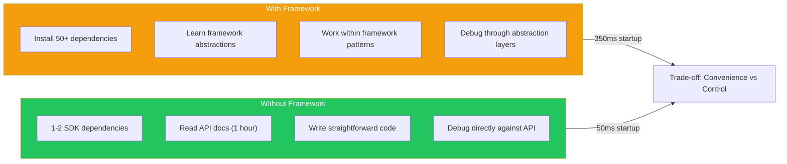
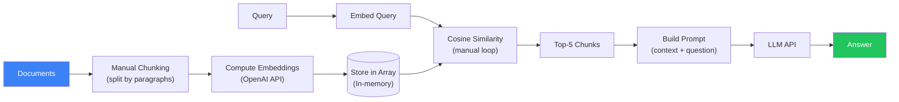
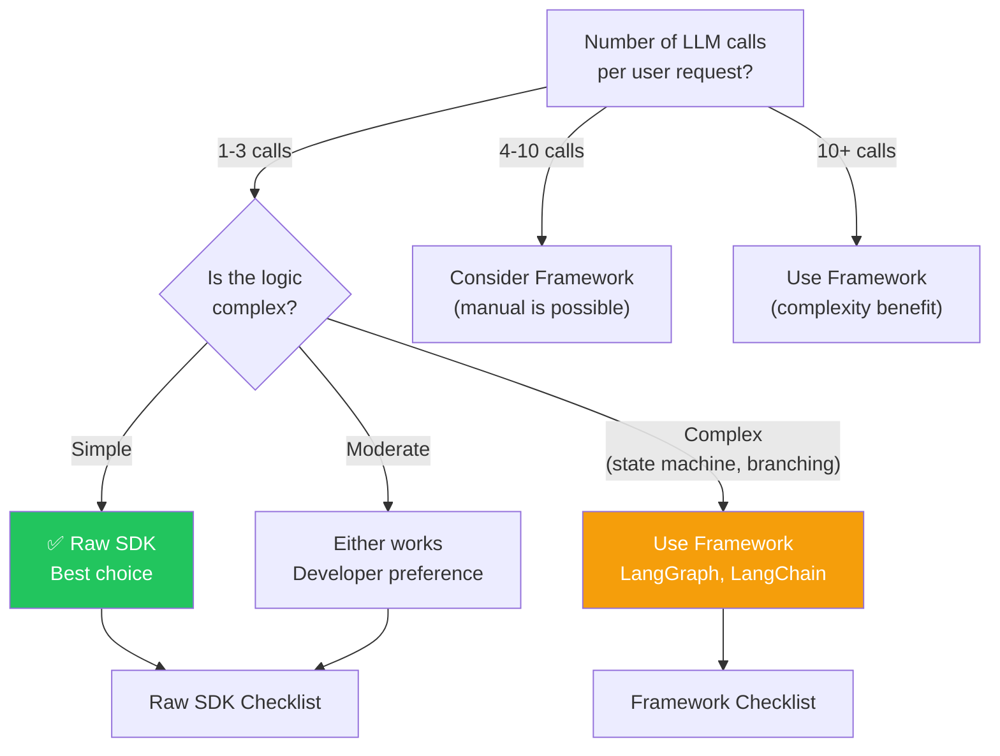
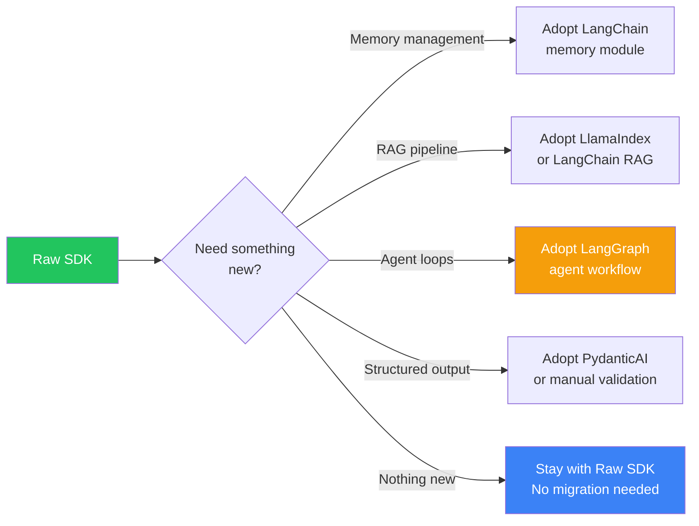
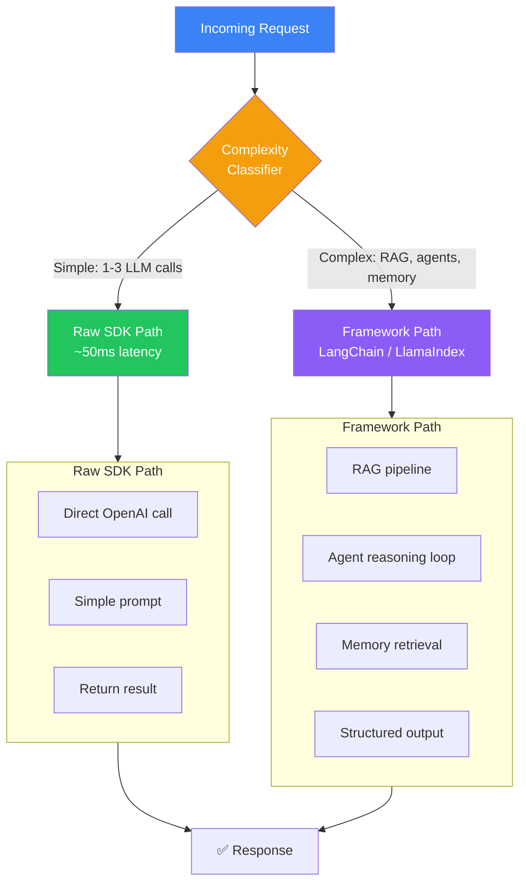

## Introduction

> **Building AI without frameworks means using the raw SDKs directly — OpenAI, Anthropic, Gemini — without LangChain, LlamaIndex, or any other abstraction layer. Sometimes this is the best engineering decision you can make.**

Frameworks provide abstractions. But every abstraction is a trade-off: you gain convenience but lose control, add dependencies, and take on framework-specific knowledge. For many AI applications — especially simple ones — raw SDKs are the better choice.



---

## Why Build Without Frameworks?

### The Case for Raw SDKs

1. **Simplicity** — Fewer dependencies, less code, faster to understand
2. **Control** — Full control over prompts, parameters, and error handling
3. **Performance** — No framework overhead (50-200ms saved per request)
4. **Learning** — Understanding the raw API is essential knowledge
5. **Debugging** — One layer to debug instead of framework + API
6. **Stability** — SDKs change less frequently than frameworks

### When Frameworks Add Value

Frameworks shine when you need:
- Complex memory management
- Multi-step agent loops
- RAG pipelines
- Built-in observability
- Cross-provider abstraction

---

## Real-World Analogy

### Building Furniture

**Raw SDK** = Using basic tools (hammer, screwdriver, saw):
- You understand exactly how everything works
- Simple projects are quick
- Complex projects take longer
- You have full control over every joint and finish

**Framework** = Using pre-cut furniture kits (IKEA):
- Instructions guide every step
- Complex projects are faster
- You're limited to the kit's design
- If something doesn't fit, it's harder to fix

Sometimes you need custom furniture (raw SDK). Sometimes you need a bookshelf in 2 hours (framework). The skill is knowing which approach fits the task.

---

## Core Patterns (Without Frameworks)

### 1. Simple Completion

```python
from openai import OpenAI

client = OpenAI()

response = client.chat.completions.create(
    model="gpt-4o",
    messages=[
        {"role": "system", "content": "You are a helpful assistant."},
        {"role": "user", "content": "What is RAG?"}
    ]
)

print(response.choices[0].message.content)
```

**Framework equivalent**: 10+ lines of LangChain setup + dependencies.

### 2. Chat with History (Manual Memory)

```python
class ChatSession:
    def __init__(self, system_prompt: str):
        self.messages = [{"role": "system", "content": system_prompt}]
    
    def send(self, message: str) -> str:
        self.messages.append({"role": "user", "content": message})
        
        response = client.chat.completions.create(
            model="gpt-4o",
            messages=self.messages
        )
        
        reply = response.choices[0].message.content
        self.messages.append({"role": "assistant", "content": reply})
        
        return reply
    
    def summarize(self, max_tokens: int = 4000):
        """Truncate old messages to fit context window."""
        while len(str(self.messages)) > max_tokens:
            self.messages.pop(1)  # Remove oldest non-system message

session = ChatSession("You are a helpful assistant.")
session.send("What is RAG?")
session.send("Can you give me an example?")
```

**Framework equivalent**: LangChain's ConversationBufferMemory.

---

### 3. Structured Output

```python
from pydantic import BaseModel
import json

class SearchResult(BaseModel):
    title: str
    url: str
    summary: str
    relevance_score: float

def search(query: str) -> list[SearchResult]:
    response = client.chat.completions.create(
        model="gpt-4o",
        messages=[{
            "role": "system",
            "content": f"""Return search results as JSON array.
            Each result must have: title, url, summary, relevance_score.
            Query: {query}"""
        }],
        response_format={"type": "json_object"}
    )
    
    data = json.loads(response.choices[0].message.content)
    return [SearchResult(**item) for item in data["results"]]
```

**Framework equivalent**: PydanticAI handles validation + retry automatically.

---

### 4. RAG from Scratch



```python
import numpy as np
from openai import OpenAI

client = OpenAI()

class SimpleRAG:
    def __init__(self):
        self.chunks = []
        self.embeddings = []
    
    def add_document(self, text: str, chunk_size: int = 500):
        # Simple chunking
        words = text.split()
        for i in range(0, len(words), chunk_size):
            chunk = " ".join(words[i:i + chunk_size])
            self.chunks.append(chunk)
        
        # Batch embed
        chunks_to_embed = self.chunks[len(self.chunks) - len(words)//chunk_size:]
        response = client.embeddings.create(
            model="text-embedding-3-small",
            input=chunks_to_embed
        )
        self.embeddings.extend([d.embedding for d in response.data])
    
    def query(self, question: str, top_k: int = 3) -> str:
        # Embed query
        q_embed = client.embeddings.create(
            model="text-embedding-3-small",
            input=question
        ).data[0].embedding
        
        # Cosine similarity
        scores = [
            np.dot(q_embed, emb) / (np.linalg.norm(q_embed) * np.linalg.norm(emb))
            for emb in self.embeddings
        ]
        top_indices = np.argsort(scores)[-top_k:][::-1]
        
        # Build context
        context = "\n\n".join([self.chunks[i] for i in top_indices])
        
        # Generate answer
        response = client.chat.completions.create(
            model="gpt-4o",
            messages=[
                {"role": "system", "content": f"Answer based on context:\n\n{context}"},
                {"role": "user", "content": question}
            ]
        )
        return response.choices[0].message.content
```

**Framework equivalent**: LlamaIndex does this in 5 lines. But this implementation shows exactly what's happening under the hood.

---

### 5. Tool Calling

```python
def get_weather(city: str) -> str:
    """Get weather for a city."""
    return f"Weather in {city}: Sunny, 72°F"

def calculator(expression: str) -> str:
    """Evaluate a math expression."""
    return str(eval(expression))

tools = [
    {
        "type": "function",
        "function": {
            "name": "get_weather",
            "description": "Get weather for a city",
            "parameters": {
                "type": "object",
                "properties": {
                    "city": {"type": "string"}
                },
                "required": ["city"]
            }
        }
    },
    {
        "type": "function",
        "function": {
            "name": "calculator",
            "description": "Evaluate math expressions",
            "parameters": {
                "type": "object",
                "properties": {
                    "expression": {"type": "string"}
                },
                "required": ["expression"]
            }
        }
    }
]

def agent_loop(user_input: str):
    messages = [{"role": "user", "content": user_input}]
    
    for _ in range(5):  # Max 5 turns
        response = client.chat.completions.create(
            model="gpt-4o",
            messages=messages,
            tools=tools,
            tool_choice="auto"
        )
        
        msg = response.choices[0].message
        messages.append(msg)
        
        if not msg.tool_calls:
            return msg.content
        
        for tool_call in msg.tool_calls:
            name = tool_call.function.name
            args = json.loads(tool_call.function.arguments)
            
            if name == "get_weather":
                result = get_weather(**args)
            elif name == "calculator":
                result = calculator(**args)
            
            messages.append({
                "role": "tool",
                "tool_call_id": tool_call.id,
                "content": result
            })
    
    return "Max iterations reached"
```

---

## When to Choose Raw SDKs



### Raw SDK Checklist

- [ ] Fewer than 5 LLM calls per user request
- [ ] No persistent memory (or simple list)
- [ ] No RAG (or simple vector similarity)
- [ ] Single LLM provider (no need for abstraction)
- [ ] Team knows the API directly
- [ ] Latency-critical (< 500ms)
- [ ] Minimal dependencies preferred

### Framework Checklist

- [ ] 5+ LLM calls per user request
- [ ] Complex memory management
- [ ] RAG with multiple document sources
- [ ] Multi-provider strategy
- [ ] Team doesn't know the raw API
- [ ] Observability and evaluation needed
- [ ] Complex agent logic (loops, conditions)

---

## Migration Path: Raw → Framework



---

## Hybrid Architecture: Raw + Framework



> **This hybrid approach gives you the best of both worlds**: low latency for simple requests, and framework power for complex ones.

---

## Advantages of Raw SDKs

1. **No dependency bloat** — 1-2 packages vs 50+ with frameworks
2. **Full control** — Every prompt token, every parameter
3. **Better performance** — No framework overhead (50-200ms saved)
4. **Easier debugging** — One layer to debug, not framework + API
5. **Stability** — SDKs change less frequently than frameworks
6. **Learning value** — Understands how AI APIs actually work

## Disadvantages

| Issue | Impact |
|-------|--------|
| **More code** for complex tasks | RAG takes 50 lines instead of 5 |
| **No built-in memory** | Implement your own |
| **No built-in observability** | Add your own logging/tracing |
| **No provider abstraction** | Switch providers = rewrite code |
| **No agent loop** | Implement ReAct manually |

---

## When NOT to Use Raw SDKs

- Building a complex multi-agent system
- Need built-in observability and evaluation
- Team is new to AI and needs framework guidance
- Rapid prototyping where speed matters more than control
- Need to support multiple LLM providers simultaneously

---

## Interview Questions

### Beginner

**Q: When would you choose to use raw SDKs instead of an AI framework?**

> When the task is simple: 1-3 LLM calls, no memory needs, no RAG, no multi-step agents. For example: a text summarizer, a translation tool, or a simple chatbot. Frameworks add unnecessary complexity and dependencies for these cases.

**Q: What are the main disadvantages of building AI without a framework?**

> (1) More code for complex tasks (RAG, memory, agents), (2) No built-in observability, (3) No provider abstraction (switching from OpenAI to Anthropic requires rewriting code), (4) No standard patterns — every developer may implement things differently.

### Intermediate

**Q: How would you implement tool calling with raw OpenAI SDK? How is this different from LangChain's agent?**

> Raw SDK: Define tools as JSON schemas in the API call. When the model returns a tool_call, execute the function, append the result, and make another API call. Loop until the model returns a regular message. LangChain: Higher-level abstraction — define tools as Python functions with decorators, and the framework handles the loop. Raw SDK gives you control over every retry and error case; LangChain handles the common cases but makes custom error handling harder.

**Q: At what point would you migrate from raw SDKs to a framework?**

> When you find yourself implementing the same patterns repeatedly: memory management, RAG pipelines, or agent loops. As a rule of thumb: if you have 5+ LLM calls per user request or need persistent memory across sessions, it's time to adopt at least part of a framework.

### Senior

**Q: Design a hybrid approach where simple requests use raw SDKs and complex requests use a framework.**

> Architecture: (1) **Request classifier** — Simple ML model (or rules) classifies request complexity, (2) **Simple path** — Raw SDK with minimal overhead (~50ms), (3) **Complex path** — Framework pipeline with RAG, agents, memory (~2s), (4) **Shared LLM client** — Both paths use the same OpenAI client with shared rate limiting, (5) **Observability** — Both paths emit OpenTelemetry spans with a "processing_mode" attribute (raw/framework), (6) **Graduation** — If a simple request type becomes complex over time, it can be moved to the framework path without affecting other requests.

**Q: How would you implement a custom agent framework from scratch for a specific use case where LangChain is overkill?**

> Implementation: (1) **LLM Client** — Thin wrapper around OpenAI SDK with retry logic and rate limiting, (2) **Tool Registry** — Dictionary of tool name → function with JSON schema, (3) **Memory** — Simple list of messages with truncation logic, (4) **Agent Loop** — While loop that checks tool_calls, executes tools, and appends results, with max iteration limit, (5) **Prompt Builder** — Template function that builds the system prompt with tool descriptions, (6) **Total** — ~100 lines of code vs 1000+ with LangChain for the same functionality.

### Staff Engineer

**Q: What architectural principles should guide the decision to use or avoid AI frameworks in a production system?**

> (1) **Dependency cost** — Each framework dependency is a risk (breaking changes, security vulnerabilities, migration cost). Only accept this cost when the framework provides clear value. (2) **Control vs speed** — Frameworks trade control for development speed. For core differentiators (your unique AI logic), prefer raw APIs for control. For commodity functionality (standard RAG, basic agents), frameworks are fine. (3) **Abstraction leakage** — All framework abstractions leak eventually. When you need to debug something, you'll need to understand both the framework and the underlying API. (4) **Exit strategy** — Always have a plan to migrate off the framework if needed. Abstract the framework behind your own interface.

### Architecture

**Q: Compare the long-term maintenance costs of a raw SDK approach vs a framework approach for an AI application that will be maintained for 5+ years.**

> **Raw SDK**: Lower initial complexity. Maintenance costs are stable — API changes happen but are incremental. No framework upgrade pressure. Team needs to maintain custom implementations of memory, RAG, etc. **Framework**: Higher initial complexity (learning curve). Maintenance costs spike during major framework upgrades (LangChain 0.1 → 0.2 → 0.3). Ecosystem provides updates for memory, RAG, agents. **5-year cost estimate**: Raw SDK costs more in development (building features), less in maintenance (no framework upgrades). Framework costs less initially (built-in features), more over time (version migration, abstraction changes). The break-even point is typically 2-3 years of active development.

### System Design

**Q: Design an AI system that uses raw SDKs by default but can dynamically load framework components for specific capabilities.**

> Architecture: (1) **Core engine** — Raw SDK for LLM calls, simple memory, basic tool use, (2) **Plugin system** — Framework components loaded as needed: RAG plugin (LlamaIndex), Agent plugin (LangGraph), Evaluation plugin (LangSmith), (3) **Plugin manager** — Loads frameworks in isolated environments (subprocess or containers) to prevent dependency conflicts, (4) **IPC** — Core engine communicates with plugins via JSON-RPC or gRPC, (5) **Configuration** — YAML config specifies which plugins are active, (6) **Fallback** — If a plugin fails, core engine handles with simpler logic, (7) **Monitoring** — All plugin interactions are traced and logged.

---

## Summary

| Approach | Best For | Worst For |
|----------|----------|-----------|
| **Raw SDK** | Simple tasks, low latency, full control | Complex agents, RAG, multi-provider |
| **Framework** | Complex workflows, production monitoring | Simple tasks, ultra-low latency |
| **Hybrid** | Applications with mixed complexity | Simple apps (unnecessary complexity) |

---

## Navigation

**Previous:** [10 — Framework Selection Guide](/ai/phase-08-ai-frameworks/10-framework-selection-guide)

**Next:** [12 — Phase Summary](/ai/phase-08-ai-frameworks/12-phase-summary)

**Related Topics:**
- [Why AI Frameworks Exist](/ai/phase-08-ai-frameworks/01-why-ai-frameworks)
- [Framework Comparison](/ai/phase-08-ai-frameworks/09-framework-comparison)
- [Framework Selection Guide](/ai/phase-08-ai-frameworks/10-framework-selection-guide)
