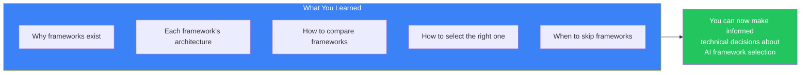
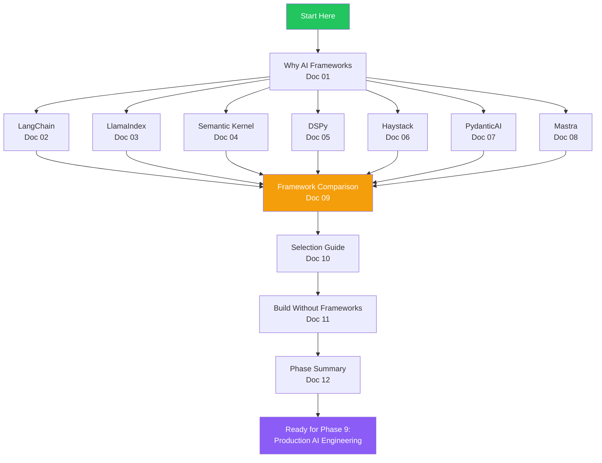
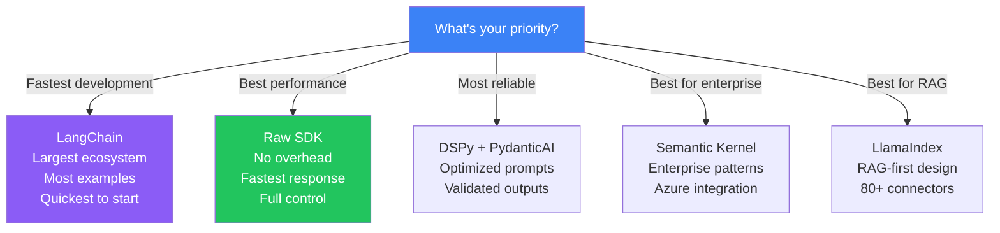
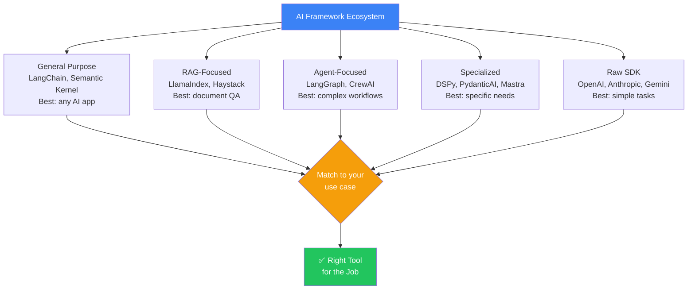
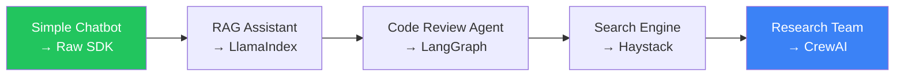

## Introduction

> **Phase 8 covered the entire AI framework ecosystem — from general-purpose frameworks like LangChain to specialized tools like DSPy and PydanticAI, and when to use raw SDKs instead.**

By now you should understand the strengths and weaknesses of each major framework, how to choose the right one for your project, and when building without frameworks is the better engineering decision.



---

## Complete Roadmap



---

## Framework Cheat Sheet

### Quick Reference

| Framework | Language | `pip install` / `npm install` | Core Abstraction | Best For |
|-----------|----------|------------------------------|------------------|----------|
| **LangChain** | Python, TS | `langchain` | Runnables / LCEL | General AI apps |
| **LlamaIndex** | Python | `llama-index` | Index → Query Engine | RAG / Document QA |
| **Haystack** | Python | `haystack-ai` | Pipeline DAG | Production search |
| **Semantic Kernel** | .NET, Python, Java | `semantic-kernel` | Kernel + Plugins | Enterprise .NET |
| **DSPy** | Python | `dspy-ai` | Signature + Module | Prompt optimization |
| **PydanticAI** | Python | `pydantic-ai` | Typed Agent | Type-safe APIs |
| **Mastra** | TypeScript | `@mastra/core` | Agent + Workflow | Serverless TS |
| **CrewAI** | Python | `crewai` | Crew + Agent + Task | Multi-agent teams |
| **LangGraph** | Python, TS | `langgraph` | State Graph | Agent workflows |

---

## Comparison: When to Use What



---

## Framework Matrix

| Capability | LangChain | LlamaIndex | Haystack | SK | DSPy | PydanticAI | Mastra | CrewAI | LangGraph |
|-----------|-----------|------------|----------|----|------|------------|--------|--------|-----------|
| **LLM abstraction** | ⭐⭐⭐ | ⭐⭐⭐ | ⭐⭐⭐ | ⭐⭐⭐ | ⭐⭐⭐ | ⭐⭐⭐ | ⭐⭐⭐ | ⭐⭐⭐ | ⭐⭐⭐ |
| **Prompt mgmt** | ⭐⭐⭐ | ⭐⭐ | ⭐⭐⭐ | ⭐⭐⭐ | ⭐⭐⭐ | ⭐⭐⭐ | ⭐⭐⭐ | ⭐⭐ | ⭐⭐⭐ |
| **Memory** | ⭐⭐⭐ | ⭐⭐ | ⭐⭐ | ⭐⭐⭐ | ❌ | ⭐⭐⭐ | ⭐⭐⭐ | ⭐⭐⭐ | ⭐⭐⭐ |
| **RAG** | ⭐⭐⭐ | ⭐⭐⭐ | ⭐⭐⭐ | ⭐⭐ | ⭐ | ⭐ | ⭐⭐⭐ | ⭐ | ⭐⭐ |
| **Agents** | ⭐⭐⭐ | ⭐ | ❌ | ⭐⭐⭐ | ⭐⭐ | ⭐⭐⭐ | ⭐⭐⭐ | ⭐⭐⭐ | ⭐⭐⭐ |
| **Workflows** | ⭐⭐ | ❌ | ⭐⭐⭐ | ⭐⭐ | ❌ | ❌ | ⭐⭐⭐ | ⭐⭐ | ⭐⭐⭐ |
| **Observability** | ⭐⭐⭐ | ⭐⭐ | ⭐⭐ | ⭐⭐⭐ | ⭐⭐⭐ | ⭐⭐ | ⭐⭐⭐ | ⭐ | ⭐⭐⭐ |
| **Evaluation** | ⭐⭐⭐ | ⭐⭐ | ⭐⭐⭐ | ⭐⭐ | ⭐⭐⭐ | ⭐⭐⭐ | ⭐ | ⭐ | ⭐⭐⭐ |
| **Ecosystem** | ⭐⭐⭐ | ⭐⭐⭐ | ⭐⭐ | ⭐⭐ | ⭐⭐ | ⭐⭐ | ⭐ | ⭐⭐ | ⭐⭐⭐ |
| **DX / Simplicity** | ⭐⭐ | ⭐⭐⭐ | ⭐⭐⭐ | ⭐⭐ | ⭐⭐ | ⭐⭐⭐ | ⭐⭐⭐ | ⭐⭐⭐ | ⭐⭐ |

---

## Glossary

| Term | Definition |
|------|------------|
| **Chain** | A sequence of operations (prompt → LLM → parser) |
| **Agent** | An LLM that can use tools and decide its own actions |
| **RAG** | Retrieval-Augmented Generation — retrieving context before generating |
| **LCEL** | LangChain Expression Language — composable pipeline syntax |
| **DAG** | Directed Acyclic Graph — how Haystack structures pipelines |
| **Plugin** | A unit of functionality in Semantic Kernel |
| **Signature** | DSPy's typed input/output definition |
| **RunContext** | PydanticAI's dependency injection mechanism |
| **Workflow** | Mastra's state machine for multi-step processes |
| **Crew** | A team of agents in CrewAI |
| **State Graph** | LangGraph's state machine representation |
| **Planner** | Semantic Kernel's automatic function orchestration |

---

## Common Mistakes

| Mistake | Fix |
|---------|-----|
| Using LangChain for a 2-line API call | Use raw SDK |
| Mixing multiple frameworks in one project | Pick one primary framework |
| Not understanding the raw API before using a framework | Learn the SDK first |
| Upgrading frameworks without testing | Pin versions, use CI tests |
| Choosing a framework based on popularity alone | Evaluate against your specific needs |
| Ignoring language support | Check if the framework supports your stack |
| Over-engineering with agents | Start simple, add complexity as needed |
| No exit strategy from framework | Abstract the framework behind your interface |

---

## Key Insights Diagram



---

## Project Suggestions



| Project | Framework | What You'll Build |
|---------|-----------|-------------------|
| **1. Simple Chatbot** | Raw OpenAI SDK | Chat with history, no frameworks |
| **2. RAG Assistant** | LlamaIndex | Document QA with citations |
| **3. Customer Support Agent** | LangGraph + LangChain | Multi-step support workflow |
| **4. Enterprise Search** | Haystack | Production search with Elasticsearch |
| **5. Typed API** | PydanticAI | Structured output API |
| **6. Research Agent Team** | CrewAI | Multi-agent research team |
| **7. Prompt Optimizer** | DSPy | Automatic prompt optimization |
| **8. Full-Stack AI App** | Mastra | Serverless AI with TypeScript |

---

## Learning Path to Phase 9

```
Phase 1: AI Fundamentals        ───→  Done ✓
Phase 2: Machine Learning       ───→  Done ✓
Phase 3: Deep Learning          ───→  Done ✓
Phase 4: Large Language Models   ─→  Done ✓
Phase 5: Retrieval Systems      ───→  Done ✓
Phase 6: AI Agents              ───→  Done ✓
Phase 7: Model Context Protocol  ─→  Done ✓
Phase 8: AI Frameworks          ───→  Done ✓
                                      ↓
Phase 9: Production AI Engineering ←── Next!
```

---

## Interview Questions

### Beginner

**Q: What are the major categories of AI frameworks?**

> Four categories: (1) **General purpose** — LangChain, Semantic Kernel (chains, agents, RAG), (2) **RAG-focused** — LlamaIndex, Haystack (document processing, search), (3) **Agent-focused** — LangGraph, CrewAI (multi-step reasoning, team collaboration), (4) **Specialized** — DSPy (prompt optimization), PydanticAI (typed outputs), Mastra (TypeScript AI).

**Q: What's the difference between LangChain and LangGraph?**

> LangChain is a general-purpose framework for building AI applications with chains, agents, and RAG. LangGraph is a specialized extension for building state machine-based agent workflows. Use LangChain for standard AI apps; use LangGraph when you need complex, branching agent logic with human-in-the-loop support.

### Intermediate

**Q: Your team uses Python and needs to build a RAG system for 50K documents. Which three frameworks would you evaluate and why?**

> (1) **LlamaIndex** — RAG-first design, 80+ data connectors, multiple index types. Best for getting started quickly. (2) **Haystack** — Production search infrastructure, Elasticsearch integration, built-in evaluation. Best if the system needs to scale. (3) **LangChain** — More flexible, can add agents later. Best if RAG is just one component of a larger AI system.

**Q: When would you recommend Semantic Kernel over LangChain for a Python project?**

> When the organization is already invested in the Microsoft/Azure ecosystem: using Azure OpenAI, Azure AI Search, Entra ID, and .NET for other services. Semantic Kernel's deep Azure integration and enterprise patterns (DI, telemetry, managed identities) provide more value than LangChain's broader ecosystem for these teams.

### Senior

**Q: Design a framework evaluation process for a startup choosing their first AI framework.**

> Evaluation process: (1) **Define requirements** — List must-have features (RAG? Agents? Memory? Streaming?), (2) **Shortlist** — Based on language + requirements, pick 3 frameworks, (3) **Proof of concept** — Build the same simple feature with all 3 (1 day each), (4) **Evaluate** — Score each on: code complexity, learning curve, documentation quality, community support, (5) **Load test** — Simulate production traffic (100 concurrent requests), measure latency and reliability, (6) **Team vote** — Developer experience matters for long-term productivity, (7) **Commit** — Choose one and migrate PoC to full implementation.

**Q: How would you migrate a Python LangChain application to TypeScript Mastra?**

> Migration: (1) **Map components** — LangChain chains → Mastra workflows, LangChain agents → Mastra agents, LangChain memory → Mastra memory, (2) **Rewrite prompts** — LangChain prompt templates → Mastra instruction strings, (3) **Rewrite tools** — Python functions → TypeScript tools, (4) **Reimplement RAG** — LangChain retrievers → Mastra RAG, (5) **Testing** — Run both implementations in parallel comparing outputs, (6) **Gradual rollout** — Route 10% of traffic to Mastra, then 50%, then 100%, (7) **Decommission** — Remove LangChain dependencies after validation.

### Staff Engineer

**Q: What are the long-term implications of choosing a framework with a small community vs a large one?**

> **Large community (LangChain)**: (1) More tutorials, examples, Stack Overflow answers, (2) Faster bug fixes and feature releases, (3) Easier hiring — more developers know it, (4) More third-party integrations, (5) But — slower decision-making, more breaking changes, more dependencies. **Small community (Mastra, PydanticAI)**: (1) Faster innovation — small teams make decisions quickly, (2) Cleaner APIs — less legacy cruft, (3) Better support — maintainers are more accessible, (4) But — fewer integrations, less hiring pool, higher risk of abandonment. **Strategy**: Use large-community frameworks for core infrastructure; consider small-community frameworks for specialized needs where you can contribute back.

### Architecture

**Q: Compare the architectural philosophy of LangChain (runnable composition) with Semantic Kernel (plugin-based orchestration).**

> **LangChain (Runnable composition)** — Everything is a Runnable with a standard invoke/batch/stream interface. Components compose via the pipe operator (`|`). Philosophy: functional composition — build pipelines by connecting functions. **Semantic Kernel (Plugin-based)** — Everything is a Plugin with functions. The Kernel orchestrates plugins via the Planner. Philosophy: dependency injection — build capabilities as plugins, let the planner figure out the order. **Implications**: LangChain is more flexible for arbitrary compositions; Semantic Kernel is more structured for enterprise governance (plugins can be approved, versioned, and governed independently).

### System Design

**Q: Design an AI architecture that uses different frameworks for different layers while maintaining a consistent developer experience.**

> Architecture: (1) **Orchestration layer** — LangGraph for agent workflows (state machine), (2) **Data layer** — LlamaIndex for document processing (ingestion, indexing, retrieval), (3) **API layer** — PydanticAI for typed endpoints (validated requests/responses), (4) **Observability layer** — OpenTelemetry across all layers with consistent span naming, (5) **Shared services** — LLM gateway (common rate limiting, caching, auth), vector store (single Pinecone instance), (6) **Developer experience** — Monorepo with shared types and common utilities, (7) **Consistency** — Code generation for boilerplate, shared linting/formatting, common error handling patterns, (8) **Testing** — Integration tests across layers, contract tests between layers.

---

## Summary

| Topic | Key Takeaway |
|-------|-------------|
| **Frameworks** | Tools for reducing complexity — choose wisely |
| **LangChain** | Most versatile, largest ecosystem |
| **LlamaIndex** | Best for RAG and document processing |
| **Haystack** | Best for production search |
| **Semantic Kernel** | Best for .NET/Azure enterprises |
| **DSPy** | Best for prompt optimization |
| **PydanticAI** | Best for type-safe structured outputs |
| **Mastra** | Best for TypeScript serverless AI |
| **CrewAI** | Best for multi-agent teams |
| **LangGraph** | Best for complex agent workflows |
| **Raw SDKs** | Best for simple tasks, full control |
| **Key principle** | Choose the right tool for the specific job |

---

## Navigation

**Previous:** [11 — Build Without Frameworks](/ai/phase-08-ai-frameworks/11-build-without-frameworks)

**Next:** Phase 9 — Production AI Engineering (Coming Soon)

**Related Topics:**
- [Why AI Frameworks Exist](/ai/phase-08-ai-frameworks/01-why-ai-frameworks)
- [Framework Comparison](/ai/phase-08-ai-frameworks/09-framework-comparison)
- [Framework Selection Guide](/ai/phase-08-ai-frameworks/10-framework-selection-guide)
