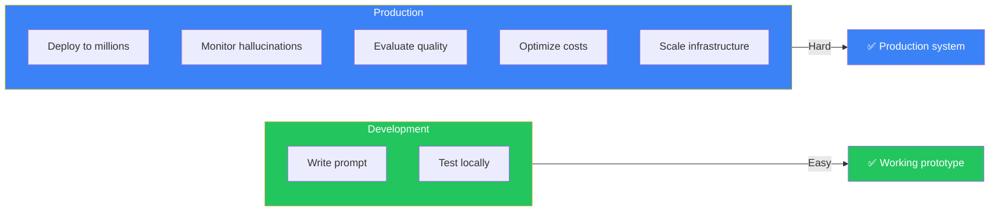
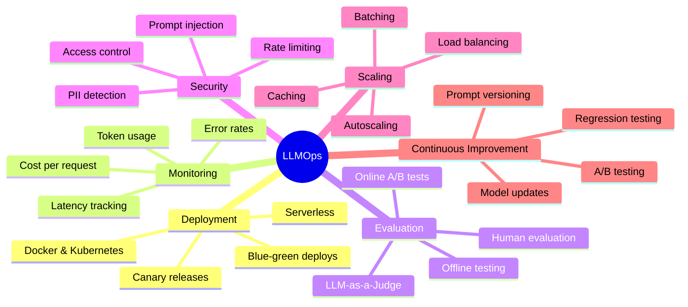
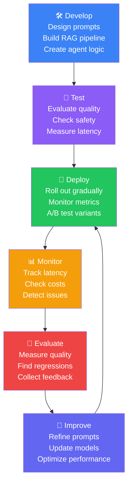
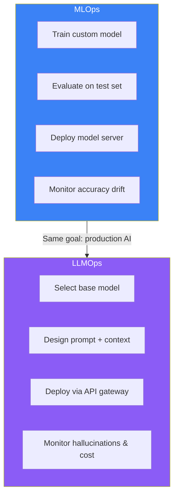
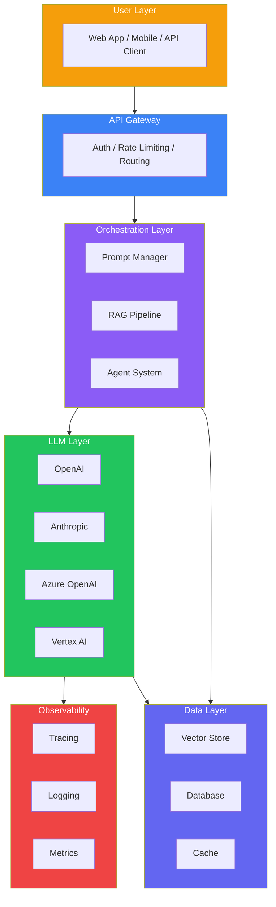
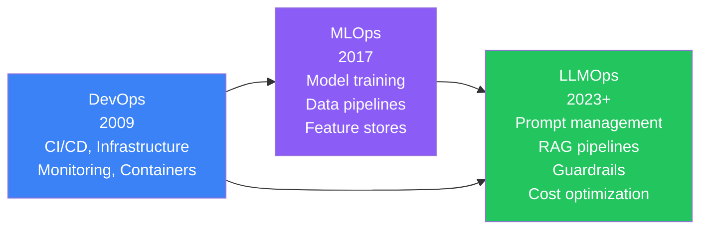

## Introduction

> **LLMOps (Large Language Model Operations) is the practice of deploying, monitoring, evaluating, securing, and continuously improving LLM-powered applications in production — combining software engineering, DevOps, and AI expertise.**

Building an AI chatbot that works on your laptop is easy. Building one that serves a million users reliably, safely, and cost-effectively is a completely different challenge.

---

## The Problem: Why Isn't Building an AI Chatbot Enough?

### The Story

Imagine you build a car in your garage. You can drive it around your neighborhood. It works! But running a taxi company with 10,000 cars in a busy city is a completely different challenge. You need:

- **Mechanics** — Keeping cars running (monitoring)
- **Dispatch** — Routing cars efficiently (scaling)
- **Safety inspections** — Making sure cars are safe (guardrails)
- **Customer support** — Handling complaints (evaluation)
- **Fuel management** — Optimizing costs (cost optimization)
- **Fleet tracking** — Knowing where every car is (observability)

Production AI is exactly the same. Building a prototype is the easy part. Operating it at scale is where the real engineering challenges begin.

---

## What is LLMOps?

LLMOps is the set of practices, tools, and processes for operating LLM applications in production. It covers the entire lifecycle of an AI application — from development to deployment to ongoing improvement.

### The LLMOps Lifecycle

---

## MLOps vs LLMOps: Key Differences

| Dimension | MLOps | LLMOps |
|-----------|-------|--------|
| **Core artifact** | Trained models (weights) | Prompts + base models |
| **Training** | Custom training required | Pre-trained models, minimal fine-tuning |
| **Evaluation** | Accuracy, precision, recall | Groundedness, relevance, safety |
| **Deployment** | Model servers (Triton, TorchServe) | API gateways + LLM providers |
| **Monitoring** | Data drift, model degradation | Hallucinations, prompt injection, cost |
| **Versioning** | Model versions | Prompt templates + model config |
| **Infrastructure** | GPU clusters | API calls + vector databases |
| **Main cost** | Compute (training/inference) | API tokens + context window |
| **Failure modes** | Poor predictions | Hallucinations, toxic outputs, jailbreaks |

---

## The LLMOps Stack

---

## Key LLMOps Disciplines

### 1. Deployment
- Containerizing AI applications with Docker
- Orchestrating with Kubernetes
- Serverless deployment for variable workloads
- Blue-green and canary deployment strategies

### 2. Observability & Tracing
- Tracking every LLM call end-to-end
- Measuring latency, token usage, and costs
- Distributed tracing across services
- Tools: OpenTelemetry, LangSmith, Phoenix, Arize

### 3. Evaluation
- Offline evaluation with golden datasets
- Online evaluation with A/B testing
- LLM-as-a-Judge for automated scoring
- Human evaluation for nuanced quality

### 4. Guardrails & Safety
- Detecting prompt injection attacks
- Preventing jailbreaks
- Filtering PII and sensitive data
- Content moderation and output validation

### 5. Security & Compliance
- Authentication and authorization
- Encryption at rest and in transit
- GDPR, HIPAA, SOC2 compliance
- Audit logging and data isolation

### 6. Performance & Cost Optimization
- Prompt caching to reduce costs
- Response caching for repeated queries
- Model selection (small vs large models)
- Token optimization and context management

### 7. CI/CD for AI
- Automated prompt testing
- Evaluation gates in pipelines
- Model and prompt versioning
- Canary releases with rollback

---

## The Evolution: DevOps → MLOps → LLMOps

### What DevOps Teaches Us

| DevOps Principle | LLMOps Application |
|-----------------|-------------------|
| Infrastructure as Code | Prompts and model config as code |
| CI/CD pipelines | Automated prompt testing + eval gates |
| Monitoring & alerting | Hallucination detection + cost alerts |
| Incident response | AI incident management playbooks |
| Immutable deployments | Prompt versioning with rollback |
| Canary deployments | A/B testing prompt variants |

---

## Real-World Example: How ChatGPT Evolved

ChatGPT's journey from research demo to production system illustrates every LLMOps discipline:

| Phase | Challenge | LLMOps Solution |
|-------|-----------|----------------|
| **Launch** (Nov 2022) | Overwhelming demand | Rate limiting, queue management |
| **Reliability** | Frequent outages | Load balancing, auto-scaling |
| **Safety** | Toxic outputs, jailbreaks | Content filters, moderation API |
| **Cost** | $700K/day inference costs | Prompt caching, model optimization |
| **Quality** | Hallucinations, factual errors | RLHF, evaluation pipelines |
| **Monitoring** | System observability | Dashboards, tracing, alerting |
| **Scaling** | Millions of users | Distributed infrastructure |

> **Key Insight:** Every production AI system follows a similar evolution — launch fast, then layer on LLMOps practices as you scale.

---

## Best Practices

1. **Start with observability** — You can't improve what you can't see. Instrument everything from day one
2. **Evaluate before you deploy** — Never deploy a prompt change without evaluation
3. **Gradual rollouts** — Use canary deployments for prompt and model changes
4. **Monitor for hallucinations** — Hallucination detection should be as important asuptime monitoring
5. **Track costs per user** — Understand which users/features drive AI costs
6. **Version everything** — Prompts, models, configurations, evaluation datasets
7. **Human-in-the-loop** — Start with human review, automate gradually as confidence grows

## Common Mistakes

| Mistake | Why It's Wrong |
|---------|---------------|
| No monitoring from day one | You have no baseline for improvement or debugging |
| Deploying prompts directly to production | Every prompt change is a potential regression |
| Ignoring costs until the bill arrives | AI costs can grow exponentially without tracking |
| No evaluation pipeline | You can't measure if changes improve or degrade quality |
| Treating LLMs as deterministic | Same prompt can produce different results |
| No guardrails for safety | One jailbreak can cause reputational damage |
| Deploying on Friday afternoon | AI systems have unique failure modes that require immediate attention |

---

## Interview Questions

### Beginner

**Q: What is LLMOps and why does it matter?**

> LLMOps is the practice of deploying, monitoring, evaluating, and improving LLM applications in production. It matters because building a prototype is easy, but operating a reliable, safe, and cost-effective AI system at scale requires engineering discipline, processes, and tools.

**Q: How is LLMOps different from traditional MLOps?**

> MLOps focuses on training and deploying custom models (data pipelines, model training, serving). LLMOps focuses on operating pre-trained models accessed via APIs (prompt management, RAG pipelines, guardrails, cost optimization). LLMOps is more concerned with prompt quality and safety than model accuracy.

### Intermediate

**Q: What are the key components of an LLMOps platform?**

> An LLMOps platform includes: (1) **Prompt management** — versioning, testing, registry, (2) **Evaluation** — offline/online, LLM-as-a-Judge, human review, (3) **Observability** — tracing, logging, metrics, (4) **Guardrails** — safety filters, prompt injection detection, (5) **Deployment** — canary releases, A/B testing, rollback, (6) **Cost management** — caching, token optimization, usage tracking.

**Q: How would you monitor an LLM application in production?**

> Monitor: (1) **Latency** — TTFT (time to first token), TPOT (time per output token), total response time, (2) **Cost** — tokens per request, cost per user, cost per feature, (3) **Quality** — user feedback (thumbs up/down), automated evaluation scores, (4) **Safety** — toxic output rate, jailbreak attempts, PII leaks, (5) **Reliability** — error rate, retry rate, timeout rate, (6) **Usage** — requests per second, active users, token volume.

### Senior

**Q: Design an LLMOps strategy for a company launching their first AI product.**

> Phase 1 (Launch): Basic monitoring (latency, errors, costs), simple evaluation (user feedback), manual guardrails. Phase 2 (Growth): Automated evaluation pipeline, canary deployments, cost optimization (caching, model selection). Phase 3 (Scale): Multi-model routing, advanced guardrails, human-in-the-loop workflows, A/B testing framework. Phase 4 (Enterprise): Compliance (GDPR/HIPAA), multi-tenancy, audit logging, custom model fine-tuning pipeline.

**Q: How would you reduce AI costs in a production application without sacrificing quality?**

> Strategy: (1) **Prompt caching** — Cache exact prompt matches, (2) **Response caching** — Cache common queries, (3) **Model routing** — Use small models for simple tasks, large models for complex ones, (4) **Token optimization** — Shorten prompts, trim context, use shorter outputs, (5) **Batching** — Batch non-urgent requests, (6) **Streaming** — Reduce perceived latency, (7) **Fallback models** — Cheaper backup models for non-critical requests.

### Staff Engineer

**Q: How would you build a platform that enables multiple AI teams to deploy independently while maintaining governance?**

> Architecture: (1) **Shared LLM Gateway** — Central service for auth, rate limiting, caching, cost tracking, (2) **Team-specific prompt registries** — Version-controlled prompt templates per team, (3) **Evaluation framework** — Shared eval harness with team-specific tests, (4) **Observability** — Central tracing with team-level dashboards, (5) **Guardrails** — Organization-wide safety policies enforced at the gateway, (6) **Cost allocation** — Chargeback per team based on token usage, (7) **Compliance** — Shared audit logging with team-specific data isolation.

### System Design

**Q: Design a production LLMOps infrastructure for an AI customer support system serving 1M users.**

> Architecture: (1) **Frontend** — Web/mobile app sends queries, (2) **API Gateway** — Auth, rate limiting, request routing, (3) **Query Classification** — Small model classifies query type (billing, technical, general), (4) **RAG Pipeline** — Vector store with company knowledge base, (5) **Prompt Router** — Routes to specialized prompts per query type, (6) **LLM Layer** — Primary: GPT-4 (complex queries), Fallback: GPT-4o-mini (simple queries), (7) **Guardrails** — PII redaction, toxicity filter, fact-checking, (8) **Observability** — LangSmith for tracing, Datadog for metrics, (9) **Evaluation** — LLM-as-a-Judge on 10% of responses, (10) **Human Review** — Escalation path for low-confidence responses.

---

## Summary

| Concept | Key Point |
|---------|-----------|
| **What is LLMOps** | Operating LLM applications in production — deploying, monitoring, evaluating, securing, improving |
| **DevOps → MLOps → LLMOps** | Natural evolution of production software operations for AI |
| **Key disciplines** | Deployment, observability, evaluation, guardrails, security, cost optimization, CI/CD |
| **Core difference from MLOps** | Prompts over models, APIs over serving, cost over compute |
| **Lifecycle** | Develop → Test → Deploy → Monitor → Evaluate → Improve |

---

## Navigation

**Previous:** [12 — Phase Summary — AI Frameworks](/ai/phase-08-ai-frameworks/12-phase-summary)

**Next:** [02 — Production AI Architecture](/ai/phase-09-production-ai/02-production-ai-architecture)

**Related Topics:**
- [Production AI Architecture](/ai/phase-09-production-ai/02-production-ai-architecture)
- [Observability & Tracing](/ai/phase-09-production-ai/04-observability-and-tracing)
- [Deployment & Scaling](/ai/phase-09-production-ai/09-deployment-and-scaling)
