## Introduction

> **A production AI architecture is a multi-layered system that connects user-facing applications to LLMs, with observability, caching, security, and reliability built into every layer.**

A prototype AI app might just be a single Python script calling an API. A production AI system requires dozens of interconnected services — API gateways, prompt routers, RAG pipelines, vector stores, caches, queues, observability platforms, and more.

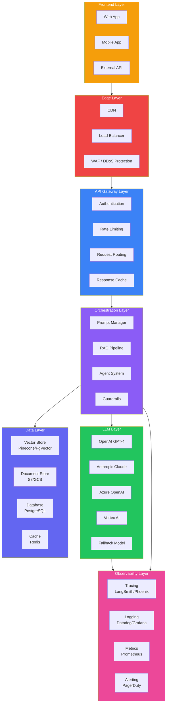

---

## The Problem: From Monolith to Distributed Architecture

### The Story

You start with a simple chatbot. A single Python script calls OpenAI, returns a response. It works for you and a few friends.

Then your company wants to deploy it to customers. Suddenly you need:
- **Authentication** — Only authorized users can access it
- **Rate limiting** — Prevent a single user from overwhelming the API
- **Caching** — Same questions get the same answers
- **RAG** — Answers should use company knowledge, not just the model's training
- **Monitoring** — Track latency, cost, and errors
- **Safety** — Filter toxic inputs and outputs
- **Scaling** — Handle thousands of concurrent users

Your single script becomes a distributed system. That's production AI architecture.

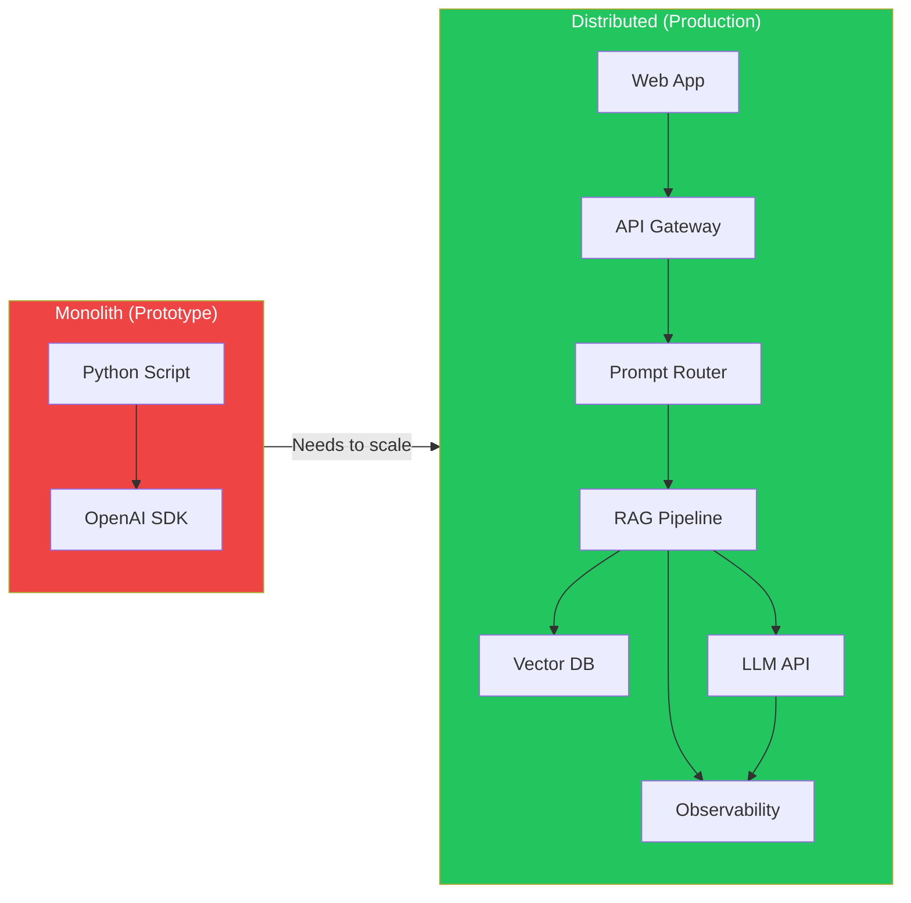

---

## Architecture Layers Explained

### 1. Frontend Layer

The user-facing entry point. Could be a web app, mobile app, Slack bot, or API integration.

| Component | Purpose | Technology |
|-----------|---------|-----------|
| Web App | Chat interface for users | React, Next.js, Vue |
| Mobile App | On-the-go access | Swift, Kotlin, React Native |
| API Client | Programmatic access | REST, GraphQL, WebSocket |
| Integration | Embedding in existing tools | Slack API, Zendesk, Intercom |

### 2. Edge Layer

Protects the system before requests reach your infrastructure.

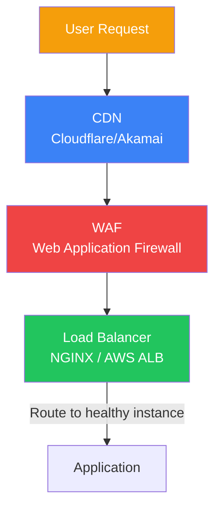

### 3. API Gateway Layer

The control point for all AI traffic.

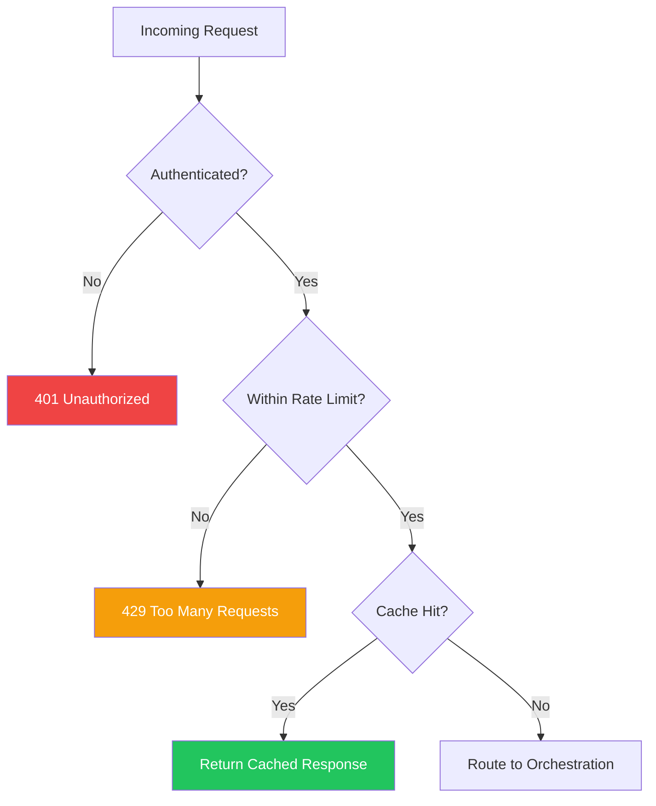

**Key responsibilities:**
- **Authentication** — Verify identity via API keys, JWT, or OAuth
- **Rate limiting** — Per-user, per-API-key, global limits
- **Request routing** — Route to different models or prompts based on request
- **Response caching** — Return cached responses for identical queries
- **Cost tracking** — Log token usage per request for billing

### 4. Orchestration Layer

The brain of the AI system. This is where prompts, RAG, agents, and guardrails live.

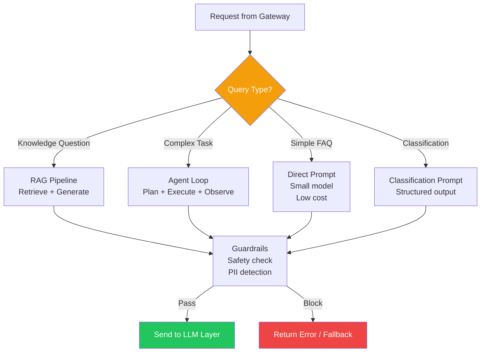

### 5. LLM Layer

The actual model serving. Production systems rarely use a single model.

| Strategy | Description | Use Case |
|----------|-------------|----------|
| **Single provider** | All requests to one LLM | Simple apps, cost predictability |
| **Multi-provider** | Route to different providers | Resilience, best-priced routing |
| **Model routing** | Small/large model based on task complexity | Cost optimization |
| **Fallback chain** | Primary → Fallback1 → Fallback2 | High availability |
| **Ensemble** | Multiple models, vote on answer | Quality-critical applications |

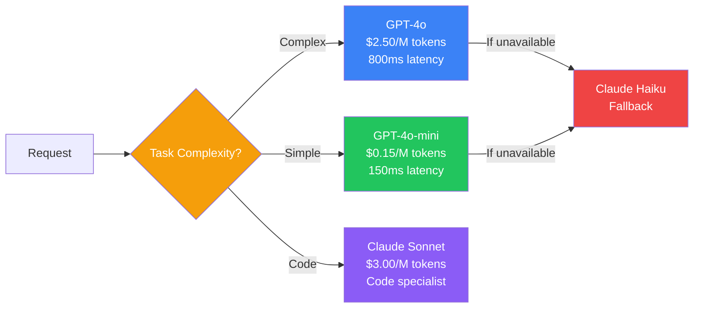

### 6. Data Layer

All persistent state for the AI system.

| Component | Purpose | Examples |
|-----------|---------|----------|
| **Vector Store** | Semantic search for RAG | Pinecone, Weaviate, PgVector |
| **Document Store** | Original source documents | S3, GCS, Azure Blob |
| **Database** | Application state, user data | PostgreSQL, MySQL |
| **Cache** | Low-latency response storage | Redis, Memcached |
| **Queue** | Async processing | RabbitMQ, SQS, Kafka |

### 7. Observability Layer

Monitoring everything that happens in the system.

```mermaid
flowchart LR
    subgraph SOURCES["Data Sources"]
        LLM["LLM Calls"]
        APP["Application Logs"]
        INFRA["Infrastructure"]
    end
    subgraph COLLECT["Collection"]
        OTEL["OpenTelemetry"]
        AGENTS["Agents/Exporters"]
    end
    subgraph STORE["Storage"]
        TRACES["Tracing Store"]
        METRICS_DB["Metrics DB"]
        LOGS_DB["Log Store"]
    end
    subgraph VIS["Visualization"]
        GRAFANA["Grafana"]
        DATADOG["Datadog"]
        LANG["LangSmith Dashboard"]
    end
    
    SOURCES --> COLLECT
    COLLECT --> STORE
    STORE --> VIS
    
    style SOURCES fill:#3b82f6,color:#fff
    style COLLECT fill:#8b5cf6,color:#fff
    style STORE fill:#6366f1,color:#fff
    style VIS fill:#22c55e,color:#fff
```

---

## Architectural Patterns

### Microservices Architecture

Each component (prompt router, RAG, agents, guardrails) is a separate service.

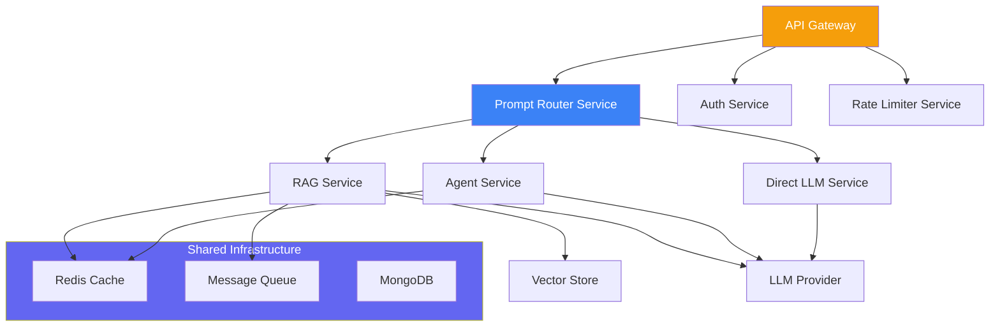

> **Pros:** Independent scaling, team autonomy, fault isolation
> **Cons:** Network latency, operational complexity, distributed debugging

### Queue-Based Architecture

For heavy workloads, requests go through a queue for async processing.

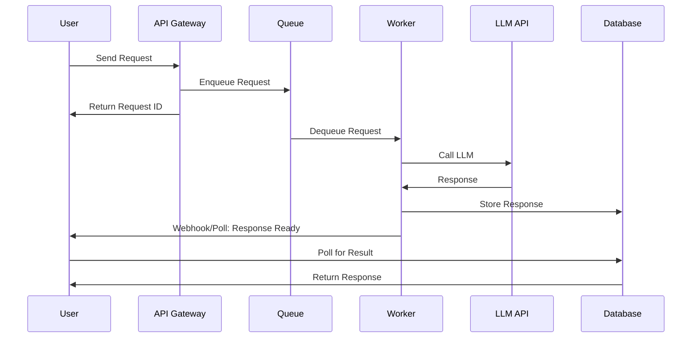

### Streaming Architecture

For real-time responses, use streaming at every layer.

---

## Caching Strategy

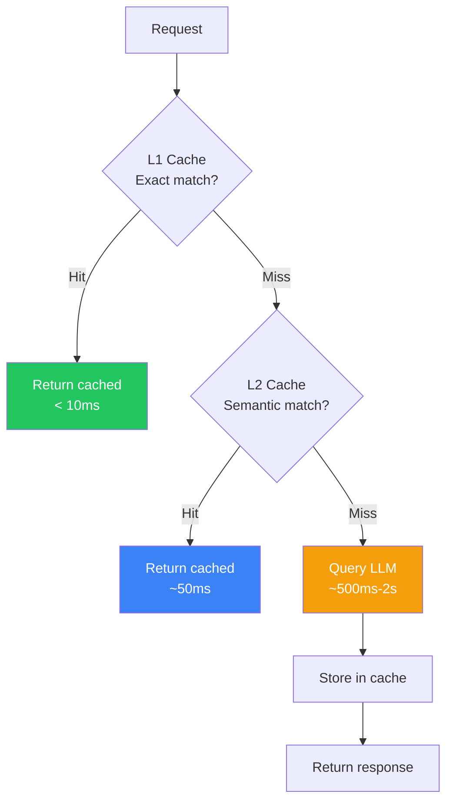

| Cache Level | Store | TTL | Hit Rate | Latency Saved |
|------------|-------|-----|----------|---------------|
| **L1: Exact match** | Redis (key-value) | 24h | 20-30% | ~95% |
| **L2: Semantic match** | Vector DB | 1h | 10-20% | ~80% |
| **L3: Prompt cache** | LLM provider | 5min | Varies | Partial |

---

## Retry & Fallback Strategy

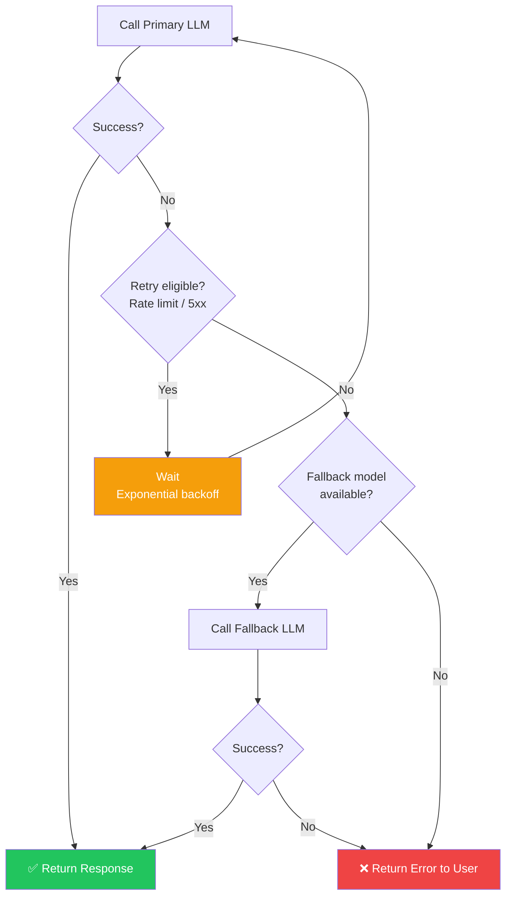

---

## Disaster Recovery

### Multi-Region Architecture

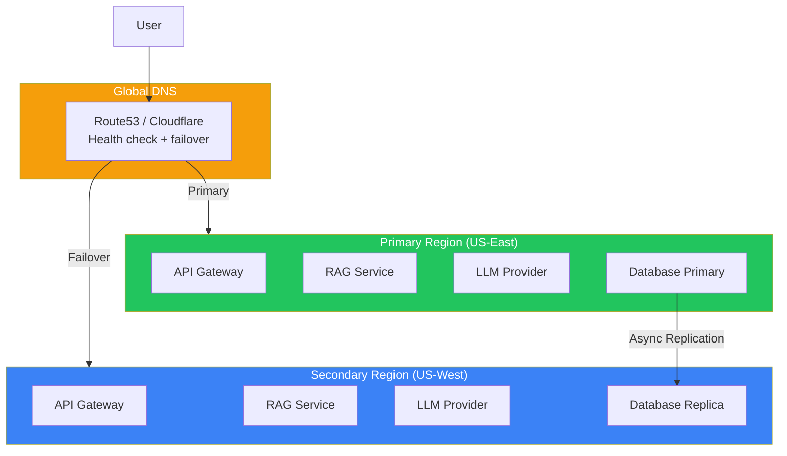

---

## Production Checklist

### Architecture Readiness

- [ ] API Gateway with auth and rate limiting
- [ ] Multi-model routing with fallback
- [ ] RAG pipeline with vector store
- [ ] Response caching at multiple levels
- [ ] Streaming support for real-time responses
- [ ] Queue-based processing for heavy workloads
- [ ] Distributed tracing across all services
- [ ] Health checks and readiness probes

### Reliability

- [ ] Retry logic with exponential backoff
- [ ] Fallback models for every provider
- [ ] Circuit breakers for failing services
- [ ] Graceful degradation (degraded but working)
- [ ] Multi-region deployment
- [ ] Regular disaster recovery drills

---

## Best Practices

1. **Design for failure** — Every service should have a fallback. Assume LLM APIs will fail
2. **Decouple with queues** — Async processing prevents cascading failures
3. **Cache aggressively** — AI calls are expensive. Cache everything you can
4. **Stream responses** — Users preferea treaming over waiting for full response
5. **Monitor every layer** — Frontend metrics don't tell you about LLM latency
6. **Use circuit breakers** — Stop calling failing services before they cause cascading failures
7. **Version your models** — Never update a model in place. Always deploy with versioning

## Common Mistakes

| Mistake | Why It's Wrong |
|---------|---------------|
| Single model without fallback | One outage takes down the entire application |
| No caching | Every identical request calls the LLM, wasting money and latency |
| Monolithic architecture | Hard to scale individual components, single point of failure |
| No rate limiting | One user's abuse can exhaust your API quota and budget |
| Ignoring streaming | Users wait for full response instead of seeing real-time tokens |
| No circuit breakers | A slow LLM backs up requests across the entire system |

---

## Interview Questions

### Beginner

**Q: What are the main layers of a production AI architecture?**

> Seven layers: (1) Frontend, (2) Edge (CDN, WAF, Load Balancer), (3) API Gateway (Auth, Rate Limiting, Routing), (4) Orchestration (Prompt Manager, RAG, Agents, Guardrails), (5) LLM Layer (Primary + Fallback models), (6) Data Layer (Vector Store, Cache, Database), (7) Observability (Tracing, Logging, Metrics).

**Q: Why do production AI systems need an API Gateway?**

> An API Gateway provides authentication, rate limiting, request routing, caching, and logging — all before requests reach your AI services. Without it, every service would need to implement these capabilities independently, and you'd have no single control point for security and cost management.

### Intermediate

**Q: How would you design a caching strategy for an AI chatbot?**

> Three-tier caching: (1) **Exact match cache** — Redis keyed by (user_id + prompt_hash), 24h TTL. Returns cached response instantly. (2) **Semantic cache** — Vector DB storing query embeddings + responses. New query finds similar query, returns cached response. ~80% latency savings on similar queries. (3) **LLM prompt caching** — Provider-side cache for system prompts. Saves on input tokens for repeated system prompts.

**Q: What's the difference between model routing and a fallback model?**

> **Model routing** is proactive — you choose the best model for each request based on complexity, cost, and latency requirements. **Fallback model** is reactive — when the primary model fails (error, timeout), you retry with a different model. A complete strategy uses both: route intelligently, fallback gracefully.

### Senior

**Q: Design a multi-region architecture for an AI application that must maintain 99.99% uptime.**

> Architecture: (1) **Global DNS** — Route53 with health checks routing traffic to healthy regions, (2) **Primary region** — Full deployment (API Gateway → Orchestration → LLM) with active traffic, (3) **Secondary region** — Same deployment ready to take traffic, (4) **Database** — Active-passive with async replication, (5) **LLM failover** — Each region hasits own API keys, plus cross-region fallback, (6) **Cache warming** — Primary region warms secondary cache for common queries, (7) **Failover testing** — Monthly drills where primary region is deliberately taken down.

**Q: How would you handle LLM API rate limits in a high-throughput production system?**

> Strategies: (1) **Request queue** — Buffer requests when approaching limits, (2) **Token bucket** — Smooth request rate over time, (3) **Multi-key rotation** — Distribute requests across multiple API keys, (4) **Multi-provider routing** — Route some traffic to alternative providers, (5) **Request prioritization** — Critical requests get priority access to remaining quota, (6) **Semideferral** — Non-urgent requests wait until quota refreshes, (7) **Monitoring** — Real-time dashboard of remaining quota with alerts.

### Staff Engineer

**Q: Compare event-driven vs request-driven architecture for an AI agent system.**

> **Request-driven** — User sends request, agent processes synchronously, returns response. Simpler to build and debug. Works for simple agents (< 5 steps). But blocks users, doesn't scale for long-running agents. **Event-driven** — User sends request, agent workflow is event-driven: each step produces events that trigger the next step. Scales to complex multi-step agents. Better for long-running workflows. But harder to debug, requires event sourcing. **Recommendation**: Use request-driven for simple agents (chatbots, Q&A). Use event-driven for complex agents (research, multi-step planning).

### System Design

**Q: Design a system that routes user queries to different LLMs based on task complexity, cost, and latency requirements.**

> Components: (1) **Classifier** — Fast, cheap model (GPT-4o-mini) classifies query into Simple/Medium/Complex, (2) **Router** — Maps classifications to model endpoints, (3) **Small model pool** — Multiple cheap model instances (throughput-optimized), (4) **Large model pool** — Multiple powerful model instances (quality-optimized), (5) **Fallback pool** — Alternative providers, (6) **Monitoring** — Tracks routing decisions, latencies, costs, (7) **Adaptive routing** — If large model pool is overloaded, route complex queries to fallback pool with priority flag.

> Decision logic: Simple (≤ 5 tokens output, factual) → GPT-4o-mini (< 200ms). Medium (needs some reasoning) → Claude Haiku (< 500ms). Complex (multi-step reasoning, code) → GPT-4o or Claude Sonnet (< 2s). Critical (customer-facing, needs maximum quality) → GPT-4o with backup.

---

## Summary

| Layer | Purpose | Key Components |
|-------|---------|---------------|
| **Frontend** | User interface | Web, Mobile, API, Integrations |
| **Edge** | First line of defense | CDN, WAF, Load Balancer |
| **API Gateway** | Traffic control | Auth, Rate Limiting, Caching, Routing |
| **Orchestration** | AI logic | Prompt Manager, RAG Pipeline, Agents, Guardrails |
| **LLM** | Model inference | Primary, Fallback, Multi-provider |
| **Data** | State & storage | Vector Store, Database, Cache, Queue |
| **Observability** | Monitoring | Tracing, Logging, Metrics, Alerting |

---

## Navigation

**Previous:** [01 — Introduction to LLMOps](/ai/phase-09-production-ai/01-introduction-to-llmops)

**Next:** [03 — Prompt Management](/ai/phase-09-production-ai/03-prompt-management)

**Related Topics:**
- [LLMOps Introduction](/ai/phase-09-production-ai/01-introduction-to-llmops)
- [Deployment & Scaling](/ai/phase-09-production-ai/09-deployment-and-scaling)
- [Performance & Cost Optimization](/ai/phase-09-production-ai/08-performance-and-cost-optimization)
