## Introduction

> **Prompt management is the practice of treating prompts as production code — with version control, testing, staging, gradual rollouts, and monitoring — rather than strings you edit in a Jupyter notebook.**

Prompts are the configuration files of your AI application. A bad prompt costs you money, produces bad outputs, and frustrates users. A well-managed prompt lifecycle is the difference between a fragile AI app and a reliable one.

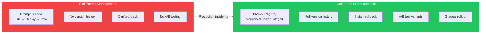

---

## The Problem: Why Prompts Need Management

### The Story

Your team's AI chatbot is working well. Then someone "quickly edits" the system prompt to fix a minor issue. Two days later, you notice the bot is giving wrong answers. Nobody knows who changed what, when, or why. The old prompt is lost. You have to guess what the original looked like.

This is the **untracked prompt problem** — and it's one of the most common causes of production AI incidents.

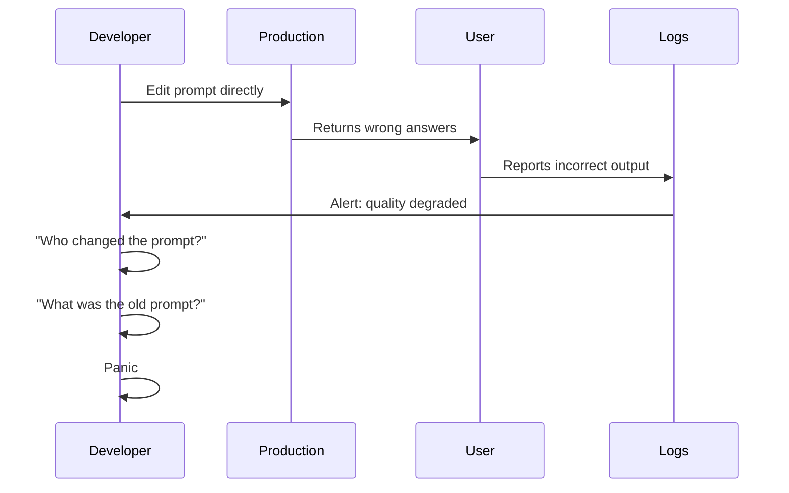

---

## Prompt Management Lifecycle

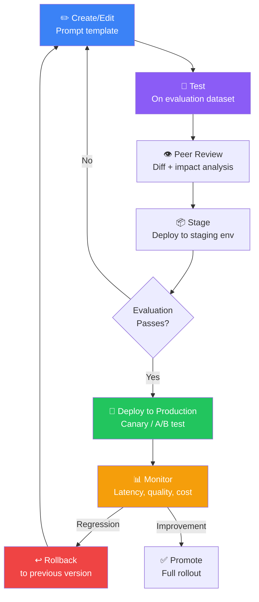

---

## Prompt Templates

A prompt template is a structured prompt with variables and configuration.

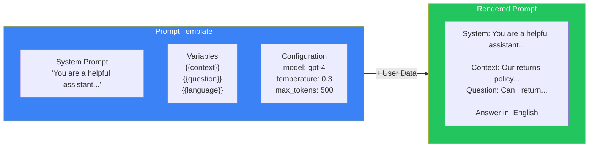

### Components of a Prompt Template

| Component | Description | Example |
|-----------|-------------|---------|
| **System prompt** | The persona and rules | "You are a customer support agent for Acme Corp" |
| **Context injection** | Dynamic data from RAG | `{{retrieved_documents}}` |
| **User message** | The actual user query | `{{user_question}}` |
| **Output format** | Expected structure | JSON schema, XML, markdown |
| **Few-shot examples** | Example inputs/outputs | Dynamic based on query type |
| **Configuration** | Model parameters | temperature, max_tokens, stop_sequences |

---

## Prompt Versioning

### Why Versioning Matters

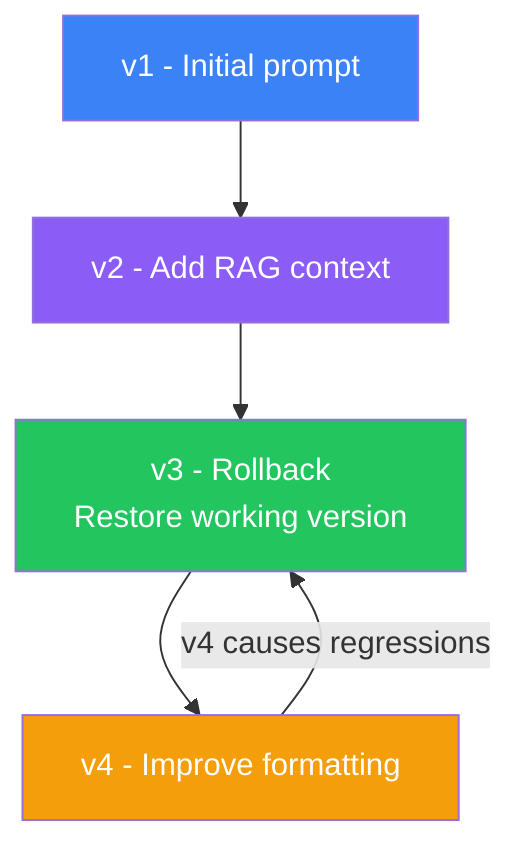

### Versioning Schema

```
prompts/
  customer-support/
    v1/
      system-prompt.md
      config.json
      evaluation-results.json
    v2/
      system-prompt.md
      config.json
      evaluation-results.json
    v3/
      system-prompt.md
      config.json
      evaluation-results.json
```

### Version Metadata

```json
{
  "version": "v4",
  "created_at": "2025-06-15T10:30:00Z",
  "author": "alice@company.com",
  "change_description": "Added few-shot examples for refund queries",
  "evaluation_score": 92.5,
  "previous_score": 88.1,
  "model": "gpt-4o",
  "tags": ["customer-support", "refund", "production"],
  "base_prompt": "v2",
  "approval_status": "approved"
}
```

---

## Prompt Registry

A centralized service that stores, versions, and serves prompts.

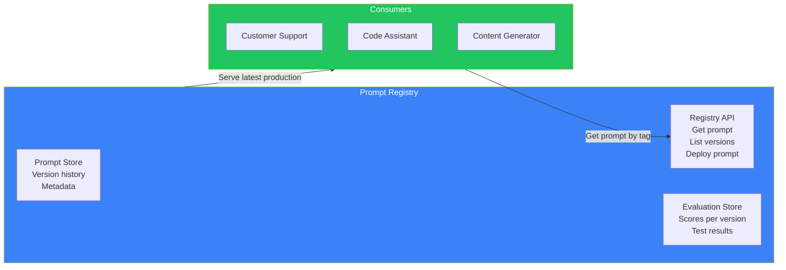

### Registry API

```javascript
// Get the production prompt for a specific use case
const prompt = await promptRegistry.getPrompt({
  app: "customer-support",
  tag: "production"  // or "staging", "canary"
});

// Deploy a new version to canary
await promptRegistry.deploy({
  app: "customer-support",
  version: "v5",
  target: "canary",  // 5% of traffic
});

// Rollback
await promptRegistry.rollback({
  app: "customer-support",
  target: "production",
  to_version: "v3",
});
```

---

## A/B Testing Prompts

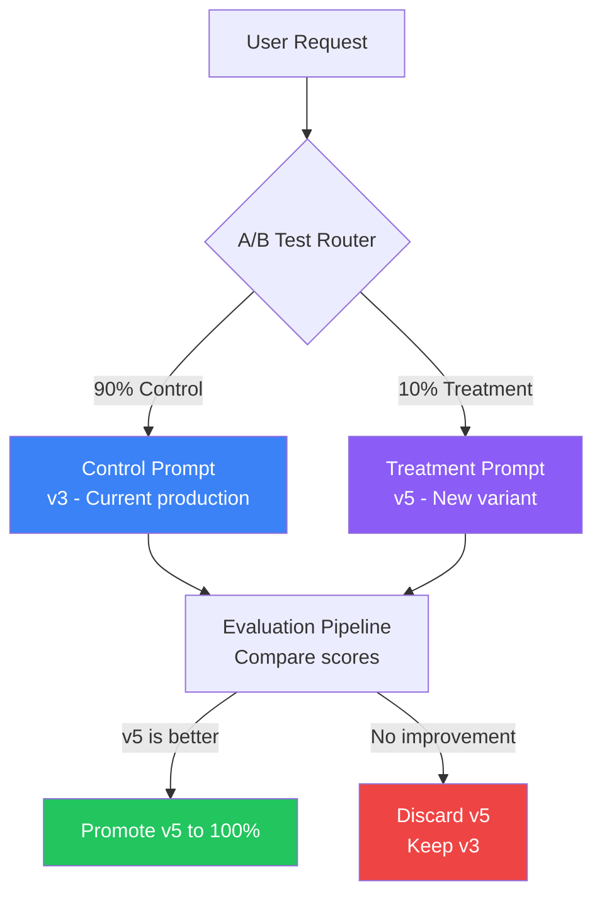

### A/B Test Metrics

| Metric | Description | How to Measure |
|--------|-------------|---------------|
| **User satisfaction** | Thumbs up/down | Compare ratios between variants |
| **Response quality** | LLM-as-a-Judge score | Automated evaluation on 100% of responses |
| **Task completion** | Did the user get what they needed? | Follow-up survey or task tracking |
| **Latency** | Response time impact | P50, P95, P99 latency comparison |
| **Token usage** | Cost per request | Input/output tokens comparison |
| **Error rate** | Failed responses | Parsing errors, content filter blocks |

---

## Dynamic Prompts

Prompts that change based on context, user, or situation.

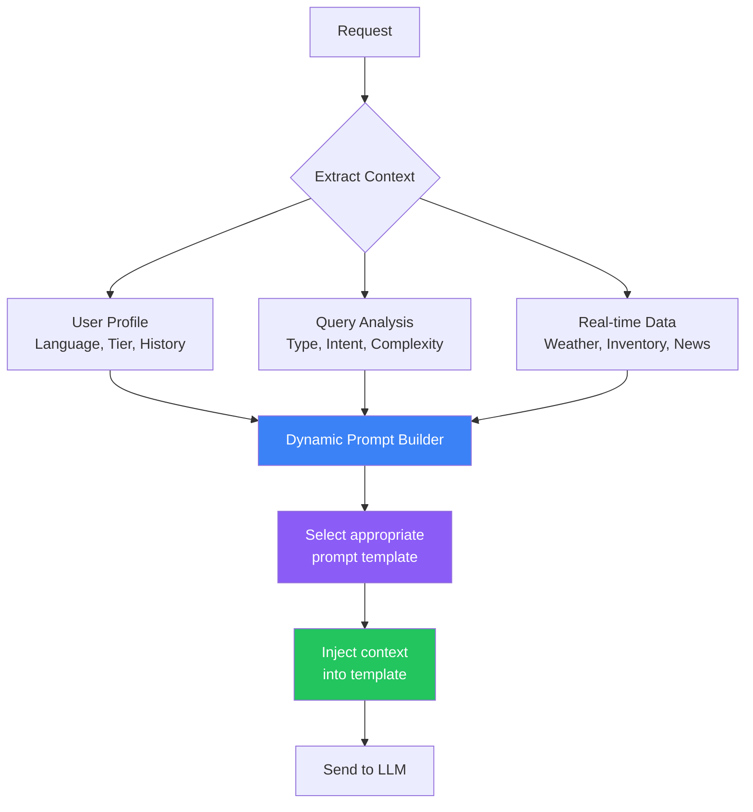

### Examples of Dynamic Prompts

| Scenario | Dynamic Element | Example |
|----------|---------------|---------|
| **Multi-language** | User's language preference | "Answer in {{user.language}}" |
| **User tier** | Premium vs free response detail | Free: short, Premium: detailed |
| **Personalization** | User history | "You previously asked about {{topic}}" |
| **Time-sensitive** | Current context | "Today's date: {{current_date}}" |
| **A/B test** | Variant selection | Different system prompts per variant |

---

## Context Injection

How to safely inject dynamic context into prompts.

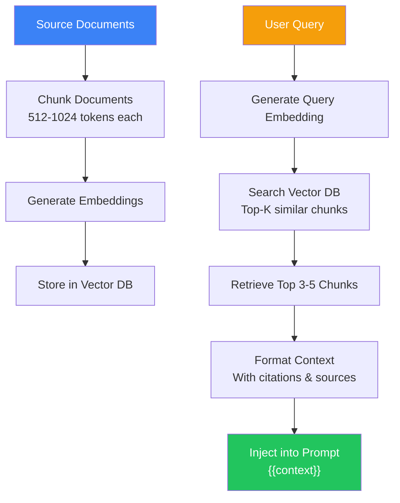

### Context Injection Best Practices

| Practice | Why |
|----------|-----|
| **Truncate to fit** | Never exceed the model's context window |
| **Cite sources** | So the model can attribute information |
| **Prioritize relevance** | Most relevant context first (top of prompt) |
| **Add guardrails** | "If the context doesn't answer the question, say so" |
| **Format consistently** | Use markdown, XML, or JSON structure |
| **Limit to 3-5 chunks** | More context ≠ better results (can confuse the model) |

---

## Prompt Governance

Enforcing standards and policies across a organization.

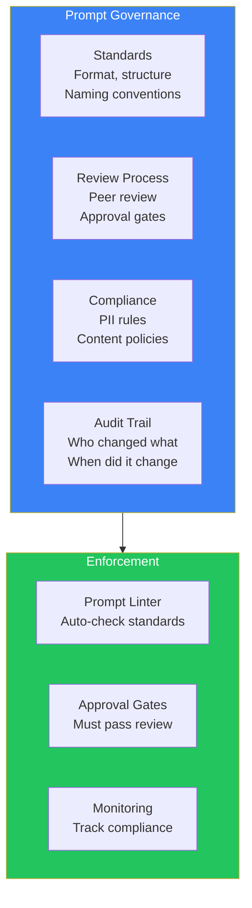

### Governance Policies

| Policy | Description | Enforcement |
|--------|-------------|-------------|
| **No hardcoded secrets** | API keys, passwords in prompts | Automated scan on commit |
| **Language consistency** | Single language per prompt | Linter check |
| **Output schema** | Structured output format | Validation after generation |
| **PII restrictions** | No PII in prompt examples | Automated scan |
| **Maximum prompt length** | System prompt ≤ 2000 tokens | CI gate |
| **Approval required** | Production prompts need review | Review workflow |
| **Rollback plan** | Every deploy has a rollback version | CI/CD requirement |

---

## Prompt Testing & Evaluation Pipeline

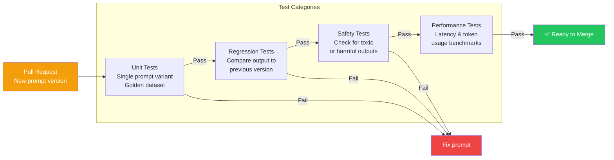

---

## Real-World Example: Prompt Management at Scale

### How Anthropic Manages Prompts for Claude

Anthropic uses a structured prompt management system:

1. **Templates** — All prompts start as structured templates with version metadata
2. **Testing** — Every prompt change runs through thousands of eval cases
3. **Staging** — Prompts are deployed to internal users first
4. **Canary** — Gradually rolled out to production (1% → 5% → 25% → 100%)
5. **Monitoring** — Real-time quality metrics, user feedback, safety checks
6. **Rollback** — One-click rollback to previous version if issues detected

### Industry Example: How Companies Handle Prompt Management

| Company | Approach | Tools |
|---------|----------|-------|
| **OpenAI** | Internal prompt registry with versioning | Custom platform |
| **Anthropic** | Template library + eval pipeline | Custom + internal tools |
| **LangSmith** | Prompt hub with versioning | LangSmith Hub |
| **Microsoft** | Prompt flow in Azure AI Studio | Azure AI Studio |
| **Startups** | Git-based + custom scripts | GitHub + CI/CD |

---

## Best Practices

1. **Prompts are code** — Version control, review, test, deploy with the same rigor as application code
2. **One prompt per file** — Don't mix multiple prompts in a single file
3. **Use a registry** — Serve prompts from a central service, not hardcoded in applications
4. **Test on golden datasets** — Maintain a curated set of inputs with expected outputs
5. **A/B test changes** — Never replace a prompt entirely without comparing
6. **Tag your prompts** — Use meaningful tags (production, staging, canary, v1, v2)
7. **Log prompt versions** — Every response should include the prompt version that generated it

## Common Mistakes

| Mistake | Why It's Wrong |
|---------|---------------|
| Hardcoding prompts in source code | Can't change without deploying new code |
| Editing prompts directly in production | No rollback, no audit trail |
| No prompt testing | Every change is a blind deploy |
| No version tracking | Can't identify which prompt caused a regression |
| Ignoring prompt length | Long prompts cost more and increase latency |
| Not tagging prompt versions | Can't distinguish production from experimental |

---

## Interview Questions

### Beginner

**Q: Why should prompts be version-controlled?**

> Prompts directly affect output quality, cost, and safety. Without versioning, you can't track changes, rollback bad updates, or know which prompt version produced a given response. Versioning gives you audit trails, rollback capability, and the ability to A/B test changes.

**Q: What is a prompt registry?**

> A prompt registry is a centralized service that stores, versions, and serves prompts to applications. Applications request prompts by name and tag (e.g., "customer-support:production"). The registry manages deployment, rollback, and A/B testing without requiring application redeployments.

### Intermediate

**Q: How would you implement A/B testing for prompts?**

> Steps: (1) Create two prompt variants in the registry — control (current) and treatment (new), (2) Route a percentage of traffic (e.g., 10%) to the treatment variant, (3) Collect metrics on both variants (quality scores, latency, cost, user satisfaction), (4) Compare results statistically, (5) If treatment is significantly better, promote it to 100%. If not, discard and iterate.

**Q: What metrics would you track when A/B testing prompts?**

> Track: (1) **Quality** — LLM-as-a-Judge score, human evaluation rating, (2) **Latency** — Time to first token, total response time, (3) **Cost** — Input/output tokens per request, (4) **Safety** — Toxicity scores, PII detection rate, (5) **User feedback** — Thumbs up/down ratio, (6) **Error rate** — Parsing failures, content filter blocks.

### Senior

**Q: Design a prompt management system for a company with 10 AI features and 20 developers.**

> Architecture: (1) **Prompt Registry Service** — Centralized service with REST API, stores prompt templates + metadata in PostgreSQL, (2) **Git Integration** — Prompts as YAML files in a monorepo, changes flow through CI/CD, (3) **Versioning** — Semantic versioning per prompt with changelog, (4) **Testing** — Golden dataset per prompt, automated eval on every commit, (5) **Deployment** — Registry supports environment tags (dev/staging/production), (6) **A/B Testing** — Built-in traffic splitting between versions, (7) **Dashboard** — View all prompts, versions, deployment status, eval scores.

**Q: How do you handle context window limits when injecting dynamic context into prompts?**

> Strategies: (1) **Sliding window** — Keep the most recent/relevant context, discard older entries, (2) **Semantic truncation** — Use embeddings to select only the most relevant chunks, (3) **Summarization** — Summarize long context into a shorter version, (4) **Chunk ranking** — Score and rank context chunks, include only top-K, (5) **Multi-turn compression** — Compress conversation history into summaries, (6) **Configurable limit** — Set maximum context tokens per prompt type with fallback behavior.

### Staff Engineer

**Q: How would you build a prompt governance system that enforces policy without slowing down development?**

> Balance via tiered governance: (1) **Auto-linting** — Immediate feedback on formatting, secrets, PII. Fast and automated. (2) **Automated testing** — Safety and regression tests in CI. Failures block merge. (3) **Peer review** — Changes to production prompts require at least one approval. (4) **Staged deployment** — Canary → 25% → 100% with automated evaluation gates at each stage. (5) **Post-deploy monitoring** — If quality drops below threshold, automated rollback. (6) **Exception process** — Emergency changes can bypass review but require post-hoc justification.

### System Design

**Q: Design a system that manages prompts across multiple environments (dev, staging, production) with automated promotion gates.**

> System design: (1) **Git repo** — Prompts as code in a monorepo with environment folders, (2) **CI Pipeline** — On push: lint → unit test → safety test → eval on golden dataset, (3) **Dev deploy** — Automated deploy to dev environment on merge to main, (4) **Staging gate** — Manual approval to promote from dev to staging, plus automated eval on staging dataset, (5) **Production gate** — Automated eval must pass (score ≥ 90%), plus manual approval for major changes, (6) **Canary deploy** — 5% traffic for 1 hour, then 25% for 4 hours, then 100%, (7) **Monitoring** — Quality score monitor, auto-rollback if score drops by 5%+, (8) **Audit** — Every promotion logged with who, what, when, and eval results.

---

## Summary

| Concept | Key Point |
|---------|-----------|
| **Prompt as code** | Version, test, review, deploy like software |
| **Prompt registry** | Centralized service for prompt storage and serving |
| **Versioning** | Every change tracked with metadata and rollback |
| **A/B testing** | Compare variants on quality, cost, latency |
| **Dynamic prompts** | Templates + context injection for personalization |
| **Governance** | Standards, review, compliance, audit trails |
| **Testing pipeline** | Unit → Regression → Safety → Performance |

---

## Navigation

**Previous:** [02 — Production AI Architecture](/ai/phase-09-production-ai/02-production-ai-architecture)

**Next:** [04 — Observability & Tracing](/ai/phase-09-production-ai/04-observability-and-tracing)

**Related Topics:**
- [Production AI Architecture](/ai/phase-09-production-ai/02-production-ai-architecture)
- [AI Evaluation](/ai/phase-09-production-ai/05-ai-evaluation)
- [CI/CD for AI](/ai/phase-09-production-ai/11-cicd-for-ai)
