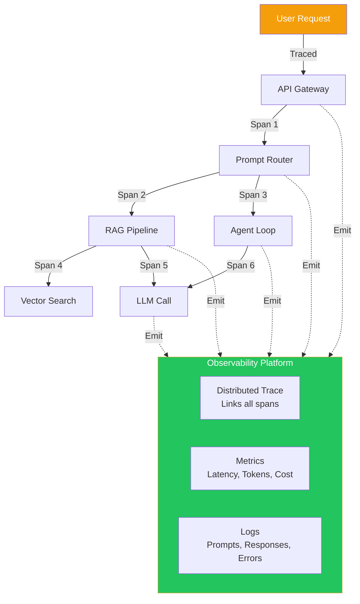
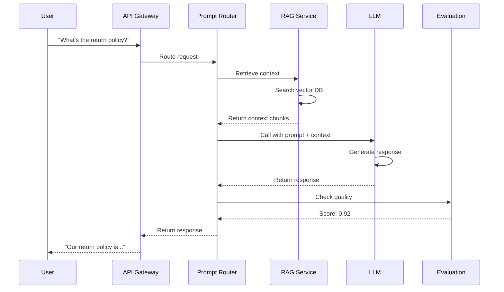
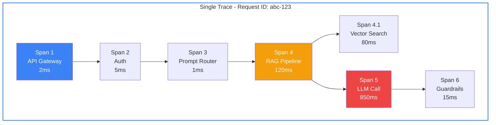
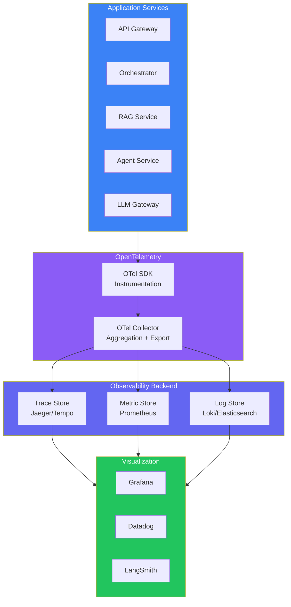
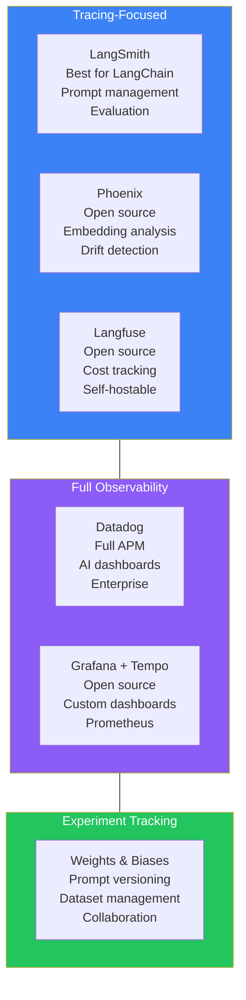
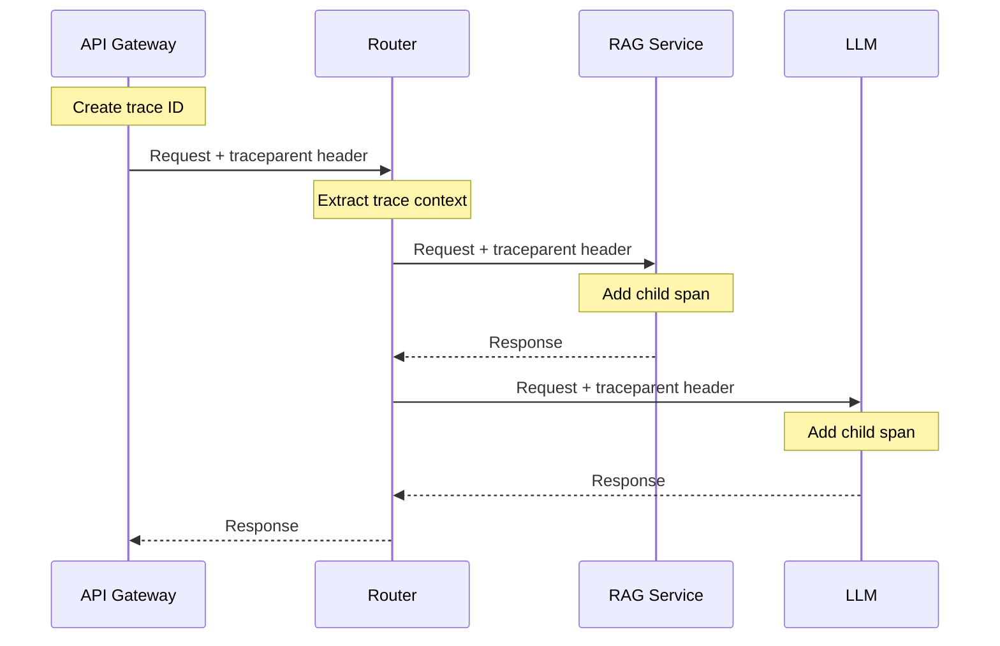
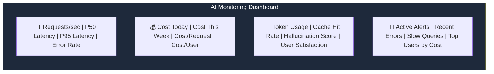
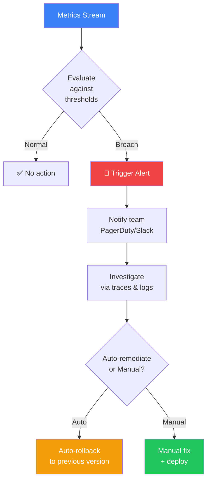
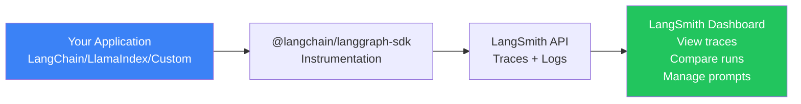

## Introduction

> **Observability for AI systems is the ability to understand what your LLM application is doing, why it's doing it, and how well it's performing — through traces, logs, and metrics that capture the full journey of every request.**

A traditional web service might need to track response times and error rates. An AI system needs to track tokens, prompts, model versions, vector search results, agent decisions, hallucination scores, and costs — all linked to a single user request.



---

## The Problem: Why Observability is Harder for AI

### The Story

A user reports that the AI assistant gave a wrong answer. You need to figure out why. With traditional software, you look at the logs — what endpoint was called, what parameters were passed, what was returned.

With AI, you need to know:
- Which prompt template was used and which version?
- What context was retrieved from the vector store?
- Which model and configuration was used?
- What was the raw LLM response?
- How many tokens were consumed?
- What was the latency at each step?
- Was the response flagged by guardrails?
- Did an agent make multiple tool calls?

All of this needs to be **linked to a single request**. That's what distributed tracing provides.



---

## Three Pillars of Observability

### 1. Tracing

Tracing captures the end-to-end journey of a single request across all services.



**Key trace data:**
| Span | Service | Duration | Data |
|------|---------|----------|------|
| API Gateway | Ingress | 2ms | User ID, request path |
| Auth | Auth Service | 5ms | User roles, permissions |
| Prompt Router | Orchestration | 1ms | Prompt version, model selection |
| RAG Pipeline | RAG Service | 120ms | Chunks retrieved, scores |
| Vector Search | Vector DB | 80ms | Query embedding, top-K results |
| LLM Call | LLM Provider | 850ms | Model name, tokens, temperature |
| Guardrails | Safety Service | 15ms | Safety scores, flags raised |

### 2. Metrics

Aggregated numerical data over time.

| Metric | Description | Measured By |
|--------|-------------|-------------|
| **Requests per second** | Traffic volume | API Gateway |
| **Latency P50/P95/P99** | Response time distribution | Every service |
| **Time to First Token (TTFT)** | Time before first token arrives | LLM calls |
| **Tokens per Second (TPS)** | Generation speed | LLM calls |
| **Total token usage** | Input + output tokens | Every LLM call |
| **Cost per request** | $ per API call | LLM calls |
| **Error rate** | Percentage of failed requests | Every service |
| **Cache hit rate** | Percentage of cache hits | Cache layer |
| **Hallucination score** | Estimated factual accuracy | Evaluation service |

### 3. Logging

Detailed records of individual events.

```
[2025-06-15T10:30:00Z] [INFO] [RAG-Service] [trace=abc-123] 
  Retrieved 5 chunks from vector store
  Query: "What is the return policy?"
  Top chunk score: 0.92
  Chunk sources: returns-policy-v2.pdf, faq-page-3.md

[2025-06-15T10:30:01Z] [INFO] [LLM-Call] [trace=abc-123]
  Model: gpt-4o
  Prompt version: customer-support/v4
  Input tokens: 1542
  Output tokens: 312
  Temperature: 0.3
  Latency: 847ms

[2025-06-15T10:30:01Z] [WARN] [Guardrails] [trace=abc-123]
  Content flagged: potential_hallucination
  Score: 0.34 (threshold: 0.5)
  Action: allowed (below threshold)
```

---

## Tracing Architecture



---

## AI-Specific Observability Tools

| Tool | Focus | Key Features | Pricing |
|------|-------|-------------|---------|
| **LangSmith** | LLM tracing + evaluation | Prompt versioning, eval, datasets, monitoring | Free tier, paid per trace |
| **Phoenix (Arize)** | LLM observability | Trace visualization, embeddings, drift detection | Open source + cloud |
| **Arize AI** | ML + LLM observability | Production monitoring, bias detection, quality | Paid |
| **Weights & Biases** | Experiment tracking | Prompt management, dataset versioning, eval | Free tier, paid teams |
| **Datadog** | Full observability | APM, logs, metrics, AI-specific dashboards | Paid |
| **Grafana** | Open-source dashboards | Custom dashboards, alerting, multi-source | Open source + cloud |
| **Langfuse** | Open-source LLM tracing | Cost tracking, eval, dataset management | Open source + cloud |
| **Helicone** | LLM API monitoring | Cost tracking, latency, caching | Free tier, paid |

### Tool Comparison Matrix



---

## Distributed Tracing Implementation

### Step 1: Instrumentation

```javascript
// Example: OpenTelemetry instrumentation for an LLM call
const tracer = opentelemetry.trace.getTracer('llm-service');

async function callLLM(prompt, context) {
  return tracer.startActiveSpan('llm.call', async (span) => {
    span.setAttributes({
      'llm.model': 'gpt-4o',
      'llm.prompt_version': 'v4',
      'llm.input_tokens': prompt.length / 4, // approximate
      'llm.temperature': 0.3,
    });
    
    try {
      const response = await openai.chat.completions.create({...});
      
      span.setAttributes({
        'llm.output_tokens': response.usage.completion_tokens,
        'llm.total_tokens': response.usage.total_tokens,
        'llm.latency_ms': response.response_ms,
      });
      
      span.setStatus({ code: SpanStatusCode.OK });
      return response;
    } catch (error) {
      span.setStatus({ code: SpanStatusCode.ERROR, message: error.message });
      span.recordException(error);
      throw error;
    } finally {
      span.end();
    }
  });
}
```

### Step 2: Context Propagation



### Step 3: AI-Specific Attributes

| Attribute | Description | Example |
|-----------|-------------|---------|
| `gen_ai.system` | AI provider | `openai`, `anthropic`, `azure` |
| `gen_ai.request.model` | Model name | `gpt-4o`, `claude-3-sonnet` |
| `gen_ai.request.temperature` | Temperature | `0.3` |
| `gen_ai.request.max_tokens` | Max tokens | `1024` |
| `gen_ai.response.usage.prompt_tokens` | Input tokens | `1542` |
| `gen_ai.response.usage.completion_tokens` | Output tokens | `312` |
| `gen_ai.response.usage.total_tokens` | Total tokens | `1854` |
| `gen_ai.response.model` | Actual model used | `gpt-4o-2025-05-13` |

---

## Monitoring Dashboards

### LLM-Specific Dashboard



### Key Dashboard Panels

| Panel | Metrics | Purpose |
|-------|---------|---------|
| **Traffic** | Requests/sec, Active users | Is the system handling load? |
| **Latency** | P50, P95, P99, TTFT | Is the system fast enough? |
| **Cost** | Cost/hr, Cost/req, By model | Are we spending too much? |
| **Quality** | Hallucination score, User feedback | Is the AI producing good answers? |
| **Errors** | Error rate, By type, By service | Is anything broken? |
| **Cache** | Hit rate, Savings | Are we caching effectively? |
| **Safety** | Flagged content, PII detected, Jailbreak attempts | Is the system safe? |

---

## Alerting

### What to Alert On

| Alert | Condition | Severity | Response |
|-------|-----------|----------|----------|
| **High error rate** | Error rate > 5% in 5 minutes | Critical | Auto-rollback to previous model/prompt |
| **High latency** | P95 latency > 5s in 5 minutes | Critical | Investigate LLM provider, scale up |
| **Cost spike** | Cost/hr > 2x normal | Warning | Check for abuse, optimize prompts |
| **Quality drop** | Hallucination score threshold exceeded | Critical | Auto-rollback, investigate prompt |
| **Safety breach** | PII detected in output | Critical | Block user, review and remediate |
| **Cache miss spike** | Cache hit rate < 10% | Warning | Warm cache, check for new query types |
| **Rate limit hit** | > 10% requests rate limited | Warning | Add capacity, optimize usage |

### Alert Flow



---

## Production Examples

### How LangSmith Traces LLM Applications

LangSmith automatically captures:
- Every LLM call with input/output
- Chain and agent steps
- Token usage and costs
- Latency breakdowns
- Evaluation scores
- Feedback from users



### How Arize Phoenix Monitors AI

Phoenix provides:
- **Trace inspection** — See every step of complex AI workflows
- **Embedding analysis** — Visualize how query embeddings change over time
- **LLM evaluation** — Built-in evaluators for relevance, toxicity, etc.
- **Drift monitoring** — Detect when your data distribution changes

---

## Best Practices

1. **Trace every LLM call** — No exceptions. Token usage, latency, and costs are non-negotiable
2. **Include prompt versions** — Tag every trace with the prompt version used
3. **Add user context** — Know which user/customer experienced each trace
4. **Set cost budgets** — Alert when costs exceed thresholds
5. **Monitor from day one** — You can't add observability after a crisis
6. **Use structured logging** — Machine-parseable logs enable automated analysis
7. **Retain traces with samples** — Keep 100% of error traces, sample successful ones

## Common Mistakes

| Mistake | Why It's Wrong |
|---------|---------------|
| No tracing | You can't debug AI-specific issues like hallucination sources |
| Only monitoring latency | Cost, quality, and safety are equally important |
| Not linking traces to users | Can't identify which user segment has issues |
| Sampling too aggressively | Missing rare but critical error patterns |
| Not monitoring cost | AI costs can grow exponentially without detection |
| Ignoring prompt version | Can't identify which prompt change caused a regression |

---

## Interview Questions

### Beginner

**Q: What's the difference between monitoring and observability?**

> Monitoring tells you **what** is happening (error rate is 5%). Observability tells you **why** it's happening (users from region X get errors because the vector store is slow). Monitoring checks known failure modes. Observability finds unknown failure modes.

**Q: Why is tracing especially important for AI applications?**

> AI applications involve multiple services (router, RAG, LLM, guardrails) that need to be linked to a single request. Traditional logging can't easily connect these. Tracing captures the full request journey across all services, including AI-specific data like tokens, model versions, and retrieved context.

### Intermediate

**Q: How would you implement distributed tracing for an AI application?**

> (1) Choose an observability backend (Jaeger, Tempo, or Datadog), (2) Instrument your applications with OpenTelemetry SDK, (3) Propagate trace context via HTTP headers (`traceparent`), (4) Add AI-specific attributes (model, tokens, prompt version), (5) Export traces to the backend via OTel Collector, (6) Create dashboards and alerts based on trace data.

**Q: What AI-specific metrics would you track that aren't relevant for traditional web services?**

> (1) **Token usage** — Input/output tokens per request, (2) **Time to First Token (TTFT)** — Perceived responsiveness, (3) **Hallucination score** — Estimated factual accuracy, (4) **Cache hit rate** — For prompt and response caches, (5) **Cost per request** — Varies by model and token count, (6) **Model routing accuracy** — Is the right model being chosen?, (7) **Safety filter rate** — How often content is flagged.

### Senior

**Q: Design an observability strategy for a multi-model, multi-provider AI system.**

> Strategy: (1) **Standard instrumentation** — OpenTelemetry across all services with consistent AI attributes, (2) **Centralized trace store** — Store 100% of traces for 24h, then sample 10% for 30 days, 1% for 90 days, (3) **Provider-level dashboards** — Latency/cost/error rate per provider (OpenAI, Anthropic, Azure), (4) **Model-level dashboards** — Quality scores per model (GPT-4o vs Claude), (5) **Cost allocation** — Tags for team, feature, user tier, (6) **Quality pipeline** — Automated evaluation on traced responses, (7) **Alerting** — Anomaly detection on all key metrics with auto-rollback.

**Q: How would you reduce observability costs for a high-volume AI application processing 10M requests/day?**

> (1) **Intelligent sampling** — Keep 100% of error traces, 10% of successful ones, (2) **Tail-based sampling** — Keep traces that match certain criteria (high latency, high cost, etc.), (3) **Aggregation** — Use Prometheus-style metrics instead of traces for high-volume events, (4) **Log levels** — Debug logs to local storage, error logs to central store, (5) **Trace compression** — Compress trace data before storage, (6) **Retention tiers** — Full traces for 7 days, summaries for 30 days, aggregates for 90 days, (7) **Cost monitoring** — Track observability costs separately and optimize.

### Staff Engineer

**Q: How would you build a trace-based evaluation system that automatically detects regressions?**

> Architecture: (1) **Real-time trace stream** — Every request emits a trace to a streaming pipeline (Kafka), (2) **Evaluation workers** — Consume traces and run automated evaluations (LLM-as-a-Judge, safety checks, factuality), (3) **Score aggregator** — Rolling window of quality scores per prompt version, model, and feature, (4) **Regression detector** — Statistical comparison to baseline, alert when score drops significantly (p < 0.05), (5) **Auto-rollback trigger** — Drop below threshold triggers automated rollback of prompt/model, (6) **Blameless postmortem** — All traces leading to regression are automatically collected for analysis, (7) **Dashboard** — Real-time quality score trends with drill-down to individual traces.

### System Design

**Q: Design a full observability platform for an AI-powered customer support system.**

> Components: (1) **Instrumentation** — OpenTelemetry SDK in all services (API Gateway, Router, RAG, Agent, LLM Gateway), (2) **Collection** — OTel Collector cluster with load balancing, (3) **Storage** — Grafana Tempo (traces), Prometheus (metrics), Loki (logs), (4) **LLM-specific** — LangSmith for prompt-level tracing and evaluation, (5) **Dashboards** — Grafana dashboards for real-time monitoring, LangSmith for prompt quality, (6) **Alerting** — Prometheus AlertManager + PagerDuty for critical alerts, (7) **Cost tracking** — Custom service that traces cost per request, per user, per team, (8) **Quality monitoring** — Automated eval pipeline scoring every response for relevance, factuality, safety.

---

## Summary

| Concept | Key Point |
|---------|-----------|
| **Why observability** | AI systems have unique failure modes that require AI-specific monitoring |
| **Three pillars** | Traces (what happened), Metrics (aggregated), Logs (detailed events) |
| **Distributed tracing** | Links all services involved in a single request |
| **AI-specific metrics** | Tokens, TTFT, hallucination scores, cost per request |
| **Tools** | LangSmith, Phoenix, Arize, Datadog, Grafana, Langfuse |
| **Alerting** | Auto-rollback for quality drops, cost spikes, and safety breaches |

---

## Navigation

**Previous:** [03 — Prompt Management](/ai/phase-09-production-ai/03-prompt-management)

**Next:** [05 — AI Evaluation](/ai/phase-09-production-ai/05-ai-evaluation)

**Related Topics:**
- [Monitoring, Logging & Alerting](/ai/phase-09-production-ai/10-monitoring-logging-alerting)
- [Performance & Cost Optimization](/ai/phase-09-production-ai/08-performance-and-cost-optimization)
- [CI/CD for AI](/ai/phase-09-production-ai/11-cicd-for-ai)
