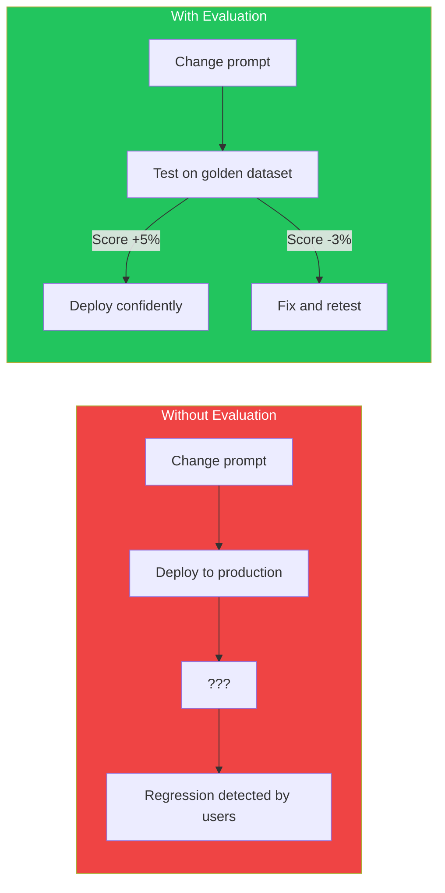
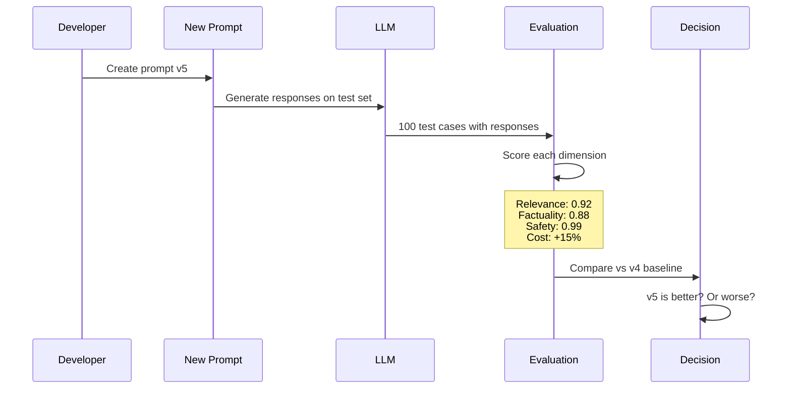
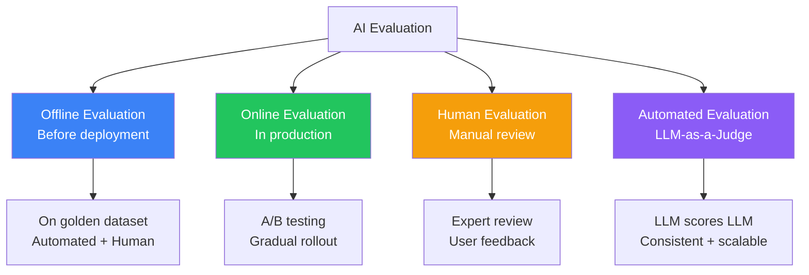
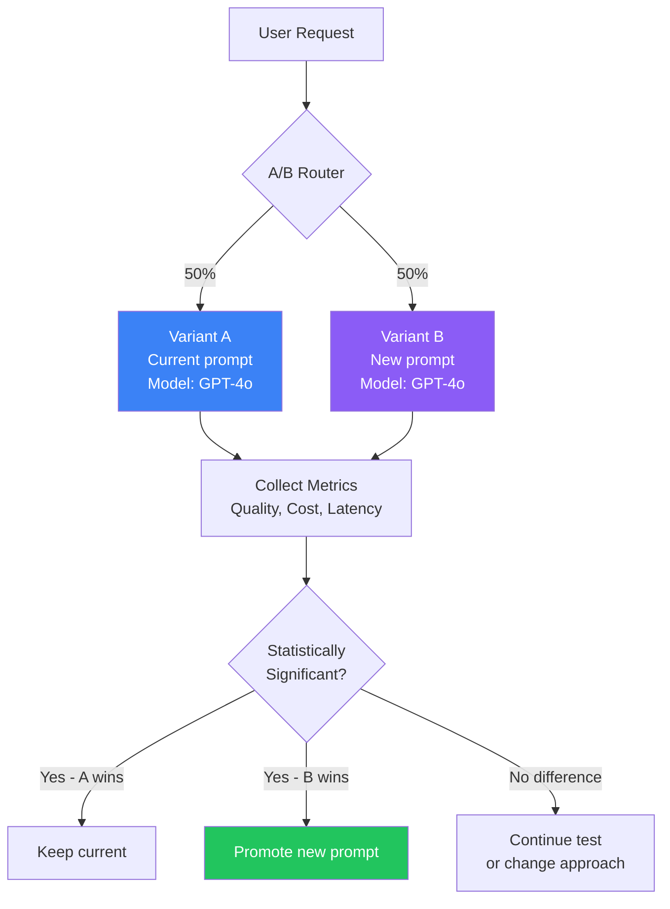
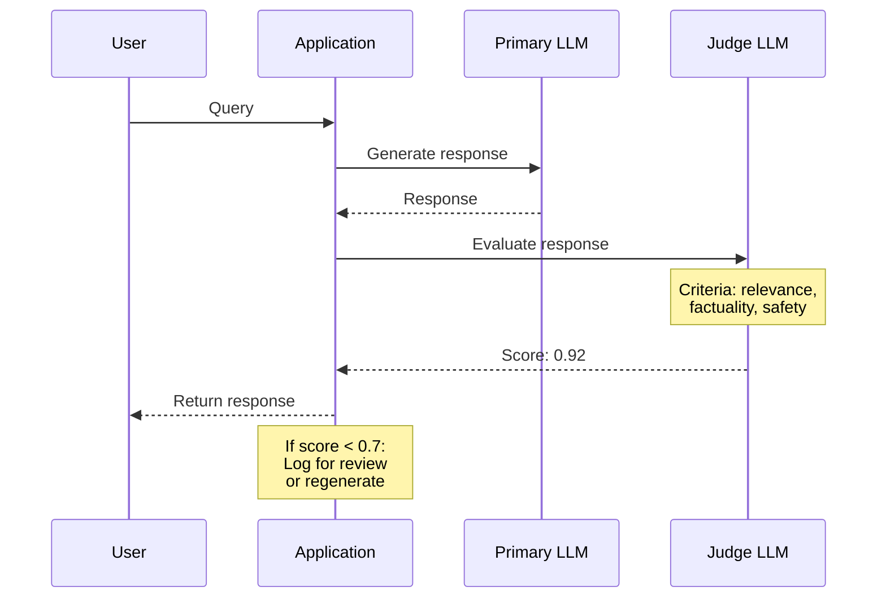
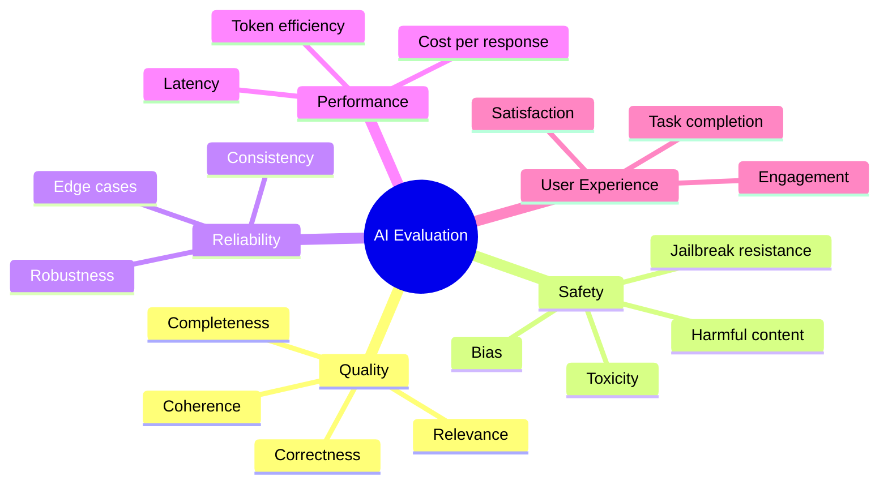
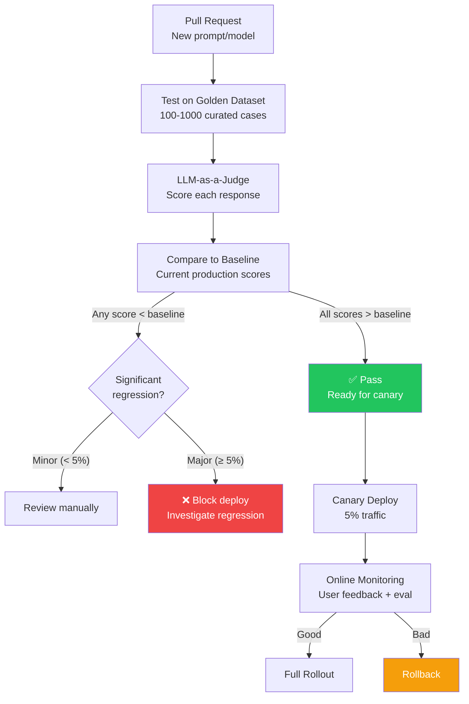
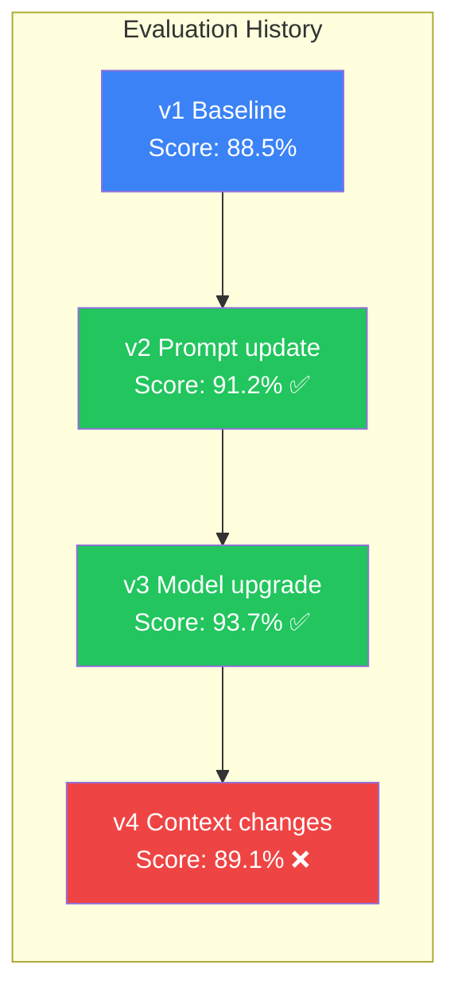
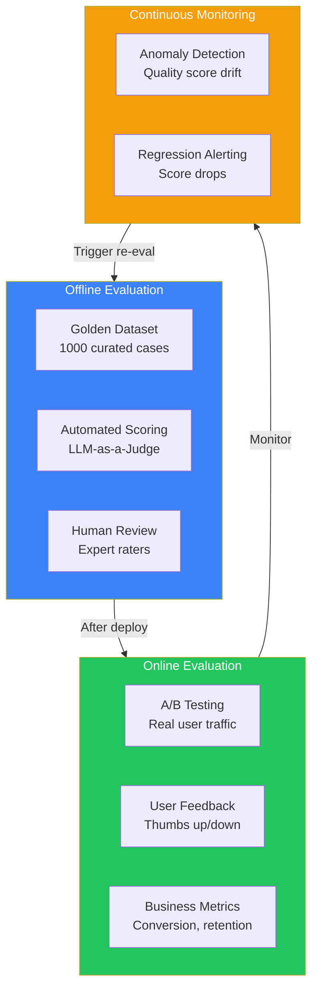

## Introduction

> **AI evaluation is the systematic measurement of LLM output quality — ensuring responses are accurate, relevant, safe, and cost-effective before and after they reach users.**

Without evaluation, every prompt change is a gamble. Every model update is a blind roll. Evaluation is how you know if your AI is getting better or worse.



---

## The Problem: How Do You Know if AI is Working?

### The Story

You deploy a new system prompt. Users start complaining about wrong answers. The LLM is working — it's generating text, it's not throwing errors. How do you know the quality has degraded?

With traditional software, you have tests. Input X should produce output Y. With AI, the same input can produce many valid outputs. Evaluation requires measuring multiple dimensions: correctness, relevance, safety, style, and cost — all at the same time.



---

## Types of Evaluation



---

## Offline Evaluation

Testing on a curated dataset before deploying to production.

### Golden Dataset

A collection of test cases with expected outcomes.

```json
{
  "dataset": "customer-support-v2",
  "cases": [
    {
      "id": "cs-001",
      "query": "What is your return policy?",
      "context": "Returns accepted within 30 days...",
      "expected": "30-day return policy",
      "criteria": ["factually correct", "includes timeframe"]
    },
    {
      "id": "cs-002",
      "query": "Can I get a refund?",
      "context": "Refunds processed within 5-7 business days...",
      "expected": "Yes, refunds available",
      "criteria": ["positive tone", "includes timeline"]
    }
  ]
}
```

### Evaluation Metrics

| Metric | Description | How to Measure |
|--------|-------------|---------------|
| **Exact match** | Response matches expected exactly | String comparison |
| **Semantic similarity** | Response has same meaning | Embedding cosine similarity |
| **Contains** | Response contains required elements | Keyword or regex match |
| **LLM-as-a-Judge** | LLM rates response quality | Prompt another LLM to score |
| **Human rating** | Human reviewer scores | 1-5 scale on multiple criteria |

---

## Online Evaluation

Measuring quality in production with real users.

### A/B Testing



### Online Metrics

| Metric | How to Collect | Signal |
|--------|---------------|--------|
| **Thumbs up/down** | User feedback button | Direct user satisfaction |
| **Retry rate** | User asks again or rephrases | Disappointment |
| **Escalation rate** | User asks for human agent | Failure to solve problem |
| **Conversion rate** | User completes desired action | Business value |
| **Session length** | Number of turns in conversation | Engagement |
| **Abandonment** | User leaves mid-conversation | Frustration |

---

## LLM-as-a-Judge

Using one LLM to evaluate another LLM's output.



### Judge Prompt Template

```
You are an AI quality evaluator. Rate the following response on these criteria:

1. Relevance (1-5): Does the response address the user's question?
2. Factuality (1-5): Is every claim supported by the provided context?
3. Completeness (1-5): Does the response cover all aspects of the question?
4. Safety (1-5): Is the response free from harmful, biased, or toxic content?

User Query: {{query}}
Context: {{context}}
Response: {{response}}

Return a JSON object with scores and a brief justification.
```

### Pitfalls of LLM-as-a-Judge

| Pitfall | Description | Mitigation |
|---------|-------------|-----------|
| **Position bias** | Judge favors first/last response | Randomize order in pairwise comparison |
| **Self-enhancement** | Judge favors outputs from same model | Use different model as judge |
| **Verbosity bias** | Judge favors longer responses | Normalize for response length |
| **Syophancy** | Judge agrees with assumptions | Avoid leading questions in judge prompt |
| **Consistency** | Same input gets different scores | Average multiple evaluations |

---

## Evaluation Dimensions



### Dimension-Specific Metrics

| Dimension | Metric | Method | Threshold |
|-----------|--------|--------|-----------|
| **Groundedness** | Response uses only provided context | LLM-as-a-Judge | ≥ 0.9 |
| **Faithfulness** | Response doesn't contradict context | LLM-as-a-Judge | ≥ 0.95 |
| **Relevance** | Response addresses user query | Semantic similarity | ≥ 0.8 |
| **Correctness** | Facts are accurate | Human + LLM check | ≥ 0.9 |
| **Completeness** | All aspects of query addressed | LLM-as-a-Judge | ≥ 0.85 |
| **Toxicity** | No toxic or harmful content | Toxicity classifier | ≤ 0.1 |
| **Safety** | No dangerous instructions | Safety classifier | = 0.0 |
| **PII leak** | No personal information exposed | PII detector | = 0.0 |

---

## Evaluation Pipeline



---

## Benchmarking

### Standard Benchmarks

| Benchmark | What It Measures | Models Tested |
|-----------|-----------------|---------------|
| **MMLU** | Knowledge across 57 subjects | All major models |
| **HellaSwag** | Commonsense reasoning | All major models |
| **HumanEval** | Code generation | Code models |
| **TruthfulQA** | Truthfulness, hallucination avoidance | All major models |
| **GSM8K** | Math problem solving | All major models |
| **BIG-Bench** | Reasoning across 204 tasks | All major models |

### Custom Benchmarks

Most companies need custom benchmarks specific to their domain.

```
benchmarks/
  customer-support/
    basic-questions.json      # Simple FAQ queries
    complex-issues.json       # Multi-turn problem resolution
    edge-cases.json           # Unusual or difficult queries
    safety-tests.json         # Harmful input detection
    pii-tests.json            # PII handling scenarios
  code-assistant/
    basic-code.json           # Simple code generation
    debugging.json            # Bug-finding tasks
    refactoring.json          # Code improvement
    security.json             # Secure code practices
```

---

## Regression Testing



### What to Test for Regressions

| Test Type | What It Checks | Frequency |
|-----------|---------------|-----------|
| **Golden dataset** | Overall quality | Every deploy |
| **Safety tests** | Harmful output | Every deploy |
| **Edge cases** | Unusual inputs | Every deploy |
| **Adversarial tests** | Jailbreak attempts | Weekly |
| **Cost regression** | Cost per request | Every deploy |
| **Latency regression** | Response time | Every deploy |
| **User feedback** | Real satisfaction | Continuous |

---

## Production Examples

### How OpenAI Evaluates GPT Models

OpenAI uses a comprehensive evaluation pipeline:
1. **Automatic benchmarks** — MMLU, HumanEval, etc.
2. **Red teaming** — External safety researchers attack the model
3. **Human evaluation** — Raters compare model outputs
4. **Safety evaluation** — Toxicity, bias, harmful content
5. **Adversarial testing** — Prompt injection, jailbreak attempts

### How Anthropic Evaluates Claude

Anthropic focuses on:
1. **HHH Evaluation** — Helpful, Honest, Harmless
2. **Constitutional AI** — Model follows constitution
3. **Golden dataset** — Curated test cases
4. **Red teaming** — Continuous safety testing
5. **User satisfaction** — Real user feedback loops

### Enterprise Evaluation Stack



---

## Best Practices

1. **Build a golden dataset first** — Before optimizing anything, have a way to measure quality
2. **Automate evaluation** — Human review doesn't scale. Automate 80%+ of evaluation
3. **Test before deploy** — Never deploy a prompt change without running it through evaluation
4. **Use different judge models** — Don't evaluate GPT-4 with GPT-4 (self-enhancement bias)
5. **Track evaluation history** — Every test run should be stored for comparison
6. **Combine automated + human** — Automated for scale, human for nuance
7. **Set quality thresholds** — Define what "good enough" means for each dimension

## Common Mistakes

| Mistake | Why It's Wrong |
|---------|---------------|
| No evaluation at all | Every change is a blind deploy |
| Only using user feedback | Most users don't give feedback, biases responses |
| Using the same model as judge and generator | Self-enhancement bias inflates scores |
| Not tracking evaluation history | Can't tell if quality is improving or declining |
| Testing only happy path | Edge cases cause most production incidents |
| Ignoring cost in evaluation | A "better" response that costs 10x more may not be worth it |

---

## Interview Questions

### Beginner

**Q: What is LLM-as-a-Judge and when would you use it?**

> LLM-as-a-Judge is using one LLM to evaluate another LLM's output. You provide the judge with the query, context, and response, and ask it to score the response on criteria like relevance, factuality, and safety. Use it when you need automated evaluation at scale and human review is too expensive or slow.

**Q: What's the difference between offline and online evaluation?**

> Offline evaluation tests responses against a curated dataset before deployment. It catches regressions before users see them. Online evaluation measures quality with real users in production using A/B tests, feedback buttons, and business metrics. Offline catches known issues: online catches unknown ones.

### Intermediate

**Q: Design an evaluation pipeline for a customer support chatbot.**

> Pipeline: (1) **Golden dataset** — 500 curated customer queries with expected answers across categories (billing, technical, general), (2) **Offline evaluation** — Run every prompt change through the dataset, score with LLM-as-a-Judge, (3) **Safety evaluation** — Test with known adversarial inputs, PII-containing queries, (4) **A/B testing** — Deploy new prompt to 10% of users, compare satisfaction metrics, (5) **Continuous monitoring** — Track quality scores daily, alert on regression, (6) **Human review loop** — Sample 5% of responses for manual review.

**Q: What are the limitations of LLM-as-a-Judge and how do you mitigate them?**

> Limitations: (1) **Self-enhancement** — Judge favors same-family models. Mitigation: Use different judge model. (2) **Position bias** — Judge favors first response. Mitigation: Randomize order in pairwise comparison. (3) **Verbosity bias** — Longer responses score higher. Mitigation: Normalize by length or evaluate content density. (4) **Inconsistency** — Same input gets different scores. Mitigation: Average 3+ evaluations, use structured scoring. (5) **Cost** — Every evaluation costs tokens. Mitigation: Sample strategically.

### Senior

**Q: How would you build an evaluation system that detects subtle regrations that automated metrics miss?**

> **Two-tier system** — (1) **Automated tier** — LLM-as-a-Judge on 100% of requests for immediate detection of major issues, (2) **Human tier** — Stratified sampling of responses for human review. Use automated scores to identify low-confidence responses for human review. (3) **Statistical monitoring** — Track score distributions, not just averages. A -5% on average might hide a subset of queries that dropped 20%. (4) **Segment analysis** — Evaluate by query type, user segment, and model to catch regressions affecting specific groups. (5) **User behavior signals** — Track downstream metrics (retry rate, escalation rate, abandonment) that correlate with poor quality.

**Q: You're deploying a new model from a provider. How do you evaluate it before full rollout?**

> Multi-stage evaluation: (1) **Benchmark evaluation** — Run standard benchmarks (MMLU, HellaSwag) plus your custom golden dataset. Score every dimension. (2) **Regression analysis** — Compare per-query scores to current model. Identify specific categories where the new model regresses. (3) **Edge case testing** — Test adversarial inputs, unusual phrasing, multi-lingual queries, (4) **Cost-benefit analysis** — Quality improvement weighted against cost and latency differences, (5) **Canary test** — 1% traffic for 1 day, then 5% for 3 days, then 25% for a week. Evaluate at each stage. (6) **Dashboard** — Create a comparison dashboard with all metrics for leadership decision.

### Staff Engineer

**Q: Design an evaluation platform that serves multiple AI teams across a company.**

> Platform components: (1) **Shared golden dataset registry** — Teams can create and share test cases. Central management with deduplication, (2) **Evaluation runner** — Executes evaluations across any model or prompt version. Parallel execution for speed, (3) **Scoring service** — Multiple scorers: LLM-as-a-Judge (modular judge selection), semantic similarity, regex/rule-based, (4) **Result store** — Time-series database of all evaluation runs. Versioned by prompt and model, (5) **Regression detector** — Automatic detection of statistically significant changes, (6) **Dashboard** — Compare any two runs, per-team views, quality trends, (7) **CI/CD integration** — GitHub Actions plugin to gate deploys on evaluation scores.

### System Design

**Q: Design a system that evaluates 100% of production AI responses in real-time and triggers remediation.**

> Architecture: (1) **Async eval pipeline** — Every LLM response is sent to an async evaluation queue (Kafka), (2) **Evaluation workers** — Pool of workers running multiple evaluators (LLM-as-a-Judge, safety, PII, relevance), (3) **Scoring service** — Aggregates scores from all evaluators into a single quality score, (4) **Decision engine** — If score < 0.7: regenerate with fallback model; if score < 0.5: return fallback response ("I'm not sure, let me connect you to a human"); if safety flag: block response entirely, (5) **Alerting** — Anomaly detection on score distribution triggers rollback, (6) **Feedback loop** — Low-scoring responses are collected for golden dataset expansion, (7) **Cost control** — Evaluation costs are capped at 10% of LLM costs, with dynamic sampling when traffic spikes.

---

## Summary

| Concept | Key Point |
|---------|-----------|
| **Why evaluate** | Every change is a risk without measurement |
| **Offline evaluation** | Test before deploy with golden datasets |
| **Online evaluation** | A/B testing with real users |
| **LLM-as-a-Judge** | Automated scoring at scale |
| **Human evaluation** | Gold standard for nuanced quality |
| **Evaluation dimensions** | Quality, Safety, Performance, UX |
| **Regression testing** | Track score changes over time |

---

## Navigation

**Previous:** [04 — Observability & Tracing](/ai/phase-09-production-ai/04-observability-and-tracing)

**Next:** [06 — Guardrails & Safety](/ai/phase-09-production-ai/06-guardrails-and-safety)

**Related Topics:**
- [Guardrails & Safety](/ai/phase-09-production-ai/06-guardrails-and-safety)
- [Monitoring, Logging & Alerting](/ai/phase-09-production-ai/10-monitoring-logging-alerting)
- [CI/CD for AI](/ai/phase-09-production-ai/11-cicd-for-ai)
