## Introduction

> **Performance and cost optimization in AI is about delivering the best possible user experience while managing the significant costs of LLM inference — through caching, model selection, token optimization, and intelligent routing.**

AI costs are the new cloud costs. Just as companies had to learn to manage AWS bills, they now need to manage AI inference costs. A single GPT-4 call can cost $0.10. At 1M requests/day, that's $100,000/day. Optimization isn't optional — it's essential.

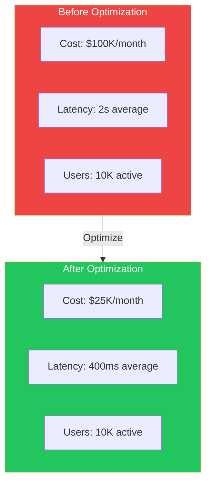

---

## The Problem: AI is Expensive and Slow

### The Story

Your company launches an AI feature. Users love it. Traffic grows 10x. Your monthly AI bill grows 10x. Suddenly, AI is costing more than the rest of the infrastructure combined. Management is asking why each customer query costs $0.15.

This is the AI cost crisis. And it happens to every company that launches a successful AI feature without optimizing costs from day one.

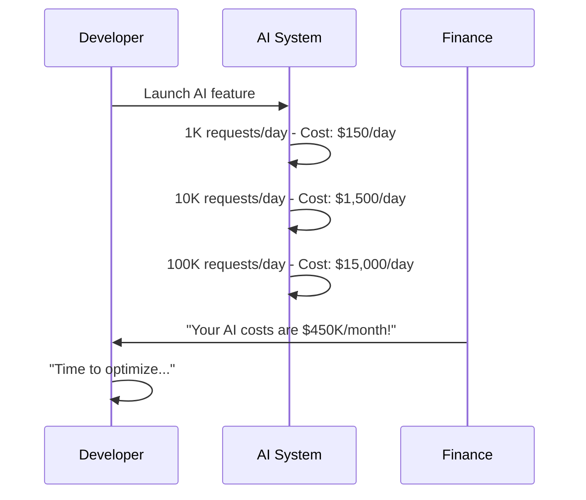

---

## Caching Strategies

Caching is the single most effective way to reduce AI costs.

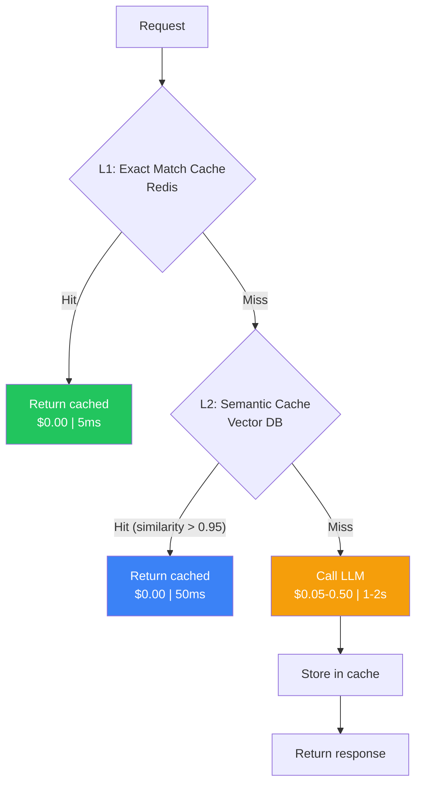

### Cache Types

| Cache Type | Store | TTL | Hit Rate | Cost Savings |
|------------|-------|-----|----------|--------------|
| **Exact prompt cache** | Redis (key-value) | 24h | 20-40% | ~90% |
| **Semantic cache** | Vector DB | 1h | 10-25% | ~80% |
| **Response cache** | Redis | Varies | 30-50% | ~95% |
| **LLM prompt caching** | Provider-side | 5-10min | 50-80% on system tokens | Partial |
| **Embedding cache** | Redis | 24h | 60-80% | ~95% |

### Prompt Caching

Many LLM providers now offer prompt caching — reusing processed system prompts across requests.

```
Before:              After (Prompt Caching):
Input: 2000 tokens   Input: 2000 tokens (1800 cached)
Output: 300 tokens    Output: 300 tokens
Cost: $0.035          Cost: $0.008 (77% savings)
Latency: 800ms        Latency: 350ms (56% reduction)
```

### Semantic Caching

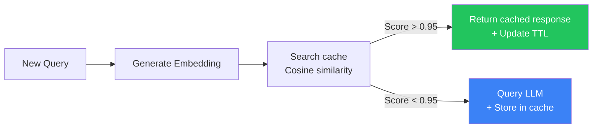

---

## Streaming

Streaming improves perceived performance without reducing actual processing time.

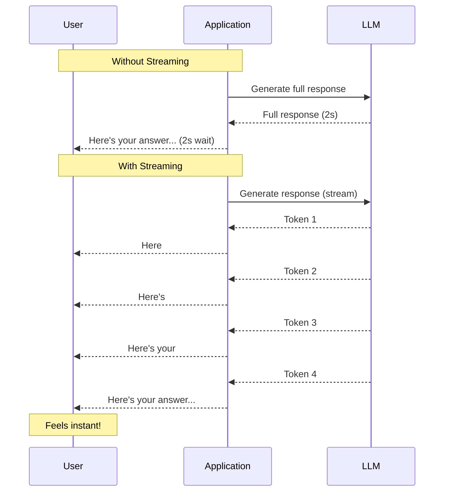

### Streaming Benefits

| Metric | Without Streaming | With Streaming | Improvement |
|--------|------------------|----------------|-------------|
| **Time to first token** | 2s | 200ms | 90% faster |
| **User satisfaction** | 60% | 95% | +35% |
| **Perceived latency** | 2s | 200ms | 10x better |
| **Bounce rate** | 15% | 3% | -80% |

---

## Model Selection

Choosing the right model for each request is the biggest cost optimization lever.

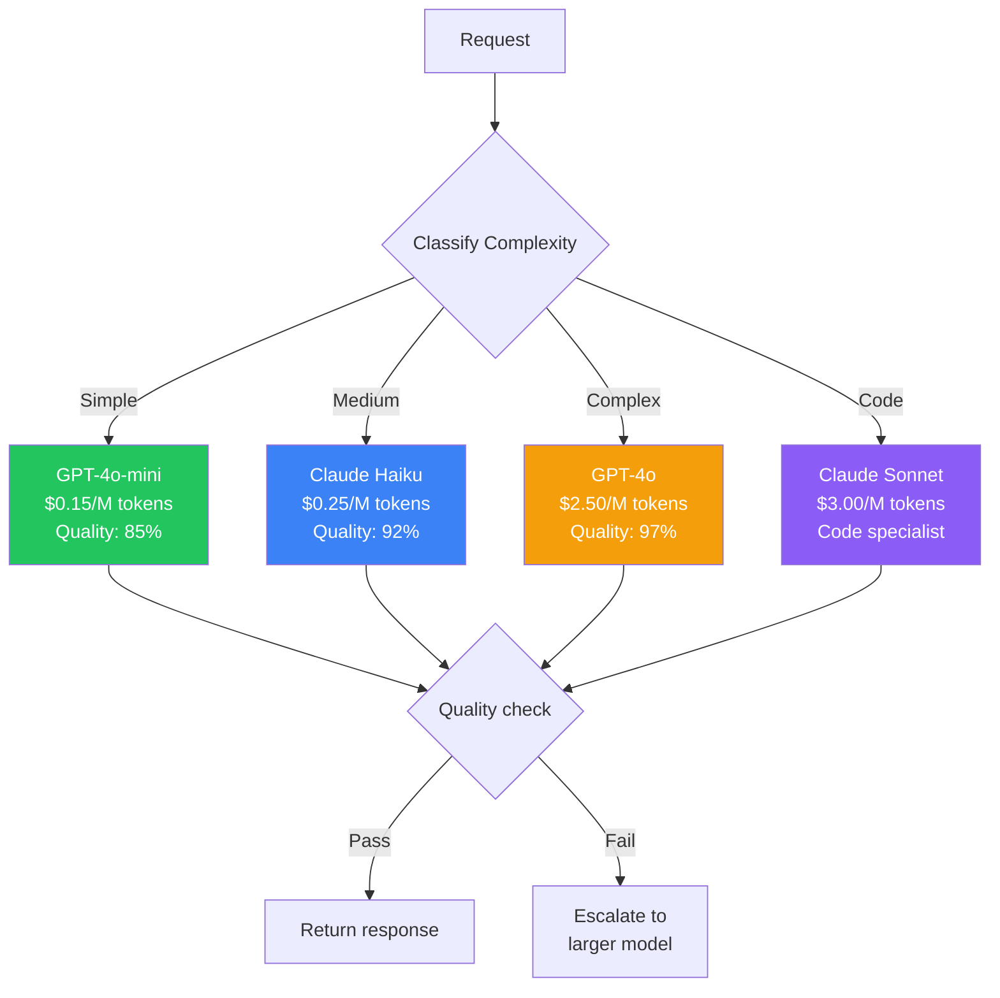

### Model Cost Comparison

| Model | Input Cost (per 1M tokens) | Output Cost (per 1M tokens) | Speed | Quality |
|-------|---------------------------|----------------------------|-------|---------|
| **GPT-4o-mini** | $0.15 | $0.60 | Very Fast | Good |
| **Claude Haiku** | $0.25 | $1.25 | Fast | Very Good |
| **GPT-4o** | $2.50 | $10.00 | Medium | Excellent |
| **Claude Sonnet** | $3.00 | $15.00 | Fast | Excellent |
| **Claude Opus** | $15.00 | $75.00 | Slow | Best |
| **Gemini 1.5 Pro** | $1.25 | $5.00 | Fast | Excellent |

### Model Routing Strategy

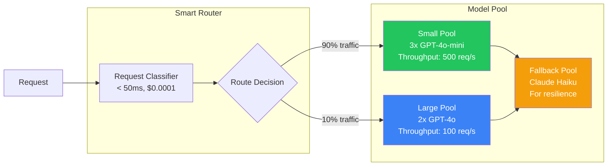

---

## Token Optimization

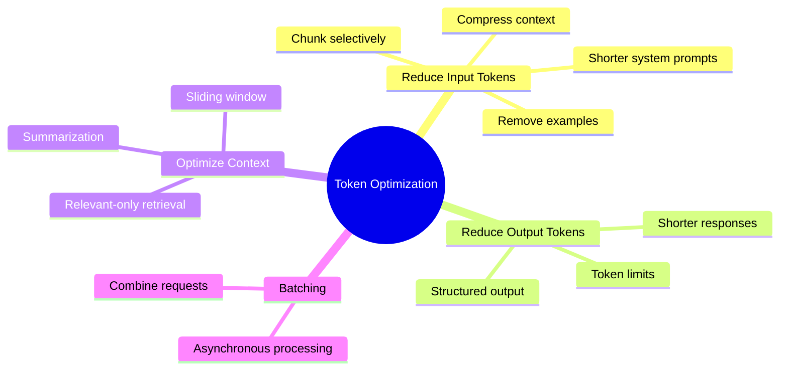

### Optimization Techniques

| Technique | Savings | Effort | Risk |
|-----------|---------|--------|------|
| **Trim system prompt** | 10-30% on input | Low | Low |
| **Selective RAG chunks** | 20-50% on input | Medium | Medium |
| **Context compression** | 50-80% on input | Medium | Medium |
| **Output token limits** | 20-50% on output | Low | Low |
| **Structured output (JSON)** | Similar tokens | Low | Low |
| **Remove few-shot examples** | Varies | Low | Medium |
| **Dynamic context window** | 30-60% on input | High | Low |

### Example: Prompt Size Optimization

```
Before (1200 tokens):
"You are a helpful customer support assistant for Acme Corp, a company that
sells widgets, gadgets, and accessories. Our return policy allows returns 
within 30 days of purchase for a full refund. Products must be in original
condition. Shipping costs are covered by the customer unless the item is 
defective. Warranty is 1 year for widgets, 2 years for gadgets. To start
a return, visit acme.com/returns or call 1-800-ACME. Here are some examples:
[3 long examples]"

After (450 tokens):
"You are Acme Corp support. Key policies:
- Returns: 30 days, original condition, customer pays shipping
- Warranty: Widgets 1yr, Gadgets 2yr
- Contact: acme.com/returns | 1-800-ACME
Be concise and helpful."
```

---

## Batching

Grouping multiple requests into a single API call.

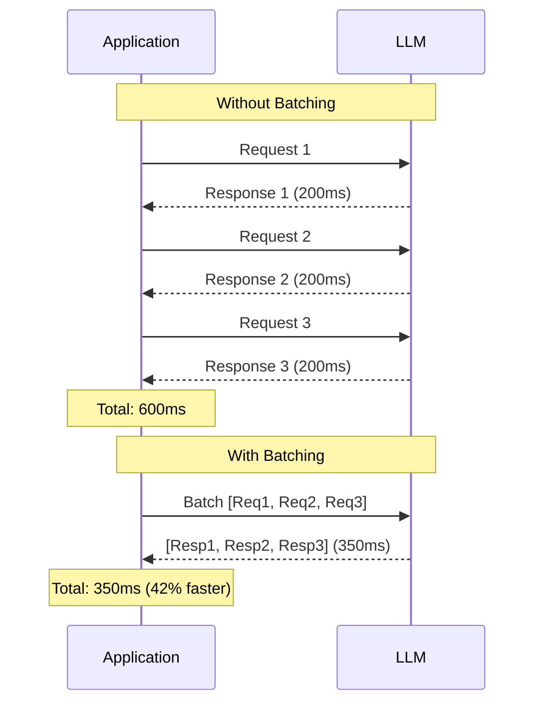

---

## Cost Analysis

### Cost Calculation

```
Cost per request = (Input tokens × Input price) + (Output tokens × Output price)

Example:
  Input: 2000 tokens × GPT-4o ($2.50/M) = $0.005
  Output: 500 tokens × GPT-4o ($10.00/M) = $0.005
  Total: $0.01 per request

At 100K requests/day:
  Daily: $1,000
  Monthly: $30,000
  Annual: $365,000
```

### Cost Breakdown Dashboard

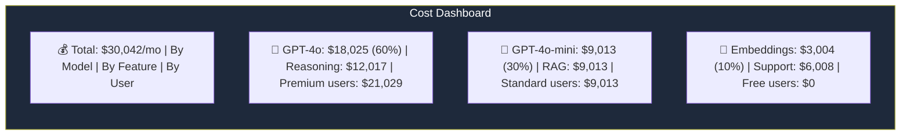

### Cost Optimization Targets

| Technique | Potential Savings | Implementation Complexity | Impact on Quality |
|-----------|------------------|------------------------|-------------------|
| **Exact match caching** | 30-40% | Low | None |
| **Semantic caching** | 15-25% | Medium | Minimal |
| **Model routing** | 50-70% | Medium | None (with fallback) |
| **Prompt compression** | 20-40% | Low | Low |
| **Output length limits** | 20-50% | Low | Medium |
| **Batching** | 10-30% | Medium | None |
| **Context optimization** | 30-60% | Medium | Medium |
| **Self-hosting (small models)** | 70-90% | High | Medium |

---

## Performance Optimization

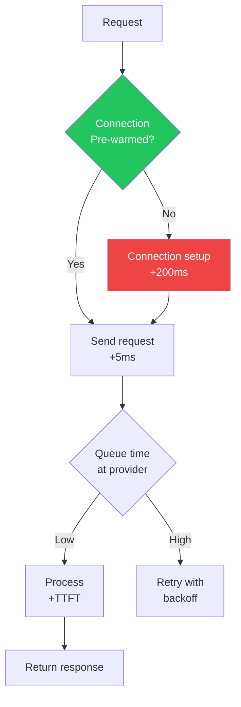

### Latency Optimization Techniques

| Technique | Improvement | Trade-off |
|-----------|-------------|-----------|
| **Connection pooling** | 100-200ms saved | Memory for connections |
| **Streaming** | 10x perceived improvement | Slightly higher infrastructure cost |
| **Smaller models** | 2-5x faster | Potential quality loss |
| **Lower temperature** | More predictable + faster | Less creative responses |
| **Shorter outputs** | Proportional savings | Less detailed responses |
| **Edge deployment** | 50-100ms saved per region | Higher ops complexity |
| **Pre-warmed connections** | 100-200ms saved | Idle connection cost |

---

## Production Examples

### How Companies Optimize AI Costs

| Company | Optimization | Savings |
|---------|-------------|---------|
| **ChatGPT** | Model routing + prompt caching | ~40% cost reduction |
| **GitHub Copilot** | Caching similar code completions | ~35% fewer API calls |
| **Notion AI** | Selective context injection | ~50% token reduction |
| **Perplexity** | Hybrid search + caching | ~60% cost reduction |
| **Enterprise** | Self-hosted small models for simple tasks | ~80% cost reduction |

### Real-World Optimization Case

A customer support chatbot processing 500K queries/month:

| Strategy | Before | After | Savings |
|----------|--------|-------|---------|
| **Model routing** | All queries → GPT-4o | 70% → GPT-4o-mini | 55% cost reduction |
| **Response caching** | No cache | 30% cache hit rate | 30% fewer API calls |
| **Prompt optimization** | Long system prompt | Trimmed 40% | 40% fewer input tokens |
| **Total** | $15,000/month | $4,500/month | **70% savings** |

---

## Best Practices

1. **Cache aggressively** — Exact match + semantic caching can reduce costs by 30-50%
2. **Use the smallest model that works** — Start with GPT-4o-mini, escalate to larger models when needed
3. **Optimize prompts for token efficiency** — Shorter prompts mean lower costs and faster responses
4. **Monitor costs in real-time** — Don't wait for the monthly bill to discover you're overspending
5. **Set per-user budgets** — Prevent any single user from driving excessive costs
6. **Stream by default** — Improves user experience even if total latency is the same
7. **A/B test optimizations** — Measure quality impact before committing to cost-saving changes

## Common Mistakes

| Mistake | Why It's Wrong |
|---------|---------------|
| Only using the most expensive model | 70% of queries can be handled by cheaper models |
| No caching | Paying for the same response multiple times |
| Ignoring token usage | Long prompts silently increase costs |
| No cost monitoring | Surprise bills at end of month |
| Optimizing latency without measuring tokens | Faster isn't always cheaper |
| No model fallback strategy | Can't use cheaper models without quality assurance |

---

## Interview Questions

### Beginner

**Q: What are the main ways to reduce AI costs in production?**

> (1) **Caching** — Cache exact and semantically similar queries, (2) **Model routing** — Use cheaper models for simple queries, (3) **Prompt optimization** — Shorter prompts consume fewer tokens, (4) **Output limits** — Cap response length, (5) **Batching** — Combine multiple requests.

**Q: What's the difference between exact match caching and semantic caching?**

> **Exact match caching** stores responses keyed by the exact input string. Only identical queries get a cache hit. **Semantic caching** stores query embeddings and finds similar queries using vector similarity. This catches paraphrased versions of the same question. Semantic caching has higher hit rates but requires a vector database.

### Intermediate

**Q: Design a model routing system that balances cost and quality.**

> Components: (1) **Query classifier** — Small, fast model classifies query difficulty (simple/medium/complex), (2) **Routing table** — Maps complexity levels to model pools, (3) **Model pools** — Small (GPT-4o-mini x5), Medium (Claude Haiku x3), Complex (GPT-4o x2), (4) **Fallback chain** — If complex model fails, fallback to medium with quality check, (5) **Quality check** — For low-confidence responses from small models, re-route to larger model, (6) **Cost tracking** — Track cost per request by route, optimize routing thresholds.

**Q: How would you implement a semantic cache for an AI chatbot?**

> Implementation: (1) Generate embedding for each user query (using text-embedding-3-small), (2) Store {embedding, response, timestamp} in vector DB, (3) On new query, generate embedding and search for similar (cosine similarity > 0.95), (4) If found, return cached response (update TTL), (5) If not found, query LLM, store result with embedding, (6) Background job to evict old entries.

### Senior

**Q: How would you optimize costs for a multi-feature AI platform used by 100K daily active users?**

> Strategy: (1) **Tiered model routing** — 70% simple queries → GPT-4o-mini ($0.15/M), 20% medium → Claude Haiku ($0.25/M), 10% complex → GPT-4o ($2.50/M). Saves ~80% vs using GPT-4o for everything. (2) **Aggressive caching** — Exact match + semantic cache for repeated queries. Expected 30-40% hit rate. (3) **Prompt optimization** — Compress system prompts, use selective context injection. (4) **Batch non-urgent requests** — Background tasks wait for batch processing. (5) **Per-feature budgets** — Cap costs per feature, escalate overages for review. (6) **Monitoring** — Real-time cost dashboard with per-user, per-feature breakdown.

**Q: How do you handle the trade-off between cost optimization and response quality?**

> Trade-off management: (1) **Tiered quality** — Define quality tiers (Gold: GPT-4o, Silver: Haiku, Bronze: Mini), (2) **Quality monitoring** — Track quality scores per tier, ensure Bronze doesn't degrade below threshold, (3) **A/B test optimizations** — Every cost-saving change is A/B tested against current baseline, (4) **Fallback safety net** — If small model's quality check fails (confidence < 0.7), escalate to larger model, (5) **User segmentation** — Premium users always get best model, (6) **Dynamic thresholds** — Adjust routing thresholds based on current load and budget.

### Staff Engineer

**Q: Design a cost allocation system for an AI platform serving multiple internal teams.**

> System: (1) **Tagging** — Every request tagged with team_id, feature_id, user_tier, (2) **Real-time cost tracking** — Stream of cost events to time-series DB, (3) **Budget enforcement** — Per-team daily budgets with soft (alert) and hard (throttle) limits, (4) **Chargeback** — Monthly cost reports allocated to team budgets, (5) **Optimization recommendations** — Automated analysis of cost patterns suggesting model downgrades for specific query types, (6) **Anomaly detection** — Alert on unusual cost spikes per team, (7) **Dashboard** — Team-level cost breakdown with trend analysis.

### System Design

**Q: Design a cost optimization system that automatically routes queries to the cheapest adequate model.**

> Architecture: (1) **Query intake** — All requests routed through classifier service, (2) **Classifier** — Fine-tuned small model (DistilBERT) classifies into difficulty levels, trained on labeled queries, (3) **Routing engine** — Maps difficulty level to model, with fallback chain and quality gates, (4) **Quality gate** — LLM-as-a-Judge on a sample of responses from cheaper models, (5) **Feedback loop** — When quality gate flags a cheap model response as poor, reclassify the query type and update routing rules, (6) **Cost monitor** — Real-time cost tracking, auto-adjust routing when budget is exceeded, (7) **A/B testing** — Continuous comparison of routing decisions vs cost-quality tradeoffs.

---

## Summary

| Concept | Key Point |
|---------|-----------|
| **Caching** | Exact + semantic caching can reduce costs by 30-50% |
| **Streaming** | Improves perceived performance 10x |
| **Model routing** | Use small models for 70%+ of queries |
| **Token optimization** | Shorter prompts = lower cost + faster responses |
| **Batching** | Combine requests for better throughput |
| **Cost monitoring** | Track costs per user, feature, and model |
| **Quality-cost balance** | A/B test every optimization |

---

## Navigation

**Previous:** [07 — Security & Compliance](/ai/phase-09-production-ai/07-security-and-compliance)

**Next:** [09 — Deployment & Scaling](/ai/phase-09-production-ai/09-deployment-and-scaling)

**Related Topics:**
- [Deployment & Scaling](/ai/phase-09-production-ai/09-deployment-and-scaling)
- [Observability & Tracing](/ai/phase-09-production-ai/04-observability-and-tracing)
- [Production AI Architecture](/ai/phase-09-production-ai/02-production-ai-architecture)
