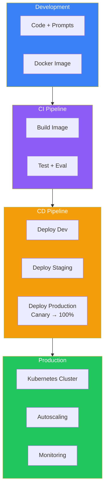
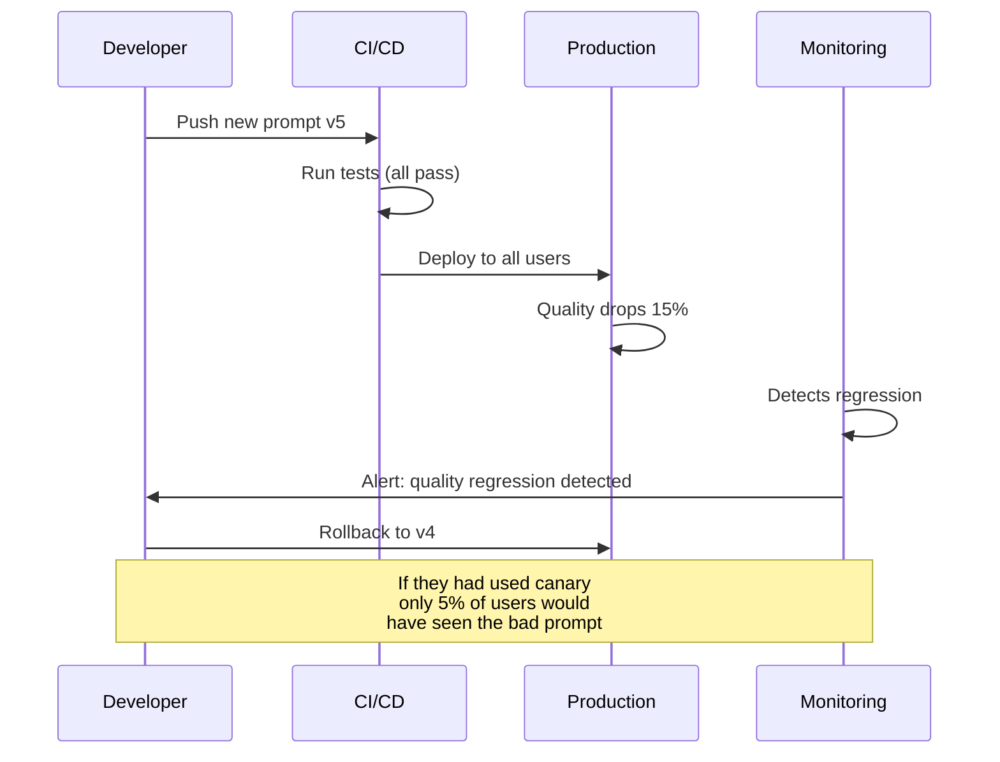
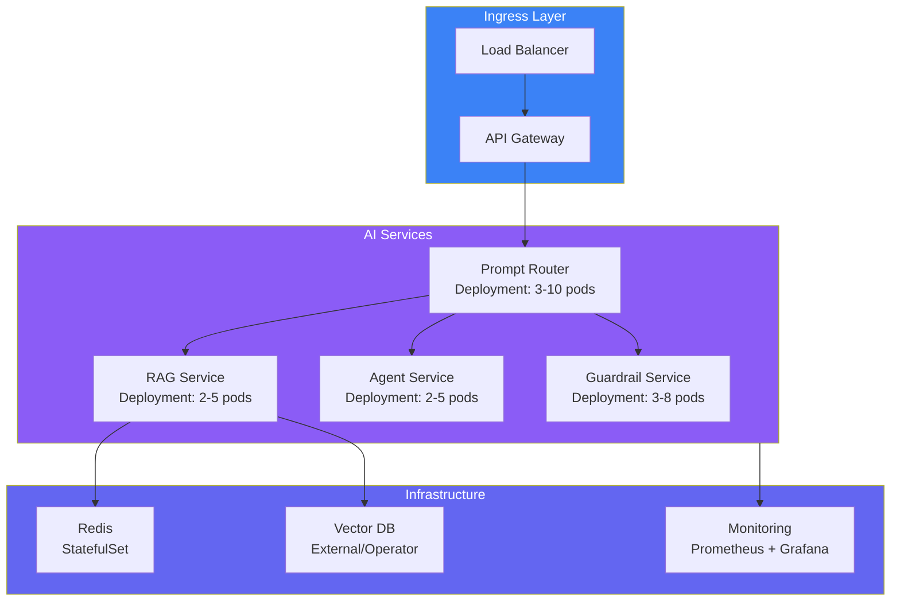
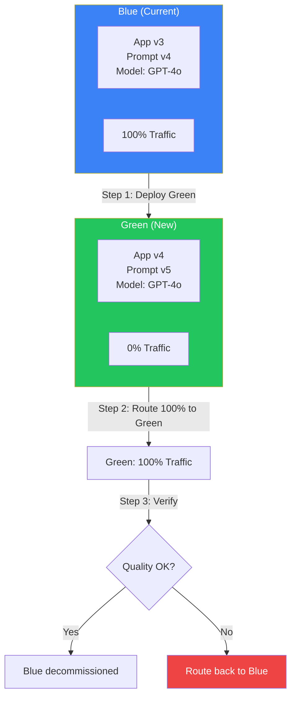
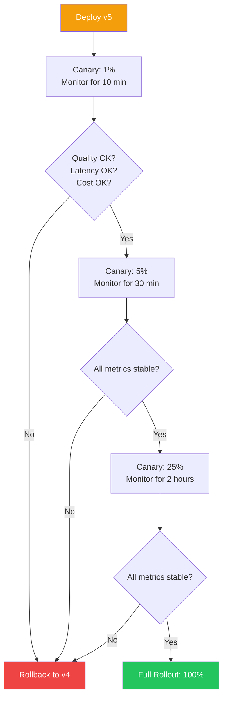
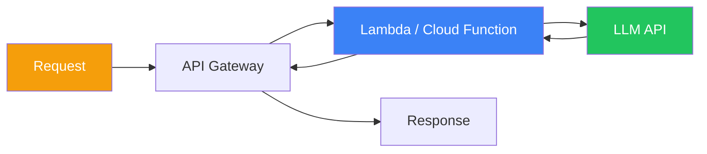
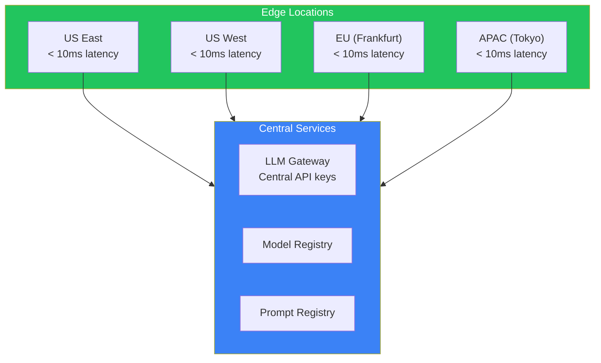
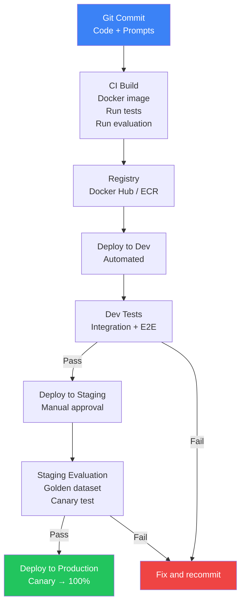
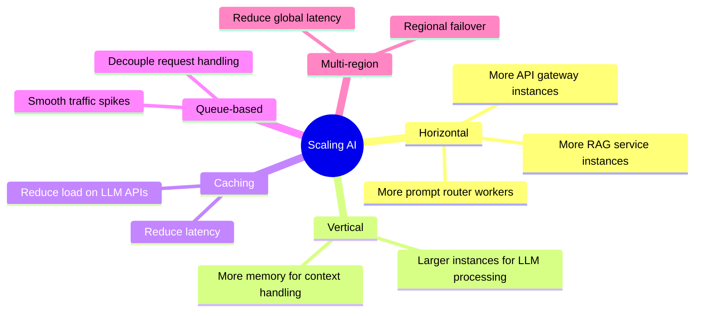

## Introduction

> **Deployment and scaling for AI applications involves containerizing AI services, orchestrating them with Kubernetes, implementing safe deployment strategies (blue-green, canary), and autoscaling to handle variable workloads.**

AI applications have unique deployment requirements. They depend on external LLM APIs that have rate limits and latency. They need to manage prompt versions, model configurations, and vector stores. A deployment mistake in AI can mean serving bad responses, not just serving errors.



---

## The Problem: AI Deployment is Different

### The Story

A team deploys a new prompt to production. All tests pass. Five minutes later, the chatbot starts giving nonsensical answers. The LLM isn't throwing errors — it's just producing bad output. The team has to scramble to revert.

With traditional software, deployment issues are clear — 500 errors, timeouts, crashes. With AI, deployment issues can be subtle — quality degradation, increased hallucination rates, higher costs. You need specialized deployment strategies to catch these issues before they affect all users.



---

## Containerization

### Docker for AI Applications

```dockerfile
FROM node:20-slim

WORKDIR /app

# Install dependencies
COPY package*.json ./
RUN npm ci --only=production

# Copy application code
COPY . .

# Copy prompt templates (versioned)
COPY prompts/ ./prompts/

# Set environment
ENV NODE_ENV=production
ENV PROMPT_VERSION=v4

EXPOSE 3000

CMD ["node", "server.js"]
```

### Multi-Stage Build

```dockerfile
# Build stage
FROM node:20 AS builder
WORKDIR /app
COPY package*.json ./
RUN npm ci
COPY . .
RUN npm run build

# Runtime stage
FROM node:20-slim
WORKDIR /app
COPY --from=builder /app/dist ./dist
COPY --from=builder /app/node_modules ./node_modules
COPY prompts/ ./prompts/
CMD ["node", "dist/server.js"]
```

---

## Kubernetes Orchestration

```yaml
apiVersion: apps/v1
kind: Deployment
metadata:
  name: ai-router
  labels:
    app: ai-router
    version: v4
spec:
  replicas: 5
  strategy:
    type: RollingUpdate
    rollingUpdate:
      maxSurge: 1
      maxUnavailable: 0
  selector:
    matchLabels:
      app: ai-router
  template:
    metadata:
      labels:
        app: ai-router
    spec:
      containers:
      - name: ai-router
        image: myregistry/ai-router:v4
        ports:
        - containerPort: 3000
        env:
        - name: PROMPT_VERSION
          value: "v4"
        - name: LLM_API_KEY
          valueFrom:
            secretKeyRef:
              name: llm-secrets
              key: openai-key
        resources:
          requests:
            memory: "256Mi"
            cpu: "250m"
          limits:
            memory: "512Mi"
            cpu: "500m"
        livenessProbe:
          httpGet:
            path: /health
            port: 3000
          initialDelaySeconds: 30
        readinessProbe:
          httpGet:
            path: /ready
            port: 3000
          initialDelaySeconds: 5
```

### Kubernetes Architecture for AI



### Autoscaling

```yaml
apiVersion: autoscaling/v2
kind: HorizontalPodAutoscaler
metadata:
  name: ai-router-hpa
spec:
  scaleTargetRef:
    apiVersion: apps/v1
    kind: Deployment
    name: ai-router
  minReplicas: 3
  maxReplicas: 20
  metrics:
  - type: Resource
    resource:
      name: cpu
      target:
        type: Utilization
        averageUtilization: 70
  - type: Resource
    resource:
      name: memory
      target:
        type: Utilization
        averageUtilization: 80
```

---

## Deployment Strategies

### Blue-Green Deployment



### Canary Deployment



### Comparison

| Strategy | Risk | Speed | Complexity | Traffic Impact |
|----------|------|-------|------------|---------------|
| **Rolling Update** | Medium | Fast | Low | Gradual |
| **Blue-Green** | Low | Instant switch | Medium | All at once |
| **Canary** | Very Low | Slow | High | Gradual |
| **A/B Testing** | Very Low | Slow | High | Feature-flag based |

---

## Serverless Deployment



### Serverless vs Containerized

| Factor | Serverless | Container (K8s) |
|--------|-----------|-----------------|
| **Cold start** | 100ms-1s | None |
| **Scaling** | Instant, unlimited | Requires HPA, limited by cluster |
| **Cost** | Pay per invocation | Pay for running instances |
| **Max duration** | 15 min (Lambda) | Unlimited |
| **State** | Stateless only | Can have state |
| **Best for** | Variable traffic, simple APIs | Consistent traffic, complex services |

### Example: Serverless AI Function

```javascript
// AWS Lambda handler for AI routing
exports.handler = async (event) => {
  const { query, user_id } = JSON.parse(event.body);
  
  // Classify query complexity
  const complexity = await classifyQuery(query);
  
  // Route to appropriate model
  const model = complexity === 'simple' ? 'gpt-4o-mini' : 'gpt-4o';
  
  // Call LLM
  const response = await callLLM(query, model);
  
  return {
    statusCode: 200,
    body: JSON.stringify({ response, model, cost: response.cost }),
  };
};
```

---

## Edge Deployment

Deploying AI capabilities closer to users for lower latency.



---

## Cloud AI Platforms

| Platform | Key Features | Best For |
|----------|-------------|----------|
| **Azure OpenAI** | GPT-4, GPT-4o, DALLE, embeddings, VPC integration, compliance | Enterprise, Microsoft shop |
| **AWS Bedrock** | Multiple models, SageMaker integration, VPC | AWS-native companies |
| **Google Vertex AI** | Gemini, PaLM, Model Garden, AutoML | GCP-native, AI-first companies |
| **Anthropic API** | Claude models, safety focus | Applications needing safety |
| **OpenAI API** | GPT-4o, assistants, embeddings | Most AI applications |
| **Together AI** | Open-source models | Cost optimization, customization |

---

## Deployment Pipeline



---

## Scaling Considerations



### Scaling Dimensions

| Dimension | What to Scale | How |
|-----------|--------------|-----|
| **API Gateway** | Request handling | Horizontal scaling (add instances) |
| **Prompt Router** | LLM call management | Queue + worker pool |
| **RAG Service** | Vector search | Sharding the vector index |
| **Cache** | Reduce LLM calls | Increase Redis cluster size |
| **Guardrails** | Safety checks | Horizontal scaling (stateless) |
| **LLM API** | Provider capacity | API key rotation, multi-provider |

---

## Best Practices

1. **Always use deployment strategies** — Never deploy directly to production. Use canary or blue-green
2. **Separate prompt deploys from code deploys** — Prompts should be independently deployable
3. **Automated rollback** — Every deploy should have an automatic rollback trigger based on quality metrics
4. **Health checks are not enough** — AI needs quality checks in addition to health checks
5. **Pre-warm connections** — Keep connections to LLM providers warm to avoid cold starts
6. **Regional deployment** — Deploy in regions close to your users and LLM provider endpoints
7. **Infrastructure as code** — All deployment config should be in version control

## Common Mistakes

| Mistake | Why It's Wrong |
|---------|---------------|
| Direct deploy to production | No safety net for quality regressions |
| Deploying code and prompts together | Can't rollback independently |
| No canary testing | A bad prompt affects 100% of users instantly |
| No autoscaling | Traffic spike causes downtime or high latency |
| Single region deployment | Regional outage takes down entire service |
| Ignoring LLM API rate limits | Deploy causes rate limit errors across all instances |
| No rollback plan | Stuck with a bad deployment while fixing |

---

## Interview Questions

### Beginner

**Q: What's the difference between blue-green and canary deployments?**

> Blue-green maintains two identical environments (blue = current, green = new). You switch traffic instantly from blue to green. Canary gradually shifts traffic (1% → 5% → 25% → 100%), monitoring at each step. Blue-green is faster but riskier. Canary is slower but safer, especially important for AI where quality regressions are hard to detect.

**Q: Why is deployment for AI applications different from traditional web applications?**

> AI apps need: (1) **Prompt version management** — Separate from code deploys, (2) **Quality monitoring** — Not just error rates but response quality, (3) **Canary testing** — Gradual rollout to catch quality regressions, (4) **Rollback based on quality** — Not just errors but hallucination scores, (5) **Model configuration** — Model selection, temperature, token limits as deploy-time config.

### Intermediate

**Q: Design a Kubernetes-based deployment for an AI application that can handle 10x traffic spikes.**

> Architecture: (1) **HPA** — Horizontal Pod Autoscaler with CPU/memory targets, min 5, max 50 pods, (2) **Queue buffer** — Requests go through a queue (SQS/RabbitMQ) before processing. Smooths traffic spikes, (3) **Pod Disruption Budget** — Max 20% pods unavailable during rolling updates, (4) **Node autoscaling** — Cluster autoscaler adds nodes when pods are pending, (5) **Readiness probes** — Quality check endpoint that removes pods with degraded quality from service, (6) **Multi-AZ** — Spread across 3 availability zones.

**Q: How would you implement a canary deployment for a prompt change?**

> Steps: (1) **Registry** — Prompt registry serves both v4 (current, 95% traffic) and v5 (canary, 5% traffic), (2) **Routing** — 5% of requests randomly assigned prompt v5, (3) **Monitoring** — Compare quality scores, latency, cost, user feedback between v4 and v5, (4) **Evaluation** — If v5 shows regression in any metric: auto-rollback. If stable for 30 min → 25% for 2 hours → 50% for 4 hours → 100%, (5) **Rollback** — Immediate switch to previous version.

### Senior

**Q: Design a multi-region deployment architecture for a global AI assistant.**

> Architecture: (1) **Regions** — US-East (primary), US-West (DR), EU (Frankfurt), APAC (Tokyo), (2) **Traffic routing** — Route53 latency-based routing, users go to nearest region, (3) **LLM endpoints** — Region-specific API keys (Azure in EU, AWS Bedrock in US), (4) **Vector stores** — Regional vector DB replicas with async sync, (5) **Configuration** — Global prompt registry with regional caches, (6) **Failover** — If region degrades, traffic shifts to next closest region, (7) **Data residency** — EU data stays in EU (GDPR), (8) **Monitoring** — Per-region dashboards with global overview.

**Q: How do you handle LLM API rate limits during a deployment that increases request volume?**

> Strategies: (1) **Buffer queue** — Requests queue locally when rate limit is approached, processed when quota refreshes, (2) **Multi-key rotation** — Distribute across multiple API keys automatically, (3) **Quota monitoring** — Real-time tracking of remaining quota, slow down before hitting limits, (4) **Dynamic batching** — Batch requests when approaching limits, (5) **Fallback models** — Route to alternative models when primary is rate-limited, (6) **Rate prediction** — ML model predicts rate limit approaching based on recent usage patterns.

### Staff Engineer

**Q: Design a deployment platform that enables 10 AI teams to deploy independently with shared infrastructure.**

> Platform: (1) **Shared K8s cluster** — Namespace per team with resource quotas, (2) **Central prompt registry** — Team-specific prompt repositories with versioning, (3) **Shared LLM gateway** — Any team's service calls LLM through the gateway. Gateway handles auth, rate limiting, caching, cost tracking, (4) **CI/CD pipelines** — Team-specific pipelines that run eval gates before promoting to shared staging, (5) **Deployment strategies** — All teams must use canary deployments with automated quality gates, (6) **Observability** — Central tracing with team-filtered views, (7) **Governance** — No direct production access. Changes go through code review + eval gates.

### System Design

**Q: Design a global deployment system that can deploy prompt changes to 1M+ users within 30 seconds (feature flags for AI).**

> System: (1) **Configuration service** — Global, low-latency config store (e.g., LaunchDarkly for AI), (2) **Prompt registry** — Stores all prompt versions with metadata, (3) **Edge cache** — CDN-cached prompt versions in edge locations (Cloudflare Workers, Fastly), (4) **Realtime propagation** — Config change triggers WebSocket push to all connected app instances, (5) **Rollback** — One-click rollback, propagated via the same mechanism in < 30 seconds, (6) **Phased rollout** — Deploy to 1% EU → 10% EU → 50% global → 100% global with automatic rollback at each stage, (7) **Monitoring** — Real-time quality dashboards per region, auto-rollback on anomaly detection.

---

## Summary

| Concept | Key Point |
|---------|-----------|
| **Containerization** | Docker for AI services with multi-stage builds |
| **Kubernetes** | HPA, rolling updates, readiness probes, resource limits |
| **Blue-Green** | Two environments, instant switch, instant rollback |
| **Canary** | Gradual rollout with quality gates at each stage |
| **Serverless** | Auto-scaling, pay-per-use, cold starts |
| **Edge deployment** | Regional nodes for low latency |
| **Autoscaling** | CPU/memory + custom metrics (queue depth, request rate) |

---

## Navigation

**Previous:** [08 — Performance & Cost Optimization](/ai/phase-09-production-ai/08-performance-and-cost-optimization)

**Next:** [10 — Monitoring, Logging & Alerting](/ai/phase-09-production-ai/10-monitoring-logging-alerting)

**Related Topics:**
- [Production AI Architecture](/ai/phase-09-production-ai/02-production-ai-architecture)
- [CI/CD for AI](/ai/phase-09-production-ai/11-cicd-for-ai)
- [Performance & Cost Optimization](/ai/phase-09-production-ai/08-performance-and-cost-optimization)
