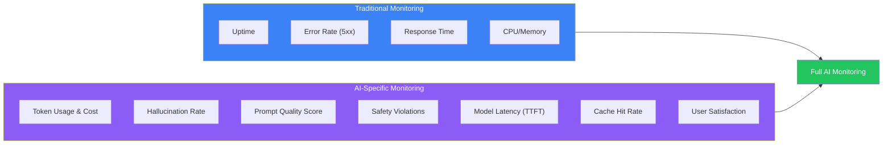
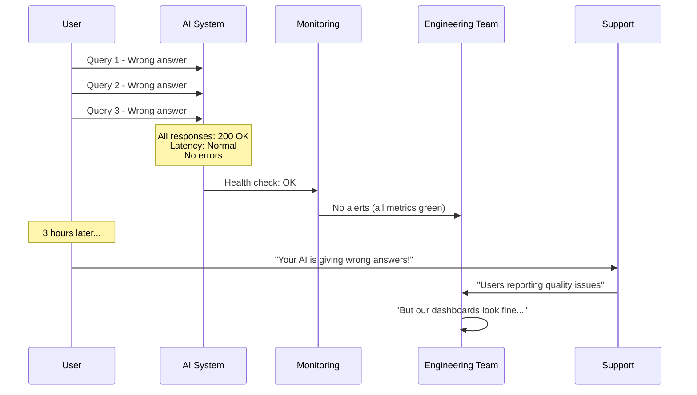
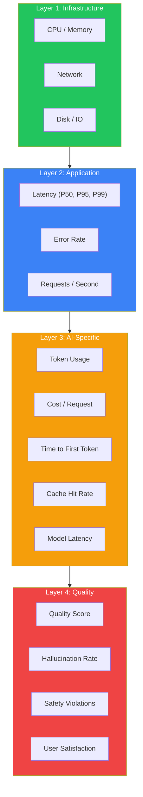
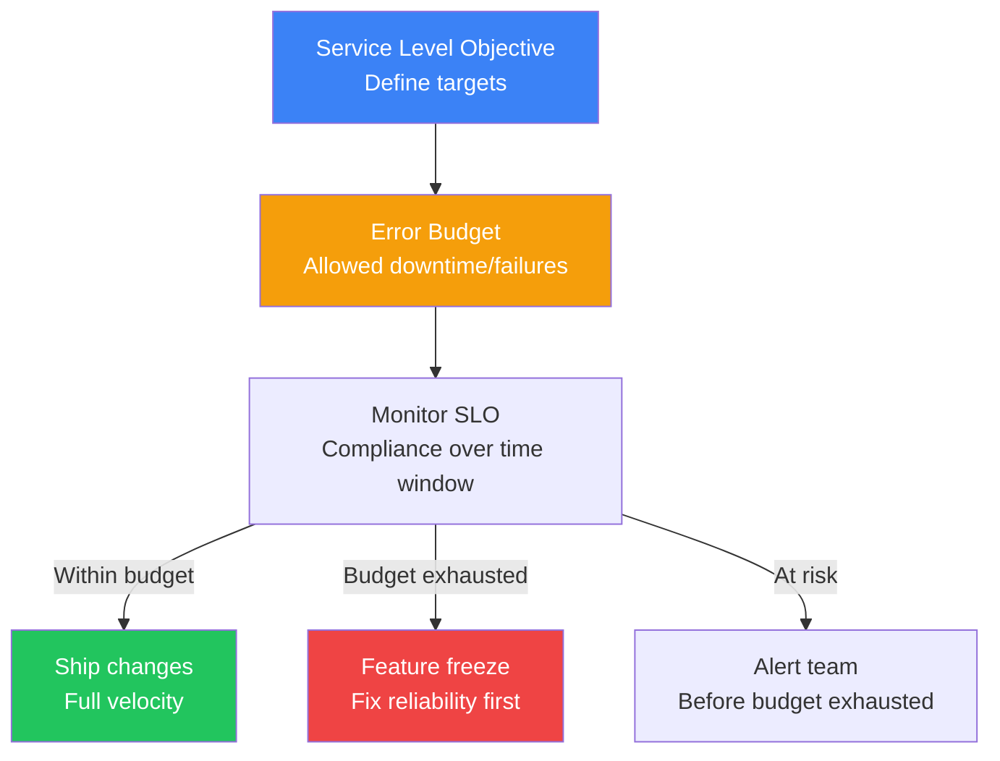
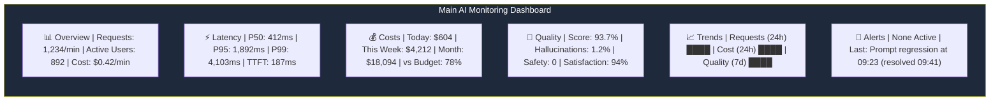
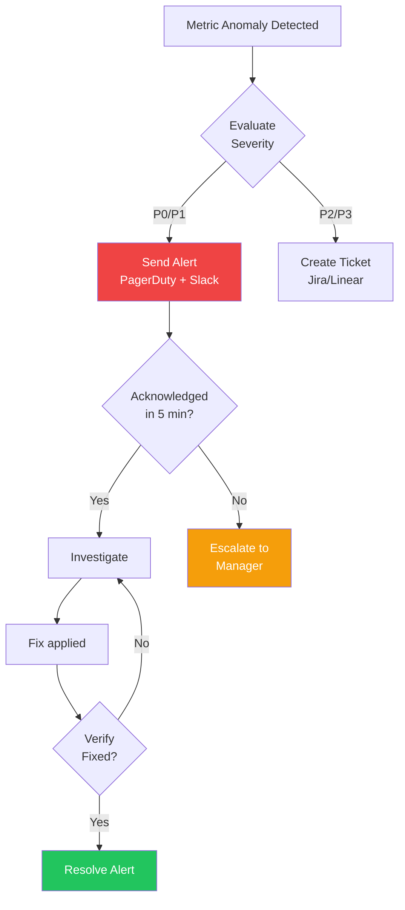
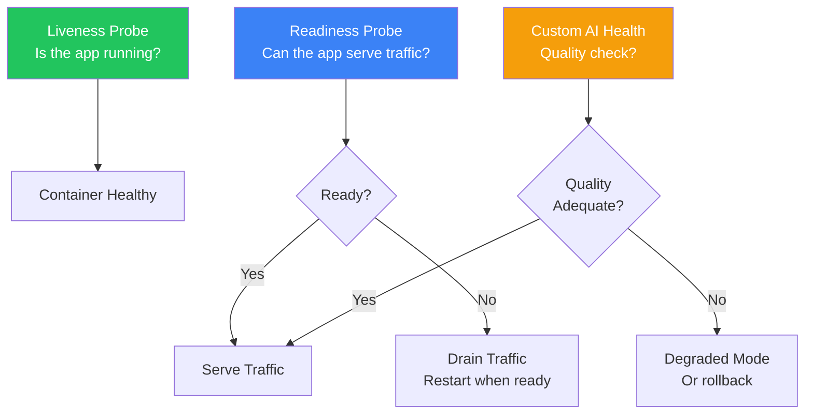
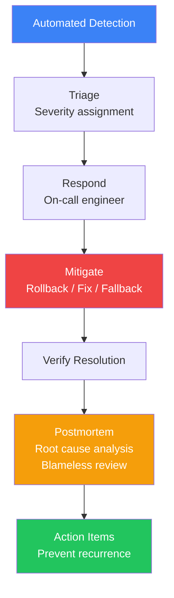

## Introduction

> **Monitoring, logging, and alerting for AI systems goes beyond traditional uptime monitoring — it tracks quality, cost, safety, and performance with AI-specific SLOs and automated incident response.**

A traditional web service monitors HTTP status codes, response times, and error rates. An AI system needs to monitor all of that plus hallucination rates, token usage, prompt quality, safety violations, cost per request, and model drift.



---

## The Problem: AI Failures Are Silent

### The Story

Everything looks green on your dashboards. Uptime is 99.99%. No 5xx errors. Response times are normal. But users are complaining that the AI assistant has been giving wrong answers for the last 3 hours.

This is a silent AI failure. The system is "up" but producing poor quality. You need AI-specific monitoring to catch these failures.



---

## Monitoring Layers



---

## Key Metrics to Monitor

### Infrastructure Metrics

| Metric | What It Tells You | Alert Threshold |
|--------|-------------------|-----------------|
| **CPU Utilization** | Load on services | > 80% for 5 min |
| **Memory Usage** | Memory leaks, scaling needs | > 85% for 5 min |
| **Request Rate** | Traffic volume | Sudden 2x increase |
| **Network I/O** | Bandwidth usage | Near limit |

### Application Metrics

| Metric | What It Tells You | Alert Threshold |
|--------|-------------------|-----------------|
| **Latency P50** | Typical response time | > 2s for 5 min |
| **Latency P95** | Slow tail requests | > 5s for 5 min |
| **Latency P99** | Worst-case requests | > 10s for 1 min |
| **Error Rate** | Failed requests | > 1% for 5 min |
| **Active Users** | Concurrent users | N/A (track trend) |

### AI-Specific Metrics

| Metric | What It Tells You | Alert Threshold |
|--------|-------------------|-----------------|
| **Token Usage** | Input + output tokens | Cost spike > 2x |
| **Tokens per Request** | Prompt efficiency trend | Trending up |
| **Cost per Request** | Unit economics | > target budget |
| **Cost per User** | User-level cost | > 5x average |
| **TTFT** | Time to first token | > 1s for 5 min |
| **TPS** | Tokens per second | < 20 TPS for 1 min |
| **Cache Hit Rate** | Caching effectiveness | < 20% for 10 min |
| **Model Distribution** | % traffic per model | Unexpected shift |

### Quality Metrics

| Metric | What It Tells You | Alert Threshold |
|--------|-------------------|-----------------|
| **Quality Score** | Overall response quality | > 10% drop from baseline |
| **Hallucination Rate** | Factual accuracy | > 5% of responses |
| **Safety Violations** | Toxic/PII/unsafe outputs | Any violation |
| **User Satisfaction** | Thumbs up/down ratio | < 80% for 1 hour |
| **Retry Rate** | User asks again | > 10% of sessions |

---

## SLOs & Error Budgets



### AI-Specific SLOs

| SLO | Target | Window | Error Budget |
|-----|--------|--------|--------------|
| **Response Quality** | ≥ 90% quality score | 30 days | 10% of responses below threshold |
| **Latency P95** | ≤ 3 seconds | 30 days | 5% of requests exceed 3s |
| **Hallucination Rate** | ≤ 3% of responses | 7 days | 3% hallucination budget |
| **Safety** | 0 violations | 30 days | Zero tolerance |
| **Availability** | ≥ 99.9% uptime | 30 days | 43 min downtime |
| **Cost per Request** | ≤ $0.05 average | 30 days | Within budget |

### Error Budget Calculation

```
Error Budget = (1 - SLO Target) × Total Requests

Example:
  SLO: Quality Score ≥ 95%
  Total requests in 30 days: 1,000,000
  Error budget: (1 - 0.95) × 1,000,000 = 50,000 poor responses

If you've had 40,000 poor responses this month:
  Remaining budget: 10,000
  If budget = 0: Feature freeze until next month
```

---

## Dashboards

### AI Monitoring Dashboard Layout



### Key Dashboard Panels

| Panel | Chart Type | Metrics | Refresh |
|-------|-----------|---------|---------|
| **Request Volume** | Time series | Requests/sec, Active users | 1 min |
| **Latency Heatmap** | Heatmap | P50/P95/P99 over time | 1 min |
| **Cost Breakdown** | Pie chart | By model, by feature, by user tier | 5 min |
| **Quality Trend** | Time series | Quality score, hallucination rate | 5 min |
| **Cache Performance** | Time series | Hit rate, requests served from cache | 1 min |
| **Top Errors** | Table | Error type, count, last occurrence | Realtime |
| **Model Distribution** | Stacked bar | % traffic per model | 5 min |

---

## Alerting

### Alert Severity Levels

| Severity | Response Time | Example | Action |
|----------|--------------|---------|--------|
| **P0 (Critical)** | < 5 min | Safety violation, complete outage | Auto-rollback, page on-call |
| **P1 (High)** | < 15 min | Quality score drop > 15% | Page team, investigate |
| **P2 (Medium)** | < 1 hour | Latency P95 > 5s | Investigate during work hours |
| **P3 (Low)** | < 24 hours | Cache hit rate < 20% | Create ticket |
| **P4 (Info)** | Next sprint | Cost trending up 5% week-over-week | Log for review |

### Alert Rules

```yaml
alerts:
  - name: quality_regression
    condition: quality_score < 0.85
    for: 5m
    severity: P1
    action: rollback_prompt + page_team
    
  - name: cost_spike
    condition: cost_per_minute > 2 * baseline
    for: 10m
    severity: P2
    action: investigate_model_routing
    
  - name: safety_violation
    condition: safety_violations > 0
    for: 1m
    severity: P0
    action: block_user + page_security_team
    
  - name: high_hallucination
    condition: hallucination_rate > 0.05
    for: 15m
    severity: P1
    action: investigate_rag_pipeline
    
  - name: cache_miss
    condition: cache_hit_rate < 0.20
    for: 30m
    severity: P3
    action: investigate_cache_warming
```

### Alert Flow



---

## Logging Pipeline

```mermaid
flowchart LR
    subgraph SOURCES["Log Sources"]
        APP["Application Logs"]
        LLM["LLM Call Logs"]
        GW["API Gateway Logs"]
        GUARD["Guardrail Logs"]
    end
    subgraph COLLECT["Collection"]
        FILE["Filebeat / Fluentd"]
        OTEL["OpenTelemetry Collector"]
    end
    subgraph PROCESS["Processing"]
        PARSE["Parse & Structure"]
        INDEX["Index (Elasticsearch)"]
        FILTER["Filter sensitive data"]
    end
    subgraph STORE["Storage"]
        HOT["Hot: 7 days\nFast search"]
        WARM["Warm: 30 days\nStandard search"]
        COLD["Cold: 1 year\nArchive"]
    end
    subgraph ACCESS["Access"]
        KIBANA["Kibana / Grafana Loki"]
        API["Log API"]
    end
    
    SOURCES --> COLLECT
    COLLECT --> PROCESS
    PROCESS --> STORE
    STORE --> ACCESS
    
    style SOURCES fill:#3b82f6,color:#fff
    style COLLECT fill:#8b5cf6,color:#fff
    style PROCESS fill:#6366f1,color:#fff
    style STORE fill:#f59e0b,color:#fff
    style ACCESS fill:#22c55e,color:#fff
```



### Log Schema for AI

```json
{
  "timestamp": "2025-06-15T10:30:00.123Z",
  "level": "info",
  "service": "prompt-router",
  "trace_id": "tr_abc123",
  "request_id": "req_456",
  
  "user": {
    "id": "user_789",
    "tier": "premium",
    "tenant": "acme_corp"
  },
  
  "llm": {
    "provider": "openai",
    "model": "gpt-4o",
    "prompt_version": "support-v4",
    "input_tokens": 1542,
    "output_tokens": 312,
    "temperature": 0.3,
    "ttft_ms": 187,
    "total_latency_ms": 843
  },
  
  "cost": {
    "input_cost": 0.003855,
    "output_cost": 0.003120,
    "total_cost": 0.006975
  },
  
  "guardrails": {
    "input_passed": true,
    "output_passed": true,
    "hallucination_score": 0.92
  },
  
  "tags": ["customer-support", "billing", "production"]
}
```

---

## Health Checks



### AI Health Check Endpoints

| Endpoint | What It Checks | Expected Response |
|----------|---------------|-------------------|
| `/health` | App running, dependencies available | `{"status": "ok"}` |
| `/ready` | Ready to serve traffic | `{"status": "ready", "replicas": 3}` |
| `/ai-health` | AI quality check | `{"status": "degraded", "quality_score": 0.72}` |
| `/metrics` | Prometheus metrics | Metrics in Prometheus format |

### Custom AI Health Probe

```javascript
async function aiHealthCheck() {
  // Run a test query through the entire pipeline
  const testQuery = "What is your return policy?";
  
  const response = await runFullPipeline(testQuery);
  
  // Check response quality
  const quality = await evaluateResponse(testQuery, response);
  
  if (quality.score < 0.7) {
    // Service is running but producing poor quality
    return { status: 'degraded', quality_score: quality.score };
  }
  
  return { status: 'healthy', quality_score: quality.score };
}
```

---

## Incident Response

### AI Incident Classification

| Type | Example | Severity | Response |
|------|---------|----------|----------|
| **Quality regression** | Hallucination rate spikes | P1 | Rollback prompt, evaluate difference |
| **Safety breach** | Toxic output, PII leak | P0 | Block user, review, patch guardrails |
| **Cost anomaly** | Costs spike 10x | P1 | Investigate model routing, cap usage |
| **Performance** | Latency P99 > 10s | P2 | Scale up, optimize prompts |
| **Availability** | Service down | P0 | Failover to secondary region |
| **Provider outage** | LLM API unavailable | P0 | Switch to fallback provider |

### Incident Response Flow



### Runbook Example: Quality Regression

```markdown
## Incident: Quality Regression

### Detection
- Alert: Quality score drops below 85% for > 5 minutes
- Dashboard link: [Quality Dashboard]

### Immediate Actions
1. Acknowledge the alert in PagerDuty
2. Check if this is caused by a recent deployment:
   - Check deployment history (last 1 hour)
   - Check prompt version in production vs staging
3. If recent deployment exists:
   - Rollback prompt to previous version
   - Rollback model config if changed
4. If no recent deployment:
   - Check for LLM provider changes
   - Check RAG pipeline (vector store updates)

### Verification
- Confirm quality score returns to baseline
- Monitor for 10 minutes

### Investigation
- Compare golden dataset scores vs production
- Check trace samples for pattern
- Investigate root cause

### Resolution
- Document findings
- Create action items
```

---

## Tools Comparison

| Tool | Type | AI-Specific | Open Source | Best For |
|------|------|-------------|-------------|----------|
| **Grafana + Prometheus** | Metrics | No | Yes | Infrastructure + custom metrics |
| **Grafana Loki** | Logs | No | Yes | Log aggregation |
| **Grafana Tempo** | Traces | No | Yes | Distributed tracing |
| **Datadog** | Full observability | Yes (AI APM) | No | All-in-one enterprise |
| **LangSmith** | AI observability | Yes | No | LLM tracing, evaluation |
| **Arize Phoenix** | AI observability | Yes | Yes | LLM monitoring |
| **Langfuse** | AI observability | Yes | Yes | Cost tracking, eval |
| **Helicone** | LLM monitoring | Yes | No | API monitoring, caching |
| **PagerDuty** | Alerting | No | No | Incident response |
| **OpsGenie** | Alerting | No | No | Incident response |

---

## Best Practices

1. **Monitor quality, not just uptime** — An AI system that's "up" but producing poor quality is the most dangerous state
2. **Set quality baselines** — Before optimizing, know what "normal" looks like
3. **Alert on leading indicators** — Cache hit rate drops before cost spikes. Catch regressions early
4. **Auto-remediate where possible** — Quality regression → auto-rollback. Don't wait for human response
5. **Log everything for audit** — Every AI decision should be traceable and reproducible
6. **SLOs should cover quality** — 99.9% uptime means nothing if hallucination rate is 20%
7. **Postmortem every incident** — Understanding failures is how you build reliable AI

## Common Mistakes

| Mistake | Why It's Wrong |
|---------|---------------|
| Only monitoring infrastructure metrics | Misses quality and cost issues |
| No quality SLO | Don't know when AI quality is unacceptable |
| Alert fatigue | Too many noisy alerts cause ignored critical alerts |
| No automated rollback | Quality regression affects users for hours during investigation |
| Ignoring cost monitoring | Surprise bills when usage grows |
| No runbooks | On-call engineers don't know how to respond to AI-specific incidents |
| Not logging prompt versions | Can't trace regression to specific prompt change |

---

## Interview Questions

### Beginner

**Q: What metrics would you monitor for an AI chatbot that traditional monitoring wouldn't capture?**

> (1) **Quality score** — Overall response quality measured by LLM-as-a-Judge, (2) **Hallucination rate** — Percentage of responses containing unsupported claims, (3) **Token usage** — Input/output tokens per request, (4) **Cost per request** — Monetary cost of each response, (5) **Cache hit rate** — How often cached responses are served, (6) **User satisfaction** — Thumbs up/down ratio, (7) **Safety violations** — Toxic or PII-containing responses.

**Q: What's an error budget and why would an AI system need one?**

> An error budget is the amount of failure a system can tolerate within an SLO window. For example, if your quality SLO is 95% over 30 days, your error budget is 5% of requests. When the budget is exhausted, teams should stop shipping new features and focus on reliability. AI systems need error budgets because quality regressions are common and need to be managed proactively.

### Intermediate

**Q: Design a monitoring dashboard for an AI-powered customer support system.**

> Dashboard sections: (1) **Overview** — Requests/sec, active users, cost rate, quality score, (2) **Latency** — P50/P95/P99 response time, TTFT, tokens per second, (3) **Cost** — Cost per day/week/month, by model, by feature, by user tier, (4) **Quality** — Quality score trend, hallucination rate, user satisfaction, top failing queries, (5) **Safety** — Safety violations count, types, users affected, (6) **Cache** — Hit rate, savings, top cached queries, (7) **Infrastructure** — Service health, resource usage, deployment status.

**Q: How would you set up alerting for an AI system to automatically rollback bad deployments?**

> Setup: (1) **Quality gate** — Deploy new prompt/model to 5% of traffic, (2) **Monitoring** — Compare quality scores between canary and baseline every minute, (3) **Decision** — If canary quality drops > 5% for 5 consecutive minutes, trigger rollback, (4) **Rollback** — Automated: switch canary traffic back to baseline, revert prompt version in registry, (5) **Notification** — Alert team with rollback details and metrics comparison, (6) **Investigation** — Automated trace collection for failing requests.

### Senior

**Q: Design a quality monitoring system that detects hallucination trends before users complain.**

> Architecture: (1) **Sample 100% of responses** — Every response is sent to an async evaluation pipeline, (2) **Fact extraction** — Extract atomic claims from each response, (3) **Verification** — Check each claim against RAG context using NLI model, (4) **Scoring** — Calculate per-response hallucination score, (5) **Trending** — Track hallucination rate over time (5 min windows), (6) **Anomaly detection** — Statistical model detects significant deviations from baseline, (7) **Correlation** — Cross-reference with prompt versions, model deployments, RAG updates, (8) **Alert** — If hallucination rate > 3% for 15 min, trigger P1 alert with auto-rollback.

**Q: How would you implement cost monitoring with chargeback for a multi-team AI platform?**

> Implementation: (1) **Tagging** — Every request tagged with team_id, feature_id, user_tier, environment, (2) **Real-time cost tracking** — Stream cost events to time-series DB (Prometheus/InfluxDB), (3) **Budget enforcement** — Per-team daily budgets with hard limits (throttle) and soft limits (alert), (4) **Dashboard** — Per-team cost dashboard with trends, comparisons, and forecasts, (5) **Chargeback** — Monthly automated reports aggregating cost by team, (6) **Anomaly detection** — Alert on unusual cost patterns (spikes, unexpected model usage), (7) **Reporting** — Executive summary with top cost drivers and optimization recommendations.

### Staff Engineer

**Q: Design an observability platform that serves 10 AI products with 50 microservices across 3 regions.**

> Platform: (1) **Unified instrumentation** — OpenTelemetry across all services with consistent semantic conventions, (2) **Regional collectors** — OTel Collector per region, reducing inter-region data transfer, (3) **Central store** — Grafana Tempo (traces), Mimir (metrics), Loki (logs) in primary region, (4) **Product isolation** — Labels/tags for product-level data isolation with cross-product views for platform team, (5) **AI-specific processing** — Pipeline for extracting AI metrics (tokens, costs, models) from traces, (6) **SLO engine** — Custom service computing real-time SLO compliance per product, (7) **Alerting** — Hierarchical alerts: product-level (immediate) and platform-level (aggregate), (8) **Cost allocation** — Observability costs charged back to products based on data volume.

### System Design

**Q: Design an incident response system that automatically detects and remediates AI quality regressions.**

> System: (1) **Continuous evaluation** — Real-time quality scoring on 100% of production responses, (2) **Anomaly detector** — ML model tracking quality score distribution, alerts on significant shifts, (3) **Root cause analyzer** — When anomaly detected, correlates with recent changes (prompt deploys, model updates, RAG changes), (4) **Automated rollback** — If root cause identified (recent deploy), auto-rollback and verify quality recovers, (5) **User impact assessment** — Estimate number of affected users and responses for postmortem, (6) **Notification** — Detailed incident report to on-call team with root cause, impact, and remediation, (7) **Postmortem generation** — Auto-collect traces, logs, and metrics for post-incident review, (8) **Feedback loop** — Incidents added to golden dataset as regression tests.

---

## Summary

| Concept | Key Point |
|---------|-----------|
| **Four monitoring layers** | Infrastructure → Application → AI-Specific → Quality |
| **Key AI metrics** | Tokens, cost, TTFT, cache rate, quality score, hallucination rate |
| **SLOs** | Define targets for quality, latency, safety, cost |
| **Error budgets** | Budget for failures, freeze features when exhausted |
| **Alerting** | P0-P4 with auto-remediation for critical issues |
| **Health checks** | Liveness, readiness, and quality probes |
| **Incident response** | Classify → Mitigate → Postmortem → Action items |

---

## Navigation

**Previous:** [09 — Deployment & Scaling](/ai/phase-09-production-ai/09-deployment-and-scaling)

**Next:** [11 — CI/CD for AI](/ai/phase-09-production-ai/11-cicd-for-ai)

**Related Topics:**
- [Observability & Tracing](/ai/phase-09-production-ai/04-observability-and-tracing)
- [AI Evaluation](/ai/phase-09-production-ai/05-ai-evaluation)
- [CI/CD for AI](/ai/phase-09-production-ai/11-cicd-for-ai)
