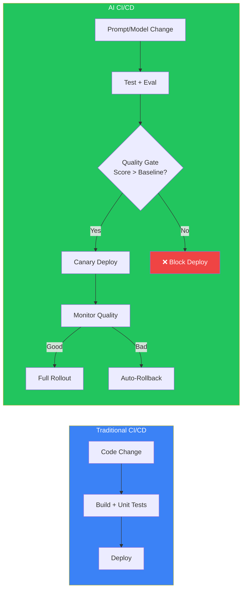
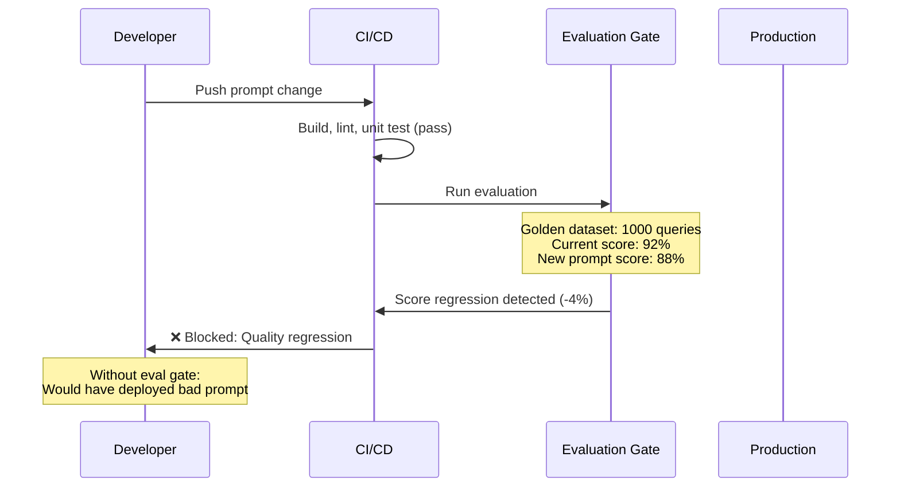
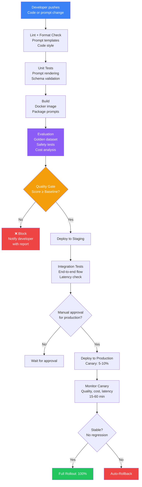
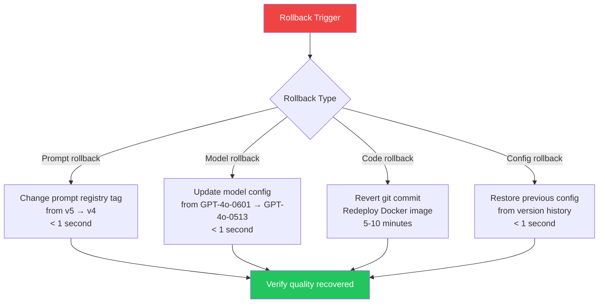

## Introduction

> **CI/CD for AI extends traditional DevOps pipelines with AI-specific concerns — automated prompt testing, evaluation gates that block regressions, canary releases for prompts and models, and infrastructure as code for AI services.**

Just as CI/CD transformed software delivery, AI CI/CD transforms how teams ship prompt changes, model updates, and evaluation improvements. The key difference: traditional CI/CD tests for errors; AI CI/CD tests for quality.



---

## The Problem: CI/CD for AI Is Different

### The Story

A developer changes a system prompt to fix a minor formatting issue. The CI pipeline passes — no syntax errors, no failing tests. But the new prompt introduces a subtle factual error that only affects 2% of queries. Two days later, support tickets start coming in.

Traditional CI/CD can't catch AI regressions because it tests for correctness (does the code compile? do the tests pass?), not quality (is the output accurate? is it safe?). AI CI/CD needs evaluation gates that measure what quality means for your application.



---

## AI CI/CD Pipeline



---

## Evaluation Gates

The most important part of AI CI/CD — automated quality checks that gate deployments.

### Types of Evaluation Gates

| Gate | What It Checks | Threshold | Time |
|------|---------------|-----------|------|
| **Golden dataset eval** | Response quality on curated test set | Score ≥ baseline | 2-10 min |
| **Safety eval** | Toxic/harmful outputs, PII leaks | Zero tolerance | 1-5 min |
| **Regression test** | Compare output to previous version | No significant diffs | 5-20 min |
| **Latency test** | Response time under load | Within 10% of baseline | 2-5 min |
| **Cost analysis** | Token usage difference | Within 5% of baseline | 1-2 min |
| **Edge case test** | Unusual/edge case inputs | Pass rate > 90% | 1-5 min |

### Evaluation Gate Implementation

```yaml
# .github/workflows/eval-gate.yml
name: AI Evaluation Gate
on:
  pull_request:
    paths:
      - 'prompts/**'
      - 'config/**'

jobs:
  evaluate:
    runs-on: ubuntu-latest
    steps:
      - uses: actions/checkout@v4
      
      - name: Run evaluation on golden dataset
        run: |
          python eval/run_eval.py \
            --dataset golden-v3 \
            --baseline-score 0.92
      
      - name: Safety evaluation
        run: |
          python eval/run_safety_eval.py \
            --test-set adversarial-v2
      
      - name: Cost comparison
        run: |
          python eval/compare_cost.py \
            --baseline-tokens 1500
      
      - name: Check quality gate
        run: |
          python eval/check_gate.py \
            --min-score 0.90 \
            --safety-zero-tolerance
```

---

## GitHub Actions for AI

### Example: Prompt Deployment Pipeline

```yaml
name: Deploy Prompt
on:
  push:
    branches: [main]
    paths:
      - 'prompts/**'

jobs:
  evaluate:
    runs-on: ubuntu-latest
    steps:
      - uses: actions/checkout@v4
      - name: Run golden dataset eval
        run: python eval/evaluate.py --dataset golden-v4
      - name: Run safety eval
        run: python eval/safety_check.py
      
  deploy-staging:
    needs: evaluate
    runs-on: ubuntu-latest
    steps:
      - name: Deploy to staging
        run: |
          python registry/deploy.py \
            --env staging \
            --prompt-version ${{ github.sha }}
      - name: Run integration tests
        run: python test/integration.py --env staging
      
  deploy-production:
    needs: deploy-staging
    runs-on: ubuntu-latest
    environment: production
    steps:
      - name: Canary deploy (5%)
        run: |
          python registry/deploy.py \
            --env production \
            --canary 5
      - name: Monitor canary (15 min)
        run: |
          python monitor/check_canary.py \
            --duration 15 \
            --quality-threshold 0.90
      - name: Full rollout
        run: |
          python registry/promote.py \
            --env production \
            --version ${{ github.sha }}
```

---

## Prompt Testing in CI

### Automated Prompt Tests

```javascript
// prompt-tests/golden-dataset.test.js
const testCases = [
  {
    query: "What is your return policy?",
    expected_contains: ["30 days", "refund"],
    expected_not_contains: ["1 year"],
  },
  {
    query: "How do I reset my password?",
    expected_contains: ["settings", "password reset"],
    expected_contains_semantic: "password reset process",
  },
];

testCases.forEach(({ query, expected_contains, expected_not_contains }) => {
  test(`Prompt handles: "${query}"`, async () => {
    const response = await runPrompt(query);
    
    expected_contains.forEach(text => {
      expect(response.toLowerCase()).toContain(text.toLowerCase());
    });
    
    expected_not_contains.forEach(text => {
      expect(response.toLowerCase()).not.toContain(text.toLowerCase());
    });
  });
});
```

### What to Test in CI

| Test Type | Purpose | How |
|-----------|---------|-----|
| **Contains tests** | Ensure key phrases are present | String matching |
| **Exclusion tests** | Ensure forbidden phrases are absent | String matching |
| **Semantic tests** | Ensure response captures meaning | Embedding comparison |
| **Structure tests** | Ensure output format is valid | Schema validation |
| **Length tests** | Ensure response isn't too long/short | Token counting |
| **Safety tests** | Ensure no harmful content | Classifier + LLM check |

---

## Model Versioning

```mermaid
flowchart LR
    subgraph MODELS["Model Registry"]
        GPT4O["GPT-4o\nv1.0 - 2025-05\nCurrent production"]
        GPT4O_NEW["GPT-4o\nv1.1 - 2025-06\nIn evaluation"]
        CLAUDE["Claude Sonnet\nv3.5 - 2025-04\nFallback"]
    end
    
    subGRAPH DEPLOYMENTS["Deployment Config"]
        PROD["Production\nGPT-4o v1.0\nPrompt: support-v4"]
        STAGING["Staging\nGPT-4o v1.1\nPrompt: support-v4"]
        CANARY["Canary\nGPT-4o v1.1\nPrompt: support-v5"]
    end
    
    MODELS --> DEPLOYMENTS
    
    style MODELS fill:#3b82f6,color:#fff
    style DEPLOYMENTS fill:#22c55e,color:#fff
```

### Model Config as Code

```yaml
# config/models.yaml
models:
  primary:
    provider: openai
    model: gpt-4o
    version: "2025-05-13"
    deployment: production
    rollout: 100%
  
  canary:
    provider: openai
    model: gpt-4o
    version: "2025-06-01"
    deployment: canary
    rollout: 5%
  
  fallback:
    provider: anthropic
    model: claude-3-sonnet
    version: "2025-04-15"
    deployment: global
    conditions: [primary_unavailable, rate_limited]
```

---

## Infrastructure as Code

```hcl
# terraform/main.tf
resource "kubernetes_deployment" "ai_router" {
  metadata {
    name = "ai-router"
    labels = {
      app = "ai-router"
      version = var.prompt_version
    }
  }
  
  spec {
    replicas = var.min_replicas
    
    selector {
      match_labels = {
        app = "ai-router"
      }
    }
    
    template {
      metadata {
        labels = {
          app = "ai-router"
          version = var.prompt_version
        }
      }
      
      spec {
        container {
          image = "myregistry/ai-router:${var.app_version}"
          name  = "ai-router"
          
          env {
            name  = "PROMPT_VERSION"
            value = var.prompt_version
          }
          
          resources {
            limits = {
              cpu    = "500m"
              memory = "512Mi"
            }
          }
        }
      }
    }
  }
}
```

---

## Canary Releases for AI

```mermaid
flowchart TD
    DEPLOY["Deploy new prompt/model"] --> CANARY_1["Stage 1: 1%\n5 minutes"]
    CANARY_1 --> CHECK_1{"Quality ≥ 90%\nLatency ≤ 3s\nCost ≤ $0.05"}
    CHECK_1 -->|"No"| ROLLBACK["Rollback"/>
    CHECK_1 -->|"Yes"| CANARY_2["Stage 2: 10%\n15 minutes"]
    CANARY_2 --> CHECK_2{"Quality ≥ 90%\nCost ≤ $0.05\nSafety = 0"}
    CHECK_2 -->|"No"| ROLLBACK
    CHECK_2 -->|"Yes"| CANARY_3["Stage 3: 50%\n2 hours"]
    CANARY_3 --> CHECK_3{"All metrics\nstable?"}
    CHECK_3 -->|"No"| ROLLBACK
    CHECK_3 -->|"Yes"| FULL["Full rollout: 100%"]
    
    style DEPLOY fill:#3b82f6,color:#fff
    style ROLLBACK fill:#ef4444,color:#fff
    style FULL fill:#22c55e,color:#fff
```

---

## Rollback Strategies



---

## Production Examples

### How Companies Implement AI CI/CD

| Company | Pipeline | Key Gate |
|---------|----------|----------|
| **OpenAI** | Internal CI for model updates | Extensive benchmark eval suite |
| **Anthropic** | Staged model releases with red teaming | Safety eval + constitutional checks |
| **GitHub Copilot** | Canary model releases to user segments | Code quality metrics |
| **Notion AI** | Prompt versioning with A/B testing | User engagement metrics |
| **Perplexity** | Multi-stage prompt deployment | Answer accuracy on curated sources |

---

## Best Practices

1. **Treat prompts as artifacts** — Prompts should be built, versioned, and deployed independently of code
2. **Evaluation gates are mandatory** — No deploy should bypass evaluation
3. **Canary every change** — Even a simple prompt change can cause regressions
4. **Auto-rollback on quality drop** — Don't wait for human response to quality regressions
5. **Version everything** — Prompts, models, configs, evaluation datasets
6. **Infrastructure as code** — All AI infrastructure managed via Terraform/Pulumi
7. **Test on production data** — Use anonymized production traces in evaluation datasets

## Common Mistakes

| Mistake | Why It's Wrong |
|---------|---------------|
| Deploying prompts with code changes | Can't rollback independently |
| No evaluation gate | Every change is a blind deploy |
| No canary testing | Bad change affects all users instantly |
| No auto-rollback | Quality regression persists during manual investigation |
| Not versioning evaluation datasets | Can't reproduce or compare evaluation results |
| Only testing happy path | Edge cases cause most production incidents |

---

## Interview Questions

### Beginner

**Q: What's different about CI/CD for AI compared to traditional CI/CD?**

> Traditional CI/CD tests for correctness (compile, unit tests, integration tests). AI CI/CD adds quality testing: evaluating prompt responses, checking for safety violations, measuring latency and cost impact, and A/B testing changes against baselines. AI CI/CD also needs canary deployments for prompt changes and automated rollback based on quality metrics.

**Q: What is an evaluation gate and why is it needed?**

> An evaluation gate is an automated quality check that runs before a prompt or model change is deployed. It runs the new prompt against a golden dataset, scores the results, and compares them to the current baseline. If scores drop below the threshold, the deploy is blocked. It's needed because prompt changes can cause quality regressions that traditional tests can't detect.

### Intermediate

**Q: Design a CI/CD pipeline for prompt changes.**

> Pipeline: (1) **Lint** — Check prompt format, variable names, no hardcoded secrets, (2) **Unit test** — Test prompt rendering with sample data, verify output schema, (3) **Golden dataset eval** — Run against 1000 curated test cases, score with LLM-as-a-Judge, (4) **Safety eval** — Test with adversarial inputs, check for toxic/PII outputs, (5) **Cost analysis** — Measure token usage vs baseline, (6) **Gate check** — Block if any metric regresses below threshold, (7) **Canary deploy** — Deploy to 5% of traffic, (8) **Monitor** — Watch quality, cost, and latency for 30 min, (9) **Full rollout or rollback** — Promote or revert based on monitoring.

**Q: How would you implement a rollback for a prompt change that degrades quality?**

> Multiple rollback strategies: (1) **Immediate rollback** — Change prompt registry tag from v5 → v4. All subsequent requests use the old prompt. Done in < 1 second, (2) **Traffic re-route** — Shift all traffic back to the previous deployment, (3) **Verification** — After rollback, run evaluation to confirm quality recovered, (4) **Root cause** — Compare v4 and v5 evaluation results to identify what caused the regression, (5) **Postmortem** — Document findings, add regression test to golden dataset.

### Senior

**Q: Design a CI/CD system that handles both code and prompt changes with independent deploy cycles.**

> Architecture: (1) **Code pipeline** — Builds Docker images, runs unit/integration tests, deploys to K8s. Triggers on code changes. (2) **Prompt pipeline** — Validates prompts, runs evaluation, deploys to prompt registry. Triggers on prompt changes. (3) **Independent versioning** — Code has semver, prompts have independent semantic versions. (4) **Runtime binding** — Application fetches prompt version from registry at startup (with cache). (5) **Gradual rollout** — Prompt changes use registry's canary feature (5% → 100%). Code changes use K8s rolling updates. (6) **Cross-pipeline coordination** — If both pipelines deploy simultaneously, ensure canary can test the combined change.

**Q: How would you build a CI/CD quality gate that catches subtle regressions that don't affect overall scores?**

> Multi-dimensional analysis: (1) **Segment evaluation** — Score by query category (billing, technical, general). A 1% drop overall might hide a 15% drop in one category. (2) **Per-query regression** — Track score change for each query in the golden dataset. Flag queries that dropped significantly even if average is stable. (3) **Statistical significance** — Use proper statistical tests (t-test, Mann-Whitney U) to detect real changes vs noise. (4) **Drift detection** — Monitor the distribution of scores, not just the average. Detect changes in variance. (5) **Adversarial testing** — Generate test cases based on known failure patterns, test these specifically.

### Staff Engineer

**Q: Design a platform that enables 10 teams to deploy AI changes independently with centralized safety governance.**

> Platform: (1) **Shared CI/CD infrastructure** — Centralized GitHub Actions runners, artifact storage, prompt registry, (2) **Team isolation** — Separate namespaces in K8s, team-specific prompt registries, (3) **Central governance** — Organization-wide safety eval must pass for all teams before production, (4) **Quality gates per team** — Teams define their own quality thresholds, (5) **Audit trail** — All deployments logged centrally with who, what, when, and eval results, (6) **Rollback authority** — Central platform team has ability to rollback any team's deployment, (7) **Monitoring** — Central dashboard showing all teams' deployment health, quality trends, and incidents.

### System Design

**Q: Design a deployment system that can detect and rollback a bad prompt change within 60 seconds of quality regression.**

> System: (1) **Real-time quality monitoring** — LLM-as-a-Judge on 5% of production responses, continuously streaming scores, (2) **Anomaly detection** — Rolling window (5 min) score distribution compared to baseline (24h). Statistical test detects shift with p < 0.01, (3) **Rollback trigger** — If anomaly detected AND recent deployment (within 1h), trigger rollback automatically, (4) **Rollback execution** — Change prompt registry tag, invalidate edge caches, propagate globally (< 10s), (5) **Verification** — After 2 minutes, check if quality returned to baseline, (6) **Notification** — Slack/PagerDuty alert with before/after metrics, suspected cause, and trace examples, (7) **Rate limiting** — Max 1 auto-rollback per 30 min to prevent oscillation.

---

## Summary

| Concept | Key Point |
|---------|-----------|
| **AI CI/CD** | DevOps for AI — automated testing, evaluation, deployment |
| **Evaluation gates** | Quality checks that block regressions |
| **Canary releases** | Gradual rollout with monitoring at each stage |
| **Model versioning** | Version-controlled model configurations |
| **Infrastructure as code** | Terraform/K8s for AI infrastructure |
| **Rollback strategies** | Prompt, model, code, config — each with different speed |
| **Prompt testing** | Contains, exclusion, semantic, structure, safety tests |

---

## Navigation

**Previous:** [10 — Monitoring, Logging & Alerting](/ai/phase-09-production-ai/10-monitoring-logging-alerting)

**Next:** [12 — Production Case Studies](/ai/phase-09-production-ai/12-production-case-studies)

**Related Topics:**
- [Prompt Management](/ai/phase-09-production-ai/03-prompt-management)
- [AI Evaluation](/ai/phase-09-production-ai/05-ai-evaluation)
- [Deployment & Scaling](/ai/phase-09-production-ai/09-deployment-and-scaling)
