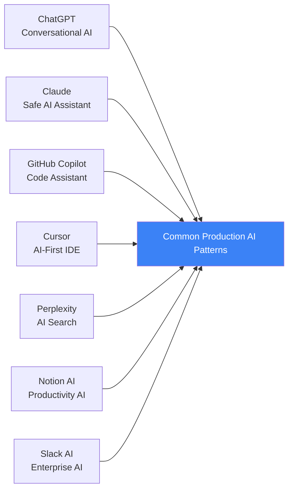
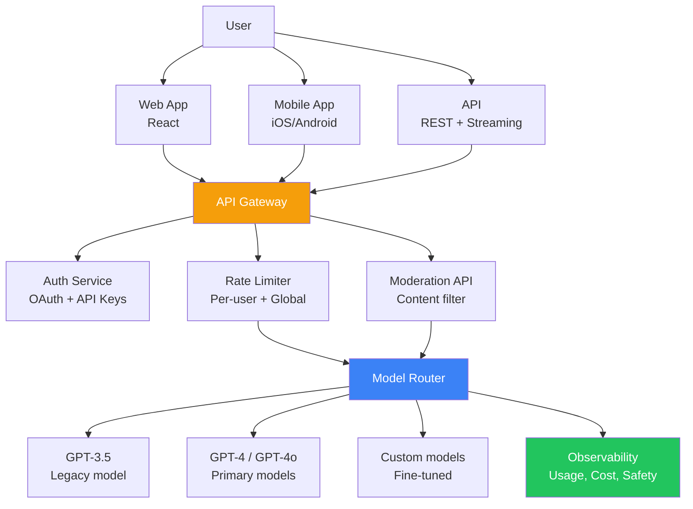
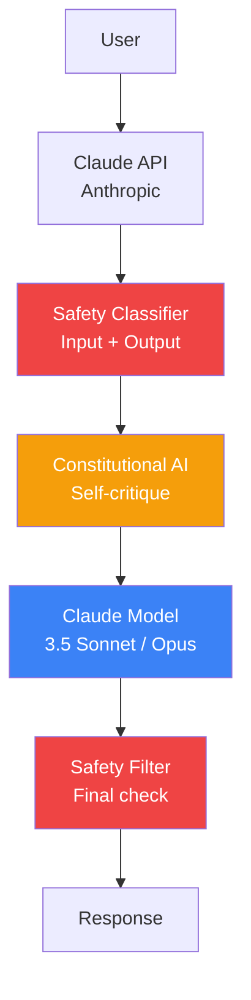
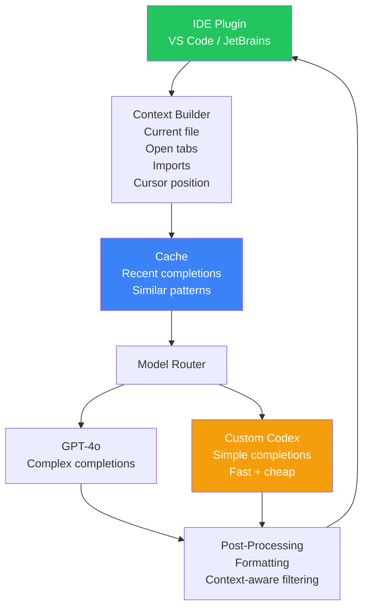
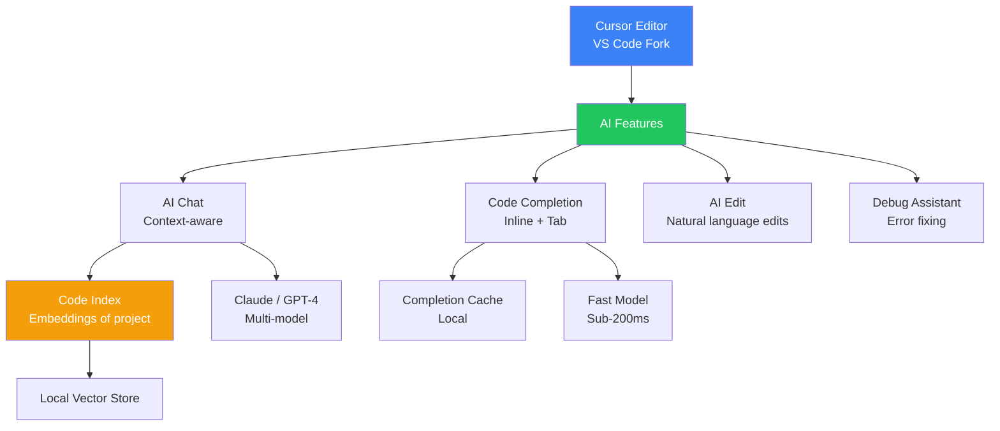
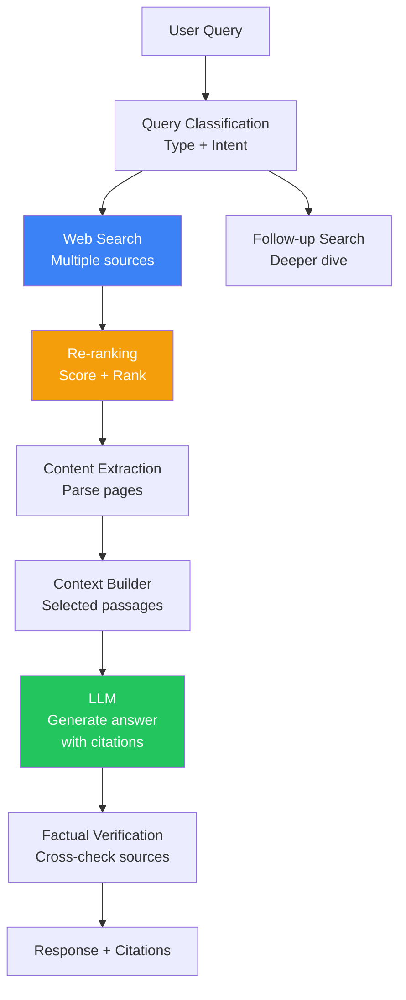
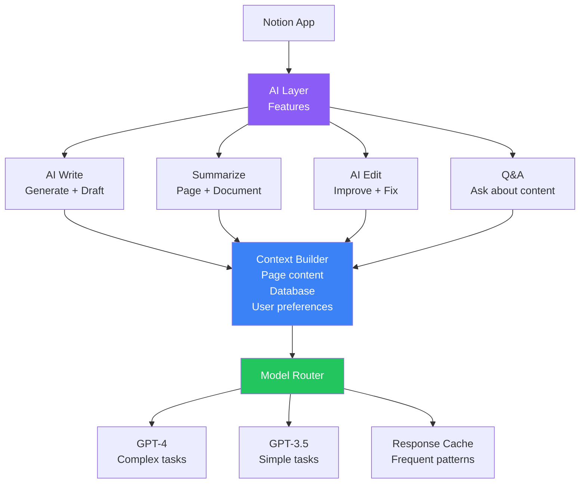
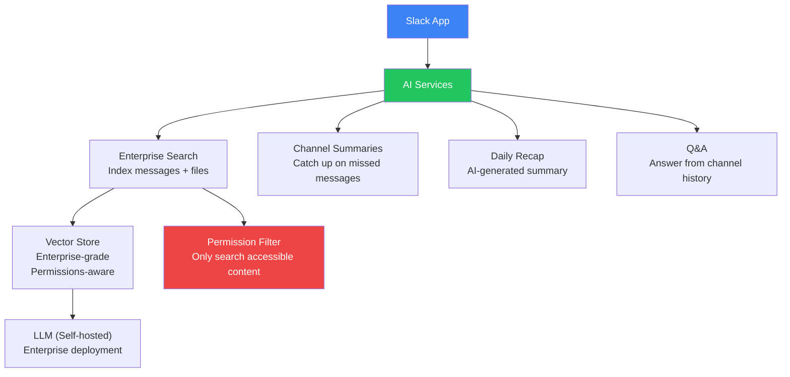
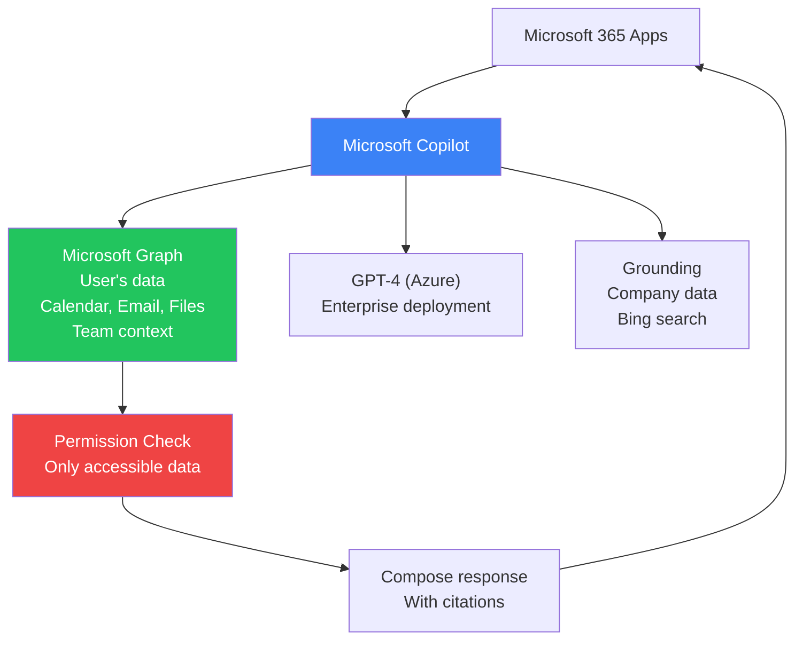
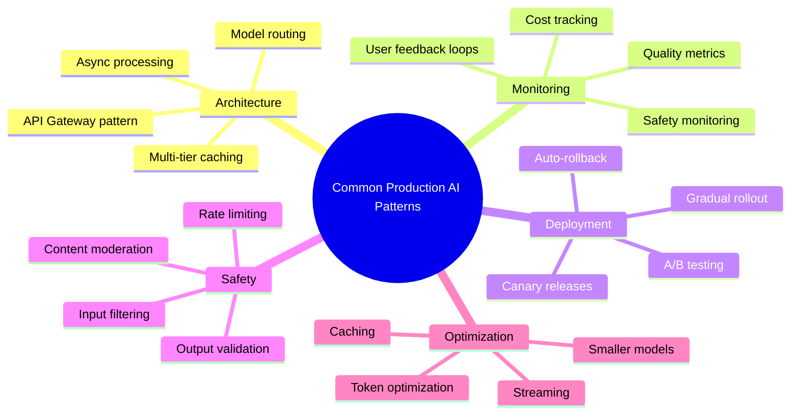

## Introduction

> **Production AI case studies reveal how real companies solve the challenges of deploying, scaling, monitoring, and securing AI applications — from OpenAI's ChatGPT to GitHub Copilot, and every major AI product in between.**

Theory is useful. Real-world examples are invaluable. Each case study examines architecture, scaling strategy, monitoring approach, security model, trade-offs, and key lessons.

---

## 1. ChatGPT (OpenAI)

### Overview

ChatGPT launched in November 2022 and became the fastest-growing consumer application in history, reaching 100M users in 2 months.

### Architecture

### Scaling

| Metric | Scale | Strategy |
|--------|-------|----------|
| **Daily active users** | ~200M | Global infrastructure |
| **Requests per day** | ~1B+ | Load balancing + caching |
| **GPU infrastructure** | Hundreds of thousands of GPUs | Distributed inference |
| **Model size** | GPT-4o: ~trillion+ parameters | Optimized inference |

### Monitoring

| What They Monitor | How |
|------------------|-----|
| **Usage** | Tokens, requests, active users per region |
| **Latency** | TTFT, TPOT, end-to-end by model |
| **Cost** | Per-user, per-model, aggregate |
| **Safety** | Flagged content rate, moderation API calls |
| **Quality** | User feedback, internal eval scores |
| **Availability** | Uptime, error rate, provider health |

### Key Trade-offs

| Trade-off | Choice | Reasoning |
|-----------|--------|-----------|
| **Free vs Paid** | Freemium model | Free tier drives adoption, paid covers costs |
| **Speed vs Quality** | Model routing | GPT-4o-mini for speed, GPT-4o for quality |
| **Memory vs Privacy** | Opt-in memory | Better experience with memory, privacy concerns |
| **Open vs Closed** | Closed API | Control over safety, monetization |

### Lessons for Production AI

1. **Expect demand to exceed all projections** — Build for 100x from day one
2. **Safety must scale** — Moderation is just as important as inference
3. **Cost management is critical** — At scale, every millisecond and token matters
4. **User feedback loops** — Thumbs up/down are invaluable for quality improvement

---

## 2. Claude (Anthropic)

### Overview

Claude focuses on safety and alignment, with a "helpful, honest, harmless" (HHH) approach.

### Architecture

### Unique Approaches

| Aspect | Anthropic's Approach |
|--------|---------------------|
| **Safety** | Constitutional AI — model follows constitution of principles |
| **Red teaming** | Continuous external safety testing |
| **Responsible scaling** | Safety measures scale with model capability |
| **Context window** | 200K tokens (longest in industry) |
| **Model family** | Opus (best), Sonnet (balanced), Haiku (fast) |

### Key Trade-offs

| Trade-off | Choice | Reasoning |
|-----------|--------|-----------|
| **Safety vs Speed** | Safety first | Constitutional AI adds latency but ensures safety |
| **Open vs Closed** | Closed + research | Public safety research while protecting IP |
| **General vs Specialized** | General + tools | Broad capabilities with function calling |

### Lessons for Production AI

1. **Safety can be a differentiator** — Claude's safety focus attracts enterprise customers
2. **Constitutional approach scales** — Automated safety vs manual RLHF
3. **Long context windows matter** — Enables use cases competitors can't handle
4. **Responsible scaling policy** — Safety processes should evolve with model capability

---

## 3. GitHub Copilot

### Overview

GitHub Copilot is an AI code completion tool used by millions of developers, integrated directly into IDEs.

### Architecture

### Scaling

| Metric | Scale |
|--------|-------|
| **Users** | 1.8M+ paid subscribers |
| **Daily completions** | Billions |
| **Latency target** | < 200ms for inline suggestions |
| **Cache hit rate** | ~35% for common patterns |

### Key Optimizations

1. **Caching** — Similar code patterns cached aggressively
2. **Context filtering** — Only relevant context sent (not entire codebase)
3. **Model routing** — Simple completions handled by lightweight model
4. **Post-processing** — Formatting aligns with codebase style

### Unique Challenges

| Challenge | Solution |
|-----------|----------|
| **Latency sensitivity** | Developers won't wait > 200ms for suggestions |
| **Code quality** | Suggestions must be syntactically valid |
| **Security** | No training on sensitive customer code |
| **Context window** | Entire codebase can't fit — must select context |

### Lessons for Production AI

1. **Latency is everything for inline AI** — Sub-200ms requires aggressive optimization
2. **Caching is critical** — Common patterns should be served without model calls
3. **Context selection** — What you send to the model matters more than quantity
4. **User experience drives adoption** — Seamless integration into existing workflows

---

## 4. Cursor

### Overview

Cursor is an AI-first code editor that reimagines the IDE experience around AI assistance.

### Architecture

### Unique Approaches

| Feature | Description |
|---------|-------------|
| **Codebase indexing** | Full project indexed for context-aware AI |
| **Multi-model** | Uses Claude, GPT-4o, and custom models |
| **AI-first UX** | Tab to accept, Cmd+K to edit, AI chat |
| **Privacy mode** | Code never leaves local machine |

### Lessons for Production AI

1. **Indexing the codebase** changes what AI can do — from "write code" to "understand your project"
2. **Multi-model strategy** lets you optimize for cost and capability per feature
3. **Privacy as a feature** — Some users won't use AI without privacy guarantees

---

## 5. Perplexity

### Overview

Perplexity is an AI-powered search engine that combines LLMs with real-time web search.

### Architecture

### Key Differentiators

| Feature | How It Works |
|---------|-------------|
| **Real-time search** | Actually searches the web, not just training data |
| **Citations** | Every claim linked to source |
| **Follow-up questions** | Maintains search context across turns |
| **Pro search** | Deeper search, multiple sources analyzed |
| **Collections** | Organized research by topic |

### Lessons for Production AI

1. **Citations build trust** — Users trust AI more when they can verify sources
2. **Hybrid approach** — Search + LLM is better than either alone
3. **Real-time information** — Many queries need current data, not training data

---

## 6. Notion AI

### Overview

Notion AI integrates AI into documents, wikis, and project management — generating, summarizing, and editing content.

### Architecture

### Key Trade-offs

| Trade-off | Choice |
|-----------|--------|
| **Quality vs Cost** | GPT-4 for quality writing, GPT-3.5 for quick tasks |
| **Features vs Simplicity** | Many AI features, but simple UI |
| **Speed vs Quality** | Streaming for perceived speed |

### Lessons for Production AI

1. **Context is everything** — Notion's AI works because it has access to your content
2. **Feature surface area** — Multiple AI features need a shared infrastructure
3. **Cost control per feature** — Different features have different cost budgets

---

## 7. Slack AI

### Overview

Slack AI brings AI to enterprise messaging — summarizing conversations, answering questions, and searching across channels.

### Enterprise-Specific Challenges

| Challenge | Solution |
|-----------|----------|
| **Enterprise security** | Data never leaves Slack's infrastructure |
| **Multi-tenant isolation** | Strict data boundaries per workspace |
| **Compliance** | Audit logging, data retention, eDiscovery |
| **Scale** | Millions of messages per workspace |

### Architecture

### Lessons for Production AI

1. **Enterprise AI needs permission-aware search** — Can't show users content they don't have access to
2. **Self-hosted models** — Some enterprises require models to run on their infrastructure
3. **Compliance drives architecture** — Audit logging and data retention requirements shape the system

---

## 8. Microsoft Copilot

### Overview

Microsoft Copilot is embedded across Microsoft 365 — Word, Excel, PowerPoint, Teams, and Outlook.

### Architecture

### Key Differentiators

| Feature | Description |
|---------|-------------|
| **Enterprise integration** | Deep integration with M365 ecosystem |
| **Permission-aware** | Only uses data user has access to |
| **Grounding** | Responses based on company data |
| **Compliance** | GDPR, HIPAA, SOC2 compliant |
| **Citations** | Every response cites sources |

### Lessons for Production AI

1. **Integration is the product** — Copilot's value is in its deep integration with M365
2. **Permission awareness is mandatory** — Enterprise AI must respect access controls
3. **Grounding in enterprise data** — Generic model knowledge isn't enough for enterprise

---

## Common Patterns Across All Case Studies

### Lessons That Apply to Every AI Product

| Lesson | Why It Matters |
|--------|---------------|
| **Cache aggressively** | Every case study uses caching to reduce costs and latency |
| **Model routing** | Not every query needs the most expensive model |
| **Safety by design** | Safety isn't an afterthought — it's built into the architecture |
| **Monitoring quality, not just uptime** | Silent failures are the most dangerous |
| **Canary everything** | Every prompt and model change should be canaried |
| **User feedback loops** | Direct user feedback is the best quality signal |
| **Cost tracking** | At scale, even micro-optimizations save millions |

---

## Summary

| Product | Core Innovation | Key Challenge | Key Lesson |
|---------|----------------|---------------|------------|
| **ChatGPT** | Conversational AI interface | Scaling to billions of requests | Expect 100x demand |
| **Claude** | Constitutional AI safety | Safety without sacrificing capability | Safety as differentiator |
| **GitHub Copilot** | AI code completion | Sub-200ms latency | Latency is everything |
| **Cursor** | AI-first IDE | Context-aware coding | Indexing changes everything |
| **Perplexity** | AI search with citations | Real-time information | Citations build trust |
| **Notion AI** | AI in documents | Context understanding | Context is everything |
| **Slack AI** | Enterprise AI assistant | Permission-aware search | Permissions are mandatory |
| **Microsoft Copilot** | Enterprise AI suite | Deep integration | Integration is the product |

---

## Navigation

**Previous:** [11 — CI/CD for AI](/ai/phase-09-production-ai/11-cicd-for-ai)

**Next:** [13 — Phase Summary](/ai/phase-09-production-ai/13-phase-summary)

**Related Topics:**
- [Introduction to LLMOps](/ai/phase-09-production-ai/01-introduction-to-llmops)
- [Production AI Architecture](/ai/phase-09-production-ai/02-production-ai-architecture)
- [Phase Summary](/ai/phase-09-production-ai/13-phase-summary)
