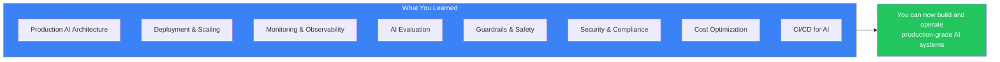
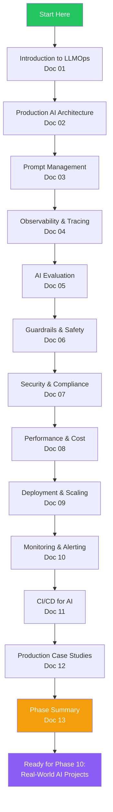
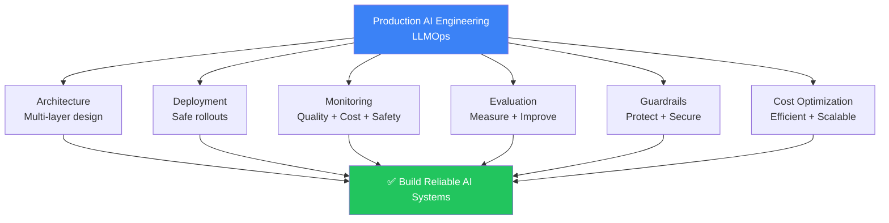

## Introduction

> **Phase 9 covered everything about operating AI systems in production — from architecture and deployment to monitoring, evaluation, safety, security, and cost optimization.**

By now you should understand how to design, deploy, monitor, evaluate, secure, and scale production AI applications. You should be ready to build systems that serve millions of users safely, reliably, and cost-effectively.



---

## Complete Roadmap



---

## LLMOps Cheat Sheet

### Quick Reference

| Concept | Key Points |
|---------|------------|
| **LLMOps** | Deploy, monitor, evaluate, secure, and improve AI in production |
| **Production Architecture** | Frontend → Edge → Gateway → Orchestration → LLM → Data → Observability |
| **Prompt Management** | Version, test, registry, A/B test, governance |
| **Observability** | Traces (what happened), Metrics (aggregated), Logs (detailed) |
| **Evaluation** | Offline (golden dataset), Online (A/B), LLM-as-a-Judge, Human |
| **Guardrails** | Input: injection, PII, jailbreak. Output: hallucination, toxicity, schema |
| **Security** | Auth, encryption, RBAC, audit logs, multi-tenancy |
| **Cost Optimization** | Caching, model routing, token optimization, streaming |
| **Deployment** | Docker, K8s, blue-green, canary, serverless, autoscaling |
| **Monitoring** | 4 layers: infra → app → AI-specific → quality |
| **CI/CD for AI** | Evaluation gates, canary prompts, auto-rollback |

---

## Comparison Tables

### Development vs Production AI

| Aspect | Development | Production |
|--------|-------------|------------|
| **Users** | 1-10 (you + testers) | Millions |
| **Latency** | Not critical | < 2s P95 |
| **Cost** | Free / cheap | $10K-$1M+/month |
| **Monitoring** | Console logs | Full observability stack |
| **Evaluation** | Manual | Automated pipeline |
| **Safety** | Basic | Multi-layer guardrails |
| **Deployment** | `python app.py` | CI/CD + canary |
| **Rollback** | Ctrl+C | Automated rollback |
| **Scaling** | Single machine | Kubernetes + HPA |
| **Uptime** | ~99% | 99.9%+ |

### MLOps vs LLMOps

| Dimension | MLOps | LLMOps |
|-----------|-------|--------|
| **Core artifact** | Custom models | Prompts + base models |
| **Training** | Required | Optional (fine-tuning) |
| **Main cost** | GPU compute | API tokens |
| **Evaluation** | Accuracy, precision | Groundedness, relevance, safety |
| **Monitoring** | Data drift, model decay | Hallucinations, cost, injection |
| **Failure mode** | Poor predictions | Toxic outputs, jailbreaks |
| **Infrastructure** | GPU clusters | API gateways + vector stores |

### Tracing vs Logging

| Aspect | Tracing | Logging |
|--------|---------|---------|
| **Granularity** | Request-level | Event-level |
| **Scope** | Cross-service | Single service |
| **AI-specific** | Token counts, latency per step | Full prompt/response text |
| **Storage** | Sampled (10-100% of requests) | All events |
| **Use case** | Debugging slow requests | Investigating specific errors |
| **Tool** | OpenTelemetry, Jaeger, Tempo | Elasticsearch, Loki, CloudWatch |

### Evaluation vs Monitoring

| Aspect | Evaluation | Monitoring |
|--------|-----------|------------|
| **When** | Before deploy + periodic | Continuous (real-time) |
| **Data** | Golden dataset | Production traffic |
| **Purpose** | Gate changes | Detect regressions |
| **Frequency** | Per commit / periodic | Every request |
| **Action** | Block or approve deploy | Alert or auto-rollback |

### Small Models vs Large Models

| Aspect | Small Model (GPT-4o-mini) | Large Model (GPT-4o) |
|--------|--------------------------|---------------------|
| **Cost per M tokens** | $0.15 input / $0.60 output | $2.50 input / $10.00 output |
| **Latency** | < 200ms | 500ms-2s |
| **Quality** | Good for simple tasks | Excellent for complex |
| **Best for** | FAQ, classification, simple Q&A | Reasoning, code, analysis |
| **Context window** | 128K | 128K |

### Hosted vs Self-Hosted Models

| Aspect | Hosted (API) | Self-Hosted |
|--------|-------------|-------------|
| **Setup** | Minutes | Days-weeks |
| **Cost** | Pay per token | GPU + ops |
| **Latency** | Variable (network) | Predictable (local) |
| **Privacy** | Data leaves your infra | Data stays local |
| **Compliance** | DPA/BAA required | Full control |
| **Customization** | Prompt only | Fine-tuning |
| **Model choice** | Provider's models | Any open-source model |
| **Scaling** | Provider handles | You handle |

---

## Checklists

### Production Readiness Checklist

- [ ] Architecture documented and reviewed
- [ ] API Gateway with auth and rate limiting
- [ ] Multi-model routing with fallback
- [ ] RAG pipeline with vector store
- [ ] Response caching at multiple levels
- [ ] Streaming support for real-time responses
- [ ] Distributed tracing across all services
- [ ] Health checks (liveness + readiness + quality)
- [ ] CI/CD pipeline with evaluation gates
- [ ] Canary deployment capability
- [ ] Automated rollback on quality regression

### Deployment Checklist

- [ ] Docker container built and tagged
- [ ] Kubernetes manifests reviewed
- [ ] Environment variables configured (no secrets in code)
- [ ] Resource limits set (CPU/memory)
- [ ] HPA configured with appropriate metrics
- [ ] Readiness and liveness probes configured
- [ ] Canary deployment plan reviewed
- [ ] Rollback plan tested
- [ ] Monitoring dashboards verified
- [ ] Alerts configured for key metrics
- [ ] Runbook reviewed by on-call team

### Security Checklist

- [ ] All API endpoints require authentication
- [ ] Least privilege access for all services
- [ ] Encryption at rest (AES-256)
- [ ] Encryption in transit (TLS 1.3)
- [ ] mTLS for service-to-service
- [ ] Secrets in vault (not in code)
- [ ] Automated key rotation
- [ ] Structured audit logging
- [ ] Rate limiting on public endpoints
- [ ] Multi-tenant data isolation
- [ ] Regular security penetration testing
- [ ] Incident response plan

### Evaluation Checklist

- [ ] Golden dataset created and versioned
- [ ] Automated evaluation pipeline in CI
- [ ] Quality thresholds defined per metric
- [ ] Safety tests (adversarial + injection)
- [ ] Edge case tests
- [ ] Latency and cost benchmarks
- [ ] Regression tests against baseline
- [ ] Online monitoring of production quality
- [ ] User feedback collection (thumbs up/down)
- [ ] A/B testing capability for prompts

### Monitoring & Alerting Checklist

- [ ] Infrastructure metrics (CPU, memory, network)
- [ ] Application metrics (latency, error rate, throughput)
- [ ] AI-specific metrics (tokens, cost, TTFT)
- [ ] Quality metrics (hallucination rate, satisfaction)
- [ ] SLOs defined for key metrics
- [ ] Error budgets tracked
- [ ] Alerts configured with appropriate severities
- [ ] Runbooks for each alert type
- [ ] Dashboards for each team/perspective
- [ ] On-call rotation established

---

## Interview Guide

### Beginner

**Q: What is LLMOps?**

> LLMOps is the practice of deploying, monitoring, evaluating, securing, and improving LLM applications in production. It covers the entire lifecycle from development to continuous improvement, with a focus on quality, safety, cost, and reliability.

**Q: What are the main layers of a production AI architecture?**

> Seven layers: Frontend (web/mobile), Edge (CDN, WAF), API Gateway (auth, rate limiting), Orchestration (prompts, RAG, agents), LLM Layer (models), Data Layer (vector store, cache, database), Observability (tracing, logging, metrics).

**Q: What's the difference between MLOps and LLMOps?**

> MLOps focuses on training and deploying custom models. LLMOps focuses on operating pre-trained models accessed via APIs. Key differences: LLMOps manages prompts instead of model training, monitors hallucinations instead of accuracy drift, and optimizes token costs instead of compute costs.

### Intermediate

**Q: How would you set up monitoring for an AI application?**

> Four layers: (1) **Infrastructure** — CPU, memory, network, (2) **Application** — latency, error rate, throughput, (3) **AI-specific** — tokens, cost, TTFT, cache hit rate, (4) **Quality** — LLM-as-a-Judge score, hallucination rate, user satisfaction. Each layer has its own thresholds and alerting.

**Q: How do you evaluate LLM output quality at scale?**

> Use a combination: (1) **Offline evaluation** — Golden dataset tested before deployment, (2) **LLM-as-a-Judge** — Automated scoring on 100% of production responses, (3) **Human evaluation** — Stratified sampling for nuanced review, (4) **User feedback** — Thumbs up/down, retry rate, escalation rate.

### Senior

**Q: Design a cost optimization strategy for an AI application serving 1M requests/day.**

> Strategy: (1) **Caching** — Exact match + semantic cache (30-40% hit rate), (2) **Model routing** — 70% queries → cheap model (GPT-4o-mini), 20% → medium (Claude Haiku), 10% → expensive (GPT-4o), (3) **Token optimization** — Compress system prompts, selective context, shorter outputs, (4) **Batching** — Batch non-urgent requests, (5) **Monitoring** — Real-time cost tracking with per-user alerts. Expected savings: 60-70% vs using GPT-4o for everything.

**Q: How would you implement a multi-layer guardrail system?**

> Four layers: (1) **Fast (sub-ms)** — Regex filters, rate limiting, basic blocklists, (2) **Medium (5-50ms)** — ML classifiers for PII, injection detection, jailbreak detection, (3) **Deep (100-500ms)** — LLM-as-a-Judge for quality, hallucination detection, (4) **Human** — Escalation for low-confidence responses. Each layer filters out issues before passing to the next. Safety violations are blocked immediately.

### Staff Engineer

**Q: Design a multi-region, multi-provider AI architecture for a global enterprise.**

> Architecture: (1) **Global DNS** — Route traffic to nearest region, (2) **Per-region deployment** — Full stack in US, EU, APAC, (3) **Multi-provider** — Azure OpenAI in EU (GDPR), AWS Bedrock in US, (4) **Regional vector stores** — Synced async with conflict resolution, (5) **Shared prompt registry** — Global with regional caches, (6) **Failover** — Region fails → traffic routes to next closest region, (7) **Compliance** — Data stays in region, per-region encryption keys, (8) **Monitoring** — Regional dashboards + global overview.

### System Design

**Q: Design a real-time quality monitoring system that auto-rollbacks regressions.**

> Components: (1) **Evaluation pipeline** — Async workers evaluate every response with LLM-as-a-Judge, (2) **Score aggregator** — Rolling window (5 min) of quality scores, (3) **Anomaly detector** — Statistical model detects significant shift from 24h baseline, (4) **Correlation engine** — Checks if anomaly correlates with recent deploy, (5) **Rollback trigger** — If recent deploy AND quality regression → auto-rollback, (6) **Verification** — After rollback, monitor quality recovery for 10 min, (7) **Postmortem** — Auto-collect traces and generate incident report.

---

## Mini Projects

| Project | Skills Practiced | Difficulty |
|---------|-----------------|------------|
| **1. AI Monitoring Dashboard** | Metrics, observability, dashboards | Medium |
| **2. Prompt Version Manager** | Prompt registry, versioning, API design | Medium |
| **3. Evaluation Pipeline** | Golden datasets, LLM-as-a-Judge, CI | Medium-Hard |
| **4. LLM Cost Analyzer** | Cost tracking, model routing, optimization | Medium |
| **5. Prompt Playground** | Prompt testing, A/B testing, UI | Easy-Medium |
| **6. AI Health Dashboard** | Health checks, alerting, monitoring | Medium |
| **7. Tracing Dashboard** | OpenTelemetry, distributed tracing | Hard |
| **8. Production Deployment Pipeline** | CI/CD, Docker, K8s, canary | Hard |
| **9. LLM Benchmark Tool** | Evaluation, benchmarking, comparison | Medium-Hard |
| **10. Guardrail Testing Framework** | Safety, injection detection, adversarial testing | Hard |

---

## Learning Path to Phase 10

```
Phase 1: AI Fundamentals          ───→  Done ✓
Phase 2: Machine Learning         ───→  Done ✓
Phase 3: Deep Learning            ───→  Done ✓
Phase 4: Large Language Models     ─→  Done ✓
Phase 5: Retrieval Systems        ───→  Done ✓
Phase 6: AI Agents                ───→  Done ✓
Phase 7: Model Context Protocol    ─→  Done ✓
Phase 8: AI Frameworks            ───→  Done ✓
Phase 9: Production AI Engineering ─→  Done ✓
                                        ↓
Phase 10: Real-World AI Projects  ←── Next!
```

---

## Key Insights Diagram



---

## Common Mistakes

| Mistake | Fix |
|---------|-----|
| No monitoring from day one | Add observability before launch |
| Deploying prompts directly to production | Use prompt registry with canary |
| Single model without fallback | Always have at least one fallback model |
| No evaluation pipeline | Build golden dataset before optimizing |
| Ignoring costs until the bill arrives | Set up cost monitoring from day one |
| No guardrails for safety | Implement multi-layer guardrails |
| Treating LLMs as deterministic | Use evaluation to measure variability |
| No rollback plan | Every deploy should have a one-click rollback |
| Skipping canary deployments | Canary everything — prompts, models, configs |
| Only monitoring uptime | Quality regressions are silent failures |

---

## Summary

| Topic | Key Takeaway |
|-------|-------------|
| **LLMOps** | Operating AI in production requires specialized practices |
| **Architecture** | Multi-layer design with caching, fallbacks, and observability |
| **Prompt Management** | Prompts are code — version, test, deploy with rigor |
| **Observability** | Traces + metrics + logs with AI-specific attributes |
| **Evaluation** | Measure quality with golden datasets and LLM-as-a-Judge |
| **Guardrails** | Multi-layer safety: input → LLM → output |
| **Security** | Auth, encryption, compliance, audit trails |
| **Cost Optimization** | Cache + route + optimize tokens |
| **Deployment** | Containerize, canary, auto-rollback |
| **Monitoring** | Four layers: infra → app → AI → quality |
| **CI/CD** | Evaluation gates before deployment |
| **Key principle** | Build for reliability, safety, and cost from day one |

---

## Navigation

**Previous:** [12 — Production Case Studies](/ai/phase-09-production-ai/12-production-case-studies)

**Next:** Phase 10 — Real-World AI Projects (Coming Soon)

**Related Topics:**
- [Introduction to LLMOps](/ai/phase-09-production-ai/01-introduction-to-llmops)
- [Production AI Architecture](/ai/phase-09-production-ai/02-production-ai-architecture)
- [Production Case Studies](/ai/phase-09-production-ai/12-production-case-studies)
