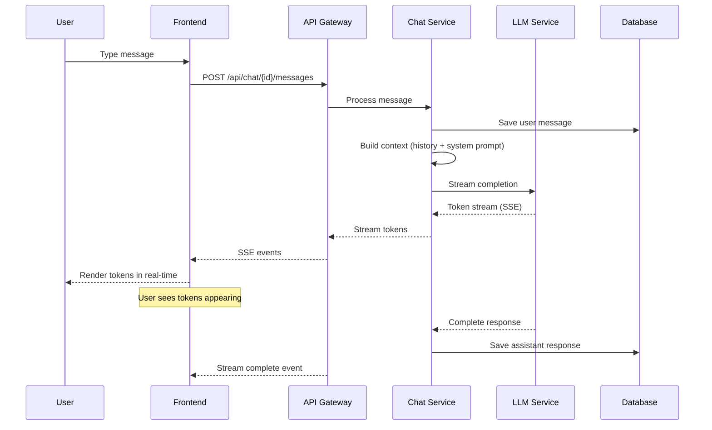
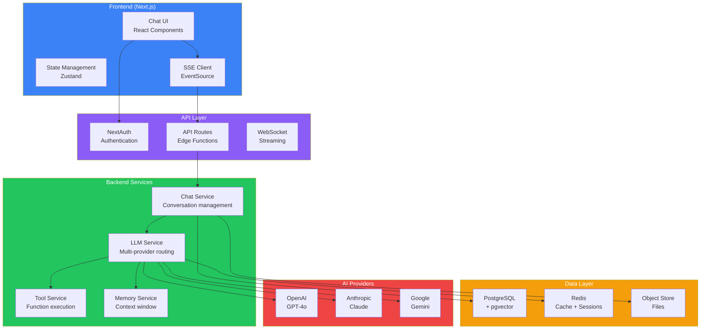
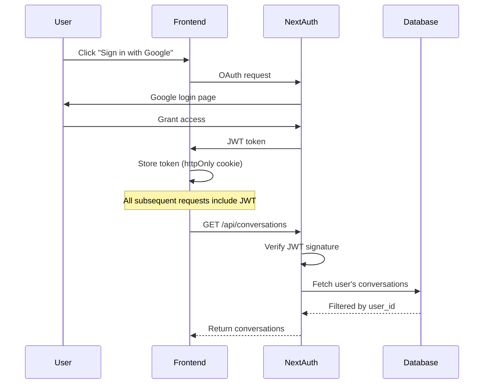
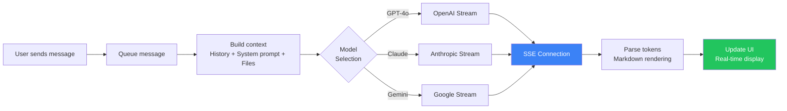
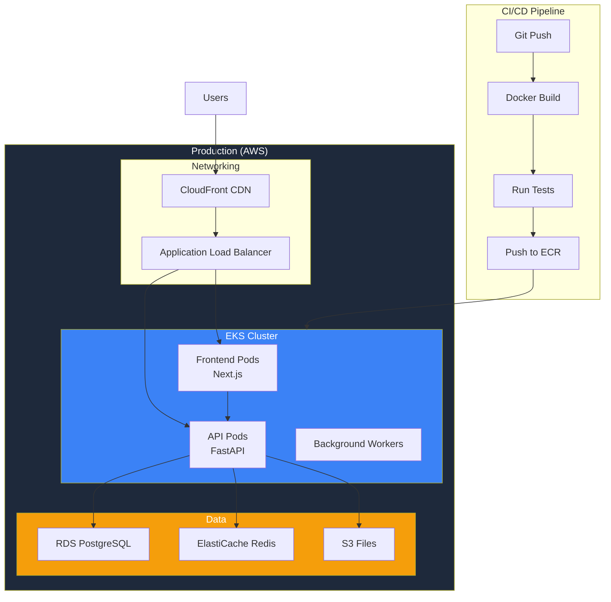
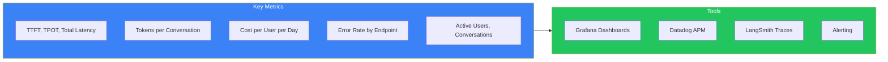

## Introduction

> **Build a production-grade conversational AI platform like ChatGPT — with streaming responses, conversation memory, tool/function calling, file uploads, multi-model selection, and a polished UI.**

ChatGPT redefined how users interact with AI. This project teaches you to build every feature that makes ChatGPT great — from real-time token streaming to conversation management, tool calling, and markdown rendering.

---

## Problem Statement

Users need a conversational AI interface that provides real-time responses, maintains context across conversations, supports multiple AI models, handles file uploads, and enables tools/plugins — all with a polished, responsive UX.

### Business Use Case

A startup building an AI chat platform for customer support teams needs a ChatGPT-like interface that:
- Handles 10K+ conversations/day
- Supports multiple LLM providers (OpenAI, Anthropic, Gemini)
- Provides real-time streaming responses
- Includes conversation history and search
- Supports file uploads and tool calling
- Deploys cost-effectively on cloud infrastructure

---

## Requirements

### Functional Requirements

| # | Feature | Description |
|---|---------|-------------|
| FR1 | User authentication | Sign up, login, OAuth (Google, GitHub) |
| FR2 | Chat sessions | Create, rename, delete conversations |
| FR3 | Streaming responses | Real-time token display via SSE |
| FR4 | Model selection | Switch between GPT-4o, Claude, Gemini |
| FR5 | Conversation memory | Maintain context across turns |
| FR6 | Message history | Persist and retrieve past conversations |
| FR7 | File upload | Upload images, PDFs, documents |
| FR8 | Tool calling | Calculator, web search, code execution |
| FR9 | Markdown rendering | Code syntax highlighting, tables, math |
| FR10 | Conversation search | Full-text search across history |
| FR11 | Export chat | Download as PDF, Markdown, JSON |
| FR12 | Dark mode | Light/dark theme toggle |

### Non-Functional Requirements

| # | Requirement | Target |
|---|-------------|--------|
| NFR1 | Response latency | TTFT < 500ms, streaming at 30+ tokens/s |
| NFR2 | Availability | 99.9% uptime |
| NFR3 | Scalability | Support 10K concurrent users |
| NFR4 | Security | End-to-end encryption, SOC2 compliance |
| NFR5 | Cost efficiency | $0.02 per avg conversation |

---

## Technology Stack

| Layer | Technology | Purpose |
|-------|-----------|---------|
| **Frontend** | Next.js 14 + React + Tailwind CSS | Web UI, SSR, streaming |
| **Backend** | FastAPI (Python) | API server, WebSocket management |
| **Database** | PostgreSQL + pgvector | Conversations, user data, embeddings |
| **Cache** | Redis | Session cache, rate limiting |
| **Vector DB** | Qdrant / pgvector | Message embeddings for search |
| **AI** | OpenAI, Anthropic, Gemini APIs | Multi-model LLM support |
| **Streaming** | Server-Sent Events (SSE) | Real-time token streaming |
| **Auth** | NextAuth.js / JWT | Authentication |
| **File Storage** | S3 / GCS | File upload storage |
| **Deployment** | Docker + Kubernetes + AWS | Production infrastructure |

---

## Folder Structure

```
chatgpt-clone/
├── frontend/
│   ├── app/
│   │   ├── (auth)/          # Login, signup pages
│   │   ├── chat/            # Main chat interface
│   │   │   ├── [id]/        # Individual chat session
│   │   │   └── layout.tsx   # Chat layout with sidebar
│   │   └── api/             # Next.js API routes
│   ├── components/
│   │   ├── chat/
│   │   │   ├── ChatMessage.tsx    # Message bubble
│   │   │   ├── ChatInput.tsx      # Input with file upload
│   │   │   ├── StreamingText.tsx  # Real-time token display
│   │   │   └── ModelSelector.tsx  # Model picker dropdown
│   │   ├── ui/
│   │   │   ├── Markdown.tsx       # Rendered markdown
│   │   │   └── CodeBlock.tsx      # Syntax highlighted code
│   │   └── layout/
│   │       ├── Sidebar.tsx        # Conversation list
│   │       └── Header.tsx         # User menu, settings
│   ├── lib/
│   │   ├── api.ts            # API client
│   │   ├── streaming.ts      # SSE handler
│   │   └── utils.ts
│   └── store/
│       └── chat.ts           # Zustand state
├── backend/
│   ├── app/
│   │   ├── routes/
│   │   │   ├── auth.py       # Auth endpoints
│   │   │   ├── chat.py       # Chat CRUD + streaming
│   │   │   ├── conversations.py
│   │   │   └── files.py      # File upload
│   │   ├── services/
│   │   │   ├── llm_service.py     # Multi-provider LLM
│   │   │   ├── memory_service.py  # Conversation memory
│   │   │   ├── tool_service.py    # Tool execution
│   │   │   └── search_service.py  # Conversation search
│   │   ├── models/
│   │   │   └── conversation.py    # DB models
│   │   └── core/
│   │       ├── config.py
│   │       └── security.py
│   └── requirements.txt
├── ai/
│   ├── prompts/
│   │   ├── system-chat.yaml
│   │   └── tools/
│   └── embeddings/
├── deployment/
│   ├── Dockerfile
│   ├── docker-compose.yml
│   └── k8s/
└── docs/
    └── architecture.md
```

---

## API Design



### Key Endpoints

| Method | Endpoint | Purpose |
|--------|----------|---------|
| POST | `/api/auth/login` | User login |
| POST | `/api/auth/signup` | User registration |
| GET | `/api/conversations` | List user conversations |
| POST | `/api/conversations` | Create new conversation |
| GET | `/api/conversations/{id}` | Get conversation history |
| DELETE | `/api/conversations/{id}` | Delete conversation |
| POST | `/api/chat/{id}/messages` | Send message + stream response |
| POST | `/api/chat/{id}/stream` | SSE streaming endpoint |
| POST | `/api/files/upload` | Upload file for context |
| GET | `/api/search?q=` | Search conversations |
| GET | `/api/models` | List available models |

---

## Architecture



---

## Authentication & Authorization



**Authorization rules:**
- Users can only access their own conversations
- Admin users can view system-wide analytics
- API keys are scoped to specific features

---

## Streaming Implementation



### Streaming Event Format

```
event: token
data: {"token": "Hello", "index": 0}

event: token  
data: {"token": " world", "index": 1}

event: done
data: {"conversation_id": "abc123", "usage": {"prompt_tokens": 150, "completion_tokens": 42}}

event: error
data: {"code": "rate_limit", "message": "Rate limit exceeded"}
```

---

## Deployment Architecture



---

## Security

| Concern | Implementation |
|---------|---------------|
| **Authentication** | NextAuth.js with OAuth + JWT |
| **Authorization** | Row-level security on conversations |
| **Encryption** | TLS 1.3, AES-256 at rest |
| **Rate limiting** | Redis-based token bucket (100 req/min per user) |
| **Input validation** | Sanitize all user input before LLM calls |
| **Output safety** | Guardrails on LLM output (toxicity, PII) |
| **Secret management** | AWS Secrets Manager / HashiCorp Vault |

---

## Monitoring



---

## Evaluation

| Dimension | Method | Target |
|-----------|--------|--------|
| Response quality | LLM-as-a-Judge | ≥ 90% |
| User satisfaction | Thumbs up/down | ≥ 85% |
| Task completion | Rate of conversations with resolution | ≥ 80% |
| Latency P95 | Monitor | ≤ 3s |
| Cost per conversation | Token tracking | ≤ $0.05 |

---

## Scaling

| Component | Strategy |
|-----------|----------|
| **Frontend** | Next.js CDN caching, ISR for static pages |
| **API servers** | Horizontal autoscaling (HPA), target 70% CPU |
| **Database** | Read replicas for conversation history, connection pooling |
| **Cache** | Redis cluster with read replicas |
| **LLM API** | Multi-key rotation, fallback models, request queuing |
| **File storage** | S3 with CDN for uploaded files |

---

## Future Improvements

| Feature | Priority | Complexity |
|---------|----------|------------|
| Voice input/output | High | Medium |
| Image generation (DALL-E) | Medium | Low |
| Custom GPTs/prompt library | High | Medium |
| Team workspaces | Medium | High |
| Offline mode (PWA) | Low | High |
| Plugin ecosystem | Medium | High |

---

## Interview Questions

### Architecture

**Q: How would you design the streaming architecture for a ChatGPT clone handling 10K concurrent users?**

> Use SSE (Server-Sent Events) from FastAPI to stream tokens. Each user gets a persistent SSE connection. Use async generators to yield tokens from the LLM API. Implement backpressure — if the client is slow, buffer tokens or drop older ones. Use Redis pub/sub to handle horizontal scaling: any API pod can stream to any user.

**Q: How do you manage conversation context within token limits?**

> Strategy: (1) Track total tokens per conversation, (2) When approaching limit, summarize older messages, (3) Keep system prompt + last N messages in full, summarize everything before that, (4) Use a sliding window — discard oldest messages first, (5) For very long conversations, create "checkpoints" that summarize the conversation so far.

### System Design

**Q: Design the database schema for a ChatGPT clone.**

> Tables: `users` (id, email, name, auth_provider), `conversations` (id, user_id, title, model, created_at, updated_at), `messages` (id, conversation_id, role, content, tokens, created_at), `message_files` (id, message_id, file_url, file_type). Use pgvector for message embeddings to enable semantic search across conversations.

### Coding

**Q: Implement an SSE streaming endpoint for chat.**

> See the streaming implementation above. Key: use `StreamingResponse` with an async generator that yields tokens as they arrive from the LLM provider.

---

## Summary

| Feature | Implementation |
|---------|---------------|
| **Chat UI** | Next.js + Tailwind + React Server Components |
| **Streaming** | SSE from FastAPI to Next.js |
| **Multi-model** | OpenAI, Anthropic, Gemini through unified interface |
| **Memory** | Sliding window + summarization |
| **Files** | S3 upload + context injection |
| **Search** | pgvector embeddings |
| **Auth** | NextAuth.js + JWT |
| **Deployment** | Docker + Kubernetes + AWS |

---

## Navigation

**Previous:** [13 — Phase Summary — Production AI](/ai/phase-09-production-ai/13-phase-summary)

**Next:** [02 — Build a Perplexity Clone](/ai/phase-10-ai-projects/02-perplexity-clone)

**Related Projects:**
- [Perplexity Clone](/ai/phase-10-ai-projects/02-perplexity-clone)
- [AI Document Assistant](/ai/phase-10-ai-projects/07-ai-document-assistant)
- [AI System Design](/ai/phase-10-ai-projects/13-ai-system-design)
