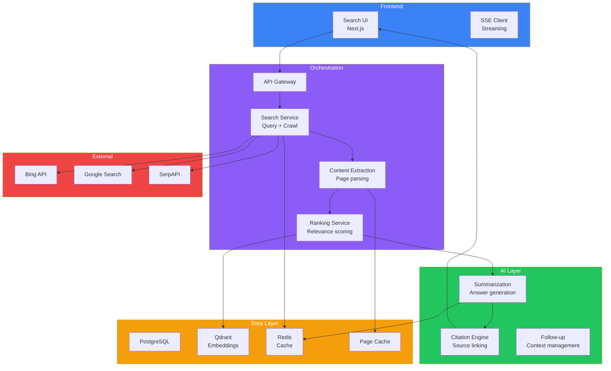
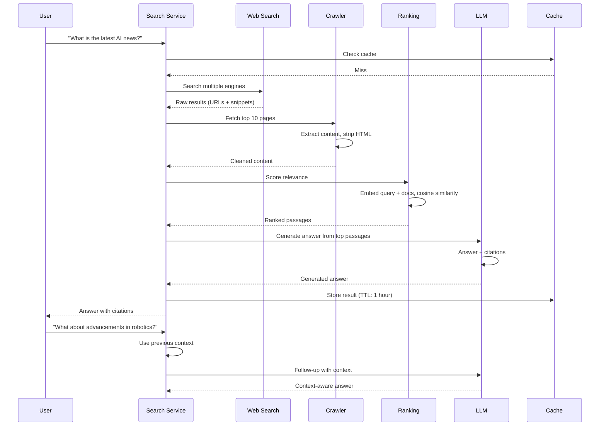
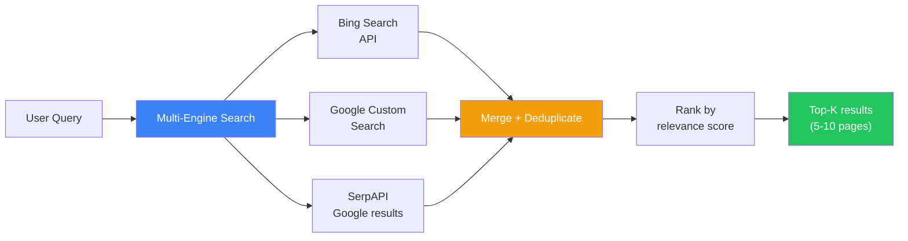
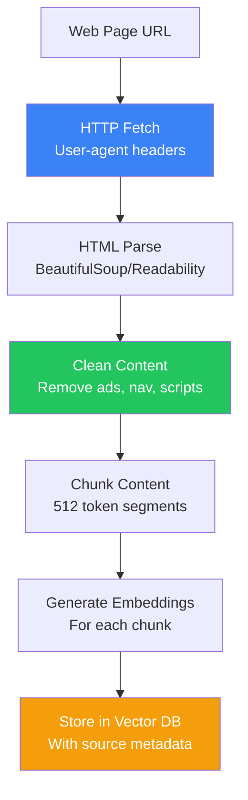
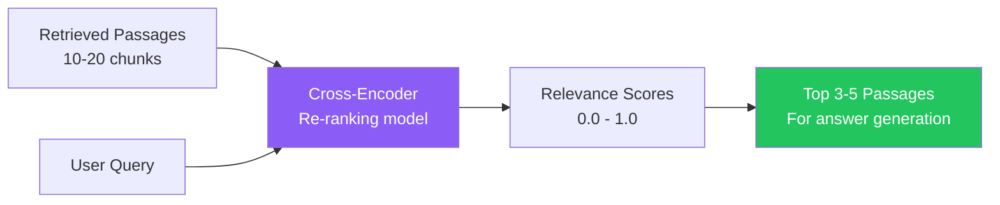
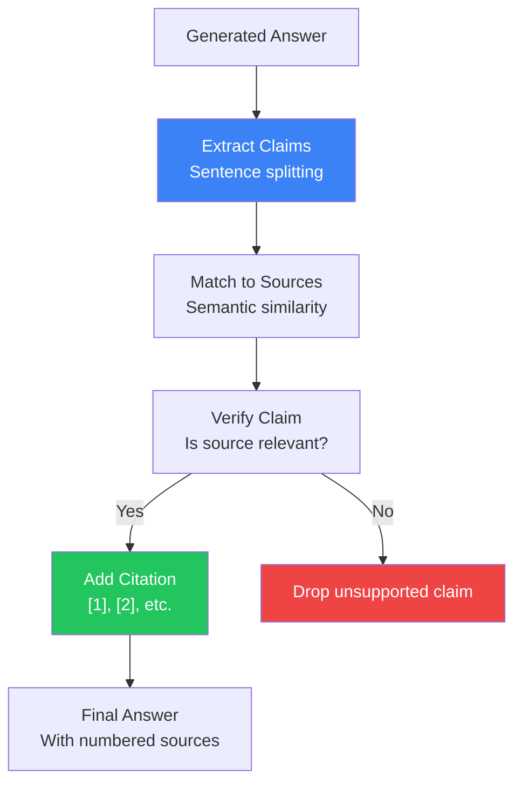
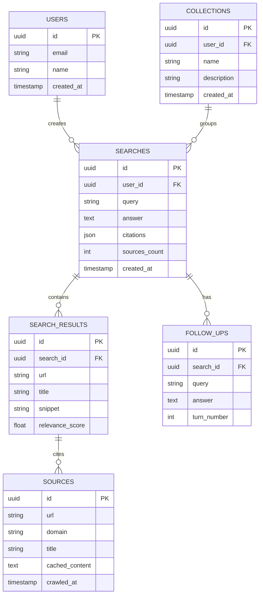
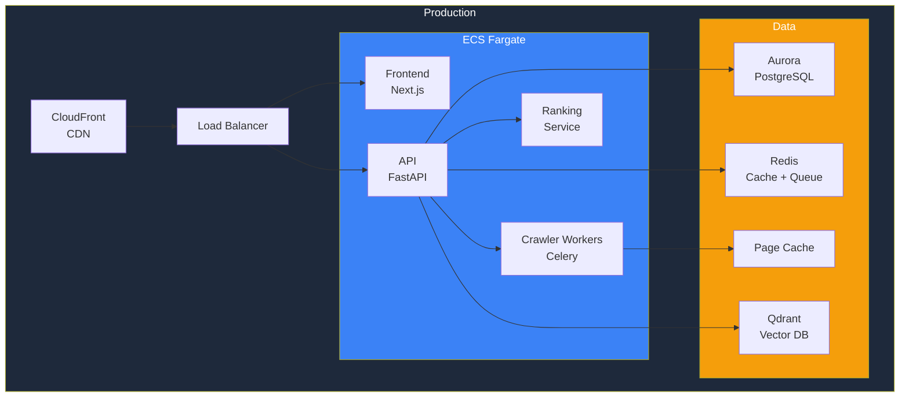

## Introduction

> **Build a production-grade AI search engine like Perplexity — combining real-time web search, RAG, source ranking, citations, and conversational follow-ups in a single interface.**

Perplexity revolutionized search by combining LLM reasoning with real-time web data. This project teaches you to build every core feature: web crawling, content extraction, relevance ranking, citation generation, and conversational search.

---

## Problem Statement

Traditional search engines return links. Users want answers. An AI search engine should:
- Understand the user's question in natural language
- Search the web in real-time
- Extract relevant content from multiple sources
- Generate a comprehensive answer with citations
- Support follow-up questions that maintain context

### Business Use Case

A media company building a research assistant for journalists needs a Perplexity-like tool that:
- Searches thousands of sources in real-time
- Extracts and summarizes relevant content
- Provides verifiable citations for every claim
- Handles 100K+ queries/day
- Supports multiple languages

---

## Requirements

### Functional Requirements

| # | Feature | Description |
|---|---------|-------------|
| FR1 | Real-time web search | Query multiple search engines (Bing, Google, SerpAPI) |
| FR2 | Content extraction | Parse and clean web pages |
| FR3 | Relevance ranking | Score and rank search results |
| FR4 | Answer generation | LLM generates answer from sources |
| FR5 | Citation generation | Link every claim to its source |
| FR6 | Follow-up questions | Context-aware conversation |
| FR7 | Source management | Add/remove/prioritize sources |
| FR8 | Search history | Persist search queries and results |
| FR9 | Collections | Organize searches into topics |
| FR10 | Pro search | Deep search with more sources |

### Non-Functional Requirements

| # | Requirement | Target |
|---|-------------|--------|
| NFR1 | Search latency | < 3s end-to-end |
| NFR2 | Answer quality | ≥ 90% factually accurate |
| NFR3 | Availability | 99.9% |
| NFR4 | Citation accuracy | Every claim linked to real source |
| NFR5 | Cost efficiency | ≤ $0.05 per search query |

---

## Technology Stack

| Layer | Technology | Purpose |
|-------|-----------|---------|
| **Frontend** | Next.js + Tailwind CSS | Search UI, streaming answers |
| **Backend** | FastAPI (Python) | Query processing, search orchestration |
| **Database** | PostgreSQL | User data, search history |
| **Vector DB** | Qdrant | Document embeddings for relevance |
| **Cache** | Redis | Search result caching |
| **Search API** | SerpAPI / Bing Search | Real-time web search |
| **AI** | OpenAI GPT-4o / Claude | Answer generation, summarization |
| **Queue** | Celery + Redis | Async web crawling |
| **File Storage** | S3 | Cached page snapshots |
| **Deployment** | Docker + K8s + AWS | Production infrastructure |

---

## Architecture

---

## Search & Retrieval Pipeline

---

## Key Components

### 1. Web Search Integration

### 2. Content Extraction

### 3. Re-Ranking

### 4. Citation Generation

---

## API Design

| Method | Endpoint | Purpose |
|--------|----------|---------|
| POST | `/api/search` | Execute a search query |
| GET | `/api/search/{id}` | Get search results |
| POST | `/api/search/{id}/followup` | Follow-up question |
| GET | `/api/history` | Get search history |
| DELETE | `/api/history/{id}` | Delete search |
| POST | `/api/collections` | Create collection |
| GET | `/api/collections/{id}` | Get collection searches |
| GET | `/api/sources` | Available search sources |

---

## Database Schema

---

## Deployment

---

## Monitoring & Evaluation

| Metric | Method | Target |
|--------|--------|--------|
| Search latency | P95 end-to-end | < 3s |
| Citation accuracy | Human review sample | > 95% |
| Answer relevance | LLM-as-a-Judge | > 90% |
| Cache hit rate | % of queries served from cache | > 30% |
| Crawl success rate | % of URLs successfully crawled | > 95% |
| User satisfaction | Thumbs up/down | > 85% |

---

## Security

| Concern | Implementation |
|---------|---------------|
| **Rate limiting** | Per-user: 10 searches/min, Per-IP: 100/min |
| **Content filtering** | Block malicious/pornographic sites from results |
| **Data privacy** | No storage of raw web content beyond TTL |
| **API security** | All endpoints authenticated via JWT |
| **Crawl ethics** | Respect robots.txt, rate-limit crawling |

---

## Future Improvements

| Feature | Priority | Complexity |
|---------|----------|------------|
| Image search integration | Medium | Medium |
| PDF/document search | High | Medium |
| Custom knowledge bases | High | High |
| Multi-language support | Medium | Medium |
| Real-time news alerts | Low | High |
| Team workspaces | Medium | High |

---

## Interview Questions

### Architecture

**Q: Design the search pipeline for a Perplexity clone handling 100 queries/second.**

> Multi-stage pipeline: (1) **Query understanding** — Classify query type (factual, opinion, news), (2) **Parallel search** — Hit Bing, Google, and internal index simultaneously, (3) **Content extraction** — Async worker pool crawls top URLs, (4) **Re-ranking** — Cross-encoder scores passages, (5) **Answer generation** — GPT-4o synthesizes answer from top passages, (6) **Caching** — Store results with TTL based on query type (news: 5min, facts: 1hr). Use Redis for hot cache, S3 for warm cache.

**Q: How do you ensure citation accuracy?**

> (1) **Claim extraction** — Parse answer into atomic claims, (2) **Source matching** — Embed each claim and find best matching source passage, (3) **Verification** — Check if source actually supports the claim (NLI model), (4) **Confidence scoring** — Only include citations above 0.85 threshold, (5) **Human review** — Sample 1% of answers for citation accuracy audit.

### System Design

**Q: Design the crawling infrastructure for a Perplexity clone.**

> Architecture: (1) **Task queue** — Celery with Redis broker, (2) **Worker pool** — 50-100 workers, respecting per-domain rate limits, (3) **Content extraction** — Readability algorithm + BeautifulSoup, (4) **Cache** — Store cleaned content in S3 with 7-day TTL, (5) **Politeness** — Track per-domain request timing, delay between requests, (6) **robots.txt** — Cache and respect per-domain rules.

---

## Summary

| Feature | Implementation |
|---------|---------------|
| **Web search** | Multi-engine (Bing, Google, SerpAPI) |
| **Content extraction** | Readability + HTML parsing |
| **Re-ranking** | Cross-encoder model |
| **Answer generation** | GPT-4o with source-grounded responses |
| **Citations** | Claim extraction + source matching |
| **Caching** | Redis (hot) + S3 (warm) |
| **Async crawling** | Celery worker pool |
| **Follow-ups** | Context-aware conversation management |

---

## Navigation

**Previous:** [01 — Build a ChatGPT Clone](/ai/phase-10-ai-projects/01-chatgpt-clone)

**Next:** [03 — Build a NotebookLM Clone](/ai/phase-10-ai-projects/03-notebooklm-clone)

**Related Projects:**
- [ChatGPT Clone](/ai/phase-10-ai-projects/01-chatgpt-clone)
- [AI Document Assistant](/ai/phase-10-ai-projects/07-ai-document-assistant)
- [AI Research Agent](/ai/phase-10-ai-projects/10-ai-research-agent)
