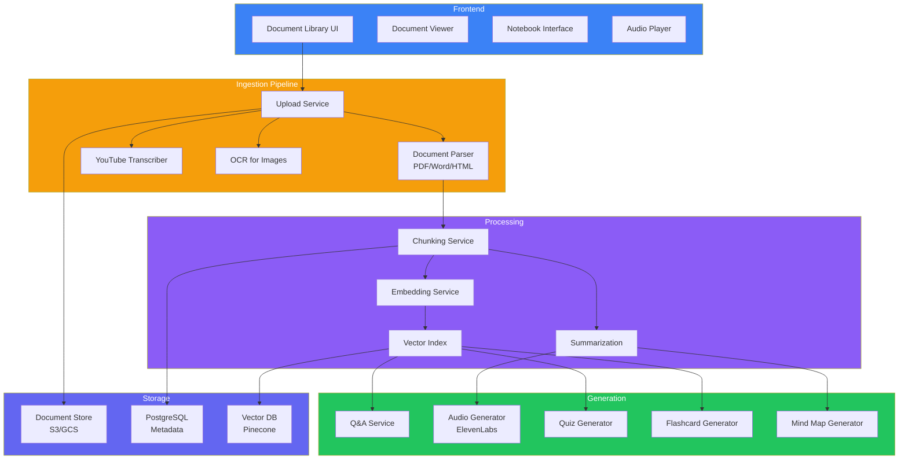
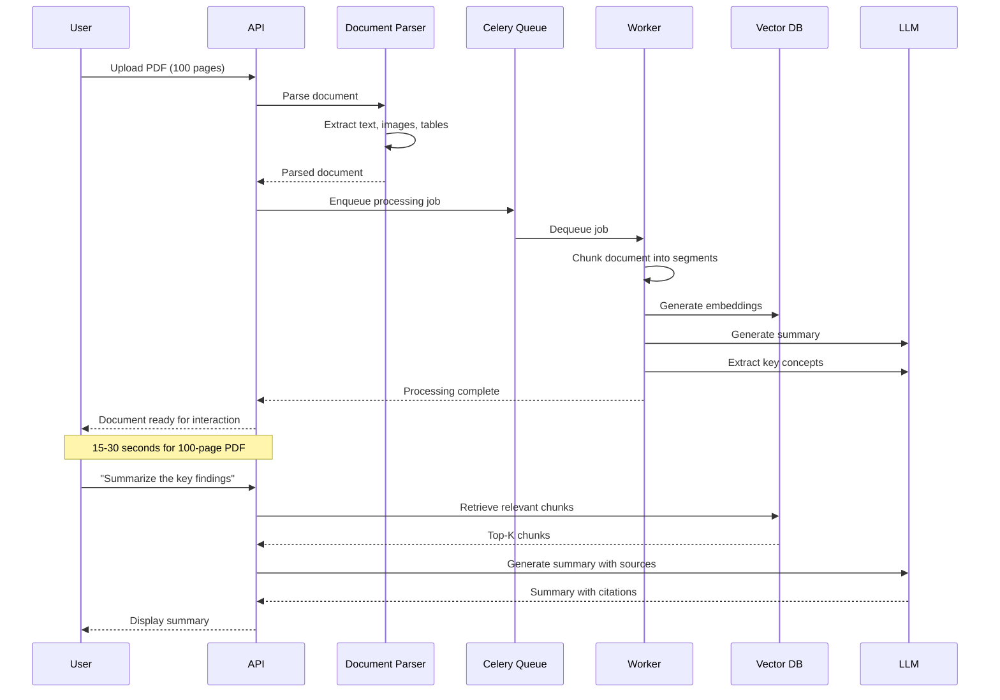
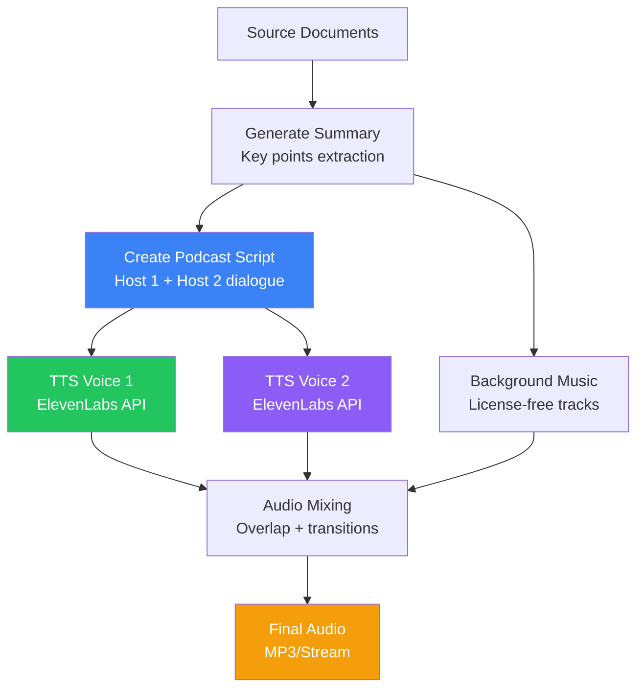
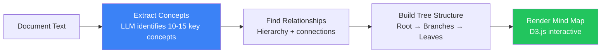
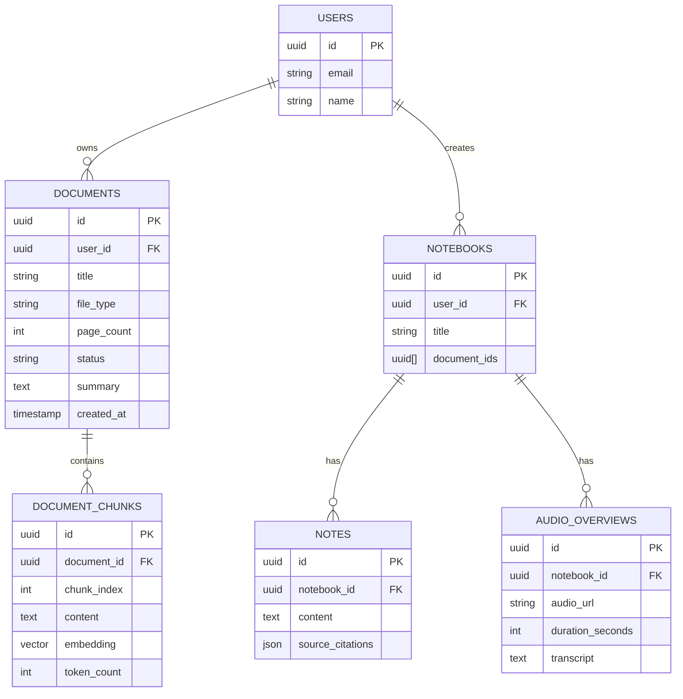
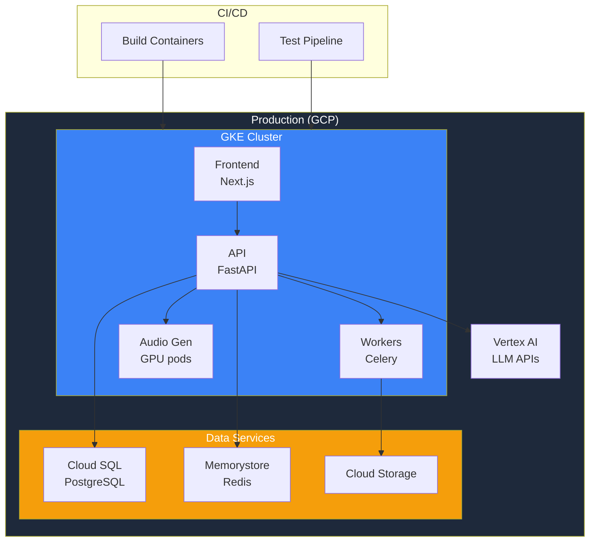

## Introduction

> **Build a personalized AI research assistant like Google NotebookLM — ingesting documents (PDF, websites, YouTube), generating audio overviews, summaries, mind maps, flashcards, and quizzes from your source materials.**

NotebookLM redefined how people interact with their documents — turning static files into interactive, AI-powered knowledge bases. This project teaches you multi-modal document processing, audio generation, and intelligent content synthesis.

---

## Problem Statement

Knowledge workers spend hours reading documents, taking notes, and creating study materials. An AI notebook should:
- Ingest documents of any format (PDF, DOCX, HTML, YouTube)
- Generate concise summaries and overviews
- Create audio discussions (podcast-style)
- Build study aids (flashcards, quizzes, mind maps)
- Answer questions based on source materials
- Maintain source attribution in all outputs

### Business Use Case

An edtech company building a study platform needs a NotebookLM-like tool that lets students upload course materials and generates personalized study aids — summaries, quizzes, flashcards, and audio reviews.

---

## Requirements

### Functional Requirements

| # | Feature | Description |
|---|---------|-------------|
| FR1 | Multi-format upload | PDF, Word, PowerPoint, text, images |
| FR2 | Website ingestion | URL input, content extraction |
| FR3 | YouTube ingestion | Transcript extraction |
| FR4 | Document analysis | Summarization, key concepts extraction |
| FR5 | Audio overview | AI-generated podcast discussion |
| FR6 | Mind map generation | Visual concept maps from content |
| FR7 | Flashcard generation | Question-answer pairs |
| FR8 | Quiz generator | Multiple-choice, true/false from content |
| FR9 | Q&A on documents | Conversational interface over sources |
| FR10 | Source attribution | Every answer cites specific source passages |

### Non-Functional Requirements

| # | Requirement | Target |
|---|-------------|--------|
| NFR1 | Document processing | < 30s for 100-page PDF |
| NFR2 | Audio generation | < 2 min for 15 min audio |
| NFR3 | Q&A accuracy | > 95% grounded in sources |
| NFR4 | Scalability | Handle 1000+ documents per user |
| NFR5 | Storage | Efficient document + embedding storage |

---

## Technology Stack

| Layer | Technology | Purpose |
|-------|-----------|---------|
| **Frontend** | Next.js + Tailwind + D3.js | Document viewer, mind maps |
| **Backend** | FastAPI (Python) | Document processing, AI pipeline |
| **Database** | PostgreSQL | User data, document metadata |
| **Vector DB** | Pinecone / Qdrant | Document chunk embeddings |
| **Cache** | Redis | Processing status, rate limiting |
| **AI** | OpenAI GPT-4o | Summarization, Q&A, quiz generation |
| **Audio** | ElevenLabs / OpenAI TTS | Audio overview generation |
| **OCR** | Tesseract / Document AI | Image-to-text for scanned PDFs |
| **Queue** | Celery + Redis | Async document processing |
| **Storage** | S3 / GCS | Document files |
| **Deployment** | Docker + K8s + GCP | Production infrastructure |

---

## Architecture

---

## Document Processing Pipeline

---

## Audio Overview Generation

---

## Mind Map Generation

---

## API Design

| Method | Endpoint | Purpose |
|--------|----------|---------|
| POST | `/api/documents/upload` | Upload document |
| GET | `/api/documents` | List user's documents |
| GET | `/api/documents/{id}` | Get document details |
| DELETE | `/api/documents/{id}` | Delete document |
| POST | `/api/documents/{id}/process` | Trigger processing |
| GET | `/api/documents/{id}/status` | Processing status |
| POST | `/api/qa` | Ask question about documents |
| POST | `/api/generate/summary` | Generate summary |
| POST | `/api/generate/audio` | Generate audio overview |
| POST | `/api/generate/flashcards` | Generate flashcards |
| POST | `/api/generate/quiz` | Generate quiz |
| POST | `/api/generate/mindmap` | Generate mind map |

---

## Database Schema

---

## Deployment

---

## Security

| Concern | Implementation |
|---------|---------------|
| **Document access** | Row-level security — users only see their documents |
| **File validation** | Scan uploaded files for malware |
| **Content isolation** | Each user's vector index is isolated |
| **Audio generation** | Watermark AI-generated audio |
| **API security** | JWT authentication on all endpoints |

---

## Evaluation

| Metric | Method | Target |
|--------|--------|--------|
| Summary quality | LLM-as-a-Judge vs human baseline | > 90% |
| Quiz accuracy | Questions answered correctly from content | > 95% |
| Audio quality | Human rating (1-5) | > 4.0 |
| Q&A groundedness | Citation accuracy | > 95% |
| Processing speed | Time from upload to ready | < 30s |

---

## Future Improvements

| Feature | Priority | Complexity |
|---------|----------|------------|
| Collaborative notebooks | High | High |
| Custom voice selection | Medium | Low |
| Export to Anki/Quizlet | Medium | Low |
| Mobile app (React Native) | High | High |
| Real-time collaboration | Low | High |
| API for external integrations | High | Medium |

---

## Interview Questions

### Architecture

**Q: Design the document processing pipeline for a Notion-like AI assistant that handles 10K uploads/day.**

> Pipeline: (1) **Upload gateway** — S3 pre-signed URLs for direct upload, (2) **Parse queue** — Celery workers parse documents (text extraction, OCR, table extraction), (3) **Processing pipeline** — Chunk → Embed → Index in Qdrant, (4) **Generation queue** — Separate workers for summaries, quizzes, etc., (5) **Status tracking** — Redis tracks each document's processing stage, (6) **WebSocket** — Real-time status updates to frontend.

**Q: How would you implement audio overview generation?**

> (1) **Content summarization** — LLM generates a concise summary of all documents, (2) **Script generation** — LLM creates a natural dialogue between two hosts discussing the content, (3) **Voice synthesis** — ElevenLabs API generates speech for each host (different voices), (4) **Audio mixing** — Combine tracks with cross-fade transitions, intro/outro music, (5) **Caching** — Cache generated audio by document set hash, (6) **Streaming** — Serve audio via CDN.

### System Design

**Q: Design a Q&A system over user documents that maintains source attribution.**

> Architecture: (1) **Retrieval** — All documents chunked and embedded in a per-user vector index, (2) **Query** — User question embedded, top-10 chunks retrieved, (3) **Re-ranking** — Cross-encoder scores chunks for relevance, (4) **Generation** — LLM generates answer from top-5 chunks with instruction to cite sources, (5) **Citation matching** — Post-process to ensure every claim links to a specific chunk, (6) **UI** — Clickable citations in the answer that scroll to source in document viewer.

---

## Summary

| Feature | Implementation |
|---------|---------------|
| **Document ingestion** | PDF, Word, YouTube, URLs — async processing |
| **Chunking & embedding** | Semantic chunking + vector embeddings |
| **Audio overview** | ElevenLabs TTS with scripted dialogue |
| **Mind maps** | D3.js with AI-generated concept hierarchies |
| **Flashcards & quizzes** | LLM-generated from document content |
| **Q&A** | RAG pipeline with source citations |
| **Async processing** | Celery queue for all heavy computation |

---

## Navigation

**Previous:** [02 — Build a Perplexity Clone](/ai/phase-10-ai-projects/02-perplexity-clone)

**Next:** [04 — Build a Cursor Clone](/ai/phase-10-ai-projects/04-cursor-clone)

**Related Projects:**
- [AI Document Assistant](/ai/phase-10-ai-projects/07-ai-document-assistant)
- [AI Research Agent](/ai/phase-10-ai-projects/10-ai-research-agent)
- [AI Resume & Interview Platform](/ai/phase-10-ai-projects/11-ai-resume-interviewer)
