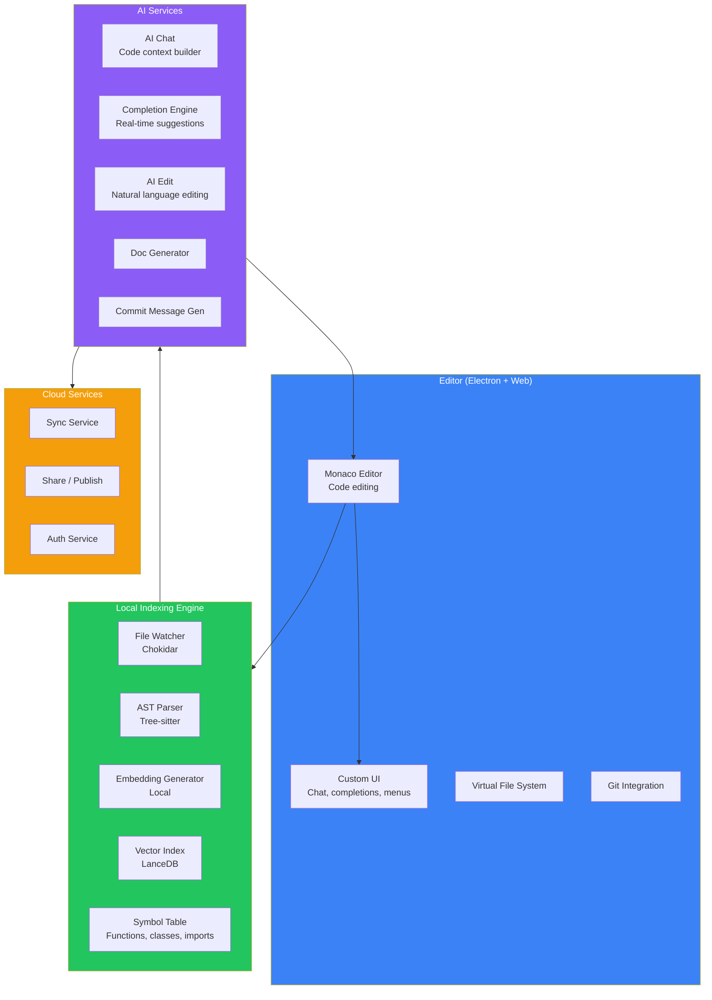
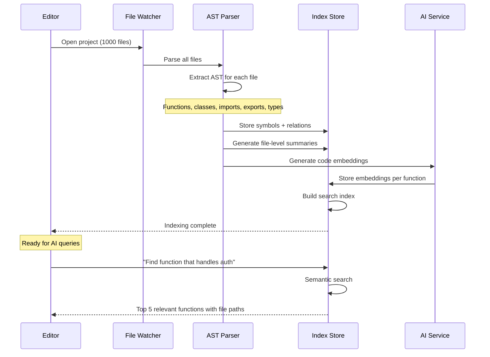
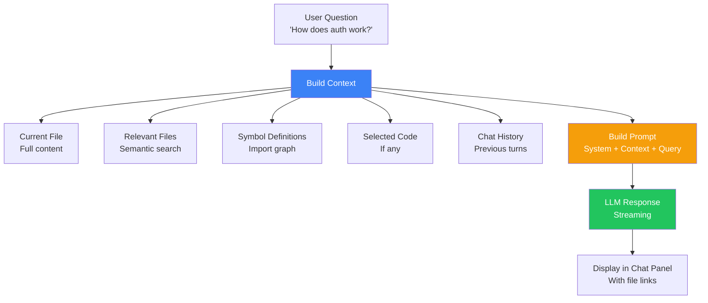
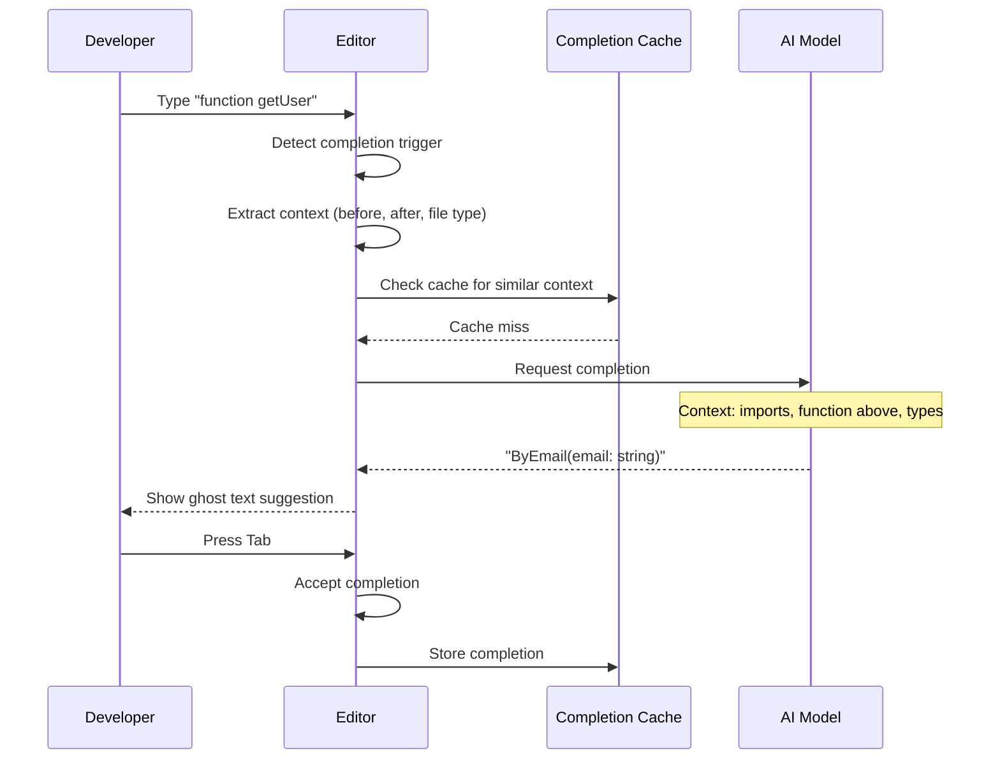
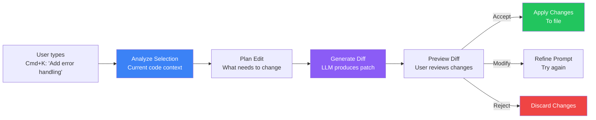
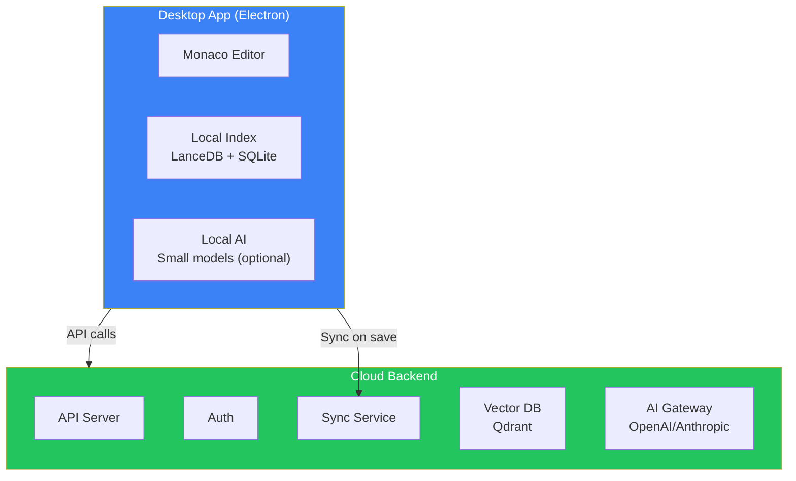

## Introduction

> **Build an AI-first code editor like Cursor — combining a VS Code-style editor with codebase indexing, AI chat, inline code completion, and natural language code editing.**

Cursor redefined the developer experience by deeply integrating AI into the editor. This project teaches you to build code intelligence features: repository parsing, AST analysis, code embeddings, AI chat with context, and automated refactoring.

---

## Problem Statement

Developers spend 50% of their time reading and understanding code. An AI-first editor should:
- Understand the entire codebase, not just the open file
- Provide context-aware AI chat about the project
- Suggest code completions inline
- Edit code via natural language commands
- Index and search across the repository

### Business Use Case

A devtools startup building the next-generation code editor needs AI features that deeply understand codebases — enabling developers to navigate, edit, and refactor code through natural language.

---

## Requirements

### Functional Requirements

| # | Feature | Description |
|---|---------|-------------|
| FR1 | Codebase indexing | Parse and index entire repository |
| FR2 | AST parsing | Extract code structure, symbols, imports |
| FR3 | Code embeddings | Semantic search across codebase |
| FR4 | AI chat | Contextual conversations about code |
| FR5 | Inline completion | Real-time code suggestions as you type |
| FR6 | AI edit mode | Natural language → code changes |
| FR7 | Code refactoring | AI-powered rename, extract, move |
| FR8 | Documentation gen | Auto-generate docs from code |
| FR9 | Git integration | Understand diffs, generate commit messages |
| FR10 | Bug detection | Find potential bugs via static + AI analysis |

### Non-Functional Requirements

| # | Requirement | Target |
|---|-------------|--------|
| NFR1 | Indexing speed | Full repo indexed in < 10s per 10K files |
| NFR2 | Completion latency | < 200ms for inline suggestions |
| NFR3 | Chat latency | < 2s for non-streaming, < 500ms TTFT for streaming |
| NFR4 | Context relevance | > 90% of AI suggestions relevant to current file |
| NFR5 | Offline support | Basic features work without internet |

---

## Technology Stack

| Layer | Technology | Purpose |
|-------|-----------|---------|
| **Frontend** | Monaco Editor + React + Tailwind | Code editor UI |
| **Backend** | Node.js + Express | API server, WebSocket management |
| **Database** | SQLite (local) + PostgreSQL (cloud) | Code index, user data |
| **Vector DB** | LanceDB (local) / Qdrant (cloud) | Code embeddings |
| **AI** | OpenAI / Anthropic API | Code generation, chat |
| **Code Analysis** | Tree-sitter / Babel | AST parsing for multiple languages |
| **Embeddings** | OpenAI text-embedding-3-small | Code semantic search |
| **Git** | isomorphic-git | Git operations in browser |
| **Indexing** | Custom file watcher + parser | Real-time code index updates |

---

## Architecture



---

## Codebase Indexing



---

## AI Chat with Context



### Context Builder

```javascript
async function buildContext(question, state) {
  const context = {
    currentFile: {
      path: state.activeFile,
      content: fs.readFileSync(state.activeFile),
      language: detectLanguage(state.activeFile),
    },
    relevantFiles: await semanticSearch(question, 5),
    selectedCode: state.selection || null,
    chatHistory: state.messages.slice(-10),
  };
  
  return context;
}
```

---

## Inline Code Completion



---

## AI Edit Mode



---

## API Design

| Method | Endpoint | Purpose |
|--------|----------|---------|
| POST | `/api/chat` | AI chat with code context |
| POST | `/api/complete` | Inline code completion |
| POST | `/api/edit` | Natural language code edit |
| POST | `/api/explain` | Explain selected code |
| POST | `/api/refactor` | Refactor code (rename, extract) |
| POST | `/api/generate-docs` | Generate documentation |
| POST | `/api/index` | Trigger codebase indexing |
| GET | `/api/index/status` | Indexing progress |
| GET | `/api/search?q=` | Semantic code search |
| POST | `/api/commit` | Generate commit message |

---

## Deployment



---

## Security

| Concern | Implementation |
|---------|---------------|
| **Code privacy** | All code stays on the device (local mode) |
| **Data sent to AI** | Only relevant context, filtered by user |
| **Authentication** | JWT for cloud features |
| **API key security** | Local AI keys stored in OS keychain |
| **No training** | Never send code to train AI models |

---

## Evaluation

| Metric | Method | Target |
|--------|--------|--------|
| Completion accuracy | % of accepted suggestions | > 30% |
| Chat relevance | User rating | > 4.0/5.0 |
| Index speed | Files indexed per second | > 1000/s |
| Search relevance | Top-5 accuracy | > 90% |
| Edit success rate | Edits applied without errors | > 95% |

---

## Future Improvements

| Feature | Priority | Complexity |
|---------|----------|------------|
| Terminal AI assistant | High | Medium |
| Multi-cursor editing | Medium | High |
| AI test generation | High | Medium |
| Code review agent | High | Medium |
| Extension API for AI | Medium | High |
| Collaborative editing | Low | High |

---

## Interview Questions

### Architecture

**Q: Design the codebase indexing pipeline for a Cursor-like editor.**

> Pipeline: (1) **File discovery** — Recursively walk project, respect .gitignore, (2) **Parallel parsing** — Tree-sitter parses each file into AST (multithreaded), (3) **Symbol extraction** — Extract functions, classes, imports, exports, type definitions, (4) **Relationship mapping** — Build dependency graph (which files import which), (5) **Summarization** — Generate per-file embeddings + LLM summaries, (6) **Index storage** — LanceDB for local, Qdrant for cloud sync, (7) **Incremental updates** — File watcher triggers re-indexing of changed files only.

**Q: How do you build context for AI chat about a codebase?**

> Multi-source context: (1) **Current file** — Full content of the active file, (2) **Related files** — Files imported by or importing the current file, (3) **Semantic search** — Embed the query, find top-5 most relevant functions/classes across the codebase, (4) **Selected code** — If user selected text, include that, (5) **Chat history** — Last 10 messages with their context, (6) **Project metadata** — Language, framework, dependencies.

### System Design

**Q: Design the inline completion system that must respond in < 200ms.**

> Architecture: (1) **Local cache** — Cache completions by context hash (file prefix + suffix + cursor position), (2) **Small model** — Run a quantized model locally (e.g., CodeGemma-2B) for first-pass completions, (3) **Fallback** — If local model confidence < 0.7, send to cloud API with full context, (4) **Context window** — Only include 200 tokens before cursor, 50 tokens after, (5) **Debounce** — 150ms debounce on keystrokes, (6) **Multi-cursor** — Support multiple cursors by batching completions.

---

## Summary

| Feature | Implementation |
|---------|---------------|
| **Codebase indexing** | Tree-sitter AST + LanceDB embeddings |
| **AI chat** | Context builder with semantic search |
| **Inline completion** | Local model + cloud fallback, < 200ms |
| **AI edit** | Diff-based patch generation with preview |
| **Code analysis** | Symbol table, dependency graph |
| **Search** | Semantic code search across entire repo |
| **Sync** | Cloud sync with local-first architecture |

---

## Navigation

**Previous:** [03 — Build a NotebookLM Clone](/ai/phase-10-ai-projects/03-notebooklm-clone)

**Next:** [05 — Build a GitHub Copilot Clone](/ai/phase-10-ai-projects/05-github-copilot-clone)

**Related Projects:**
- [GitHub Copilot Clone](/ai/phase-10-ai-projects/05-github-copilot-clone)
- [AI Code Reviewer](/ai/phase-10-ai-projects/06-ai-code-reviewer)
- [AI System Design](/ai/phase-10-ai-projects/13-ai-system-design)
