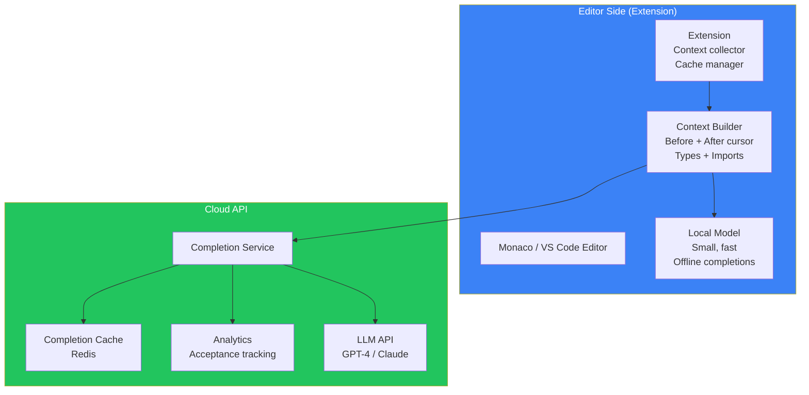
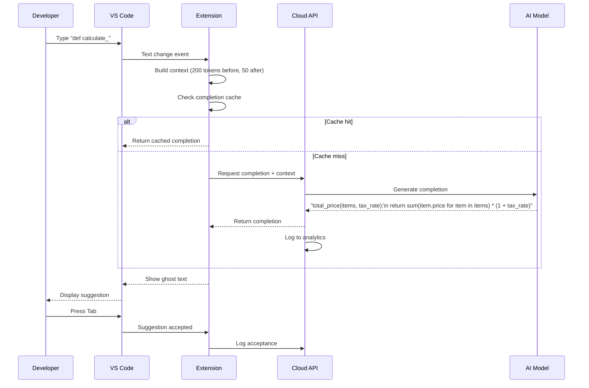
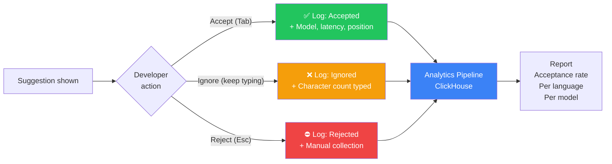
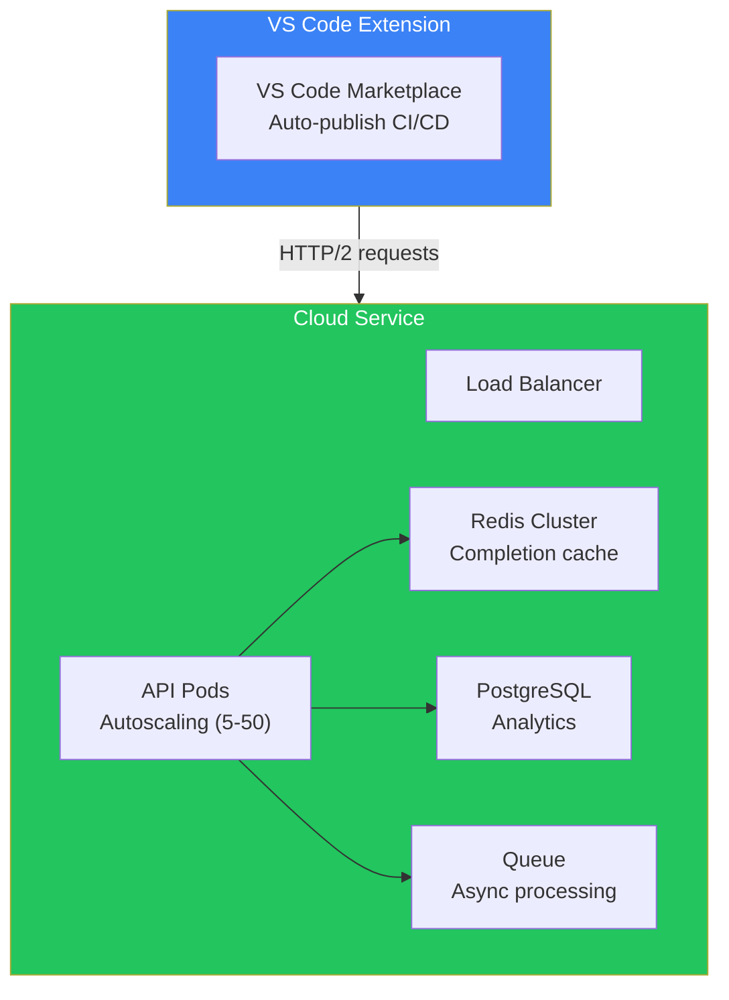

## Introduction

> **Build a GitHub Copilot-like AI code completion assistant — providing real-time inline code suggestions, multi-line completions, context-aware code generation, and editor integration.**

GitHub Copilot transformed how developers write code by embedding AI directly into the development flow. This project teaches you the core mechanics: prompt optimization, context window management, streaming completions, and fast inline suggestions.

---

## Problem Statement

Developers type code faster than they can think of the implementation. An AI code assistant should:
- Predict the next few tokens/lines based on context
- Provide completions in < 200ms
- Understand imports, types, and project patterns
- Support multiple languages (Python, JS, TS, Go, etc.)
- Integrate seamlessly into the editor workflow

### Business Use Case

A devtools company building a code intelligence platform needs an AI assistant that helps developers write code faster with accurate, context-aware suggestions — reducing boilerplate and helping with unfamiliar APIs.

---

## Requirements

### Functional Requirements

| # | Feature | Description |
|---|---------|-------------|
| FR1 | Inline autocomplete | Ghost text suggestions as you type |
| FR2 | Multi-line completions | Complete function bodies, loops, conditionals |
| FR3 | Context awareness | Understand imports, types, local variables |
| FR4 | Language support | Python, JavaScript, TypeScript, Go, Rust, Java |
| FR5 | Editor integration | VS Code extension, JetBrains plugin |
| FR6 | Snippet completions | Fill in boilerplate patterns |
| FR7 | Comment-to-code | Generate code from comments |
| FR8 | Alternative suggestions | Multiple completion options |

### Non-Functional Requirements

| # | Requirement | Target |
|---|-------------|--------|
| NFR1 | Completion latency | < 200ms for inline suggestions |
| NFR2 | Acceptance rate | > 25% of suggestions accepted |
| NFR3 | Accuracy | > 90% syntactically valid code |
| NFR4 | Memory | < 200MB extension memory |
| NFR5 | Network | Minimal bandwidth (only send necessary context) |

---

## Technology Stack

| Layer | Technology | Purpose |
|-------|-----------|---------|
| **Editor** | VS Code Extension API | Editor integration |
| **Frontend** | TypeScript + React (webview) | Settings, history |
| **Backend** | FastAPI / Node.js | Completion service |
| **Database** | PostgreSQL | Usage analytics, telemetry |
| **Cache** | Redis | Context caching, completion cache |
| **AI** | OpenAI / Anthropic API | Code generation |
| **Small Model** | CodeGemma / StarCoder (local) | Fast local completions |
| **Context** | Tree-sitter | Code structure extraction |
| **Telemetry** | ClickHouse | Acceptance analytics |

---

## Architecture

---

## Completion Flow

---

## Context Window Optimization

```mermaid
flowchart LR
    subgraph FULL["Full Context (1000+ tokens)"]
        SIGNATURE["Function signature\nAbove cursor"]
        IMPORTS["Recent imports\nLast 20 lines"]
        TYPES["Type definitions\nUsed in scope"]
        LOCAL["Local variables\nIn current scope"]
        DOCS["Docstrings\nFor used APIs"]
        AFTER["Code after cursor\nNext 50 tokens"]
    end
    
    subgraph OPTIMIZED["Optimized Context (200 tokens)"]
        SIG_SHORT["Function name only"]
        IMP_SHORT["Key imports"]
        TYPE_SHORT["Variables used\nin last 5 lines"]
        AFTER_SHORT["Code after cursor"]
    end
    
    FULL -->|"Extract most relevant"| OPTIMIZED
    
    style FULL fill:#3b82f6,color:#fff
    style OPTIMIZED fill:#22c55e,color:#fff
```

---

## API Design

| Method | Endpoint | Purpose |
|--------|----------|---------|
| POST | `/api/v1/completions` | Request code completion |
| POST | `/api/v1/completions/multi` | Request multi-line completion |
| POST | `/api/v1/completions/accept` | Log acceptance (telemetry) |
| POST | `/api/v1/snippet` | Generate snippet from description |
| POST | `/api/v1/translate` | Convert code between languages |
| GET | `/api/v1/health` | Service health check |

---

## Telemetry & Analytics

---

## Deployment

---

## Security

| Concern | Implementation |
|---------|---------------|
| **Code privacy** | Never store user code, only context at inference time |
| **API key security** | Keys stored in OS keychain, never in config files |
| **Data retention** | Completion logs anonymized after 30 days |
| **Auth** | Token-based authentication for cloud API |
| **Opt-out** | Users can disable cloud completions |

---

## Evaluation

| Metric | Method | Target |
|--------|--------|--------|
| Acceptance rate | % Tab presses on suggestions | > 25% |
| Latency P95 | Time from keystroke to suggestion | < 200ms |
| Accuracy | % syntactically valid completions | > 95% |
| Retention | % users active after 7 days | > 60% |
| Language coverage | Languages with good completions | > 10 |

---

## Future Improvements

| Feature | Priority | Complexity |
|---------|----------|------------|
| Multi-line completions | High | Medium |
| Test generation | High | Medium |
| Refactoring suggestions | Medium | High |
| Documentation generation | Medium | Low |
| Pair programming mode | Low | High |
| Enterprise privacy mode | High | Medium |

---

## Interview Questions

### Architecture

**Q: Design the completion system for a Copilot-like assistant that must respond in < 200ms.**

> Architecture: (1) **Local cache** — Cache completions by context hash. ~40% hit rate for repeated patterns, (2) **Small local model** — CodeGemma-2B or StarCoder-1B running on-device via ONNX/WebGPU. Handles 60% of suggestions in < 50ms, (3) **Cloud fallback** — Only when local model confidence < 0.7 or request is complex. Cloud API spec: P99 < 500ms, (4) **Context optimization** — Send only 200 tokens of context (before cursor: 150, after: 50), (5) **Parallel requests** — Fire local and cloud simultaneously, use whichever returns first if quality is acceptable.

**Q: How do you measure and improve suggestion acceptance rate?**

> Measurement: Track every suggestion shown vs accepted. Segment by language, file type, time of day, developer experience level. Improvement: (1) A/B test context window sizes, (2) Fine-tune on accepted completions, (3) Adjust suggestion trigger threshold (only show when > 70% confident), (4) Personalized models for frequent users, (5) Real-time feedback loop — if developer rejects, learn from the code they typed instead.

### System Design

**Q: Design the telemetry system for a code assistant serving 1M developers.**

> Pipeline: (1) **Event collection** — Extension sends events (completion shown, accepted, rejected) in batches every 30 seconds, (2) **Ingestion** — Kafka topic for completion events, (3) **Processing** — Flink/Spark streaming job aggregates hourly metrics, (4) **Storage** — ClickHouse for analytics queries, PostgreSQL for user data, (5) **Dashboards** — Real-time Grafana dashboards: acceptance rate by language, model, user segment, (6) **Privacy** — Events anonymized after aggregation, PII in separate encrypted store.

---

## Summary

| Feature | Implementation |
|---------|---------------|
| **Inline completions** | Ghost text in VS Code < 200ms |
| **Local model** | CodeGemma-2B for fast offline completions |
| **Cloud API** | GPT-4/Claude for complex completions |
| **Context optimization** | 200 token window with priority ranking |
| **Cache** | Redis-based completion cache |
| **Telemetry** | Acceptance rate tracking per language |
| **Editor integration** | VS Code Extension API |

---

## Navigation

**Previous:** [04 — Build a Cursor Clone](/ai/phase-10-ai-projects/04-cursor-clone)

**Next:** [06 — Build an AI Code Reviewer](/ai/phase-10-ai-projects/06-ai-code-reviewer)

**Related Projects:**
- [Cursor Clone](/ai/phase-10-ai-projects/04-cursor-clone)
- [AI Code Reviewer](/ai/phase-10-ai-projects/06-ai-code-reviewer)
- [AI System Design](/ai/phase-10-ai-projects/13-ai-system-design)
