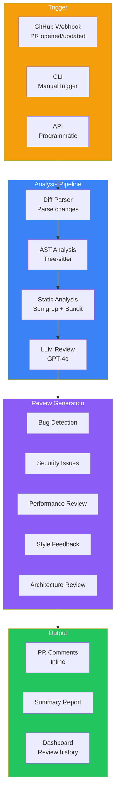
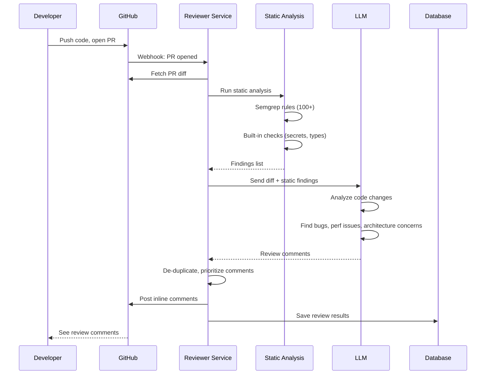
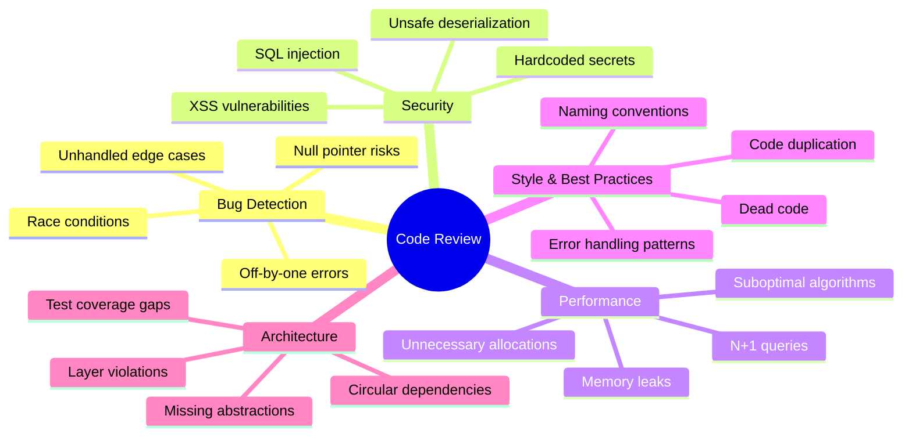

## Introduction

> **Build an AI-powered code review assistant that analyzes pull requests for bugs, security issues, performance problems, and architectural concerns — then posts automated review comments.**

Manual code review is slow and inconsistent. An AI code reviewer never gets tired, never misses a null check, and reviews every line of every PR instantly.

---

## Problem Statement

Code reviews are essential but time-consuming. Developers spend 5-10 hours/week reviewing code. An AI code reviewer should:
- Analyze PR diffs for bugs, security issues, style problems
- Suggest performance improvements
- Check for architectural violations
- Post comments inline on GitHub/GitLab
- Learn from accepted/rejected suggestions

### Business Use Case

A SaaS company with 50+ developers needs automated code review that catches issues before they reach production — reducing review time by 60% and catching 30% more bugs.

---

## Requirements

### Functional Requirements

| # | Feature | Description |
|---|---------|-------------|
| FR1 | PR diff analysis | Parse and understand every change |
| FR2 | Bug detection | Null pointers, type errors, logic bugs |
| FR3 | Security scanning | OWASP Top 10, injection, hardcoded secrets |
| FR4 | Performance review | N+1 queries, memory leaks, slow algorithms |
| FR5 | Style checking | Enforce project conventions |
| FR6 | Architecture review | Dependency violations, pattern usage |
| FR7 | Automated comments | Post inline PR comments |
| FR8 | Comment resolution | Track if developer addressed feedback |

### Non-Functional Requirements

| # | Requirement | Target |
|---|-------------|--------|
| NFR1 | Review time | < 2 min for 1000-line PR |
| NFR2 | False positive rate | < 10% |
| NFR3 | Bug catch rate | > 70% of real bugs |
| NFR4 | Availability | 99.9% |
| NFR5 | Integration | GitHub, GitLab, Bitbucket |

---

## Technology Stack

| Layer | Technology | Purpose |
|-------|-----------|---------|
| **Backend** | FastAPI (Python) | API server, webhook handler |
| **Code Analysis** | Tree-sitter, Semgrep, Bandit | Static analysis for multiple languages |
| **AI** | GPT-4o / Claude 3.5 | Intelligent code review |
| **Database** | PostgreSQL | Review history, settings |
| **Queue** | Celery + Redis | Async PR processing |
| **Integration** | GitHub App API | Webhooks, PR comments |
| **Cache** | Redis | Diff caching, rate limiting |

---

## Architecture

---

## Review Pipeline

---

## Review Categories

---

## API Design

| Method | Endpoint | Purpose |
|--------|----------|---------|
| POST | `/api/webhook/github` | GitHub PR webhook |
| POST | `/api/review` | Trigger ad-hoc review |
| GET | `/api/reviews/{pr_id}` | Get review results |
| GET | `/api/reviews/{pr_id}/comments` | Get review comments |
| POST | `/api/reviews/{pr_id}/feedback` | Log feedback (correct/incorrect) |
| GET | `/api/stats` | Review statistics |

---

## Security

| Concern | Implementation |
|---------|---------------|
| **Webhook security** | Verify GitHub webhook signatures |
| **Access control** | Per-repo installation permissions |
| **Code privacy** | Never store code, only review results |
| **Audit logging** | All reviews logged with timestamps |
| **Rate limiting** | Per-repo: 10 reviews/hour |

---

## Evaluation

| Metric | Method | Target |
|--------|--------|--------|
| Bug catch rate | Compare to manual review | > 70% |
| False positive rate | Developer reports | < 10% |
| Review time | Time from webhook to comments | < 2 min |
| Developer satisfaction | Survey | > 4.0/5 |
| Adoption | % of PRs with AI review | > 80% |

---

## Future Improvements

| Feature | Priority | Complexity |
|---------|----------|------------|
| Learning from accepted/rejected comments | High | High |
| Auto-fix suggestions (like ESLint --fix) | Medium | Medium |
| Test coverage analysis | High | Medium |
| Over-time trend analysis | Medium | Low |
| Custom rule definitions | High | Medium |

---

## Interview Questions

### Architecture

**Q: Design the analysis pipeline for an AI code reviewer that processes 1000 PRs/day.**

> Pipeline: (1) **Webhook receiver** — Validates signature, queues PR for processing, (2) **Diff parser** — Incremental: only analyze changed lines + surrounding context, (3) **Static analysis** — Run Semgrep, Bandit, ESLint in parallel per language, (4) **LLM analysis** — Send diff chunks + static findings to GPT-4o, request structured output (bugs, severity, line numbers), (5) **Deduplication** — Merge findings from static analysis and LLM, (6) **Comment formatting** — Format as GitHub markdown suggestions, (7) **Posting** — Batch POST to GitHub API to avoid rate limits.

**Q: How do you reduce false positives in AI code reviews?**

> Strategies: (1) **Confidence scoring** — Only post comments above 0.8 confidence, (2) **Context validation** — Check if the issue is actually in the changed code vs pre-existing, (3) **Duplicate suppression** — Don't repeat the same finding across multiple PRs, (4) **Learning loop** — Track accepted/rejected comments, fine-tune on real feedback, (5) **Rule-based pre-filter** — Known good patterns should suppress false positives, (6) **Human-in-the-loop** — Escalate low-confidence findings to senior developers.

---

## Summary

| Feature | Implementation |
|---------|---------------|
| **PR analysis** | Diff parsing + AST + static analysis |
| **Bug detection** | LLM + Semgrep rules |
| **Security scanning** | OWASP rules + Bandit |
| **Performance review** | LLM analysis of algorithmic complexity |
| **Automated comments** | GitHub App API inline comments |
| **Feedback loop** | Track accepted/rejected for model improvement |
| **Dashboard** | Review history and team metrics |

---

## Navigation

**Previous:** [05 — Build a GitHub Copilot Clone](/ai/phase-10-ai-projects/05-github-copilot-clone)

**Next:** [07 — Build an AI Document Assistant](/ai/phase-10-ai-projects/07-ai-document-assistant)

**Related Projects:**
- [GitHub Copilot Clone](/ai/phase-10-ai-projects/05-github-copilot-clone)
- [AI Research Agent](/ai/phase-10-ai-projects/10-ai-research-agent)
- [AI System Design](/ai/phase-10-ai-projects/13-ai-system-design)
