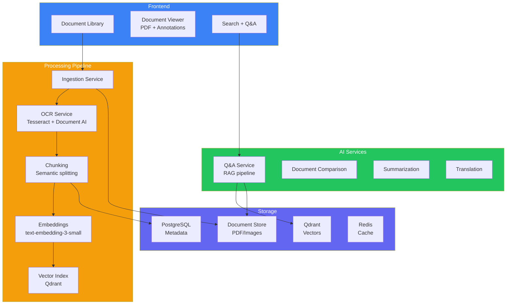
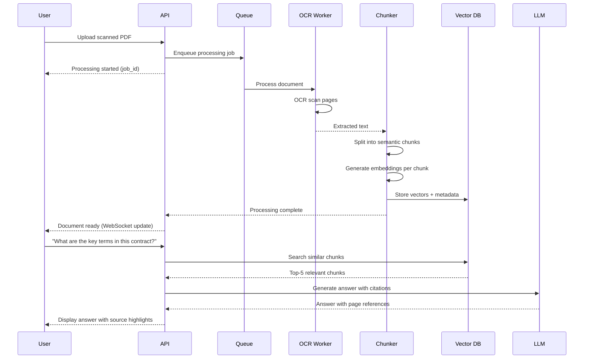
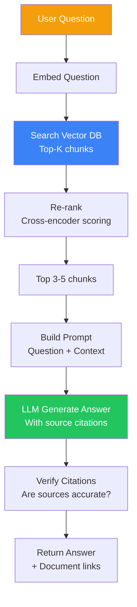
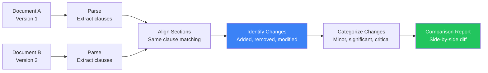

## Introduction

> **Build an AI-powered document assistant that ingests, understands, and enables interaction with business documents — combining RAG, OCR, semantic search, and AI-driven Q&A.**

Enterprises have millions of documents locked in siloed file systems. An AI document assistant unlocks this knowledge by making every document searchable, comparable, queryable, and actionable.

---

## Problem Statement

Businesses lose hours searching for information across documents. Employees need to find data from contracts, reports, manuals, and emails quickly. An AI document assistant should:
- Ingest documents of any format (PDF, DOCX, scanned images)
- OCR and digitize scanned documents
- Enable natural language queries over the knowledge base
- Compare and summarize documents
- Translate documents between languages

### Business Use Case

A law firm needs an AI assistant that ingests thousands of legal documents and enables associates to ask natural language questions, compare clauses across contracts, and generate summaries for clients.

---

## Requirements

### Functional Requirements

| # | Feature | Description |
|---|---------|-------------|
| FR1 | Document ingestion | Upload PDF, DOCX, images, HTML |
| FR2 | OCR processing | Extract text from scanned images |
| FR3 | Semantic search | Find documents by meaning, not just keywords |
| FR4 | Q&A over documents | Natural language questions with citations |
| FR5 | Document comparison | Highlight differences between versions |
| FR6 | Summarization | Generate concise document summaries |
| FR7 | Translation | Translate documents between languages |
| FR8 | Knowledge base | Organize documents into searchable collections |

### Non-Functional Requirements

| # | Requirement | Target |
|---|-------------|--------|
| NFR1 | OCR accuracy | > 98% on clean documents |
| NFR2 | Search latency | < 1s for full knowledge base |
| NFR3 | Document processing | < 60s for 100-page document |
| NFR4 | Scalability | Support 100K+ documents |
| NFR5 | Security | Document-level access control |

---

## Technology Stack

| Layer | Technology | Purpose |
|-------|-----------|---------|
| **Frontend** | Next.js + Tailwind | Document viewer, search UI |
| **Backend** | FastAPI (Python) | API server, document processing |
| **Vector DB** | Qdrant / Pinecone | Document chunk embeddings |
| **OCR** | Tesseract + Document AI | Text extraction from images |
| **Database** | PostgreSQL | Document metadata, user data |
| **Cache** | Redis | Caching search results |
| **AI** | GPT-4o / Claude | Q&A, summarization, translation |
| **Queue** | Celery + Redis | Async document processing |
| **Storage** | S3 / GCS | Document files |

---

## Architecture

---

## Document Processing Pipeline

---

## Q&A RAG Pipeline

---

## Document Comparison

---

## API Design

| Method | Endpoint | Purpose |
|--------|----------|---------|
| POST | `/api/documents/upload` | Upload document |
| GET | `/api/documents` | List user documents |
| GET | `/api/documents/{id}` | Get document details |
| DELETE | `/api/documents/{id}` | Delete document |
| POST | `/api/documents/{id}/process` | Trigger OCR + indexing |
| GET | `/api/documents/{id}/status` | Processing status |
| POST | `/api/qa` | Ask question across documents |
| POST | `/api/documents/compare` | Compare two documents |
| POST | `/api/documents/{id}/summarize` | Generate summary |
| POST | `/api/documents/{id}/translate` | Translate document |
| GET | `/api/search?q=` | Search knowledge base |

---

## Security

| Concern | Implementation |
|---------|---------------|
| **Document access** | Per-document permissions (RBAC) |
| **OCR data** | Processed text stored encrypted |
| **Search isolation** | User can only search accessible documents |
| **Compliance** | Audit logging for all document access |
| **Retention** | Automated document deletion policies |

---

## Evaluation

| Metric | Method | Target |
|--------|--------|--------|
| Q&A accuracy | Grounded in provided documents | > 95% |
| OCR accuracy | Character error rate | < 2% |
| Search relevance | Top-5 recall | > 90% |
| Processing speed | Pages processed per minute | > 50 |
| User satisfaction | NPS survey | > 40 |

---

## Future Improvements

| Feature | Priority | Complexity |
|---------|----------|------------|
| Table extraction from PDFs | High | Medium |
| Handwriting recognition | Medium | High |
| Multi-language OCR | Medium | Medium |
| Document collaboration | High | High |
| Automated document classification | Medium | Low |
| Integration with cloud storage (Google Drive, Dropbox) | High | Medium |

---

## Interview Questions

### Architecture

**Q: Design the document ingestion pipeline for an assistant that processes 10K documents/day.**

> Pipeline: (1) **Upload service** — S3 pre-signed URLs, immediate 200 response, (2) **Queue** — Celery with Redis, priority queue (small documents first), (3) **OCR workers** — 20+ workers running Tesseract + Google Document AI for scans, (4) **Text processing** — Chunk by semantic boundaries (paragraphs, sections), (5) **Embedding** — Batch embed 100 chunks at a time, (6) **Vector index** — Qdrant with incremental indexing, (7) **Metadata** — PostgreSQL for full-text search + filtering, (8) **WebSocket** — Real-time progress updates to UI.

**Q: How do you handle Q&A accuracy when answers must be grounded in specific documents?**

> (1) **Chunk-level citations** — Every answer includes specific chunk IDs, (2) **Source verification** — LLM must cite specific passages, not just document names, (3) **Re-ranking** — Cross-encoder ensures only relevant chunks are used, (4) **Confidence threshold** — Don't answer if no chunk scores above 0.7, (5) **Hallucination check** — Verify each claim against source chunks, (6) **UI enforcement** — Clickable citations that scroll to source document.

---

## Summary

| Feature | Implementation |
|---------|---------------|
| **Document ingestion** | PDF, DOCX, images, HTML → S3 |
| **OCR** | Tesseract + Document AI |
| **Chunking & embedding** | Semantic splitting + vector DB |
| **Q&A** | RAG pipeline with source citations |
| **Comparison** | Clause alignment + diff generation |
| **Summarization** | LLM with document context |
| **Translation** | LLM-based translation |

---

## Navigation

**Previous:** [06 — Build an AI Code Reviewer](/ai/phase-10-ai-projects/06-ai-code-reviewer)

**Next:** [08 — Build an AI Meeting Assistant](/ai/phase-10-ai-projects/08-ai-meeting-assistant)

**Related Projects:**
- [NotebookLM Clone](/ai/phase-10-ai-projects/03-notebooklm-clone)
- [AI Research Agent](/ai/phase-10-ai-projects/10-ai-research-agent)
- [AI CRM Assistant](/ai/phase-10-ai-projects/12-ai-crm-assistant)
