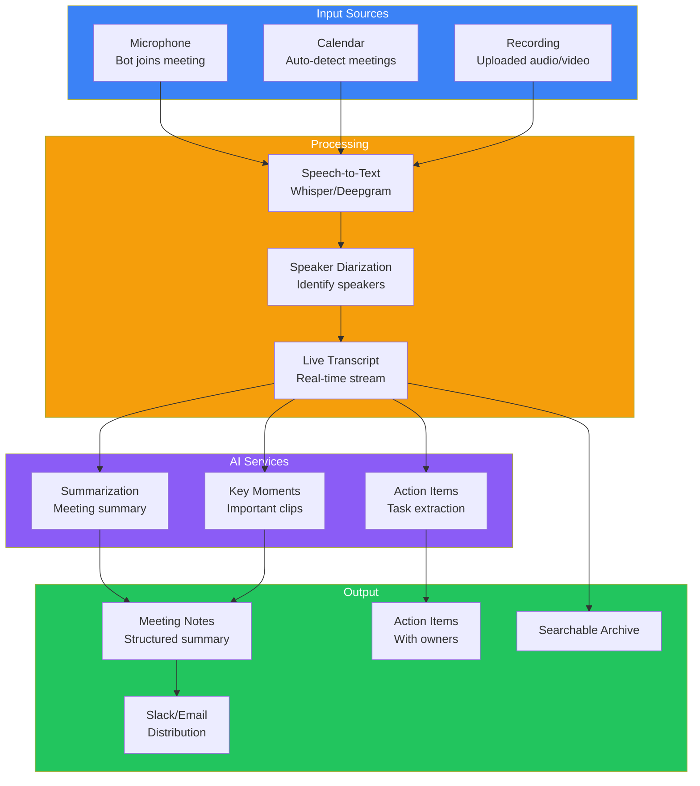
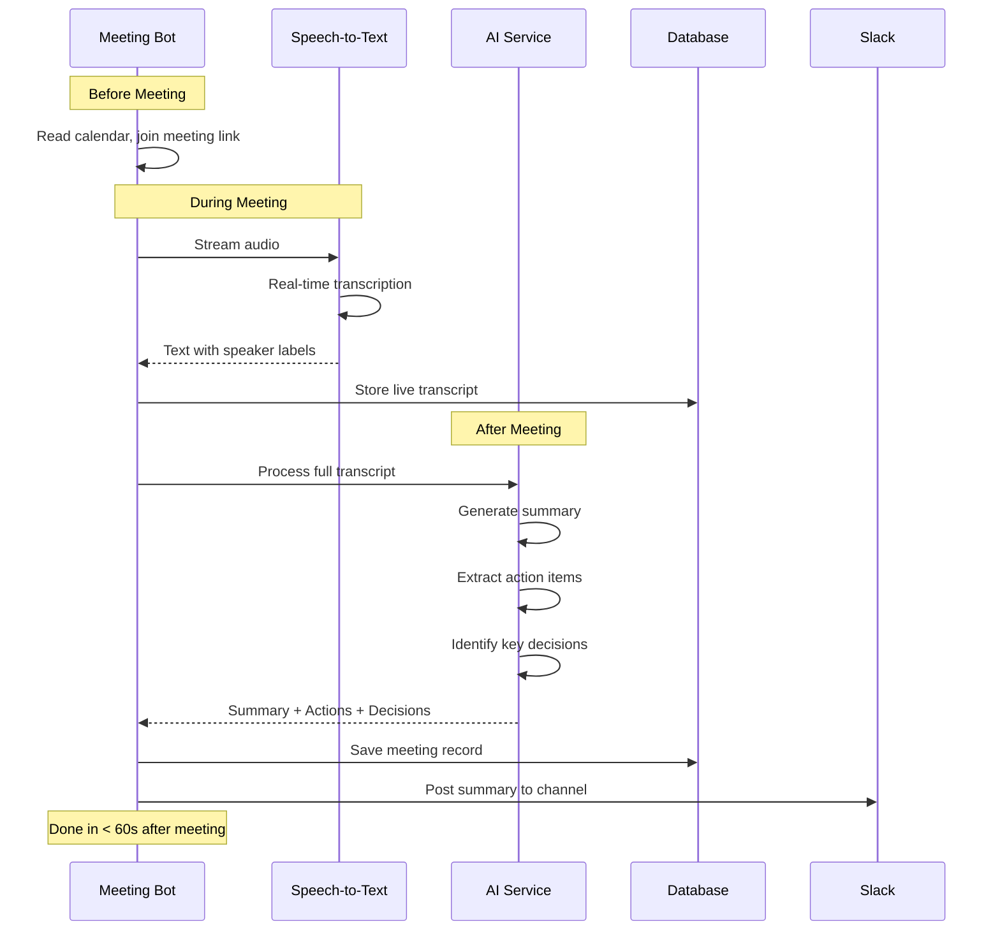
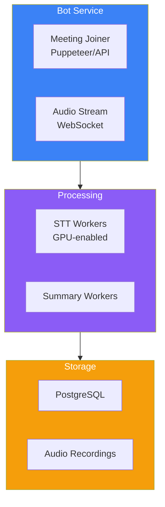

## Introduction

> **Build an AI meeting assistant that joins meetings, transcribes speech in real-time, generates meeting summaries, extracts action items, and integrates with calendars and messaging platforms.**

Meeting overload is a top productivity drain. An AI meeting assistant captures every discussion, generates concise summaries, and tracks action items — so teams never miss a detail.

---

## Problem Statement

Teams spend 15+ hours/week in meetings. Notes are incomplete, action items get lost, and absent team members miss context. An AI meeting assistant should:
- Join and transcribe meetings in real-time
- Generate structured meeting summaries
- Extract action items with owners
- Integrate with calendars (Google, Outlook) and messaging (Slack)

### Business Use Case

A remote-first company with 200 employees needs an AI meeting assistant that transcribes all meetings, generates summaries for absent members, and tracks action items across teams.

---

## Requirements

### Functional Requirements

| # | Feature | Description |
|---|---------|-------------|
| FR1 | Meeting transcription | Real-time speech-to-text |
| FR2 | Speaker diarization | Identify who said what |
| FR3 | Meeting summary | Auto-generated meeting notes |
| FR4 | Action item extraction | Tasks with owners and deadlines |
| FR5 | Calendar integration | Auto-join meetings from calendar |
| FR6 | Slack integration | Post summaries to channels |
| FR7 | Search past meetings | Full-text search over transcripts |
| FR8 | Video recording | Optional recording with transcription |

### Non-Functional Requirements

| # | Requirement | Target |
|---|-------------|--------|
| NFR1 | Transcription latency | < 2s real-time delay |
| NFR2 | Accuracy | > 95% WER (word error rate) |
| NFR3 | Speaker accuracy | > 90% correct speaker identification |
| NFR4 | Processing time | Summary generated within 1 min of meeting end |
| NFR5 | Scalability | Support 100 concurrent meetings |

---

## Technology Stack

| Layer | Technology | Purpose |
|-------|-----------|---------|
| **Frontend** | Next.js + Tailwind | Dashboard, transcript viewer |
| **Backend** | FastAPI (Python) | API server, WebSocket management |
| **Speech-to-text** | Whisper (OpenAI) / Deepgram | Real-time transcription |
| **AI** | GPT-4o / Claude | Summarization, action extraction |
| **Database** | PostgreSQL | Meeting records, transcripts |
| **Vector DB** | pgvector | Transcript search |
| **Queue** | Celery + Redis | Async processing |
| **Calendar** | Google Calendar API, Outlook API | Meeting scheduling |
| **Messaging** | Slack API, Teams API | Summary distribution |

---

## Architecture

---

## Meeting Lifecycle

---

## API Design

| Method | Endpoint | Purpose |
|--------|----------|---------|
| POST | `/api/meetings/join` | Bot joins a meeting |
| POST | `/api/meetings/schedule` | Schedule bot for future meeting |
| GET | `/api/meetings` | List past meetings |
| GET | `/api/meetings/{id}` | Get meeting details |
| GET | `/api/meetings/{id}/transcript` | Get full transcript |
| GET | `/api/meetings/{id}/summary` | Get AI summary |
| GET | `/api/meetings/{id}/actions` | Get action items |
| GET | `/api/search?q=` | Search across meetings |
| POST | `/api/integrations/slack` | Configure Slack integration |
| POST | `/api/integrations/calendar` | Configure calendar |

---

## Deployment

---

## Evaluation

| Metric | Method | Target |
|--------|--------|--------|
| Transcription accuracy | WER | < 5% |
| Speaker identification | % correct labels | > 90% |
| Summary quality | Human rating | > 4.0/5 |
| Action item recall | % of actual action items captured | > 80% |
| Processing time | Time from meeting end to summary | < 60s |

---

## Security

| Concern | Implementation |
|---------|---------------|
| **Meeting privacy** | Bot only joins meetings it's invited to |
| **Data retention** | Transcripts auto-deleted after 30/60/90 days |
| **Compliance** | GDPR — right to delete meeting data |
| **Access control** | Per-meeting access permissions |
| **Encryption** | TLS for all data, encryption at rest |

---

## Interview Questions

**Q: Design the real-time transcription pipeline for 1000+ concurrent meetings.**

> Pipeline: (1) **Audio ingestion** — WebSocket per meeting sending audio chunks to a Kafka topic, (2) **STT workers** — GPU pool running Whisper/Deepgram, each handling multiple streams, (3) **Speaker diarization** — Separate model clusters speakers, (4) **Live transcript** — Stream to frontend via WebSocket, (5) **Recording** — Save audio to S3 for post-processing.

---

## Summary

| Feature | Implementation |
|---------|---------------|
| **Transcription** | Whisper/Deepgram real-time STT |
| **Speaker ID** | Diarization model |
| **Summary** | GPT-4o post-meeting processing |
| **Action items** | LLM extraction with owner detection |
| **Calendar** | Google/Outlook API |
| **Distribution** | Slack/Teams/Email |

---

## Navigation

**Previous:** [07 — Build an AI Document Assistant](/ai/phase-10-ai-projects/07-ai-document-assistant)

**Next:** [09 — Build an AI Email Assistant](/ai/phase-10-ai-projects/09-ai-email-assistant)

**Related Projects:**
- [AI Research Agent](/ai/phase-10-ai-projects/10-ai-research-agent)
- [AI CRM Assistant](/ai/phase-10-ai-projects/12-ai-crm-assistant)
- [AI System Design](/ai/phase-10-ai-projects/13-ai-system-design)
