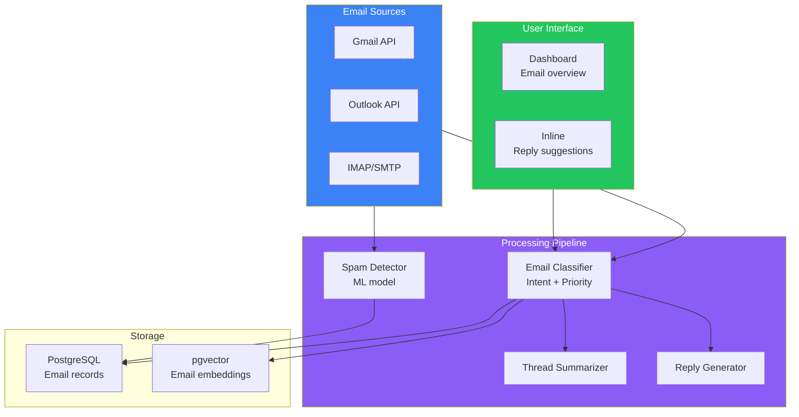
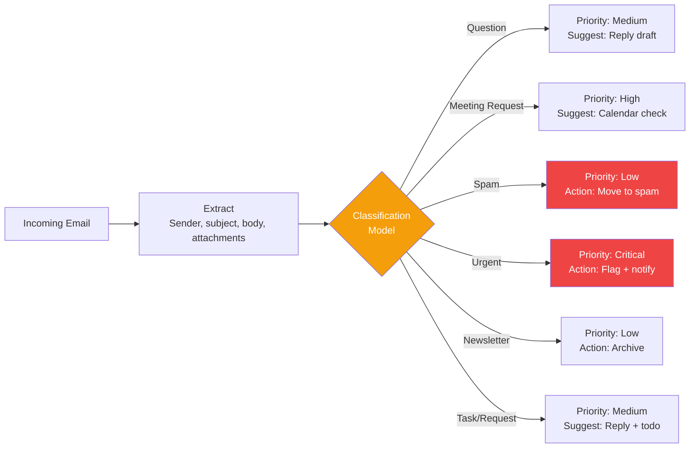
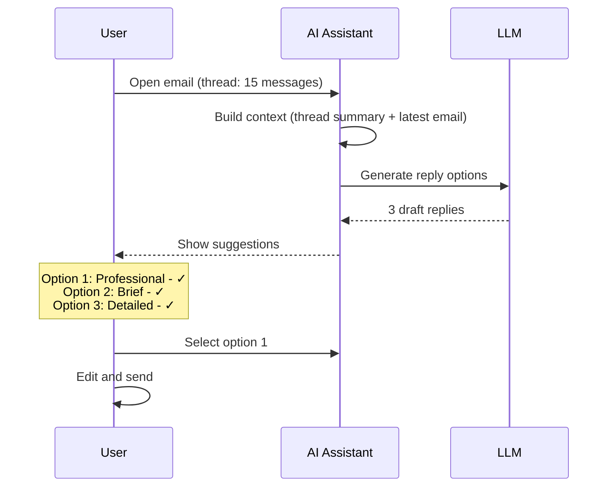

## Introduction

> **Build an AI-powered email assistant that classifies incoming emails, generates smart replies, detects spam and phishing, prioritizes messages, and automates routine email tasks.**

Email remains the backbone of business communication, but the average professional spends 3+ hours/day managing it. An AI email assistant brings inbox zero within reach.

---

## Problem Statement

Knowledge workers receive 100+ emails daily and spend hours reading, categorizing, and responding. An AI email assistant should:
- Classify emails by intent and priority
- Generate context-aware reply drafts
- Detect spam, phishing, and malicious content
- Summarize long email threads
- Automate routine responses (out-of-office, scheduling)

### Business Use Case

An enterprise with 1000 employees needs an AI email assistant that integrates with Gmail/Outlook, reduces email management time by 60%, and catches phishing attempts before they reach users.

---

## Requirements

### Functional Requirements

| # | Feature | Description |
|---|---------|-------------|
| FR1 | Email classification | Categorize by intent (question, request, spam) |
| FR2 | Reply generation | Draft context-aware replies |
| FR3 | Spam detection | ML-based spam + phishing detection |
| FR4 | Thread summarization | Summarize long email chains |
| FR5 | Priority ranking | Flag important emails |
| FR6 | Smart labels | Auto-label based on content |
| FR7 | Automation rules | Auto-respond, archive, forward |
| FR8 | Calendar integration | Detect scheduling requests |

### Non-Functional Requirements

| # | Requirement | Target |
|---|-------------|--------|
| NFR1 | Processing speed | < 1s per email |
| NFR2 | Spam detection rate | > 99% |
| NFR3 | False positive rate | < 0.5% |
| NFR4 | Reply quality | Human rating > 4.0/5 |
| NFR5 | Privacy | Email data never leaves enterprise infra |

---

## Architecture

---

## Email Classification Pipeline

---

## Reply Generation

---

## API Design

| Method | Endpoint | Purpose |
|--------|----------|---------|
| GET | `/api/emails` | List emails |
| GET | `/api/emails/{id}` | Get email details |
| POST | `/api/emails/{id}/classify` | Trigger classification |
| POST | `/api/emails/{id}/summarize` | Summarize thread |
| POST | `/api/emails/{id}/reply` | Generate reply drafts |
| POST | `/api/emails/{id}/action` | Archive, mark spam, etc. |
| GET | `/api/stats` | Email statistics dashboard |

---

## Security

| Concern | Implementation |
|---------|---------------|
| **Email access** | OAuth with minimum required scopes |
| **Data privacy** | Process in-region, never train on customer emails |
| **Phishing detection** | ML model + domain reputation checks |
| **Compliance** | GDPR for EU users, SOC2 for enterprise |
| **Retention** | Auto-delete processed email data after 30 days |

---

## Evaluation

| Metric | Method | Target |
|--------|--------|--------|
| Classification accuracy | Human validation sample | > 95% |
| Spam recall | % of actual spam caught | > 99% |
| False positive rate | Good emails marked as spam | < 0.1% |
| Reply acceptance rate | % suggestions used | > 40% |
| Time saved | Hours saved per user per week | > 2 hours |

---

## Interview Questions

**Q: Design the email classification system for an assistant processing 1M emails/day.**

> Pipeline: (1) **Ingestion** — Gmail/Outlook push notifications → SQS queue, (2) **Feature extraction** — Extract sender, subject, body, attachments, previous interactions, (3) **Classification** — Fine-tuned BERT model for intent (question, request, spam, urgent, newsletter), (4) **Priority scoring** — Heuristic + ML: combine sender importance, urgency keywords, thread length, (5) **Action routing** — Spam → auto-delete, Newsletters → archive, Urgent → notification, (6) **Storage** — PostgreSQL + pgvector for search.

---

## Summary

| Feature | Implementation |
|---------|---------------|
| **Classification** | Fine-tuned BERT for email intent |
| **Spam detection** | ML + domain reputation |
| **Reply generation** | GPT-4o with thread context |
| **Summarization** | LLM thread summary |
| **Priority** | Heuristic + ML scoring |
| **Integration** | Gmail/Outlook APIs |

---

## Navigation

**Previous:** [08 — Build an AI Meeting Assistant](/ai/phase-10-ai-projects/08-ai-meeting-assistant)

**Next:** [10 — Build an AI Research Agent](/ai/phase-10-ai-projects/10-ai-research-agent)

**Related Projects:**
- [AI CRM Assistant](/ai/phase-10-ai-projects/12-ai-crm-assistant)
- [AI Meeting Assistant](/ai/phase-10-ai-projects/08-ai-meeting-assistant)
- [AI Research Agent](/ai/phase-10-ai-projects/10-ai-research-agent)
