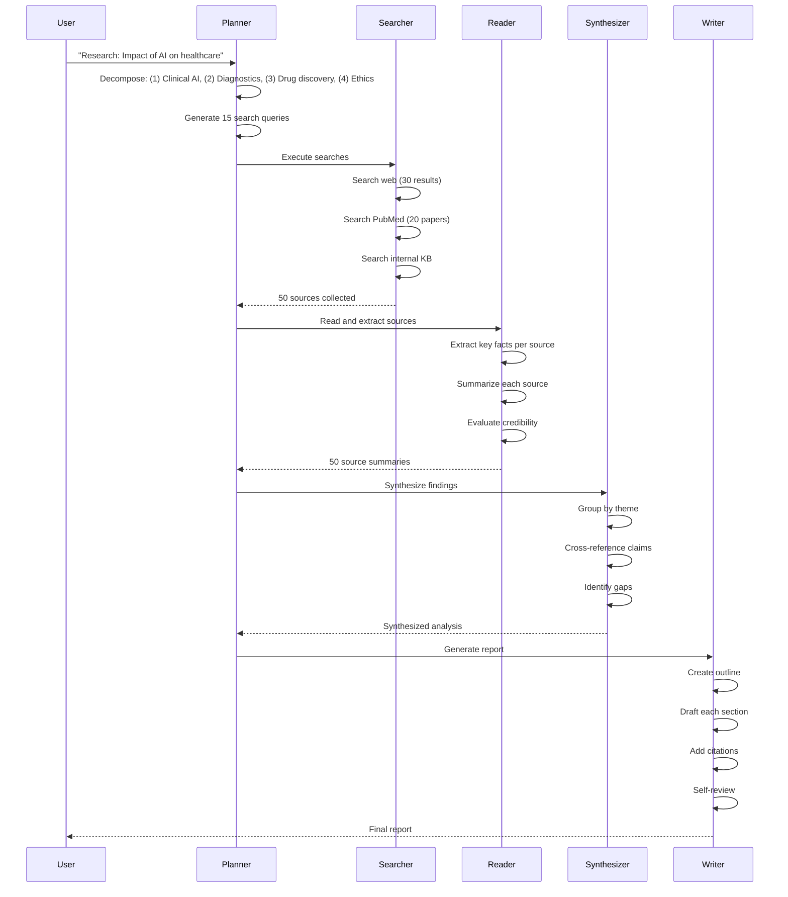

## Introduction

> **Build an autonomous AI research agent that can research any topic end-to-end — planning a research strategy, searching multiple sources, reading and synthesizing information, fact-checking, and generating a comprehensive report with citations.**

Research is time-consuming. An AI research agent automates the entire research lifecycle — from understanding what you need to know, to delivering a synthesized report with verified sources.

---

## Problem Statement

Researchers, analysts, and knowledge workers spend hours gathering and synthesizing information. An AI research agent should:
- Understand the research question and plan an approach
- Search multiple sources (web, academic, internal)
- Read and extract key information from each source
- Synthesize findings into a coherent report
- Fact-check claims and provide citations
- Support iterative refinement based on feedback

### Business Use Case

A consulting firm needs a research agent that can prepare briefs on any industry topic within 15 minutes — searching 50+ sources, analyzing findings, and generating a structured report ready for client delivery.

---

## Requirements

### Functional Requirements

| # | Feature | Description |
|---|---------|-------------|
| FR1 | Research planning | Decompose question into sub-questions |
| FR2 | Multi-source search | Web, academic, internal knowledge base |
| FR3 | Content extraction | Read and extract key information |
| FR4 | Synthesis | Combine findings into coherent analysis |
| FR5 | Fact-checking | Verify claims across multiple sources |
| FR6 | Citation generation | Every claim linked to source |
| FR7 | Report generation | Structured report with executive summary |
| FR8 | Iterative refinement | Follow-up questions and deep dives |

### Non-Functional Requirements

| # | Requirement | Target |
|---|-------------|--------|
| NFR1 | Research time | < 15 min for complex topic |
| NFR2 | Source coverage | 20-50 sources per research |
| NFR3 | Accuracy | > 95% factually correct |
| NFR4 | Citation accuracy | Every claim has verifiable source |
| NFR5 | Scalability | Multiple concurrent research tasks |

---

## Technology Stack

| Layer | Technology | Purpose |
|-------|-----------|---------|
| **Frontend** | Next.js + Tailwind | Research dashboard |
| **Backend** | FastAPI (Python) | Agent orchestration |
| **Agent Framework** | LangGraph | Agent workflow management |
| **Search** | SerpAPI, Bing, PubMed, arXiv | Multi-source search |
| **AI** | GPT-4o / Claude | Planning, reading, synthesis |
| **Vector DB** | Qdrant | Research document storage |
| **Database** | PostgreSQL | Research records, reports |
| **Queue** | Celery + Redis | Async research tasks |
| **Cache** | Redis | Search result caching |

---

## Agent Architecture

```mermaid
flowchart TD
    subgraph PLANNER["Planner Agent"]
        DECOMP["Decompose Question\nInto sub-questions"]
        STRATEGY["Search Strategy\nWhich sources to query"]
        QUERIES["Generate Search Queries\n10-20 queries"]
    end
    subgraph SEARCHER["Search Agent"]
        WEB_S["Web Search\nBing/Google"]
        ACADEMIC["Academic Search\nPubMed/arXiv"]
        INTERNAL["Internal KB\nVector search"]
    end
    subgraph READER["Reading Agent"]
        EXTRACT["Extract Content\nKey facts, stats, quotes"]
        SUMMARIZE_SRC["Source Summary\nPer-source summary"]
        EVAL_SRC["Source Evaluation\nCredibility check"]
    end
    subgraph SYNTHESIZER["Synthesis Agent"]
        COMBINE["Combine Findings\nThematic grouping"]
        CROSS["Cross-reference\nVerify across sources"]
        IDENTIFY_GAPS["Identify Gaps\nWhat's still unknown"]
    end
    subgraph WRITER["Writing Agent"]
        OUTLINE["Generate Outline\nExecutive summary"]
        DRAFT["Draft Report\nStructured content"]
        CITE["Add Citations\nEvery claim sourced"]
        REVIEW["Self-Review\nFactuality check"]
    end
    
    PLANNER --> SEARCHER
    SEARCHER --> READER
    READER --> SYNTHESIZER
    SYNTHESIZER --> WRITER
    
    style PLANNER fill:#3b82f6,color:#fff
    style SEARCHER fill:#f59e0b,color:#fff
    style READER fill:#8b5cf6,color:#fff
    style SYNTHESIZER fill:#6366f1,color:#fff
    style WRITER fill:#22c55e,color:#fff
```

---

## Research Workflow

---

## API Design

| Method | Endpoint | Purpose |
|--------|----------|---------|
| POST | `/api/research` | Start new research task |
| GET | `/api/research/{id}` | Get research status |
| GET | `/api/research/{id}/report` | Get generated report |
| GET | `/api/research/{id}/sources` | Get sources used |
| POST | `/api/research/{id}/refine` | Refine with follow-up |
| GET | `/api/research/history` | Past research tasks |

---

## Evaluation

| Metric | Method | Target |
|--------|--------|--------|
| Report quality | Human expert review | > 4.0/5 |
| Source diversity | Unique sources used | > 20 |
| Factual accuracy | Verified claims | > 95% |
| Citation accuracy | Source matches claim | > 95% |
| Time efficiency | Time vs manual research | > 5x faster |

---

## Security

| Concern | Implementation |
|---------|---------------|
| **Source credibility** | Rate sources by domain authority |
| **Bias detection** | Flag potential bias in sources |
| **Data privacy** | Don't include PII in research output |
| **API limits** | Respect search API rate limits |
| **Attribution** | Clearly mark AI-generated content |

---

## Interview Questions

**Q: Design the multi-agent architecture for a research system.**

> Agents: (1) **Planner** — Decomposes question, generates strategy, tracks progress, (2) **Search Agent** — Executes searches across multiple APIs, deduplicates results, (3) **Reader Agent** — Extracts key information, evaluates source credibility, (4) **Synthesis Agent** — Combines findings, cross-references claims, identifies gaps, (5) **Writer Agent** — Generates structured report with citations, self-reviews. Each agent uses LangGraph for state management and error recovery.

---

## Summary

| Feature | Implementation |
|---------|---------------|
| **Planning** | LLM decomposes question into sub-questions |
| **Multi-source search** | Web + academic + internal |
| **Reading & extraction** | LLM extracts and summarizes per source |
| **Synthesis** | Thematic grouping + cross-referencing |
| **Report generation** | Structured report with citations |
| **Agent framework** | LangGraph for orchestration |
| **Fact-checking** | Cross-source verification |

---

## Navigation

**Previous:** [09 — Build an AI Email Assistant](/ai/phase-10-ai-projects/09-ai-email-assistant)

**Next:** [11 — Build an AI Resume & Interview Platform](/ai/phase-10-ai-projects/11-ai-resume-interviewer)

**Related Projects:**
- [Perplexity Clone](/ai/phase-10-ai-projects/02-perplexity-clone)
- [AI Document Assistant](/ai/phase-10-ai-projects/07-ai-document-assistant)
- [AI System Design](/ai/phase-10-ai-projects/13-ai-system-design)
