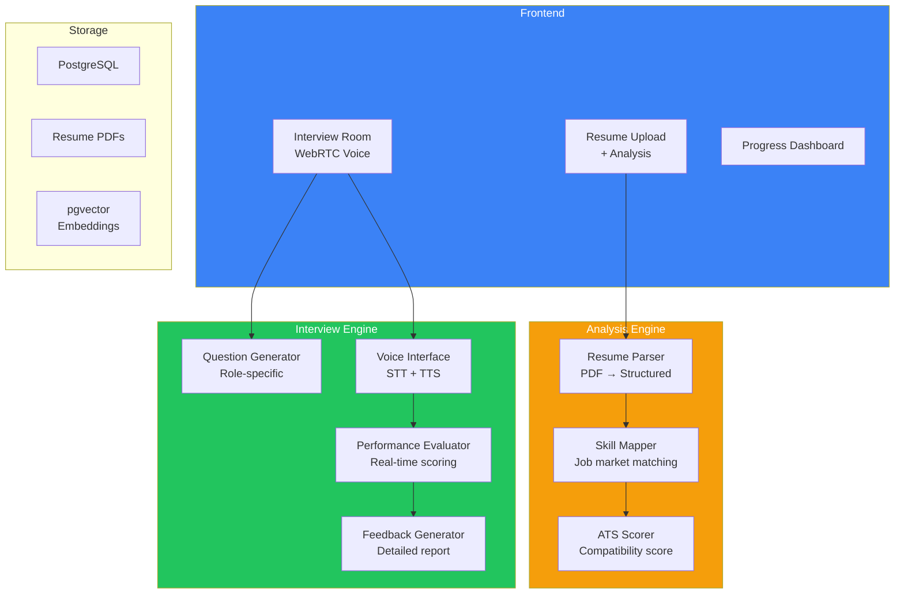
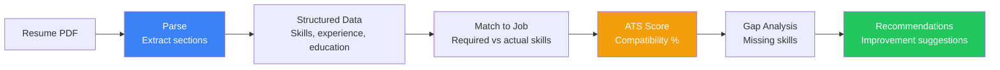
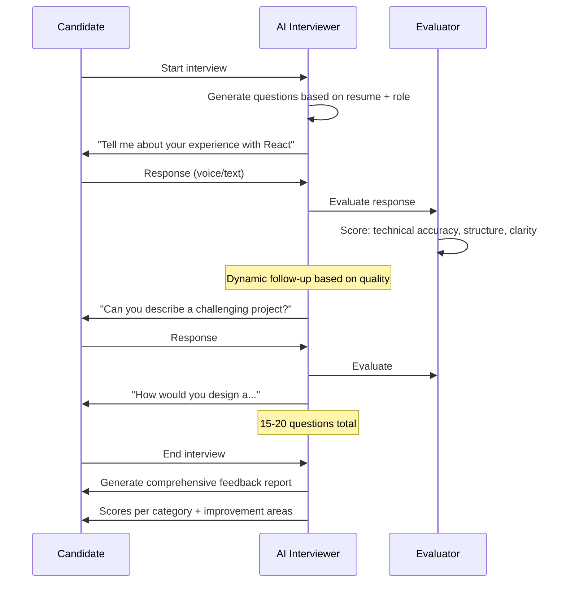

## Introduction

> **Build an AI-powered resume and interview platform that parses resumes, analyzes skills and gaps, generates an ATS compatibility score, and conducts realistic mock interviews with AI-generated questions and feedback.**

Job hunting is stressful. An AI platform that provides unbiased resume analysis, skill gap identification, and realistic interview practice helps candidates prepare effectively while helping recruiters screen efficiently.

---

## Problem Statement

Job seekers apply to hundreds of positions without knowing how their resume performs. An AI resume and interview platform should:
- Parse resumes and extract structured information
- Analyze skill match against job descriptions
- Generate ATS compatibility scores with improvement suggestions
- Conduct voice/text mock interviews with AI interviewer
- Provide detailed feedback on interview performance

### Business Use Case

A career services company needs a platform that helps 50K+ students prepare for jobs — analyzing resumes against real job listings, practicing interviews with AI, and tracking improvement over time.

---

## Requirements

### Functional Requirements

| # | Feature | Description |
|---|---------|-------------|
| FR1 | Resume parsing | Extract skills, experience, education, projects |
| FR2 | Skill analysis | Map skills to job requirements, identify gaps |
| FR3 | ATS scoring | Score resume compatibility with job descriptions |
| FR4 | Improvement suggestions | Specific recommendations for resume optimization |
| FR5 | Coding challenges | Generate and evaluate coding problems |
| FR6 | Behavioral questions | Generate situational questions |
| FR7 | Voice interview | AI interviewer with speech recognition |
| FR8 | Performance feedback | Score communication, technical accuracy, structure |

### Non-Functional Requirements

| # | Requirement | Target |
|---|-------------|--------|
| NFR1 | Resume processing | < 5s per resume |
| NFR2 | ATS accuracy | > 90% correlation with real ATS scores |
| NFR3 | Question relevance | > 85% questions relevant to job |
| NFR4 | Interview quality | Human rating > 4.0/5 |
| NFR5 | Scalability | Handle 1000+ concurrent interviews |

---

## Technology Stack

| Layer | Technology | Purpose |
|-------|-----------|---------|
| **Frontend** | Next.js + Tailwind + WebRTC | Resume viewer, interview UI |
| **Backend** | FastAPI (Python) | API server, interview orchestration |
| **AI** | GPT-4o / Claude | Resume analysis, question generation |
| **Speech** | Whisper (STT) + ElevenLabs (TTS) | Voice interview |
| **Database** | PostgreSQL | User profiles, interview records |
| **Vector DB** | pgvector | Job-resume matching |
| **PDF** | pdf.js / PyMuPDF | Resume parsing |

---

## Architecture

---

## Resume Analysis Pipeline

---

## Interview Flow

---

## API Design

| Method | Endpoint | Purpose |
|--------|----------|---------|
| POST | `/api/resume/upload` | Upload resume PDF |
| POST | `/api/resume/analyze` | Analyze resume against job |
| GET | `/api/resume/{id}/score` | Get ATS score |
| POST | `/api/interview/start` | Start mock interview |
| POST | `/api/interview/{id}/answer` | Submit answer |
| GET | `/api/interview/{id}/feedback` | Get interview feedback |
| POST | `/api/interview/{id}/end` | End interview |

---

## Evaluation

| Metric | Method | Target |
|--------|--------|--------|
| ATS score correlation | Compare with human ATS scoring | > 90% |
| Interview question quality | Candidate rating | > 4.0/5 |
| Feedback accuracy | HR professional review | > 85% |
| Resume parse accuracy | Field extraction accuracy | > 95% |
| User improvement | Score improvement over time | > 20% |

---

## Interview Questions

**Q: Design the resume parsing and ATS scoring system.**

> Pipeline: (1) **PDF parsing** — Extract text + preserve structure (sections, bullets), (2) **Section classification** — Identify experience, education, skills, projects sections, (3) **Entity extraction** — Extract skills (tech + soft), job titles, dates, companies, degrees, (4) **Skill normalization** — Map to standard skill taxonomy (e.g., "React.js" → "React"), (5) **Job matching** — Compare extracted skills against job description requirements, (6) **Scoring** — Weighted score: required skills (60%), preferred skills (30%), experience level (10%), (7) **Recommendations** — Identify highest-impact additions (most requested missing skills).

---

## Summary

| Feature | Implementation |
|---------|---------------|
| **Resume parsing** | PDF extract + LLM section classification |
| **ATS scoring** | Skill matching against job requirements |
| **Interview questions** | LLM generates role-specific questions |
| **Voice interview** | WebRTC + Whisper STT + ElevenLabs TTS |
| **Performance feedback** | Real-time evaluation + detailed report |
| **Progress tracking** | Score improvement over multiple interviews |

---

## Navigation

**Previous:** [10 — Build an AI Research Agent](/ai/phase-10-ai-projects/10-ai-research-agent)

**Next:** [12 — Build an AI CRM Assistant](/ai/phase-10-ai-projects/12-ai-crm-assistant)

**Related Projects:**
- [AI Document Assistant](/ai/phase-10-ai-projects/07-ai-document-assistant)
- [AI System Design](/ai/phase-10-ai-projects/13-ai-system-design)
- [Capstone Project](/ai/phase-10-ai-projects/14-capstone-project)
