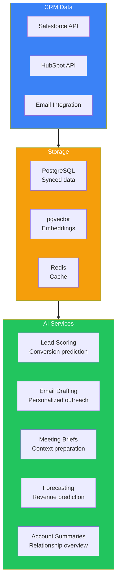
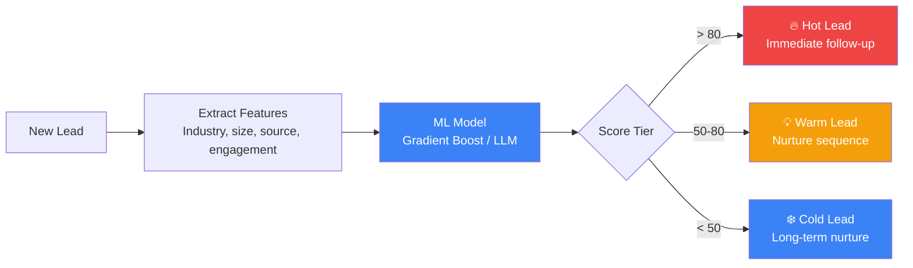

## Introduction

> **Build an AI-powered CRM assistant that helps sales teams score leads, draft personalized emails, prepare meeting briefs, summarize customer history, and forecast revenue — directly integrated with Salesforce/HubSpot.**

Sales teams spend 70% of their time on non-selling activities. An AI CRM assistant automates the busywork so salespeople can focus on building relationships and closing deals.

---

## Problem Statement

Sales reps manage hundreds of leads and accounts. An AI CRM assistant should:
- Score and prioritize leads based on conversion likelihood
- Draft personalized outreach emails
- Generate meeting preparation briefs with customer history
- Summarize interactions and next steps
- Forecast revenue based on pipeline trends
- Automate CRM data entry

### Business Use Case

A B2B SaaS company with 50 sales reps needs an AI CRM assistant that integrates with Salesforce, reduces administrative work by 50%, and improves lead conversion rates.

---

## Requirements

### Functional Requirements

| # | Feature | Description |
|---|---------|-------------|
| FR1 | Lead scoring | Rank leads by conversion probability |
| FR2 | Email drafting | Personalized outreach and follow-up |
| FR3 | Meeting briefs | Customer history, recent activity, Talking points |
| FR4 | Account summaries | Complete customer relationship overview |
| FR5 | Sales forecasting | Predict revenue based on pipeline |
| FR6 | Activity logging | Auto-log emails, calls, meetings |
| FR7 | Next-best-action | Suggest optimal actions per account |

### Non-Functional Requirements

| # | Requirement | Target |
|---|-------------|--------|
| NFR1 | CRM sync | Real-time bidirectional sync |
| NFR2 | Email personalization | < 2s per draft |
| NFR3 | Forecast accuracy | < 5% error rate |
| NFR4 | Integration | Salesforce, HubSpot, Pipedrive |
| NFR5 | Compliance | SOC2, GDPR |

---

## Architecture

---

## Lead Scoring Pipeline

---

## API Design

| Method | Endpoint | Purpose |
|--------|----------|---------|
| POST | `/api/leads/score` | Score a lead |
| POST | `/api/emails/draft` | Draft personalized email |
| GET | `/api/accounts/{id}/brief` | Generate meeting brief |
| GET | `/api/accounts/{id}/summary` | Get account summary |
| GET | `/api/forecast` | Revenue forecast |
| POST | `/api/actions/next-best` | Get next-best-action |
| POST | `/api/sync/trigger` | Trigger CRM sync |

---

## Evaluation

| Metric | Method | Target |
|--------|--------|--------|
| Lead score accuracy | Actual conversion rates | AUC > 0.85 |
| Email open rate | A/B test AI vs human | > human baseline |
| Time saved | Survey reps | > 10 hrs/week |
| Forecast accuracy | Compare to actual revenue | < 5% error |
| User adoption | % reps using daily | > 80% |

---

## Interview Questions

**Q: Design the lead scoring system for a CRM assistant.**

> Features: Company size, industry, lead source, email engagement, website visits, previous interactions, similar closed deals. Model: Gradient boosting (XGBoost) trained on historical deal data. Update: Retrain monthly with new closed deals. Explainability: SHAP values to explain why a lead scored high/low.

---

## Summary

| Feature | Implementation |
|---------|---------------|
| **Lead scoring** | XGBoost + LLM enrichment |
| **Email drafting** | GPT-4o with CRM context |
| **Meeting briefs** | LLM summary of customer history |
| **Forecasting** | Time series model on pipeline |
| **Next-best-action** | Rule-based + RL optimization |
| **CRM integration** | Salesforce/HubSpot APIs |

---

## Navigation

**Previous:** [11 — Build an AI Resume & Interview Platform](/ai/phase-10-ai-projects/11-ai-resume-interviewer)

**Next:** [13 — AI System Design](/ai/phase-10-ai-projects/13-ai-system-design)

**Related Projects:**
- [AI Email Assistant](/ai/phase-10-ai-projects/09-ai-email-assistant)
- [AI Meeting Assistant](/ai/phase-10-ai-projects/08-ai-meeting-assistant)
- [Capstone Project](/ai/phase-10-ai-projects/14-capstone-project)
