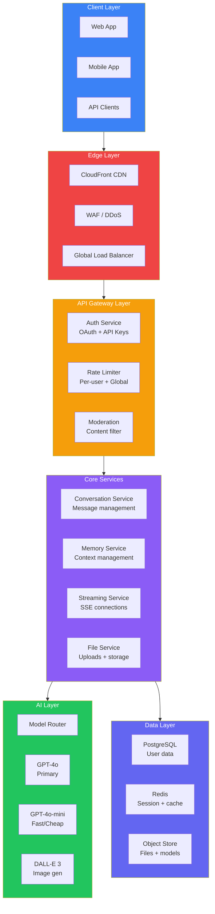
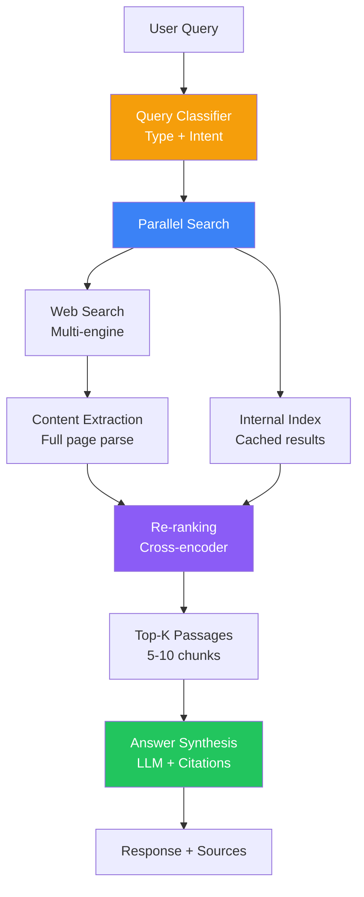
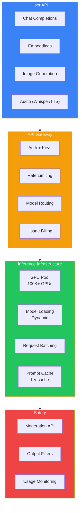

## Introduction

> **Deep-dive system design analysis of the world's leading AI products — understanding their architecture, scaling strategies, trade-offs, and engineering decisions.**

This document provides comprehensive architecture analyses of major AI products, teaching the system design patterns used by the most successful AI companies.

---

## 1. ChatGPT Architecture Analysis

**Key architecture decisions:**
- Global load balancing with regional failover
- Multiple model tiers (GPT-4o, GPT-4o-mini, custom)
- Real-time content moderation at the gateway
- Streaming via SSE for low perceived latency
- Conversation history in PostgreSQL with vector search

---

## 2. Perplexity Architecture Analysis

**Key innovations:**
- Real-time web search + LLM synthesis
- Multi-engine parallel search for coverage
- Cross-encoder re-ranking for precision
- Citation generation with source verification
- Context-aware follow-up questions

---

## 3. Cursor Architecture Analysis

**Key components:**
- **Local indexing** — Tree-sitter AST + LanceDB embeddings on user's machine
- **Context builder** — Current file + related files + semantic search results
- **Multi-model routing** — Local model for fast completions, cloud for complex chat
- **AI edit** — Diff-based natural language code modification
- **Codebase awareness** — Full project graph (imports, dependencies, types)

---

## 4. Claude Architecture Analysis

**Key components:**
- **Constitutional AI** — Self-critique based on constitution principles
- **Safety classifiers** — Input/output content filtering
- **Red teaming pipeline** — Continuous adversarial testing
- **200K context window** — Full document processing capability
- **Tool use / function calling** — Structured API integration

---

## 5. GitHub Copilot Architecture Analysis

**Key components:**
- **Context window** — 200 tokens before cursor, 50 after
- **Caching** — Completion cache for repeated patterns
- **Model routing** — Local code model (fast) + cloud LLM (quality)
- **Telemetry** — Acceptance rate tracking, per-language metrics
- **IDE integration** — VS Code extension with ghost text rendering

---

## 6. OpenAI Platform Architecture

---

## 7-10. Additional Architectures

| Product | Key Architecture Features |
|---------|-------------------------|
| **NotebookLM** | Document ingestion → chunking → embedding → multi-modal generation (audio, mind maps, quizzes) |
| **Microsoft Copilot** | Microsoft Graph integration → permission-aware retrieval → GPT-4 on Azure → grounded responses |
| **Amazon Q** | AWS account integration → structured data retrieval → code-aware generation |
| **Google Gemini** | Multi-modal (text, image, audio, video) → unified model → Google ecosystem integration |

---

## System Design Comparison

| Architecture | Model Serving | Context | Caching | Scaling |
|-------------|---------------|---------|---------|---------|
| ChatGPT | Multi-model router | Sliding window | KV-cache + response | 100K+ GPUs |
| Perplexity | Single LLM + search | Search results | Search cache | Elastic workers |
| Copilot | Local + cloud | Small window | Completion cache | Edge + cloud |
| Cursor | Local index + cloud | Full codebase | Embedding cache | Hybrid local/cloud |

---

## Interview Questions

**Q: Compare the architectures of ChatGPT and Perplexity from a system design perspective.**

> ChatGPT: Monolithic conversation service with streaming, model routing, and persistent memory. Optimized for low-latency interactive chat with rich context management. Perplexity: Search-centric architecture with parallel web search, content extraction, re-ranking, and synthesis. Optimized for factual accuracy with real-time information. Both use multi-tier caching but Perplexity's cache is search-result based while ChatGPT's is conversation and KV-cache based.

**Q: Design the inference infrastructure for a ChatGPT-scale application serving 1B requests/day.**

> Architecture: (1) **GPU fleet** — 100K+ GPUs in clusters across regions, (2) **Dynamic model loading** — Models loaded/unloaded based on demand patterns, (3) **Request batching** — Dynamic batching optimizes throughput, (4) **KV-cache** — Prompt caching reduces compute for repeated system prompts, (5) **Model parallelism** — Tensor parallelism across GPUs, pipeline parallelism across nodes, (6) **Load shedding** — Prioritize paid users during high load, (7) **Fallback** — Route to smaller model during capacity constraints.

---

## Summary

| Product | Primary Innovation | Architecture Pattern |
|---------|-------------------|---------------------|
| **ChatGPT** | Multi-model conversational AI | Gateway → Services → AI → Data |
| **Perplexity** | Real-time search + LLM | Search → Extract → Re-rank → Generate |
| **Cursor** | AI-first code editing | Local index + Cloud AI |
| **Copilot** | Inline code completion | Context → Local → Cloud |
| **Claude** | Constitutional safety | Classifiers → AI → Verification |

---

## Navigation

**Previous:** [12 — Build an AI CRM Assistant](/ai/phase-10-ai-projects/12-ai-crm-assistant)

**Next:** [14 — Capstone Project](/ai/phase-10-ai-projects/14-capstone-project)

**Related Projects:**
- [ChatGPT Clone](/ai/phase-10-ai-projects/01-chatgpt-clone)
- [Perplexity Clone](/ai/phase-10-ai-projects/02-perplexity-clone)
- [Capstone Project](/ai/phase-10-ai-projects/14-capstone-project)
