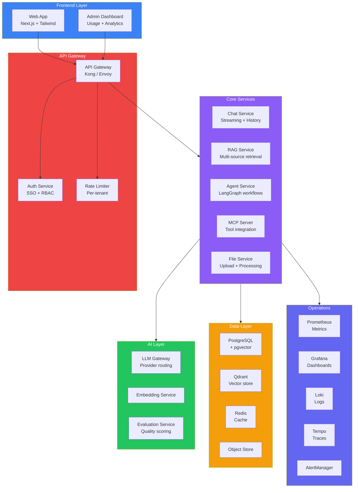
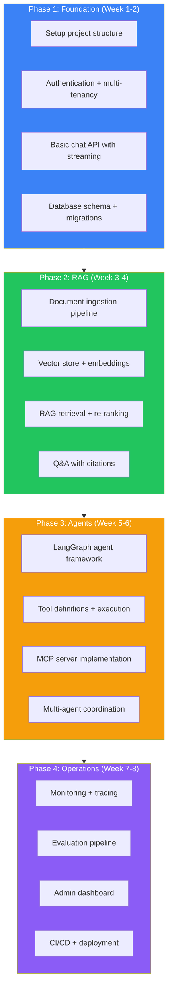
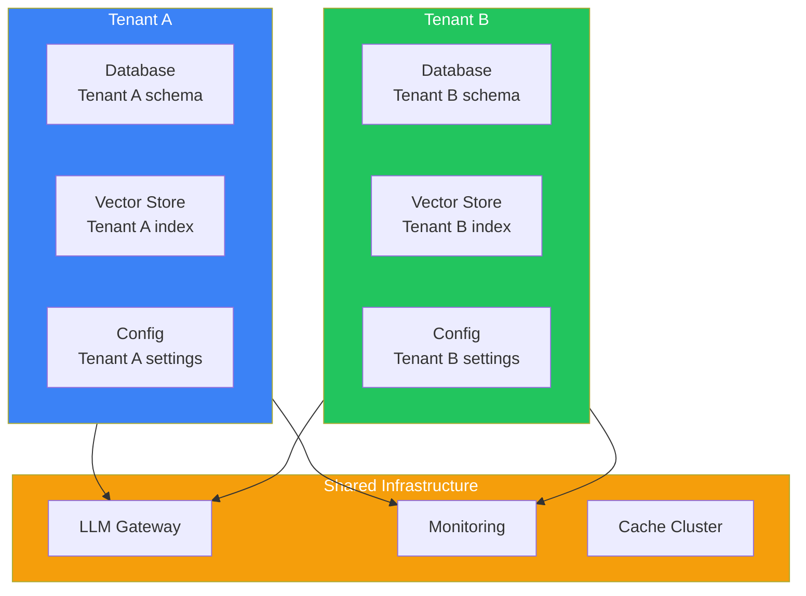
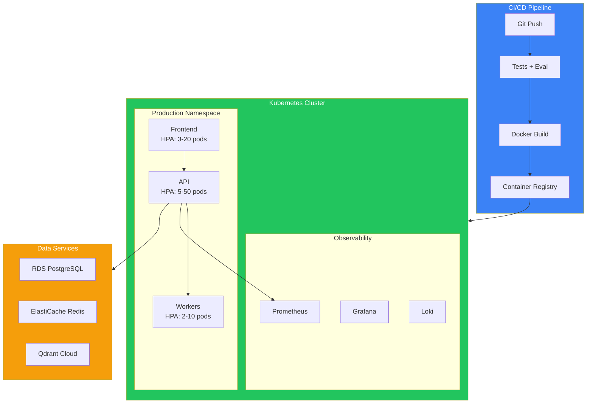
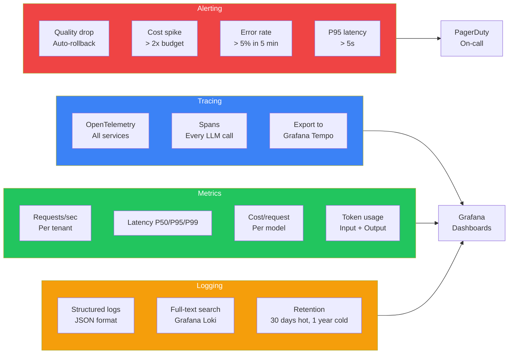

## Introduction

> **The capstone project: Build a complete enterprise AI SaaS platform from scratch — combining every skill learned across all 10 phases of the curriculum.**

This is the final, comprehensive project that ties together everything: RAG, AI agents, Model Context Protocol, streaming, monitoring, evaluation, security, deployment, and CI/CD. By the end, you'll have a production-ready enterprise AI platform you can showcase.

---

## Problem Statement

Enterprises need a unified AI platform that:
- Integrates with their existing data sources (documents, databases, APIs)
- Provides secure, governed access to AI capabilities
- Supports multiple AI use cases (chat, RAG, agents, search)
- Includes monitoring, evaluation, and cost tracking
- Deploys on their infrastructure with enterprise security

### Business Use Case

A Fortune 500 company needs an enterprise AI platform that 5000 employees will use daily for:
- Internal knowledge base Q&A
- Document analysis and summarization
- Automated workflows and data extraction
- Secure, compliant AI access with audit trails

---

## System Requirements

### Functional Requirements

| # | Feature | Description |
|---|---------|-------------|
| FR1 | Multi-tenant auth | SSO, RBAC, API key management |
| FR2 | Document ingestion | PDF, DOCX, web pages, databases |
| FR3 | RAG pipeline | Multi-source retrieval with re-ranking |
| FR4 | AI agents | Custom agents with tool integration |
| FR5 | MCP support | Model Context Protocol server/client |
| FR6 | Chat interface | Streaming, history, model selection |
| FR7 | Admin dashboard | Usage analytics, cost tracking |
| FR8 | Evaluation | LLM-as-a-Judge, human review |
| FR9 | Monitoring | Tracing, logging, alerting |
| FR10 | CI/CD | Automated testing, eval gates, deployment |

### Non-Functional Requirements

| # | Requirement | Target |
|---|-------------|--------|
| NFR1 | Availability | 99.95% |
| NFR2 | Latency P95 | < 3s |
| NFR3 | Scalability | 10K concurrent users |
| NFR4 | Security | SOC2, GDPR compliant |
| NFR5 | Multi-tenancy | 100+ tenants isolated |

---

## Technology Stack

| Layer | Technology | Purpose |
|-------|-----------|---------|
| **Frontend** | Next.js + Tailwind + Shadcn | Dashboard + Chat UI |
| **Backend** | FastAPI (Python) + Node.js | API, streaming, agents |
| **Database** | PostgreSQL + pgvector | Data + embeddings |
| **Cache** | Redis | Session, rate limiting |
| **Vector DB** | Qdrant (self-hosted) | RAG retrieval |
| **AI** | OpenAI + Anthropic + Gemini | Multi-provider |
| **Agent** | LangGraph | Agent orchestration |
| **MCP** | Custom MCP server | Tool integration |
| **Queue** | Celery + Redis | Async processing |
| **Monitoring** | Prometheus + Grafana + Loki | Observability |
| **Evaluation** | LangFuse / Custom | Quality tracking |
| **CI/CD** | GitHub Actions + ArgoCD | Deployment pipeline |
| **Infrastructure** | Terraform + Kubernetes + AWS | Cloud infra |

---

## Architecture



---

## Folder Structure

```
enterprise-ai-platform/
├── frontend/
│   ├── app/
│   │   ├── (auth)/
│   │   ├── dashboard/
│   │   ├── chat/
│   │   ├── admin/
│   │   └── evaluation/
│   ├── components/
│   └── lib/
├── backend/
│   ├── api/
│   ├── services/
│   │   ├── chat/
│   │   ├── rag/
│   │   ├── agents/
│   │   ├── mcp/
│   │   └── evaluation/
│   ├── models/
│   └── core/
│       ├── auth.py
│       ├── config.py
│       └── observability.py
├── ai/
│   ├── prompts/
│   ├── agents/
│   │   ├── research_agent/
│   │   └── support_agent/
│   ├── mcp/
│   │   ├── servers/
│   │   └── tools/
│   └── evaluation/
│       ├── golden_datasets/
│       └── evaluators/
├── infrastructure/
│   ├── terraform/
│   ├── k8s/
│   └── monitoring/
│       ├── prometheus/
│       ├── grafana/
│       └── loki/
├── deployment/
│   ├── Dockerfile
│   ├── docker-compose.yml
│   └── ci/
└── docs/
    ├── architecture.md
    ├── api.md
    └── security.md
```

---

## Implementation Phases



---

## Multi-Tenant Architecture



---

## Deployment Architecture



---

## Monitoring & Observability



---

## Evaluation Pipeline

| Evaluator | What It Checks | Frequency |
|-----------|---------------|-----------|
| LLM-as-a-Judge | Response quality | Every response |
| Safety classifier | Toxic output | Every response |
| PII detector | Data leakage | Every response |
| Golden dataset | Regression testing | Every deploy |
| Human review | Stratified sampling | 1% of responses |

---

## Security Architecture

| Concern | Implementation |
|---------|---------------|
| **Authentication** | SSO (SAML/OIDC) + API keys |
| **Authorization** | RBAC with tenant isolation |
| **Encryption** | TLS 1.3, AES-256 at rest |
| **Audit logging** | All AI operations logged |
| **Data isolation** | Schema-per-tenant |
| **Secrets** | Vault / AWS Secrets Manager |
| **Compliance** | SOC2, GDPR data processing agreements |

---

## Interview Questions

### System Design

**Q: Design the multi-tenant data isolation strategy for this enterprise AI platform.**

> Isolate by **schema-per-tenant** in PostgreSQL (data), **collection-per-tenant** in Qdrant (vectors), **prefix-per-tenant** in Redis (cache). Each tenant's LLM requests include tenant_id for cost allocation. Tenant config stored in central config DB. API keys scoped to tenant. Row-level security ensures tenants can only access their data.

**Q: Design the evaluation and monitoring system that auto-rollbacks bad deployments.**

> Pipeline: (1) Deploy to 5% of users, (2) LLM-as-a-Judge evaluates every response, (3) Score compared to baseline (rolling 24h window), (4) If score drops > 5% for 5 min → auto-rollback, (5) Rollback: revert prompt + model config + deployment version, (6) Notification sent to on-call with diff analysis.

---

## Grading Rubric

| Category | Weight | Pass Criteria |
|----------|--------|---------------|
| Architecture | 20% | Clean, well-documented microservices |
| Functionality | 25% | All core features working |
| Code quality | 15% | Tests, type hints, documentation |
| Monitoring | 15% | Dashboards, alerts, tracing |
| Security | 10% | Auth, encryption, audit logs |
| Deployment | 15% | CI/CD, K8s, infrastructure as code |

---

## Summary

| Area | What You Build |
|------|---------------|
| **Frontend** | Chat UI + Admin dashboard |
| **Backend** | Multi-service API with streaming |
| **RAG** | Document ingestion + multi-source retrieval |
| **Agents** | LangGraph agents with tools |
| **MCP** | Model Context Protocol server |
| **Monitoring** | Prometheus + Grafana + Tempo |
| **Evaluation** | LLM-as-a-Judge + golden datasets |
| **Security** | Multi-tenant SSO + RBAC |
| **Deployment** | K8s + CI/CD + Terraform |

---

## Navigation

**Previous:** [13 — AI System Design](/ai/phase-10-ai-projects/13-ai-system-design)

**Next:** [15 — Phase Summary](/ai/phase-10-ai-projects/15-phase-summary)

**Related Topics:**
- [All Phase 9 Production AI Concepts](/ai/phase-09-production-ai/01-introduction-to-llmops)
- [All Phase 10 Projects](/ai/phase-10-ai-projects/01-chatgpt-clone)
- [Phase Summary](/ai/phase-10-ai-projects/15-phase-summary)
