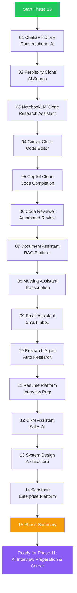
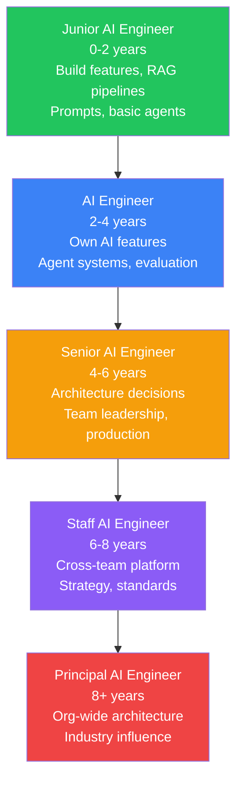
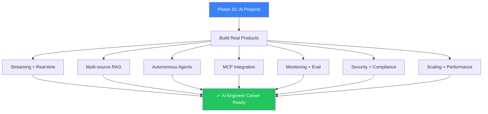

## Introduction

> **Phase 10 covered building real-world AI products — from ChatGPT clones to enterprise AI platforms. You've learned to design, build, deploy, and scale production AI applications.**

By now you should be capable of building complete AI SaaS applications, designing enterprise AI architectures, and making production engineering decisions.

```mermaid
flowchart LR
    subgraph LEARNED["What You Built"]
        P1["ChatGPT Clone\nConversational AI"]
        P2["Perplexity Clone\nAI Search"]
        P3["NotebookLM Clone\nResearch Assistant"]
        P4["Cursor Clone\nAI Code Editor"]
        P5["Copilot Clone\nCode Completion"]
        P6["Code Reviewer\nAutomated Review"]
        P7["Doc Assistant\nRAG Platform"]
        P8["Meeting Assistant\nTranscription"]
        P9["Email Assistant\nSmart Inbox"]
        P10["Research Agent\nAuto Research"]
        P11["Resume Platform\nInterview Prep"]
        P12["CRM Assistant\nSales AI"]
        P13["System Design\nArchitecture"]
        P14["Capstone\nEnterprise Platform"]
    end
    
    LEARNED --> READY["✅ Ready for Production AI Roles"]
    
    style LEARNED fill:#3b82f6,color:#fff
    style READY fill:#22c55e,color:#fff
```



---

## Complete Roadmap



---

## Project Complexity Matrix

| Project | Complexity | Time Estimate | Key Skills |
|---------|-----------|---------------|------------|
| 01 ChatGPT Clone | High | 2-3 weeks | Streaming, memory, multi-model |
| 02 Perplexity Clone | High | 2-3 weeks | RAG, search, re-ranking |
| 03 NotebookLM Clone | High | 2-3 weeks | Multi-modal, audio, vector search |
| 04 Cursor Clone | Very High | 3-4 weeks | AST, code indexing, embeddings |
| 05 Copilot Clone | High | 2-3 weeks | Context optimization, caching |
| 06 Code Reviewer | Medium | 1-2 weeks | Static analysis, LLM review |
| 07 Document Assistant | High | 2-3 weeks | OCR, RAG, document processing |
| 08 Meeting Assistant | Medium | 1-2 weeks | STT, summarization |
| 09 Email Assistant | Medium | 1-2 weeks | Classification, NLP |
| 10 Research Agent | High | 2-3 weeks | Agent orchestration, LangGraph |
| 11 Resume Platform | Medium | 1-2 weeks | Parsing, voice, evaluation |
| 12 CRM Assistant | Medium | 1-2 weeks | ML scoring, CRM APIs |
| 13 System Design | Medium | 1 week | Architecture analysis |
| 14 Capstone | Very High | 4-6 weeks | Everything combined |

---

## Architecture Checklist

- [ ] Multi-layer architecture (frontend → gateway → services → AI → data)
- [ ] API Gateway with auth, rate limiting, routing
- [ ] Multi-provider LLM support with fallback
- [ ] Streaming for real-time responses
- [ ] Vector database for RAG/embeddings
- [ ] Caching at multiple levels
- [ ] Async processing with message queues
- [ ] Health checks + readiness probes

## Deployment Checklist

- [ ] Docker containers for all services
- [ ] Kubernetes manifests (deployments, services, HPA)
- [ ] CI/CD pipeline with GitHub Actions
- [ ] Staging environment for testing
- [ ] Canary deployment capability
- [ ] Automated rollback on quality regression
- [ ] Infrastructure as code (Terraform)
- [ ] Database migrations in CI/CD

## Security Checklist

- [ ] Authentication (OAuth, SSO, API keys)
- [ ] Authorization (RBAC, tenant isolation)
- [ ] Encryption at rest and in transit
- [ ] Secrets management (Vault)
- [ ] Audit logging for all operations
- [ ] Rate limiting and abuse prevention
- [ ] Input/output guardrails for AI
- [ ] Compliance (GDPR, SOC2 as needed)

---

## Interview Guide

### AI Engineer Roles

| Role | Focus Areas | Key Questions |
|------|-------------|---------------|
| **AI Engineer** | RAG, agents, prompt engineering | Design a RAG pipeline, implement streaming |
| **LLM Engineer** | Model selection, fine-tuning | Compare GPT-4 vs Claude, design eval pipeline |
| **ML Engineer** | Training, deployment | Model serving, A/B testing, monitoring |
| **AI Platform Engineer** | Infrastructure, scaling | Design multi-tenant AI platform, CI/CD for AI |
| **AI Product Engineer** | Full-stack AI apps | Build ChatGPT clone, integrate AI features |

### Key Topics

| Topic | Projects That Cover It |
|-------|----------------------|
| **Streaming** | ChatGPT Clone, Capstone |
| **RAG** | Perplexity Clone, Doc Assistant |
| **Agents** | Research Agent, Capstone |
| **MCP** | Capstone |
| **Monitoring** | All projects |
| **Evaluation** | Code Reviewer, Capstone |
| **Security** | Capstone, Doc Assistant |
| **Scaling** | ChatGPT Clone, Perplexity Clone |

---

## Career Roadmap



---

## Learning Path to Phase 11

```
Phase 1: AI Fundamentals              ───→  Done ✓
Phase 2: Machine Learning             ───→  Done ✓
Phase 3: Deep Learning                ───→  Done ✓
Phase 4: Large Language Models         ─→  Done ✓
Phase 5: Retrieval Systems & RAG      ───→  Done ✓
Phase 6: AI Agents                    ───→  Done ✓
Phase 7: Model Context Protocol        ─→  Done ✓
Phase 8: AI Frameworks                ───→  Done ✓
Phase 9: Production AI Engineering     ─→  Done ✓
Phase 10: Real-World AI Projects      ───→  Done ✓
                                            ↓
Phase 11: AI Interview Preparation & Career ←── Next!
```

---

## Key Insights



---

## Common Mistakes

| Mistake | Fix |
|---------|-----|
| Building without planning the architecture | Start with system design before code |
| Not implementing streaming | Users expect real-time responses |
| No evaluation pipeline | Can't measure if improvements work |
| Ignoring multi-tenancy | Every project becomes harder to scale |
| No monitoring from day one | Can't debug production issues |
| Using a single model | No fallback when provider has issues |
| Not caching | Every request hits the LLM, wasting money |
| No CI/CD for AI | Every prompt change is a manual deploy |

---

## Summary

| Project | What You Learned |
|---------|-----------------|
| **ChatGPT Clone** | Streaming, conversation memory, multi-model |
| **Perplexity Clone** | Real-time search, RAG, re-ranking, citations |
| **NotebookLM Clone** | Multi-modal processing, audio generation |
| **Cursor Clone** | Codebase indexing, AST parsing, code embeddings |
| **Copilot Clone** | Context optimization, completion caching |
| **Code Reviewer** | Static analysis, AI code review, GitHub integration |
| **Document Assistant** | OCR, RAG pipelines, document processing |
| **Meeting Assistant** | Speech-to-text, summarization, calendar integration |
| **Email Assistant** | Classification, spam detection, reply generation |
| **Research Agent** | Multi-agent orchestration, LangGraph |
| **Resume Platform** | Resume parsing, voice interviews, evaluation |
| **CRM Assistant** | ML scoring, CRM integration, forecasting |
| **System Design** | Architecture analysis of major AI products |
| **Capstone** | Complete enterprise AI platform |

---

## Navigation

**Previous:** [14 — Capstone Project](/ai/phase-10-ai-projects/14-capstone-project)

**Next:** Phase 11 — AI Interview Preparation & Career Guide (Coming Soon)

**Related Topics:**
- [All Phase 9 Production AI Concepts](/ai/phase-09-production-ai/01-introduction-to-llmops)
- [ChatGPT Clone](/ai/phase-10-ai-projects/01-chatgpt-clone)
- [Capstone Project](/ai/phase-10-ai-projects/14-capstone-project)
