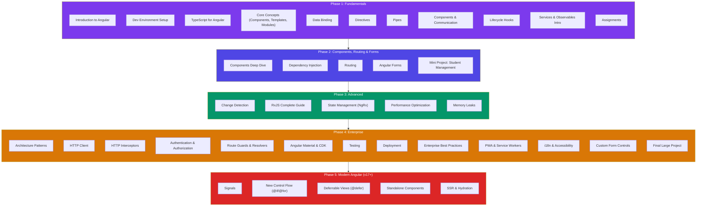

# Angular Complete Guide

Welcome to the comprehensive, topic-wise Angular study and reference notes. Organized into five phases from beginner to enterprise level — including Modern Angular (v17+).

## 📖 Learning Path

---

## Phase 1: Fundamentals

> **Mentor's Note:** This guide is written as if I'm sitting next to you, explaining everything from scratch. Every concept starts with a simple real-world analogy, then the technical explanation, then code. Read it top to bottom and don't skip sections — each one builds on the previous.

### Topics:

- [1. Introduction to Angular](/DSA-Notes-Problems/angular/phase-1/phase-1-introduction-to-angular)
- [2. Development Environment Setup](/DSA-Notes-Problems/angular/phase-1/phase-1-development-environment-setup)
- [3. TypeScript Fundamentals for Angular](/DSA-Notes-Problems/angular/phase-1/phase-1-typescript-fundamentals-for-angular)
- [4. Angular Core Concepts](/DSA-Notes-Problems/angular/phase-1/phase-1-angular-core-concepts)
- [5. Data Binding](/DSA-Notes-Problems/angular/phase-1/phase-1-data-binding)
- [6. Directives](/DSA-Notes-Problems/angular/phase-1/phase-1-directives)
- [7. Pipes](/DSA-Notes-Problems/angular/phase-1/phase-1-pipes)
- [8. Components & Communication](/DSA-Notes-Problems/angular/phase-1/phase-1-components-and-communication)
- [9. Lifecycle Hooks](/DSA-Notes-Problems/angular/phase-1/phase-1-lifecycle-hooks)
- [10. Services & Observables Intro](/DSA-Notes-Problems/angular/phase-1/phase-1-services-and-observables-intro)
- [11. Assignments](/DSA-Notes-Problems/angular/phase-1/phase-1-assignments)
- [12. Interview Questions & Answers](/DSA-Notes-Problems/angular/phase-1/phase-1-interview-questions-answers)

---

## Phase 2: Components, Routing & Forms

> **Author:** Senior Angular Architect | 15+ Years Enterprise Experience
> **Target:** Developers who know Angular basics and want to go deep
> **Version:** Angular 17+ (Standalone + Module-based covered)

### Topics:

- [1. Components Deep Dive](/DSA-Notes-Problems/angular/phase-2/phase-2-components-deep-dive)
- [2. Dependency Injection](/DSA-Notes-Problems/angular/phase-2/phase-2-dependency-injection)
- [3. Routing](/DSA-Notes-Problems/angular/phase-2/phase-2-routing)
- [4. Angular Forms](/DSA-Notes-Problems/angular/phase-2/phase-2-angular-forms)
- [5. Mini Project: Student Management System](/DSA-Notes-Problems/angular/phase-2/phase-2-mini-project-student-management-system)
- [6. Interview Questions & Answers](/DSA-Notes-Problems/angular/phase-2/phase-2-interview-questions-answers)

---

## Phase 3: Advanced

> **Senior Angular Software Architect Reference**
> Deep internals, architecture diagrams, real-world patterns, and 50 interview questions.

### Topics:

- [1. Change Detection](/DSA-Notes-Problems/angular/phase-3/phase-3-change-detection)
- [2. RxJS Complete Guide](/DSA-Notes-Problems/angular/phase-3/phase-3-rxjs-complete-guide)
- [3. State Management](/DSA-Notes-Problems/angular/phase-3/phase-3-state-management)
- [4. Performance Optimization](/DSA-Notes-Problems/angular/phase-3/phase-3-performance-optimization)
- [5. Memory Leaks](/DSA-Notes-Problems/angular/phase-3/phase-3-memory-leaks)
- [6. Advanced Interview Questions](/DSA-Notes-Problems/angular/phase-3/phase-3-advanced-interview-questions)

---

## Phase 4: Enterprise Angular

> **Principal Software Engineer & Enterprise Angular Architect Reference**
> Mentoring guide for building large-scale, production-grade Angular systems.
> Real-world patterns, architecture decisions, and 75 enterprise interview questions.

### Topics:

- [1. Angular Architecture Patterns](/DSA-Notes-Problems/angular/phase-4/phase-4-angular-architecture-patterns)
- [2. HTTP Client](/DSA-Notes-Problems/angular/phase-4/phase-4-http-client)
- [3. HTTP Interceptors](/DSA-Notes-Problems/angular/phase-4/phase-4-http-interceptors)
- [4. Authentication & Authorization](/DSA-Notes-Problems/angular/phase-4/phase-4-authentication-authorization)
- [5. Route Guards & Resolvers](/DSA-Notes-Problems/angular/phase-4/phase-4-route-guards-and-resolvers)
- [6. Angular Material & CDK](/DSA-Notes-Problems/angular/phase-4/phase-4-angular-material-and-cdk)
- [7. Testing](/DSA-Notes-Problems/angular/phase-4/phase-4-testing)
- [8. Deployment](/DSA-Notes-Problems/angular/phase-4/phase-4-deployment)
- [9. Enterprise Best Practices](/DSA-Notes-Problems/angular/phase-4/phase-4-enterprise-best-practices)
- [10. PWA & Service Workers](/DSA-Notes-Problems/angular/phase-4/phase-4-pwa-and-service-workers)
- [11. i18n & Accessibility](/DSA-Notes-Problems/angular/phase-4/phase-4-i18n-and-accessibility)
- [12. Custom Form Controls](/DSA-Notes-Problems/angular/phase-4/phase-4-custom-form-controls)
- [13. Final Large Project: Enterprise E-Commerce Platform](/DSA-Notes-Problems/angular/phase-4/phase-4-final-large-project-enterprise-e-commerce-platform)
- [14. Interview Questions](/DSA-Notes-Problems/angular/phase-4/phase-4-interview-questions)

---

## Phase 5: Modern Angular (v17+)

> **Angular 17+ features and modern patterns**
> Signals, new control flow, deferrable views, standalone components, and SSR.

### Topics:

- [1. Signals](/DSA-Notes-Problems/angular/phase-5/phase-5-signals)
- [2. New Control Flow (@if/@for/@switch)](/DSA-Notes-Problems/angular/phase-5/phase-5-new-control-flow)
- [3. Deferrable Views (@defer)](/DSA-Notes-Problems/angular/phase-5/phase-5-deferrable-views)
- [4. Standalone Components](/DSA-Notes-Problems/angular/phase-5/phase-5-standalone-components)
- [5. SSR & Hydration](/DSA-Notes-Problems/angular/phase-5/phase-5-ssr-and-hydration)
- [6. Modern Angular Interview Questions](/DSA-Notes-Problems/angular/phase-5/phase-5-interview-questions)
