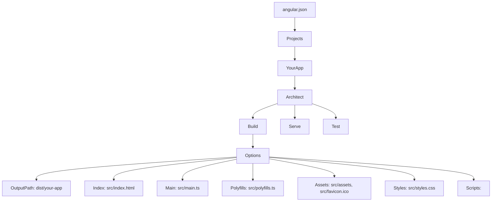

## Introduction
Angular CLI configuration file that defines how the Angular CLI builds, serves, and tests your application.

## Why do we need it?
To customize build targets, file replacements, asset copying, and environment configurations without ejecting the build configuration.

## Real-world analogy
Like a city's master plan that outlines zoning, infrastructure, and building codes — angular.json defines how your Angular application is structured and built.

## Visual Explanation


## Mermaid Diagram


## Deep Explanation
The angular.json file is the central configuration for the Angular CLI. It defines:
- **Projects**: Your Angular applications and libraries
- **Architect**: Build targets like build, serve, test, lint, e2e
- **Configurations**: Environment-specific settings (production, development)
- **File Replacements**: Replace files for different environments (e.g., environment.ts)
- **Assets**: Static files to copy to the output directory
- **Styles and Scripts**: Global stylesheets and scripts
- **Budgets**: Bundle size warnings and errors

## Code Example
```json
{
  "$schema": "./node_modules/@angular/cli/lib/config/schema.json",
  "version": 1,
  "newProjectRoot": "projects",
  "projects": {
    "your-app": {
      "projectType": "application",
      "schematics": {},
      "root": "",
      "sourceRoot": "src",
      "prefix": "app",
      "architect": {
        "build": {
          "builder": "@angular-devkit/build-angular:browser",
          "options": {
            "outputPath": "dist/your-app",
            "index": "src/index.html",
            "main": "src/main.ts",
            "polyfills": "src/polyfills.ts",
            "tsConfig": "tsconfig.app.json",
            "inlineStyleLanguage": "scss",
            "assets": [
              "src/favicon.ico",
              "src/assets"
            ],
            "styles": [
              "src/styles.scss"
            ],
            "scripts": []
          },
          "configurations": {
            "production": {
              "budgets": [
                {
                  "type": "initial",
                  "maximumWarning": "500kb",
                  "maximumError": "1mb"
                },
                {
                  "type": "anyComponentStyle",
                  "maximumWarning": "2kb",
                  "maximumError": "4kb"
                }
              ],
              "fileReplacements": [
                {
                  "replace": "src/environments/environment.ts",
                  "with": "src/environments/environment.prod.ts"
                }
              ],
              "outputHashing": "all"
            },
            "development": {
              "buildOptimizer": false,
              "optimization": false,
              "vendorChunk": true,
              "extractLicenses": false,
              "sourceMap": true,
              "namedChunks": true
            }
          }
        },
        "serve": {
          "builder": "@angular-devkit/build-angular:dev-server",
          "options": {
            "browserTarget": "your-app:build"
          },
          "configurations": {
            "production": {
              "browserTarget": "your-app:build:production"
            },
            "development": {
              "browserTarget": "your-app:build:development"
            }
          }
        },
        "extract-i18n": {
          "builder": "@angular-devkit/build-angular:extract-i18n",
          "options": {
            "browserTarget": "your-app:build"
          }
        },
        "test": {
          "builder": "@angular-devkit/build-angular:karma",
          "options": {
            "main": "src/test.ts",
            "polyfills": "src/polyfills.ts",
            "tsConfig": "tsconfig.spec.json",
            "karmaConfig": "karma.conf.js",
            "assets": [
              "src/favicon.ico",
              "src/assets"
            ],
            "styles": [
              "src/styles.css"
            ],
            "scripts": []
          }
        }
      }
    }
  },
  "defaultProject": "your-app"
}
```

## Best Practices
- Keep the configuration DRY by using extends for similar projects
- Use configuration-specific file replacements for environment variables
- Set up build budgets to monitor bundle sizes
- Configure service workers for PWAs in the serviceWorker section
- Use budget thresholds to catch regressions early

## Common Mistakes
- Forgetting to update the outputPath when changing project structure
- Misconfigured asset paths leading to missing images/fonts
- Overlooking the need to rebuild after changing angular.json
- Incorrectly setting up proxies in serve configuration

## Interview Questions
1. How would you configure multiple environments in angular.json?
2. What is the purpose of the "fileReplacements" section?
3. How do you add a third-party script to be loaded globally in your Angular app?

## Summary
angular.json is the Angular CLI's configuration file that controls how your application is built, served, and tested, allowing fine-tuning of the build process without ejecting from the CLI.