## Introduction
Angular Fundamentals is the starting point for learning Angular, covering the core concepts, architecture, and setup required to build Angular applications.

## Why do we need this?
Understanding the fundamentals is crucial before diving into advanced topics like state management, performance optimization, and enterprise architecture. This foundation ensures you grasp how Angular works under the hood.

## Real-world analogy
Learning Angular fundamentals is like learning the rules of the road and how a car engine works before attempting to drive in a city — you need the basics to navigate complex scenarios safely.

## Visual Explanation


## Mermaid Diagram

```mermaid
flowchart TD
    A[Angular Fundamentals] --> B[Introduction to Angular]
    A --> C[Development Environment Setup]
    A --> D[TypeScript Fundamentals]
    A --> E[Angular Core Concepts]
    A --> F[Data Binding]
    A --> G[Directives]
    A --> H[Pipes]
    B --> B1[What is Angular?]
    B --> B2[Why Angular Exists?]
    B --> B3[Angular Architecture]
    C --> C1[Node.js & npm]
    C --> C2[Angular CLI]
    C --> C3[VS Code Setup]
    C --> C4[Project Structure]
    D --> D1[Variables & Types]
    D --> D2[Functions]
    D --> D3[Classes & Decorators]
    E --> E1[Components]
    E --> E2[Templates]
    E --> E3[Modules]
    E --> E4[Metadata & Selectors]
    F --> F1[Interpolation]
    F --> F2[Property Binding]
    F --> F3[Event Binding]
    F --> F4[Two-way Binding]
    G --> G1[Structural Directives]
    G --> G2[Attribute Directives]
    H --> H1[Built-in Pipes]
    H --> H2[Custom Pipes]
```


## Deep Explanation
This topic introduces the building blocks of Angular applications:
- **Angular Platform**: Understanding what Angular is, its history, and why it exists
- **Development Setup**: Installing Node.js, npm, Angular CLI, and configuring your IDE
- **TypeScript**: The language Angular is built on, covering types, classes, decorators
- **Core Concepts**: Modules, components, templates, metadata, and the bootstrap process
- **Data Binding**: The four types of binding that connect component logic to templates
- **Directives**: How to manipulate the DOM and element behavior
- **Pipes**: Transforming data for display in templates

Each section builds upon the previous one, creating a solid foundation for intermediate and advanced Angular topics.

## Code Example
```bash
# Install Angular CLI
npm install -g @angular/cli

# Create a new workspace and application
ng new my-fundamentals-app
cd my-fundamentals-app

# Generate a component to practice data binding
ng generate component user-profile

# Start the development server
ng serve
```

```typescript
// user-profile.component.ts
import { Component } from '@angular/core';

@Component({
  selector: 'app-user-profile',
  templateUrl: './user-profile.component.html',
  styleUrls: ['./user-profile.component.css']
})
export class UserProfileComponent {
  username = 'JohnDoe';
  email = 'john@example.com';
  isActive = true;
  
  toggleStatus() {
    this.isActive = !this.isActive;
  }
}
```

```html
<!-- user-profile.component.html -->
<div class="profile">
  <h2>Hello, {{ username }}!</h2>
  <p>Email: {{ email }}</p>
  <p>Status: {{ isActive ? 'Active' : 'Inactive' }}</p>
  <button (click)="toggleStatus()">Toggle Status</button>
</div>
```

## Best Practices
- Always use the Angular CLI for project setup and code generation
- Follow the Angular Style Guide for code consistency
- Use TypeScript strict mode for better type safety
- Keep components focused on a single responsibility
- Leverage Angular's built-in features before creating custom solutions
- Regularly update Angular CLI and dependencies

## Common Mistakes
- Skipping TypeScript fundamentals and struggling with Angular's syntax
- Not understanding the difference between modules and components
- Overcomplicating templates with excessive logic instead of using pipes or component methods
- Forgetting to import required modules (FormsModule, HttpClientModule, etc.)
- Misusing lifecycle hooks (e.g., making HTTP calls in constructor)

## Interview Questions
1. What is the difference between AngularJS and Angular?
2. Explain the Angular bootstrapping process.
3. How does dependency injection work in Angular?
4. What are the three types of directives in Angular?
5. Describe the change detection mechanism in Angular.

## Summary
Angular Fundamentals provides the essential knowledge needed to begin building Angular applications, covering setup, core concepts, data binding, directives, and pipes. Mastering these topics prepares you for more advanced subjects like routing, forms, state management, and performance optimization.