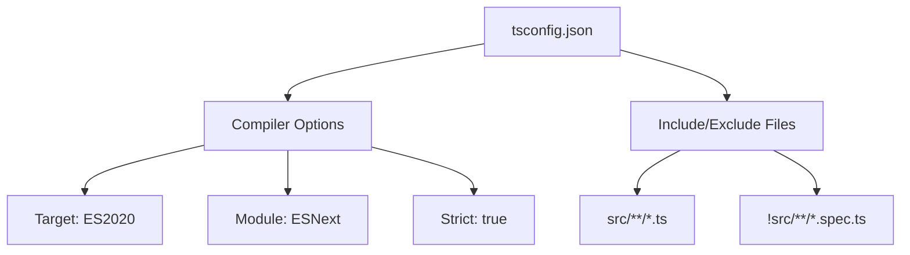

## Introduction
TypeScript configuration file that specifies the root files and the compiler options required to compile the project.

## Why do we need it?
To customize how TypeScript compiles your Angular project, enabling features like strict type checking, module resolution, and output targets.

## Real-world analogy
Like a recipe book that tells the chef exactly how to prepare a dish — ingredients, cooking time, temperature — tsconfig.json tells the TypeScript compiler how to transform your code.

## Visual Explanation


## Mermaid Diagram


## Deep Explanation
The tsconfig.json file is placed at the root of your Angular project and is used by the TypeScript compiler (tsc) and Angular's build tools. Key sections include:
- **compilerOptions**: Settings like target, module, strict, etc.
- **include**: Files to compile (usually src/**/*.ts)
- **exclude**: Files to skip (like test files)
- **extends**: Base configuration to inherit from

## Code Example
```json
{
  "compileOnSave": false,
  "compilerOptions": {
    "baseUrl": "./",
    "outDir": "./dist/out-tsc",
    "sourceMap": true,
    "declaration": false,
    "downlevelIteration": true,
    "experimentalDecorators": true,
    "moduleResolution": "node",
    "importHelpers": true,
    "target": "es2022",
    "module": "es2022",
    "lib": [
      "es2022",
      "dom"
    ]
  },
  "angularCompilerOptions": {
    "enableI18nLegacyTemplateIdLabel": false,
    "strictInjectionParameters": true,
    "strictInputAccessModifiers": true,
    "strictTemplates": true
  }
}
```

## Best Practices
- Always extend the base Angular CLI configuration
- Enable strict mode for better type safety
- Keep the configuration aligned with the CLI: ng generate app-shell
- Use path mapping for cleaner imports
- Exclude test files from compilation in production builds

## Common Mistakes
- Forgetting to set "baseUrl" leading to module resolution errors
- Including node_modules in the include array
- Misconfiguring paths causing build failures

## Interview Questions
1. What is the purpose of the "angularCompilerOptions" section in tsconfig.json?
2. How would you configure path aliases in tsconfig.json?
3. What happens if you set "strict": true in compilerOptions?

## Summary
tsconfig.json is the central configuration file for TypeScript in Angular projects, controlling how your code is compiled and ensuring consistency across the development team.