## Introduction
TypeScript is a superset of JavaScript that adds static types, classes, and interfaces. It is the primary language used for Angular development, providing type safety and advanced features that help catch errors during development.

## Why do we need this?
TypeScript helps you write more robust and maintainable code by catching type-related errors at compile time rather than at runtime. It enhances developer productivity with features like autocompletion, refactoring tools, and explicit contracts between different parts of your application.

## Real-world analogy
Think of TypeScript as a skilled assistant who double-checks your work as you go. Instead of discovering mistakes after the build or in production, TypeScript alerts you immediately when you try to assign a string to a number variable or call a function with the wrong arguments.

## Visual Explanation


## Mermaid Diagram

```mermaid
flowchart TD
    A[TypeScript] --> B[Basic Types]
    A --> C[Control Flow]
    A --> D[Functions]
    A --> E[Objects]
    A --> F[Interfaces]
    A --> G[Classes]
    A --> H[Generics]
    A --> I[Decorators]
    A --> J[Enums]
    B --> B1[Primitives: string, number, boolean]
    B --> B2[Special: null, undefined, any, unknown, void, never]
    B --> B3[Union Types]
    B --> B4[Type Aliases]
    C --> C1[if/else]
    C --> C2[for/while loops]
    C --> C3[switch statements]
    D --> D1[Regular Functions]
    D --> D2[Arrow Functions]
    D --> D3[Optional Parameters]
    D --> D4[Default Parameters]
    D --> D5[Rest Parameters]
    D --> D6[Function Overloads]
    E --> E1[Object Literals]
    E --> E2[Property Access]
    E --> E3[Destructuring]
    E --> E4[Spread Operator]
    F --> F1[Defining Interfaces]
    F --> F2[Interface Extension]
    F --> F3[Interfaces vs Types]
    G --> G1[Class Basics]
    G --> G2[Constructors]
    G --> G3[Methods]
    G --> G4[Inheritance]
    G --> G5[Getters/Setters]
    H --> H1[Generic Functions]
    H --> H2[Generic Interfaces]
    H --> H3[Generic Classes]
    I --> I1[Class Decorators]
    I --> I2[Method Decorators]
    I --> I3[Property Decorators]
    I --> I4[Parameter Decorators]
    J --> J1[Numeric Enums]
    J --> J2[String Enums]
    J --> J3[Heterogeneous Enums]
```


## Deep Explanation
TypeScript brings static typing to JavaScript, allowing developers to define the shape of data and catch errors early. Key features include:

- **Type Annotations**: Explicitly declare the type of variables, function parameters, and return values
- **Interfaces**: Define contracts for objects, ensuring they have specific properties and methods
- **Classes**: Blueprint for creating objects with encapsulation, inheritance, and polymorphism
- **Generics**: Create reusable components that work with various types while maintaining type safety
- **Decorators**: Special declarations that can be attached to classes, methods, properties, or parameters to modify their behavior
- **Enums**: Define a set of named constants, either numeric or string-based

TypeScript compiles down to plain JavaScript, so it works anywhere JavaScript runs, but provides powerful tooling during development.

## Code Example
```typescript
// Interface defining the shape of a user
interface User {
  id: number;
  name: string;
  email?: string;
}

// Class implementing the User interface
class UserService {
  private users: User[] = [];
  
  addUser(user: User): void {
    this.users.push({ ...user, id: Date.now() });
  }
  
  getUsers(): User[] {
    return [...this.users]; // Return a copy to prevent direct mutation
  }
}

// Generic function that works with any type
function identity<T>(arg: T): T {
  return arg;
}

// Usage of the generic function
let output = identity<string>("myString");  // output: "myString"
let num = identity<number>(100);            // num: 100

// Decorator example
function Logger(constructor: Function) {
  console.log("Creating instance...");
  console.log(constructor);
}

}
```

## Best Practices
- Enable strict mode in tsconfig.json for maximum type safety
- Use interfaces for object shapes and types for complex type unions/intersections
- Prefer const enums over regular enums when you don't need reverse mapping
- Use explicit return types for public functions and methods
- Leverage TypeScript's inference capabilities but don't hesitate to add annotations for clarity
- Organize types in dedicated files or folders for reusability

## Common Mistakes
- Overusing the `any` type, which defeats the purpose of TypeScript
- Forgetting to specify return types for public APIs
- Misunderstanding the difference between type aliases and interfaces
- Not using strict null checks, leading to runtime errors
- Overcomplicating generic constraints when simpler solutions exist

## Interview Questions
1. What is the difference between `interface` and `type` in TypeScript?
2. How do generics help in creating reusable components?
3. Explain the purpose of decorators in Angular with examples.
4. What are the benefits of using strict mode in TypeScript?
5. How would you handle asynchronous operations in TypeScript?

## Summary
TypeScript enhances JavaScript with static typing and advanced features that improve code quality, developer productivity, and maintainability. Mastering TypeScript is essential for building scalable Angular applications.