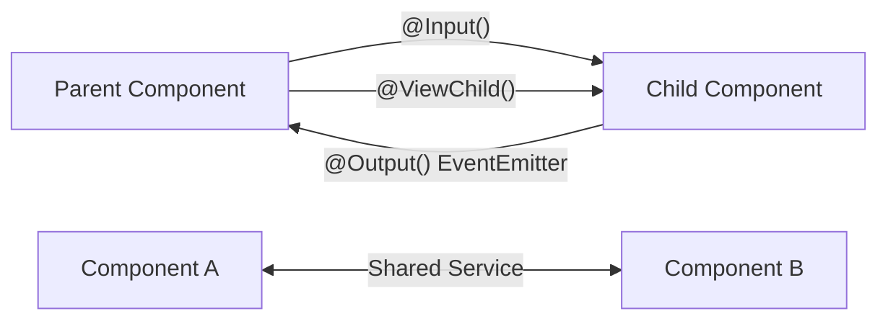

## Introduction

Components rarely work in isolation. In real applications, components need to share data, notify each other of events, and coordinate behavior. Angular provides several patterns for component communication.

## Why do we need this?

Understanding component communication is essential for building interconnected UIs where data flows between parent and child components, siblings, and unrelated components across the application.

## Real-world analogy

Think of components as **people in an office**. Each person has their own desk. Some talk by passing papers down the chain (parent → child via @Input). Others raise their hand to get attention (child → parent via @Output). And some use a shared bulletin board (service with signals/observables).

## Mermaid Diagram



## Deep Explanation

Angular provides four main communication patterns:

### 1. Parent → Child: @Input()

```typescript
@Input() userName: string = '';
@Input({ required: true }) userId: number = 0;
@Input('displayMode') mode: string = 'grid'; // aliased
```

### 2. Child → Parent: @Output() + EventEmitter

```typescript
@Output() itemSelected = new EventEmitter<Item>();
@Output() formSubmitted = new EventEmitter<FormData>();

// Emit event
this.itemSelected.emit(selectedItem);
```

### 3. Parent accesses Child: @ViewChild()

```typescript
@ViewChild(ChildComponent) child!: ChildComponent;
@ViewChild('templateRef') elementRef!: ElementRef;
```

### 4. Any → Any: Shared Service

```typescript
@Injectable({ providedIn: 'root' })
export class SharedService {
  private state = new BehaviorSubject<State>(initialState);
  state$ = this.state.asObservable();
}
```

## Code Example

```typescript
// Parent passes data and listens to events
@Component({
  template: `
    <app-child
      [data]="parentData"
      (action)="handleAction($event)"
    ></app-child>
  `
})
export class ParentComponent {
  parentData = { name: 'Test' };
  handleAction(event: any) { /* handle */ }
}

// Child receives data and emits events
@Component({
  selector: 'app-child',
  template: `<button (click)="emitAction()">Click</button>`
})
export class ChildComponent {
  @Input() data: any;
  @Output() action = new EventEmitter<any>();
  emitAction() { this.action.emit('done'); }
}
```

## Best Practices

- Use @Input() and @Output() for parent-child communication
- Use services for unrelated component communication
- Keep @Input() immutable — never modify parent data directly
- Prefix output event names with the source (e.g., productSelected)

## Common Mistakes

- Using @ViewChild before ngAfterViewInit
- Forgetting to unsubscribe from service subscriptions
- Mutating @Input() objects directly instead of emitting changes

## Summary

Component communication is the backbone of Angular applications. Master @Input, @Output, @ViewChild, and service-based patterns to build interconnected, maintainable UIs."
