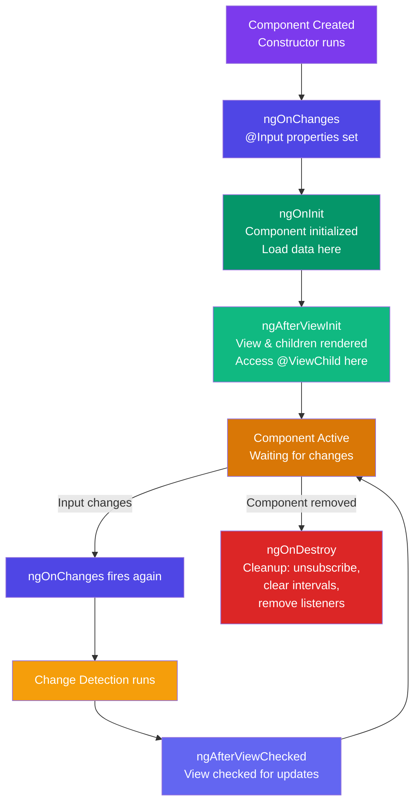

## Introduction

Angular components have a lifecycle that starts when Angular creates them and ends when it destroys them. At each stage, Angular provides lifecycle hooks — special methods you can implement to run code at specific moments.

## Why do we need this?

Understanding the component lifecycle is crucial for:
- Initializing data and subscribing to services at the right time
- Cleaning up subscriptions and timers to prevent memory leaks
- Responding to input property changes
- Accessing DOM elements and child components safely
- Optimizing change detection performance

## Real-world analogy

Think of a component like a plant in a garden:
- **Construction** = Planting the seed (component is created)
- **ngOnInit** = The sprouting stage (initial setup)
- **ngOnChanges** = Responding to changes in sunlight or water (input changes)
- **ngAfterViewInit** = When the plant is fully visible and you can measure its height (view is ready)
- **ngOnDestroy** = When the plant is removed from the garden (cleanup before destruction)

## Visual Explanation


## Mermaid Diagram



## Deep Explanation

### The 8 Hooks in Order

```typescript
@Component({ ... })
export class LifecycleDemoComponent implements
  OnChanges, OnInit, DoCheck,
  AfterContentInit, AfterContentChecked,
  AfterViewInit, AfterViewChecked, OnDestroy {

  @Input() userName: string = '';

  // 1️⃣ Constructor (not a hook, but runs first)
  constructor() {
    console.log('0️⃣ Constructor — component is being created');
    // Can't access @Input() values here yet!
  }

  // 2️⃣ ngOnChanges — Called when @Input properties change
  ngOnChanges(changes: SimpleChanges): void {
    console.log('1️⃣ ngOnChanges — Input changed:', changes);
    // Runs BEFORE ngOnInit on the first change
    for (const propName of Object.keys(changes)) {
      const change = changes[propName];
      console.log(`${propName}: ${change.previousValue} → ${change.currentValue}`);
    }
  }

  // 3️⃣ ngOnInit — Component is fully initialized
  ngOnInit(): void {
    console.log('2️⃣ ngOnInit — Component ready! Load data here');
    // ✅ This is where you fetch data, set up forms, etc.
    // @Input() values are available now
    this.loadUserData();
  }

  // 4️⃣ ngDoCheck — Called on EVERY change detection cycle
  ngDoCheck(): void {
    console.log('3️⃣ ngDoCheck — Change detection running');
    // ⚠️ Expensive! Use only for custom change detection
  }

  // 5️⃣ ngAfterContentInit — Projected content (ng-content) is ready
  ngAfterContentInit(): void {
    console.log('4️⃣ ngAfterContentInit — Projected content ready');
  }

  // 6️⃣ ngAfterContentChecked — Projected content checked
  ngAfterContentChecked(): void {
    console.log('5️⃣ ngAfterContentChecked — Projected content checked');
  }

  // 7️⃣ ngAfterViewInit — Component's view + children are rendered
  ngAfterViewInit(): void {
    console.log('6️⃣ ngAfterViewInit — View fully rendered');
    // ✅ Access @ViewChild here!
  }

  // 8️⃣ ngAfterViewChecked — View checked for changes
  ngAfterViewChecked(): void {
    console.log('7️⃣ ngAfterViewChecked — View checked');
  }

  // 9️⃣ ngOnDestroy — Component is about to be removed
  ngOnDestroy(): void {
    console.log('8️⃣ ngOnDestroy — Cleanup time!');
    // ✅ Unsubscribe, clear timers, remove event listeners
    this.subscription?.unsubscribe();
    clearInterval(this.timerId);
  }

  private loadUserData(): void { /* ... */ }
}
```

### When Each Hook Fires — Simple Reference

| Hook | Fires | Perfect For |
|------|-------|-------------|
| `ngOnChanges` | When `@Input` values change (first time before ngOnInit) | Reacting to input changes |
| `ngOnInit` | Once, after first ngOnChanges | Fetching data, initial setup |
| `ngDoCheck` | Every change detection cycle | Custom change tracking (rare!) |
| `ngAfterContentInit` | Once, when projected content is ready | Working with `ng-content` |
| `ngAfterContentChecked` | After every projected content check | — |
| `ngAfterViewInit` | Once, when view + children are rendered | Accessing `@ViewChild` |
| `ngAfterViewChecked` | After every view check | — |
| `ngOnDestroy` | Just before component is removed | Cleanup (unsubscribe, clear timers) |

### Practical Examples

**ngOnInit — Load data:**

```typescript
@Component({ ... })
export class UserProfileComponent implements OnInit {
  @Input() userId!: string;
  userData: User | null = null;

  ngOnInit(): void {
    // Input is ready! Fetch data now.
    this.userService.getUser(this.userId).subscribe(data => {
      this.userData = data;
    });
  }
}
```

**ngOnChanges — React to input changes:**

```typescript
@Component({ ... })
export class ProductDisplayComponent implements OnChanges {
  @Input() productId!: string;
  @Input() currency: string = 'USD';

  ngOnChanges(changes: SimpleChanges): void {
    if (changes['productId']) {
      // Product ID changed — reload product
      this.loadProduct(this.productId);
    }
    if (changes['currency']) {
      // Currency changed — update prices without reloading
      this.updatePrices(this.currency);
    }
  }
}
```

**ngOnDestroy — Cleanup properly:**

```typescript
@Component({ ... })
export class LiveTrackerComponent implements OnDestroy {
  private subscriptions: Subscription[] = [];

  ngOnInit(): void {
    const sub = this.socket.onMessage().subscribe(msg => {
      this.messages.push(msg);
    });
    this.subscriptions.push(sub);
  }

  ngOnDestroy(): void {
    // Unsubscribe ALL to prevent memory leaks
    this.subscriptions.forEach(sub => sub.unsubscribe());
    this.subscriptions = [];
    console.log('Tracker destroyed — cleaned up!');
  }
}
```

### 🚨 Common Gotchas

```typescript
// ❌ Accessing @ViewChild in ngOnInit
@Component({ ... })
export class BadComponent implements OnInit {
  @ViewChild('myInput') myInput!: ElementRef;

  ngOnInit(): void {
    this.myInput.nativeElement.focus(); // ❌ undefined!
  }
}

// ✅ Use ngAfterViewInit instead
export class GoodComponent implements AfterViewInit {
  @ViewChild('myInput') myInput!: ElementRef;

  ngAfterViewInit(): void {
    this.myInput.nativeElement.focus(); // ✅ Works!
  }
}
```

### In Simple Words 🧠
- Hooks run in a fixed order: constructor → ngOnChanges → ngOnInit → ngAfterViewInit → ngOnDestroy
- Use `ngOnInit` to **load data** and set up the component
- Use `ngOnDestroy` to **clean up** — unsubscribe, clear timers, prevent memory leaks
- Access `@ViewChild` in `ngAfterViewInit`, NOT in `ngOnInit`
- `ngDoCheck` runs on **every change detection cycle** — use it sparingly, it's expensive
- Not every hook needs to be implemented — use only what you need

## Code Example
Here's a simple component demonstrating key lifecycle hooks:

```typescript
import { Component, OnInit, OnDestroy, ViewChild, AfterViewInit, ElementRef } from '@angular/core';

@Component({
  selector: 'app-timer',
  template: `
    <div>
      <p>Seconds: {{ seconds }}</p>
      <button (click)="start()">Start</button>
      <button (click)="stop()">Stop</button>
      <input #focusInput placeholder="Focus me after view init">
    </div>
  `
})
export class TimerComponent implements OnInit, OnDestroy, AfterViewInit {
  seconds: number = 0;
  private intervalId: any;
  
  @ViewChild('focusInput') focusInput!: ElementRef;

  ngOnInit(): void {
    console.log('Component initialized');
  }

  ngAfterViewInit(): void {
    console.log('View initialized');
    this.focusInput.nativeElement.focus();
  }

  start(): void {
    this.intervalId = setInterval(() => {
      this.seconds++;
    }, 1000);
  }

  stop(): void {
    clearInterval(this.intervalId);
  }

  ngOnDestroy(): void {
    console.log('Component destroyed');
    this.stop(); // Clean up timer
  }
}
```

## Best Practices
- Always use `ngAfterViewInit` (not `ngOnInit`) to access `@ViewChild` or `@ContentChild` — the view isn't ready yet!
- Use `ngOnInit` for initialization logic like fetching data or setting up forms
- Use `ngOnDestroy` to clean up subscriptions, timers, and event listeners to prevent memory leaks
- Implement `ngOnChanges` when you need to react to `@Input()` property changes
- Avoid putting complex logic in `ngDoCheck` as it runs frequently and can hurt performance
- Keep lifecycle hook implementations focused and delegate complex logic to service methods
- Remember that `@Input()` values are available in `ngOnInit` but not in the constructor

## Common Mistakes
- Trying to use `@ViewChild` in `ngOnInit` instead of `ngAfterViewInit`
- Forgetting to unsubscribe from observables in `ngOnDestroy` (causing memory leaks)
- Putting heavy computation in `ngDoCheck` which runs on every change detection cycle
- Assuming `@Input()` values are available in the constructor (they're not)
- Not implementing `ngOnDestroy` for components that subscribe to observables or set timers
- Using lifecycle hooks unnecessarily when simpler solutions exist (like using async pipes)

## Interview Questions
1. What is the order of Angular component lifecycle hooks?
2. When would you use `ngOnInit` vs the constructor for initialization?
3. How do you access a child component or DOM element safely in Angular?
4. Why is it important to unsubscribe from observables in `ngOnDestroy`?
5. What is the difference between `ngOnChanges` and `ngOnInit`?
6. When would you use `ngAfterContentInit` vs `ngAfterViewInit`?

## Summary
Angular component lifecycle hooks provide visibility into key moments in a component's existence — from creation to destruction. By implementing these hooks, you can initialize data at the right time (`ngOnInit`), respond to input changes (`ngOnChanges`), access DOM elements and child views (`ngAfterViewInit`), and clean up resources to prevent memory leaks (`ngOnDestroy`). Understanding when each hook fires and what it's best used for is essential for building efficient, leak-free Angular applications.