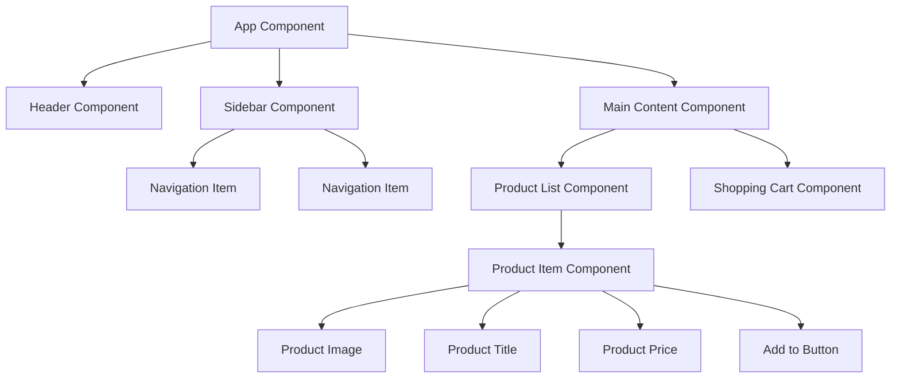

## Introduction

Components are the basic building blocks of Angular applications. Each component controls a patch of screen called a view, and you can combine components to create arbitrarily complex user interfaces. This section covers everything you need to know to create, communicate between, and manage the lifecycle of Angular components.

## Why do we need this?

Components allow you to:
- Break complex UIs into manageable, reusable pieces
- Encapsulate template, logic, and styles for each UI element
- Share data and events between parent and child components
- Control when components are created and destroyed
- Build maintainable and testable applications

## Real-world analogy

Think of building a house with LEGO bricks. Each brick is self-contained with its own shape, color, and connectors. Similarly, each Angular component is self-contained with its own template (HTML), logic (TypeScript), and styles (CSS). You combine these components to build complex applications just like you build structures with LEGO.

## Visual Explanation


## Mermaid Diagram



## Deep Explanation

Components consist of three parts:
1. **Template** - The HTML view that defines what the user sees
2. **Class** - The TypeScript code that handles the component's logic
3. **Metadata** - The @Component decorator that tells Angular how to process the class

### Creating a Component
Use the Angular CLI: `ng generate component my-component` or `ng g c my-component`

This creates four files:
- `my-component.component.html` - The template
- `my-component.component.ts` - The class with logic
- `my-component.component.css` - The styles
- `my-component.component.spec.ts` - Unit tests

### Component Communication
Components communicate through:
- `@Input()` - Parent passes data down to child
- `@Output()` + `EventEmitter` - Child sends events up to parent
- `@ViewChild()` - Parent accesses child component or DOM element
- Services - Shared data and logic between any components

### Component Lifecycle
Components go through a lifecycle from creation to destruction, with hooks at key stages:
- `ngOnInit()` - Initialize data
- `ngOnChanges()` - Respond to input changes
- `ngAfterViewInit()` - Access view and children
- `ngOnDestroy()` - Clean up resources

## Code Example
Here's a simple component that displays a user profile:

```typescript
// user-profile.component.ts
import { Component, Input } from '@angular/core';

interface User {
  name: string;
  email: string;
  avatar: string;
}

@Component({
  selector: 'app-user-profile',
  template: `
    <div class="profile-card">
      
      <h2>{{ user.name }}</h2>
      <p>{{ user.email }}</p>
      <button (click)="followUser()">Follow</button>
    </div>
  `,
  styles: [`
    .profile-card {
      border: 1px solid #ddd;
      border-radius: 8px;
      padding: 16px;
      text-align: center;
      max-width: 200px;
    }
    img {
      width: 80px;
      height: 80px;
      border-radius: 50%;
      object-fit: cover;
    }
  `]
})
export class UserProfileComponent {
  @Input() user: User | null = null;
  
  followUser(): void {
    console.log(`Following ${this.user?.name}`);
    // Implementation would call a service
  }
}
```

Used in a parent template:
```html
<app-user-profile 
  [user]="{name: 'John Doe', email: 'john@example.com', avatar: 'https://example.com/avatar.jpg'}">
</app-user-profile>
```

## Best Practices
- Keep components focused on a single responsibility
- Use `@Input()` and `@Output()` for parent-child communication
- Prefer services for sharing data between unrelated components
- Keep templates simple; move complex logic to the component class
- Use trackBy with *ngFor to improve performance
- Always unsubscribe from observables in `ngOnDestroy`
- Use `ChangeDetectionStrategy.OnPush` for performance when possible
- Style encapsulation ensures component styles don't leak

## Common Mistakes
- Making components too large and doing too much in one component
- Forgetting to unsubscribe from observables (memory leaks)
- Using `any` type instead of proper TypeScript interfaces
- Putting business logic directly in templates
- Not using `trackBy` with *ngFor for large lists
- Accessing DOM elements in `ngOnInit` instead of `ngAfterViewInit`
- Overusing `@ViewChild` when services or `@Input`/``@Output` would suffice

## Interview Questions
1. What are the three parts of an Angular component?
2. How do you pass data from a parent component to a child component?
3. How does a child component send data or events to its parent?
4. What is the purpose of the `ngOnDestroy` lifecycle hook?
5. How would you access a child DOM element from a parent component?
6. What is the difference between `@ViewChild` and `@ContentChild`?
7. How do you improve performance of *ngFor loops?
8. When would you use `ViewContainerRef` and `ComponentFactoryResolver`?

## Summary
Components are the essential building blocks of Angular applications. Mastering component creation, communication, and lifecycle management is crucial for building scalable, maintainable applications. By following best practices and understanding the common pitfalls, you can create powerful user interfaces with clean, efficient code.