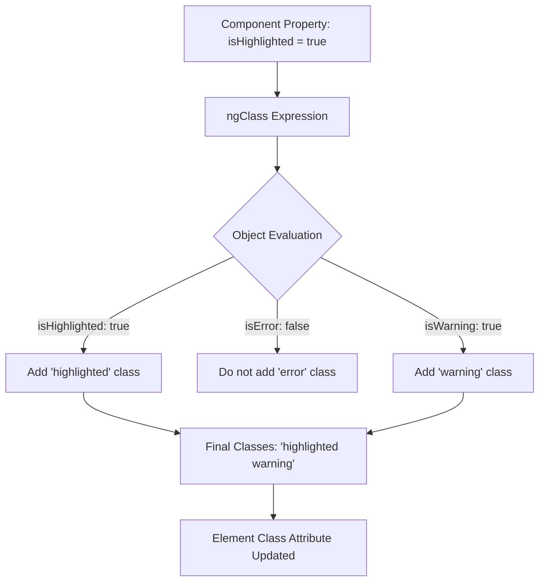
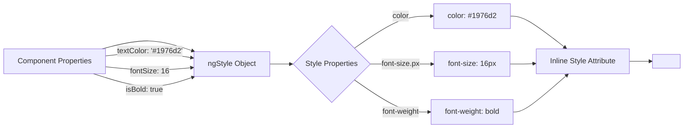

## Introduction
Attribute directives change the appearance or behavior of DOM elements. Unlike structural directives that modify the DOM structure, attribute directives alter existing elements by changing their properties, classes, styles, or responding to events. They are applied as attributes on HTML elements and don't have the asterisk (*) prefix.

## Why do we need this?
Manually setting element styles, classes, or responding to DOM events leads to scattered, hard-to-maintain code. Attribute directives provide a centralized, reusable way to encapsulate presentation logic and DOM interactions, making your templates cleaner and your components more focused on data and behavior.

## Real-world analogy
Think of attribute directives as smart clothing that adapts to conditions. Just as a jacket might automatically adjust its insulation based on temperature (changing its properties), or behave) or change color based on your mood (changing its appearance), attribute directives modify how elements look and behave based on application state, without changing whether the element exists in the DOM.

## Visual Explanation


## Mermaid Diagram
```mermaid
flowchart LR
    A[Component Property -->[ElementPropertyStyle]
    C[ Style Element
    D[DOM -->[ Trigger] C[Directive Method
    D -->| -->|Update| Update| A[ E[Component
```

### ngClass Object Syntax


### ngStyle Object Syntax


## Code Example
```typescript
// attribute-directives-example.component.ts
import { Component } from '@angular/core';

@Component({
  selector: 'app-attribute-directives-example',
  template: `
    <div class="directives-demo">
      <h2>Attribute Directives Demo</h2>
      
      <!-- ngClass Examples -->
      <section>
        <h3>ngClass Examples</h3>
        <div class="control-group">
          <label>
            <input type="checkbox" [(ngModel)]="isHighlighted">
            Highlighted
          </label>
          <label>
            <input type="checkbox" [(ngModel)]="isError">
            Error State
          </label>
          <label>
            <input type="checkbox" [(ngModel)]="isWarning">
            Warning State
          </label>
        </div>
        
        <div [ngClass]="{
          'highlighted': isHighlighted,
          'error': isError,
          'warning': isWarning,
          'active': isActive
        }" class="base-box">
          Dynamic Classes Box
          <p>Classes applied: 
            <span *ngIf="isHighlighted">highlighted </span>
            <span *ngIf="isError">error </span>
            <span *ngIf="isWarning">warning </span>
            <span *ngIf="isActive">active</span>
          </p>
        </div>
        
        <!-- Shorthand ngClass alternatives -->
        <div [class.active]="isActive">Shorthand: [class.active]="isActive"</div>
        <div [class.highlighted]="isHighlighted">Shorthand: [class.highlighted]="isHighlighted"</div>
      </section>
      
      <!-- ngStyle Examples -->
      <section>
        <h3>ngStyle Examples</h3>
        <div class="control-group">
          <label>
            Text Color:
            <input type="color" [(ngModel)]="textColor">
          </label>
          <label>
            Font Size:
            <input type="number" [(ngModel)]="fontSize" min="10" max="40">
            px
          </label>
          <label>
            <input type="checkbox" [(ngModel)]="isBold">
            Bold
          </label>
        </div>
        
        <p [ngStyle]="{
          'color': textColor,
          'font-size.px': fontSize,
          'font-weight': isBold ? 'bold' : 'normal'
        }" class="styled-text">
          Styled Text with ngStyle
        </p>
        
        <!-- Shorthand ngStyle alternatives -->
        <p [style.color]="textColor">Shorthand: [style.color]="textColor"</p>
        <p [style.fontSize.px]="fontSize">Shorthand: [style.fontSize.px]="fontSize"</p>
        <p [style.fontWeight]="isBold ? 'bold' : 'normal'">Shorthand: [style.fontWeight]</p>
      </section>
      
      <!-- Custom Attribute Directive Examples -->
      <section>
        <h3>Custom Attribute Directives</h3>
        <div class="control-group">
          <label>
            Hover Color:
            <input type="color" [(ngModel)]="hoverColor" value="#ffeb3b">
          </label>
          <label>
            Default Color:
            <input type="color" [(ngModel)]="defaultColor" value="#f5f5f5">
          </label>
        </div>
        
        <p [appHighlight]="hoverColor" [defaultColor]="defaultColor">
          Custom Highlight Directive - Hover over me!
        </p>
        
        <div appClickOutside (clickOutside)="handleClickOutside()">
          Click Outside Directive
          <div *ngIf="isDropdownOpen" class="dropdown-content">
            <p>Dropdown content</p>
            <button (click)="isDropdownOpen = false">Close</button>
          </div>
          <button (click)="isDropdownOpen = !isDropdownOpen" class="toggle-btn">
            {{ isDropdownOpen ? 'Hide' : 'Show' }} Dropdown
          </button>
        </div>
        
        <div *ngIf="clickOutsideCount > 0">
          <p>Clicked outside {{ clickOutsideCount }} time{{ clickOutsideCount > 1 ? 's' : '' }}</p>
        </div>
      </section>
    </div>
  `,
  styles: [`
    .directives-demo { max-width: 800px; margin: 0 auto; padding: 20px; }
    .control-group { margin: 15px 0; display: flex; gap: 15px; align-items: center; flex-wrap: wrap; }
    .control-group label { display: flex; align-items: center; gap: 5px; }
    .base-box { 
      padding: 20px; 
      margin: 10px 0; 
      min-height: 60px;
      display: flex;
      align-items: center;
      justify-content: center;
      transition: all 0.3s ease;
    }
    .highlighted { background-color: #fff9c4; }
    .error { background-color: #ffcdd2; border: 2px solid #f44336; }
    .warning { background-color: #fff3e0; border: 2px solid #ff9800; }
    .active { background-color: #c8e6c9; border: 2px solid #4caf50; }
    .styled-text { 
      padding: 15px; 
      margin: 10px 0; 
      min-height: 40px;
      display: flex;
      align-items: center;
      justify-content: center;
      border: 1px solid #ddd;
    }
    .dropdown-content {
      margin-top: 10px;
      padding: 15px;
      background-color: #f5f5f5;
      border: 1px solid #ddd;
    }
    .toggle-btn { 
      margin-top: 10px; 
      padding: 8px 16px; 
      cursor: pointer;
    }
  `]
})
export class AttributeDirectivesExampleComponent {
  // ngClass properties
  isHighlighted = false;
  isError = false;
  isWarning = false;
  isActive = true;
  
  // ngStyle properties
  textColor = '#1976d2';
  fontSize = 16;
  isBold = false;
  
  // Custom directive properties
  hoverColor = '#ffeb3b';
  defaultColor = '#f5f5f5';
  
  // Click outside tracking
  isDropdownOpen = false;
  clickOutsideCount = 0;
  
  handleClickOutside() {
    this.clickOutsideCount++;
    // Close dropdown when clicking outside
    if (this.isDropdownOpen) {
      this.isDropdownOpen = false;
    }
  }
}

// Custom Highlight Directive
import { Directive, ElementRef, HostListener, Input, OnInit } from '@angular/core';

@Directive({
  selector: '[appHighlight]'
})
export class HighlightDirective implements OnInit {
  @Input() appHighlight: string = 'yellow';
  @Input() defaultColor: string = 'transparent';
  
  constructor(private el: ElementRef) {}
  
  ngOnInit(): void {
    this.setBackground(this.defaultColor);
  }
  
  @HostListener('mouseenter')
  onMouseEnter(): void {
    this.setBackground(this.appHighlight || 'yellow');
  }
  
  @HostListener('mouseleave')
  onMouseLeave(): void {
    this.setBackground(this.defaultColor);
  }
  
  private setBackground(color: string): void {
    this.el.nativeElement.style.backgroundColor = color;
  }
}

// Custom Click Outside Directive
import { Directive, ElementRef, HostListener, Output, EventEmitter } from '@angular/core';

@Directive({
  selector: '[appClickOutside]'
})
export class ClickOutsideDirective {
  @Output() clickOutside = new EventEmitter<void>();
  
  constructor(private elementRef: ElementRef) {}
  
  @HostListener('document:click', ['$event'])
  onClick(event: Event): void {
    if (!this.elementRef.nativeElement.contains(event.target)) {
      this.clickOutside.emit();
    }
  }
}
```